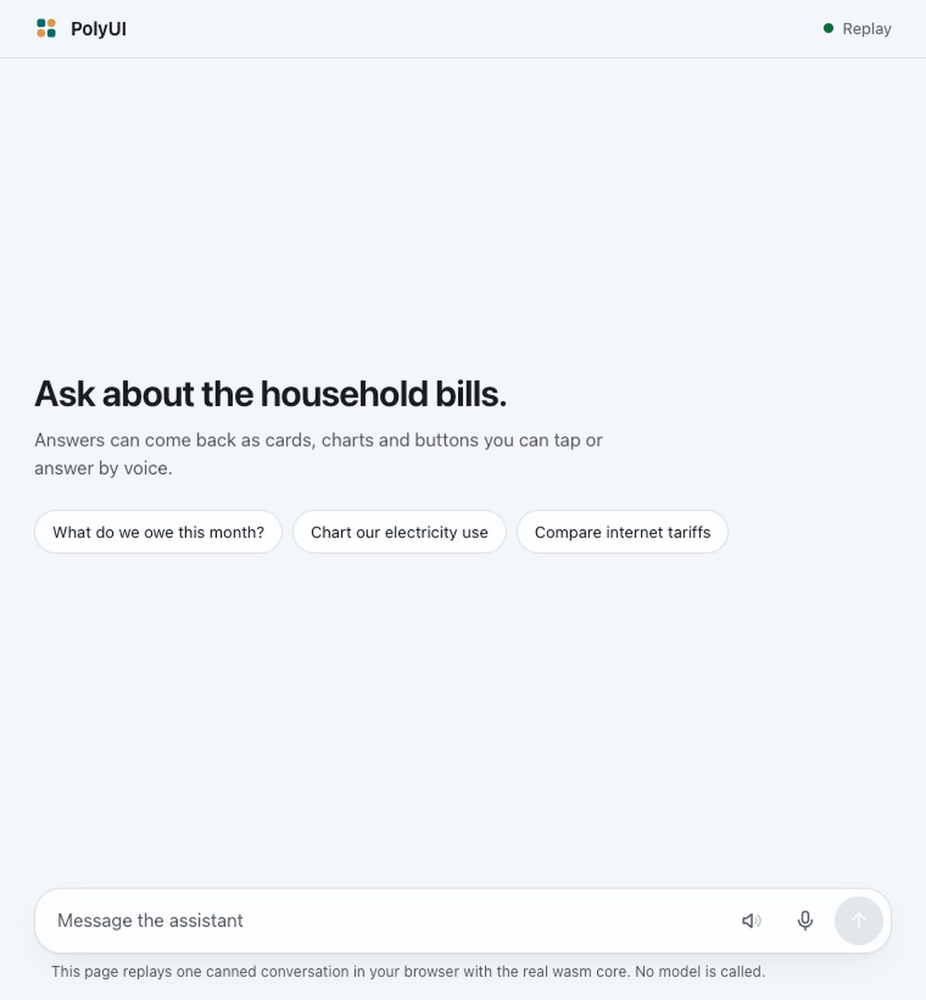
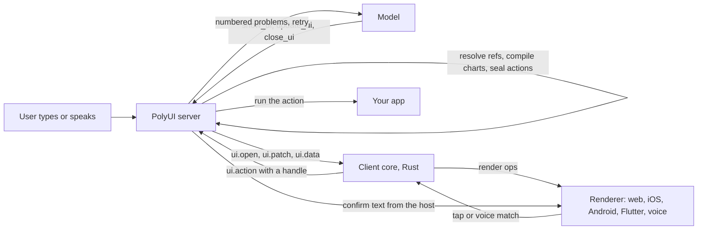
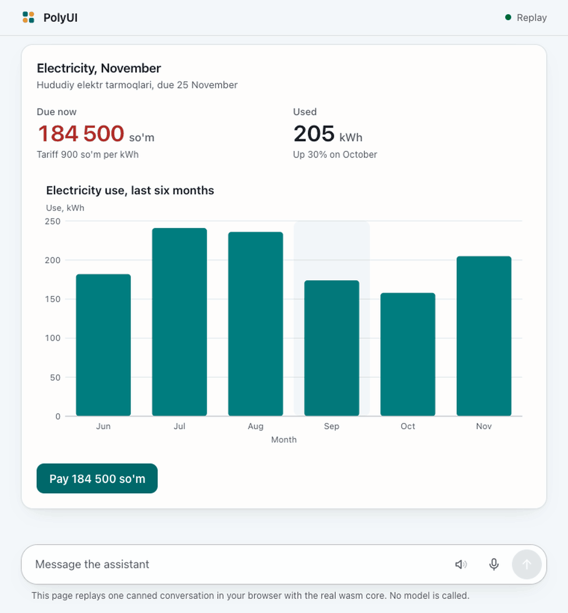
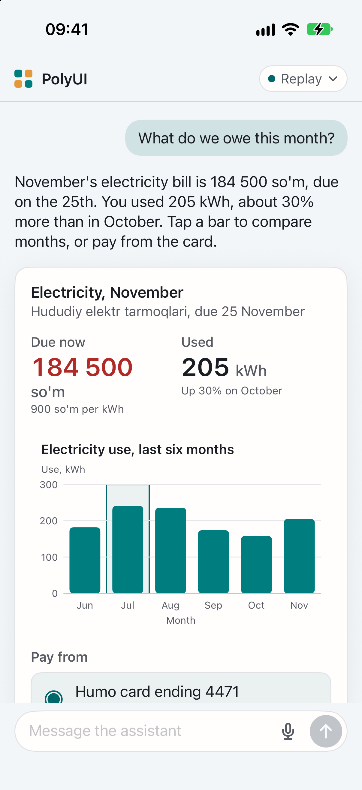
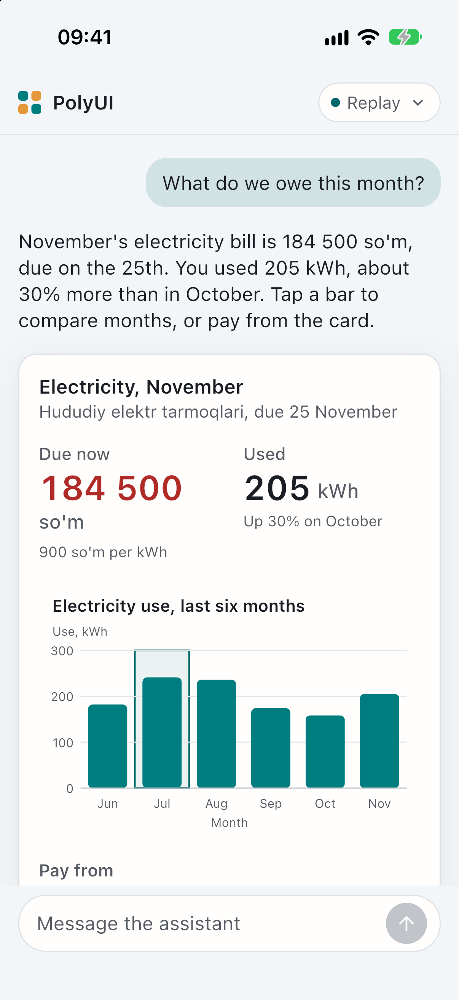
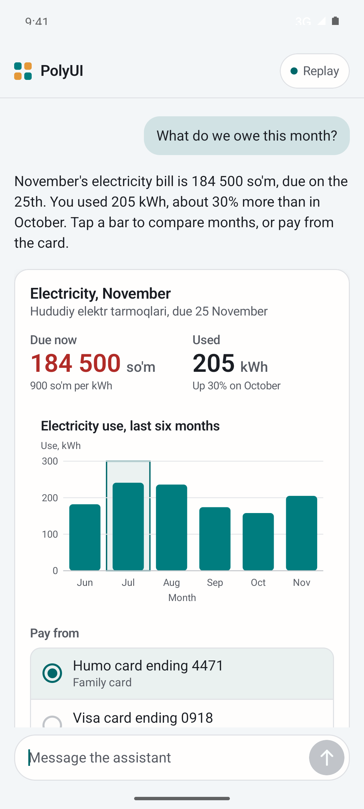

# PolyUI

PolyUI lets an LLM agent answer with real interface (cards, charts, forms and buttons) instead of only text, and checks every piece against a typed catalog before anything reaches the user. The same answer draws on a web page, in a native app, or reads aloud in a voice assistant with no screen.

[Documentation](https://murtazox04.github.io/polyui/) · [Live demo](https://murtazox04.github.io/polyui/demos/chat/) · [Protocol](spec/protocol.md)



The demo above is the chat example replaying a canned turn in the browser with the real wasm core. The live demo link runs the same thing; no model is called.

## Why it exists

- **One answer for every modality.** Each component knows its plain text form (`alt`) and its spoken form (`say`). A screen client draws the surface, a voice client reads it in order, and a screen plus voice client does both and highlights what it is reading. "The second one" or "ikkinchisi" picks the second option without a trip to the model.
- **Friendly to small models.** Components are a flat list with ids, not a nested tree, so there are no brackets to lose track of. Tool schemas are closed objects. When a call is wrong the model gets a numbered list of problems with the component id and prop, and tries again. For local models there is a grammar that blocks most mistakes while the model writes (see [Local models](docs/decode.md); not yet run against a real local model).
- **Security first.** The model never writes markup, script, CSS or URLs that run. Private values such as account numbers are filled in on the server through `$ref` and never enter the model's context. Buttons carry sealed handles, so neither the model nor the client can change what an action does, and risky actions get a confirm sheet whose text the host writes. Each rule has named tests ([Security](docs/security.md)).
- **Dashboards from your own data.** The model writes read-only SQL over your CSV and Parquet files, and the numbers on screen come from the query, not from the model ([Dashboards](docs/dashboards.md)).
- **One Rust core everywhere.** Protocol types, catalog checks, bindings, `alt` and `say` text, URL rules and voice matching live in one crate. It runs as wasm in the browser, as a native module in Python and Node, and through one C interface in the iOS, Android and Flutter apps. Renderers only draw.

## How it works



The model calls three tools. The server checks each call with the Rust core; a call with problems goes back to the model and never reaches a client. A valid call has its `$ref` values resolved for the current user, its charts compiled to SVG scenes, and its actions replaced with handles. The client core applies the messages and hands the renderer a short list of create, update and remove operations. Details are in [Concepts](docs/concepts.md) and the [protocol](spec/protocol.md).

## Quick start

You need Rust (the toolchain in `rust-toolchain.toml` with the `wasm32-unknown-unknown` target), Node 22, the `wasm-bindgen` CLI 0.2.130 and `wasm-opt` from binaryen. The [quick start](docs/quickstart.md) has the install commands.

**With a model.** The bills demo is a household in Tashkent with gas, power, water and internet bills. It calls the Anthropic API, so it needs a key in an env file.

```sh
(cd examples/chat && npm install && npm run build)
cargo run --release -p polyui -- serve --env-file ~/.config/polyui/anthropic.env --static examples/chat/dist
```

Open http://127.0.0.1:8787/ and ask "What do we owe this month?"

**Without a key.** The chat example has a dev server that replays one canned conversation through the same page:

```sh
cd examples/chat && npm install && npm run dev
```

Open http://localhost:4190/, send any message, tap a bar, then pay.

**Check a call by hand.** `polyui validate` runs the same checks the server runs on a `show_ui` call:

```sh
cargo run -p polyui -- validate surface.json
```

```
2 problems, nothing was shown:
1. components[1] id "due" prop "value": required prop is missing.
2. components[2] id "pay": type "PayButton" is not in the catalog. Known: Badge, Button, Card, ChoiceGroup, ConfirmSheet, Divider, Image, Input, List, Row, Stat, Text, chart:Chart, chart:Dashboard.
```



## Components

Three catalogs ship with PolyUI. `core` and `chart` are on by default; `embed` only when the host turns it on. Hosts can add their own catalogs under a namespace such as `acme:InvoiceCard`, and draw those types with their own view on every platform ([Platforms](docs/platforms.md#extension-catalogs)).

| Component | What it is | Main props |
|---|---|---|
| `Text` | A paragraph or heading | `text`, `style` (body, title, subtitle, caption, muted) |
| `Card` | A box that groups content under an optional title | `title`, `subtitle`, `tone` |
| `Row` | Children side by side, wrapping on narrow screens | `gap`, `align` |
| `List` | A vertical list, one child per item | `title`, `ordered` |
| `Stat` | One important number with a label | `label`, `value`, `unit`, `tone`, `hint` |
| `Badge` | A short status label | `text`, `tone` |
| `Image` | A picture from an https URL | `src`, `alt`, `aspect` |
| `Button` | Fires an action | `label`, `tone`, `on_press`, `disabled` |
| `ChoiceGroup` | Pick one or more options | `options`, `multiple`, `value`, `on_change` |
| `Input` | A text field that writes into the data model | `label`, `value`, `input`, `placeholder`, `max_length` |
| `ConfirmSheet` | A simple yes or no question | `title`, `body`, `on_confirm`, `on_cancel` |
| `Divider` | A thin line between sections | none |
| `chart:Chart` | Bar, line, area, pie or scatter chart; bars and points are tappable | `title`, `kind`, `rows`, `unit`, `on_select` |
| `chart:Dashboard` | A grid of charts and stats | `title`, `columns` |
| `embed:Embed` | An MCP App in a sandboxed frame | `resource` (`ui://`), `title`, `height`, `on_message` |

Every prop, limit and default is in [The catalogs](docs/catalogs.md). Charts are compiled on the server by `polyui-chart` into an SVG scene plus a hit map, so clients need no chart library.

## Numbers we have measured

| What | Result | Where it comes from |
|---|---|---|
| Wasm client core | 60 467 bytes brotli (172 028 raw), budget 61 440 | `bindings/wasm/build.mjs`, checked in CI |
| Web renderer `polyui.js` | 10 986 bytes brotli, budget 12 288; CSS 3 613 bytes | `js/polyui-web/scripts/size.mjs` |
| First UI while the model is still writing | first `ui.open` at 4.9 s, `show_ui` input complete at 7.7 s; a call without streaming opened at 6.8 s | Measured once on a dev machine against the live API; see the [server guide](docs/server.md#streaming-ui-while-the-model-writes) |
| Same, replayed with scripted timing | 0.32 s with streaming, 2.47 s without, for a 15 component card | `cargo test -p polyui-server --test streaming` |
| Grammar compile for all three UI tools | 4.82 ms, first token mask 1.04 ms | Measured once on a dev machine (Apple M5 Pro); see [Local models](docs/decode.md#how-fast-it-is) |
| `polyui` release binary | 7 641 888 bytes (7.3 MiB), 92 356 400 bytes (88.1 MiB) with the SQL `query` feature | Measured once on a dev machine (macOS, arm64); see [Dashboards](docs/dashboards.md#costs-and-limits) |

### How well the model draws UI

Runs of the 32 prompt benchmark with `claude-haiku-5-5` (compact on 2026-11-25, full on 2026-11-24), in English, Uzbek (Latin and Cyrillic) and Russian, with tool calls. The server sends the compact tool profile unless you configure it otherwise, so the first row is what you get by default. The full profile puts every prop in the tool schema; it was the default before.

| Tool profile | `show_ui` valid on the first try | UI shown when the prompt expected one | Mean time to first `ui.open` | Cost of the 32 prompts |
|---|---|---|---|---|
| compact (default) | 27 of 28 turns with a UI call | 24 of 24 | 4.6 s | $0.0349 |
| full | 28 of 28 | 24 of 24 | 5.1 s | $0.1037 |

Compact costs about a third as much and opens the first UI sooner. It used to draw a form for the phone number request less often; the reason was that the test host had no action to save the number, and with one added compact draws the form every time ([details](docs/benchmark.md#forms-with-the-compact-profile-2026-11-25)). One first call in 28 needed the retry. One run with one model is a small sample; [the benchmark page](docs/benchmark.md#compact-tool-profile-2026-11-24) has the full tables, the inline JSON setting, and what the numbers can and cannot tell you.

We also tried `ember:chat`, a self-hosted Gemma model of about 12B, on 8 prompts. It struggled: tool calls ran out of time on that server, inline JSON gave 1 valid UI in 5 tries (mostly missing closing braces), and the constrained run gave none. The validator caught every bad answer, so nothing broken reached a client. The sample is too small to settle anything about small models yet; the details and what a fair test needs are in [docs/benchmark.md](docs/benchmark.md).

## Documentation

The same pages are on the [documentation site](https://murtazox04.github.io/polyui/).

| Guide | Reference | Evidence |
|---|---|---|
| [Quick start](docs/quickstart.md) | [Protocol](spec/protocol.md) | [Security model and tests](docs/security.md) |
| [Concepts](docs/concepts.md) | [Catalog format](spec/catalog.md) | [Benchmark](docs/benchmark.md) |
| [Server guide](docs/server.md) | [The catalogs](docs/catalogs.md) | [Architecture decisions](docs/adr/0001-stack.md) |
| [Python and Node](docs/bindings.md) | [Renderer contract](spec/renderer.md) | |
| [Dashboards](docs/dashboards.md) | | |
| [Local models](docs/decode.md) | | |
| [Embedding MCP Apps](docs/embed.md) | | |
| [Platforms](docs/platforms.md) | | |
| [iOS](docs/ios.md) | | |
| [Android](docs/android.md) | | |
| [Flutter](docs/flutter.md) | | |

## Platforms

| Platform | Status |
|---|---|
| Rust server (`polyui-server`, the `polyui` command) | Done |
| Web: wasm core and the `polyui-web` renderer | Done |
| Python (PyO3) and Node (napi-rs) bindings | Done |
| iOS: C interface over the core and a SwiftUI renderer | Done, tested on a simulator and on Mac Catalyst; MCP Apps, listening |
| Flutter | Done, run on an iOS simulator and an Android emulator; MCP Apps, live mode, speech |
| Android: JNI shim and a Compose renderer | Done, tested on an API 35 emulator; MCP Apps, live mode, listening, TalkBack walk |

The same bills turn in the iOS, Flutter and Android example apps, each drawn by its own renderer from the same core. MCP Apps now show inside native surfaces too, through one embed page the C interface builds ([Embedding MCP Apps](docs/embed.md#native-renderers)). More screenshots are in `docs/images` (`ios-*.png`, `flutter-*.png`, `android-*.png`) and on the [Platforms](docs/platforms.md) page.

<p>



</p>

## License

Apache-2.0. See [LICENSE](https://github.com/murtazox04/polyui/blob/main/LICENSE).
