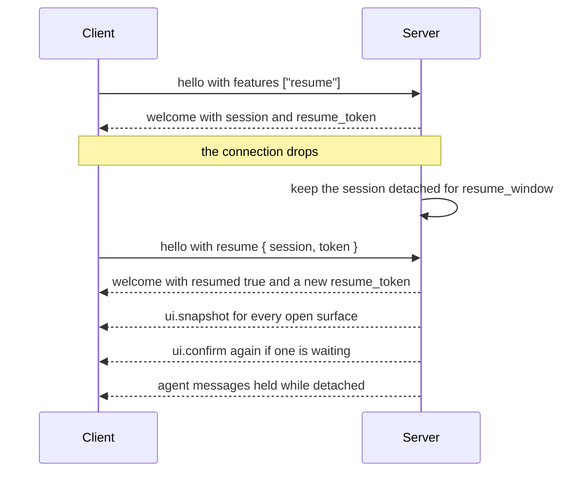

# 2. Resume a session after the connection drops

Date: 2026-11-27
Status: accepted

## What we need to decide

A session lives exactly as long as its WebSocket or SSE stream (`spec/protocol.md`, section 8). On a phone that is a short life: the app goes to the background, the network switches from Wi-Fi to mobile data, a lift blocks the signal. Each time, every surface the person can still see loses its action handles, a pending confirmation is gone, and a model turn that was running stops. The client can only mark the cards as stale and the person has to ask again.

We want a client that loses its connection for a short time to come back to the same session: the same surfaces with working handles, the same pending confirmation, and the rest of a turn that was running.

## Proposal

1. **Opt in.** A client that can resume adds `resume` to `features` in `hello`. Only then does `welcome` carry a `resume_token`: 32 random bytes, base64url, separate from the session id.
2. **Detach instead of ending.** When the transport of such a session closes, the server keeps the session for `resume_window` (default 120 seconds). A turn that is running keeps running. Messages for the client wait in the session's existing outgoing queue (`outgoing_queue`, 256 messages). If it stays full for `slow_consumer_after`, the session ends as a slow consumer would, and the next `hello` gets a new session.
3. **Come back.** The new `hello` carries `"resume": { "session": "...", "token": "..." }`. If the session is still kept, the token matches (compared in constant time), the user and the origin are the same, the server attaches the new transport and answers `welcome` with `"resumed": true` and a new token. The old token stops working at that moment. Then it sends `ui.snapshot` for every open surface that is not still streaming, `ui.confirm` again for a pending confirmation with its remaining time, and the held messages in order, without the surface messages the snapshots already cover.
4. **Fall back cleanly.** An unknown session, a wrong or used token, a different origin or an expired window gives a normal new session with `"resumed": false`. The client then treats its old surfaces as stale, as today. A `hello` with `resume` from a client that did not declare the feature is treated the same way.
5. **One transport at a time.** A resume for a session whose old transport is still open closes the old one first, so two sockets never act on the same handles.
6. **Client side.** Renderers keep the token in memory only, never in storage, and send it with the next `hello`. Applying `ui.snapshot` to a surface that is already shown is what `ui.resync` uses today, so the client core does not change. That matters because the wasm client has 973 bytes of budget left.
7. **Limits.** Detached sessions keep their place in `max_sessions`, and each holds at most `outgoing_queue` messages, so the memory a detached session can take is bounded like an attached one.

## Failure modes

| Risk | What could go wrong | What limits it |
|---|---|---|
| Stolen token | Whoever has the token can take over the session and its handles. | The token is only in memory, travels over the same TLS connection as everything else, works once, is bound to the origin, and dies after `resume_window`. It is never logged. |
| Memory | Many phones drop at once and their sessions pile up with held messages. | Each detached session holds at most `outgoing_queue` messages and keeps its place in `max_sessions`, so the total is bounded by the same numbers as for connected sessions. |
| A turn finishing while nobody listens | The model calls `show_ui` and the person never sees it if they do not come back. | The surface is part of the session; the snapshot on resume shows it. Without a resume it is dropped with the session, as today. |
| Expired confirmation | The confirmation nonce lives 60 seconds and may expire while detached. | `ui.confirm` is sent again only with time left; an expired one is answered `expired` exactly as today. |

## Alternatives

| Option | Why not |
|---|---|
| Keep things as they are | Every network change on a phone throws away the person's cards and any payment confirmation in progress. |
| Replay every message since the last `seq` the client saw | Needs an unbounded log per session. Snapshots carry the same surface state in bounded space. |
| Let the client rebuild surfaces from its own copy | The client copy has resolved `$ref` values and sealed handles. The server would have to trust handles it no longer holds, which breaks the rule that handles are only valid in their session. |
| Persist sessions in Redis or a database | Needed for several server processes behind a load balancer, but a much bigger step. This proposal keeps sessions in memory, so a resume must reach the same process (sticky sessions). Shared storage can come later behind the same protocol. |

## What changes

- `spec/protocol.md`: the `resume` feature, `hello.resume`, `welcome.resume_token` and `welcome.resumed`, and the rules above in section 8.
- `polyui-server`: detached sessions, the new `ServerConfig::resume_window`, and tests for each failure mode.
- Renderers (web, iOS, Android, Flutter): declare `resume`, keep the token, and send it on reconnect. The example apps reconnect by themselves.
- Conformance fixtures for a resumed and a refused resume.
