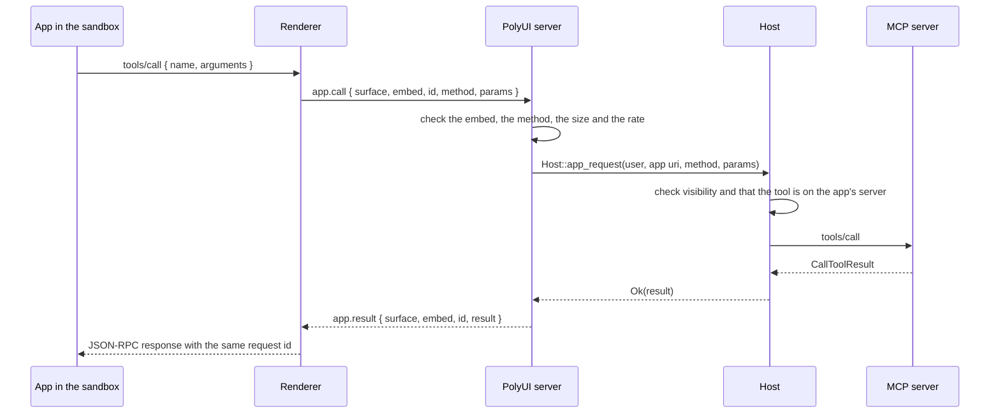

# 3. Tool calls from an embedded app

Date: 2026-11-27
Status: proposed

## What we need to decide

An MCP App inside `embed:Embed` can draw itself, send `ui/message` and ask to open a link. It cannot ask for fresh data. Its `tools/call` and `resources/read` requests are answered with JSON-RPC error `-32601`, and `hostCapabilities` advertises neither `serverTools` nor `serverResources` (`docs/embed.md`, "What the renderer does not do yet"). A seat map cannot load the next flight, a forecast cannot switch city, a form cannot submit. Each of these has to go back through the model as a `ui/message`, which is slow, costs a turn and lets the model rewrite what the app asked for.

The MCP Apps specification (`specification/2026-01-26/apps.mdx`, and unchanged in `specification/draft/apps.mdx`) lets the host forward these requests to the MCP server the app came from:

- The host advertises `serverTools` and `serverResources` in `hostCapabilities` when it can proxy them.
- The host MUST reject a `tools/call` from an app for a tool whose `_meta.ui.visibility` does not include `"app"`. `visibility` defaults to `["model", "app"]`.
- A tool is callable by the app "from the same server connection only". Cross-server calls are always blocked for app-only tools.
- The host MAY block requests or ask the user first.

The reference SDK does the same on the host side: `AppBridge.oncalltool` in `src/app-bridge.ts` of `modelcontextprotocol/ext-apps` forwards the request to the server, and the bridge only advertises `serverTools` when the host sets it.

PolyUI never talks to an MCP server itself. The host does, through `Host::ui_resource` today. Between the app and the host sit the renderer, the transport and the PolyUI server, and protocol version 1 has no message that carries an app's request across that gap.

## Proposal

1. **Opt in.** A client that can carry app requests adds `app_calls` to `features` in `hello`. Only then does the server accept `app.call` from it. The renderer advertises `serverTools` and `serverResources` to an app only when the app option is on, which the client turns on after a `welcome` from a server that has a host with app support. The server says so with `"features": ["app_calls"]` in `welcome`, the features it accepted from the `hello`. A client core that does not know the field ignores it, as for every unknown field.
2. **Client to server.** `app.call` carries `surface`, `embed` (the component id of the `embed:Embed`), `id` (the renderer's own request id, a string of at most 64 characters, unique per embed while the call is open), `method` (`tools/call` or `resources/read`) and `params` unchanged from the app's request. The renderer never forwards the app's JSON-RPC id: the app picks it, so it can collide with another app's.
3. **What the server checks.** The surface is open in this session and not streaming, the component is an `embed:Embed` that was sent with an `app`, the method is one of the two, `params` is an object of at most 64 KiB serialized, and for `tools/call` `params.name` is a non-empty string and `params.arguments`, when present, an object. At most 4 app calls may be open per session and at most 30 may start per minute per embed. Any failed check is answered at once with an `app.result` error, without reaching the host.
4. **The host decides.** The server calls `Host::app_request(user, request)` where `request` holds the app's resource URI, the method and the params. The default answers "method not found", so nothing changes for a host that does not implement it. The host checks visibility and that the tool or resource belongs to the MCP server that served the app URI, makes the MCP call and returns the result, or refuses. `polyui_server::apps::callable_by_app(tool)` reads `_meta.ui.visibility` with the specification's default, so hosts do not reimplement it. The host may also refuse a tool it wants a person to confirm; a confirmation step for app calls is left for later (see the alternatives).
5. **Server to client.** `app.result` carries `surface`, `embed`, `id` and either `result` (the MCP result, unchanged) or `error` (`{ "code", "message" }` with JSON-RPC codes: `-32601` method not available, `-32602` invalid params, `-32000` refused, timed out, rate limited or too large). The server puts a 30 second limit on the host call. A result that would not fit in one 256 KiB message is replaced by a `-32000` error saying it is too large. `app.result` has the next `seq` like any message, but it is not covered by `ui.snapshot`, so on resume it is sent with the other held messages.
6. **The model does not see it.** App calls and their results never enter the conversation. That matches the specification, where `tools/call` from an app is for "UI-only interactions". When an app wants the model to know something it sends `ui/message`, as today.
7. **Client side.** The core does not change. It already ignores `t` values it does not know (`spec/protocol.md`, section 3), so `app.result` passes through it as an empty batch. The renderer's embed bridge sends `app.call` through the same `send` callback as `ui.action` and routes `app.result` back to the frame it belongs to by `surface`, `embed` and `id`. A result for an embed that is gone, or for a frame that reloaded with a new nonce, is dropped. The server side of the decoder is behind `cfg(not(feature = "client-lite"))`, like `hello.resume`, so the wasm core stays inside its budget.

`ui/update-model-context` stays refused with `-32601`. It would put text written by third-party app code into the model's context on the next turn, which is a prompt injection path that needs its own decision.

## Failure modes

| Risk | What could go wrong | What limits it |
|---|---|---|
| The app is hostile | App code is third-party. It can call any tool its MCP server exposes to apps, with any arguments, as often as it may. | Only tools with `"app"` in `visibility` on the app's own server, checked by the host; arguments go to the MCP server, which validates them as for any client; 4 open calls per session and 30 per minute per embed; nothing reaches the model. |
| A tool with side effects | An app-callable tool pays, books or deletes without the confirmation sheet PolyUI uses for actions. | The host decides per tool and can refuse; the docs say to keep paying tools out of `"app"` visibility until app calls can ask for confirmation. |
| One embed starves the others | A slow MCP server keeps every slot busy. | The 30 second limit ends each call, and the 4 slots are per session, so other sessions are not affected. |
| Large results | A `resources/read` returns megabytes. | The server measures the `app.result` before sending and answers with a too-large error instead. |
| Mixing up apps | Two embeds use the same JSON-RPC ids, or a result reaches the wrong frame. | The renderer uses its own `id` per embed and routes by `surface`, `embed` and `id`; the server answers only for an embed of that session. |

## Alternatives

| Option | Why not |
|---|---|
| Keep refusing | Apps stay static pictures, and every interaction costs a model turn. |
| Route app requests through the model as `ui/message` | Slow, costs tokens, and the model can change what the app asked for. The specification has a direct path for this. |
| Let the renderer call the MCP server directly | The renderer would need MCP credentials on the device, and the host would lose the check on which user may call which tool. |
| Reuse `ui.action` with a special action id | Actions are sealed handles the model defined and the server checks; an app's tool name and arguments come from the app, not from the model. Mixing the two would weaken the handle rule. |
| Ask the person to confirm every app call | Safe, but it would turn a refresh button into a dialog. A confirmation that the host can ask for per tool, using the existing `ui.confirm` sheet, is the better follow-up. |

## What changes

- `spec/protocol.md`: the `app_calls` feature, `welcome.features`, `app.call` in section 9 and `app.result` in section 8, with the checks above.
- `polyui-core`: decoding of `app.call` for the server, behind `cfg(not(feature = "client-lite"))`, and the `welcome.features` field.
- `polyui-server`: `Host::app_request`, `apps::callable_by_app`, the checks, the limits and the timeout, with tests for each failure mode.
- Renderers: the web renderer's embed bridge and the native embed page (`bindings/ffi/src/embed-page.html`, used by iOS, Android and Flutter) forward `tools/call` and `resources/read` and advertise `serverTools` and `serverResources` when app calls are on. The examples' transports pass `app.result` to the renderer.
- The bills example host gets one app-callable tool, `quote_tariffs`, so the tariff app can ask the server for prices when the usage or household slider moves, without a model turn. The docs show it.
