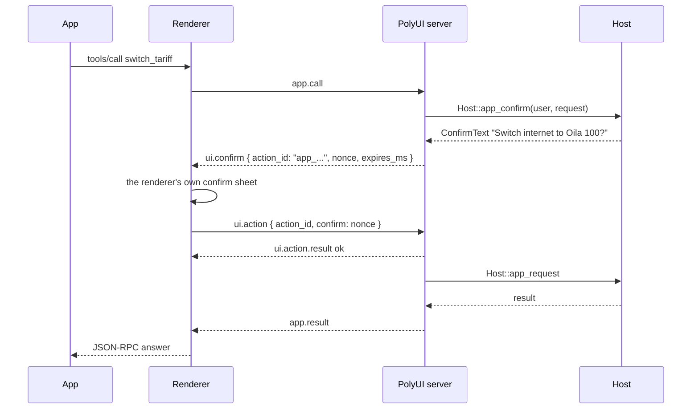

# 4. Confirming an app call

Date: 2026-11-27
Status: accepted

## What we need to decide

Since [ADR 3](0003-tool-calls-from-an-embedded-app.md) an MCP App inside `embed:Embed` can call tools on its own MCP server. The call never passes through the confirmation sheet that PolyUI shows before an action that moves money. The docs therefore tell hosts to keep paying or deleting tools out of `"app"` visibility, which also means an app cannot offer a "Switch now" or "Pay" button of its own. The MCP Apps specification allows exactly this case: the host "MAY decide to block some messages or subject them to further user approval" (`specification/2026-01-26/apps.mdx`).

We want the host to be able to say "this app call needs a person", and the person to answer in the same sheet the renderer already uses for payments, outside the app's frame where the app cannot draw over it.

## Proposal

1. **The host decides.** `Host::app_confirm(user, request)` returns `Option<ConfirmText>`, the same type `confirm_text` returns for actions. The default is `None`, so nothing changes for a host that does not implement it. It is called after the server's own checks and before `app_request`.
2. **The existing sheet.** The server sends a normal `ui.confirm` for the app's surface with a fresh `action_id` (`app_` and random characters, never a handle the model knows) and a fresh nonce. Clients already turn `ui.confirm` into their confirm sheet and the user's yes into `ui.action` with `confirm` set, for any `action_id`, so no renderer and no client core changes for the sheet.
3. **A yes.** A `ui.action` with that `action_id`, the same surface and the matching nonce (compared in constant time) gets `ui.action.result` `ok`, and only then does the server call `app_request`. The usual timeout for the host call starts at that moment.
4. **No yes.** The question lives for `app_call_timeout` (30 seconds). When it runs out, the server sends `ui.action.result` `expired` for the confirm and an `app.result` error `-32000` "The person did not confirm this request." to the app. A wrong nonce gets `ui.action.result` `rejected`, and the question stays open until it runs out. Cancel in a renderer's sheet only closes the sheet and sends nothing, as for action confirmations today, so after a cancel the app hears the answer when the question runs out.
5. **One question at a time.** While an app question is open in a session, another app call that needs a person is refused at once with `-32000`. Calls that need no person are not affected.
6. **Resume.** An open app question is sent again after a resume, with its remaining time, like an action confirmation.
7. **Client timeout.** Renderers wait 90 seconds for `app.result` instead of 40, so a call that waits up to 30 seconds for a person and then up to 30 seconds for the host is not cut off by the client.

## Failure modes

| Risk | What could go wrong | What limits it |
|---|---|---|
| The app forges a yes | The app sends the confirming `ui.action` itself. | The app has no way to send protocol messages; it only talks JSON-RPC to the renderer's bridge, and the nonce never reaches its frame. |
| The app asks again and again | The person gets a stream of sheets. | One app question per session at a time, and the app call rate limit of 30 a minute per embed. |
| The sheet text comes from the app | The app words the question so it looks harmless. | The text comes from the host's `app_confirm`, built from the tool name and arguments it knows, never from the app. |
| The person walks away | The app waits forever. | The question expires after 30 seconds and the app gets an error. |

## Alternatives

| Option | Why not |
|---|---|
| Keep side-effect tools out of `"app"` visibility | Safe, but every "Pay" or "Switch" in an app has to go through the model as `ui/message`. |
| Let the app show its own confirmation | The app's frame is untrusted and can draw anything; the yes would mean nothing. |
| A new message pair just for app confirmations | The `ui.confirm` and `ui.action` pair already does this on every client. A new pair would need new code in four renderers and the client core. |

## What changes

- `polyui-server`: `Host::app_confirm`, the open app question, its expiry, resume, and tests.
- Renderers: the app call timeout becomes 90 seconds on web, iOS, Android and Flutter.
- The bills example: an app-only `switch_tariff` tool that needs a person, and a "Switch now" button in the tariff app.
- `spec/protocol.md` section 8.3 and the embed and security docs.
