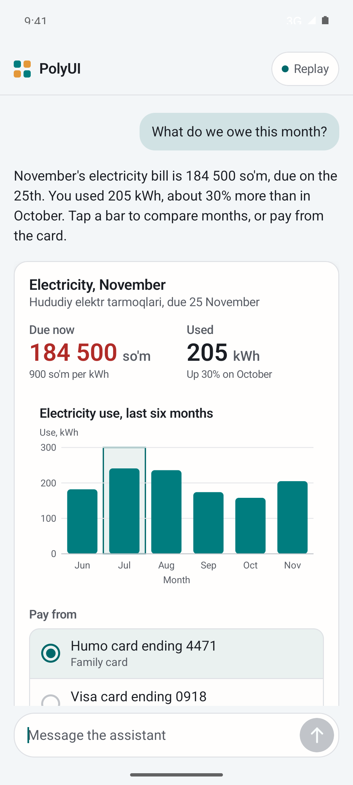
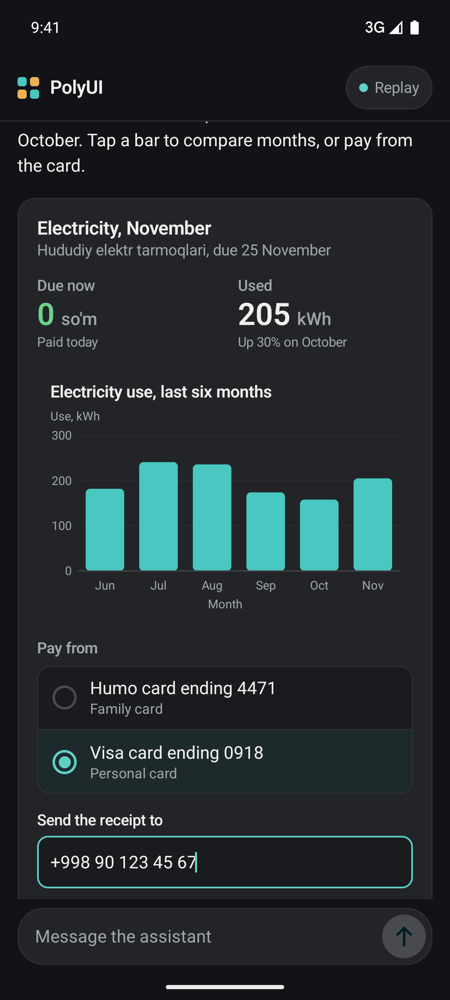
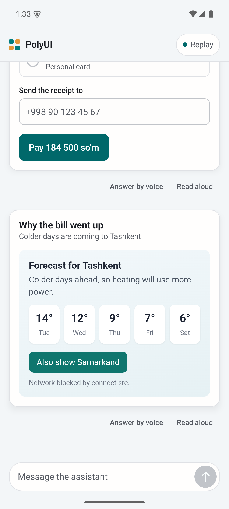
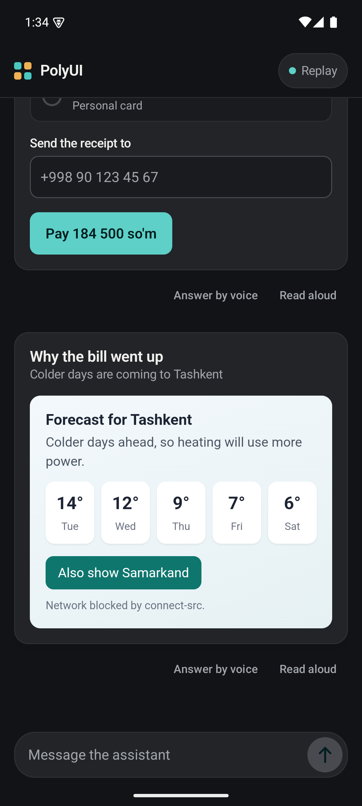
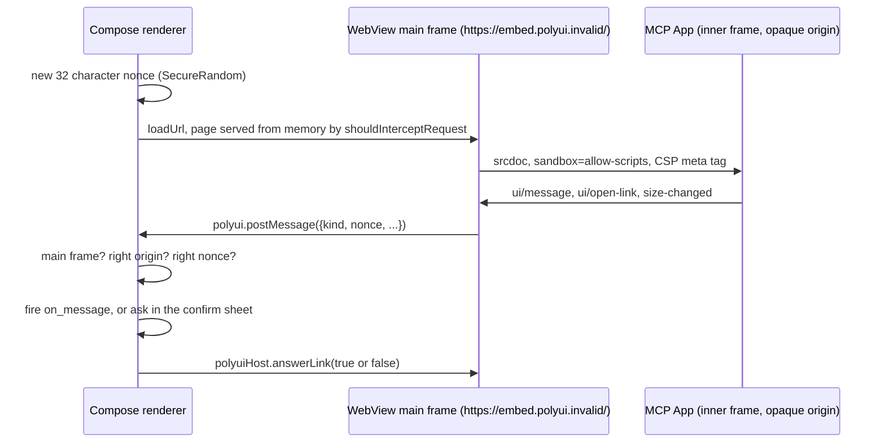

# PolyUI on Android

The Android side mirrors the iOS one. At the bottom is the same `polyui-ffi` C ABI over the Rust client core. A small JNI shim written in C sits on top of it, the Kotlin class `PolyuiCore` wraps that, and a Jetpack Compose renderer (`PolyuiSurface`) draws surfaces. The example app in `android/example` replays the same canned bills conversation as the iOS example, through the real core, or talks to a real `polyui serve` over a WebSocket.





The light screenshot shows the July bar after a tap. The other two come from one run in dark mode: the Visa card was picked, a phone number typed into the receipt field, Pay pressed (the confirm sheet), then confirmed, and the server's patch turned the due amount into 0 and the button into Paid. All of it was driven with `adb shell input` on an emulator.

## Layout

```
android/
  settings.gradle.kts, build.gradle.kts, gradle/libs.versions.toml, gradlew
  scripts/build-rust.sh         cargo-ndk for the device ABIs, or a host build for JVM tests
  polyui/                       the library (namespace dev.polyui)
    src/main/cpp/               polyui_jni.c and CMakeLists.txt
    src/main/kotlin/dev/polyui/ core wrapper, model, Compose renderer
    src/test/                   JVM tests against a host build of the core
    src/androidTest/            device tests: conformance replay and Compose UI tests
    src/sharedTest/             the conformance replayer both test sets use
  example/                      the demo app (dev.polyui.example)
```

## Building

You need a JDK 17 or newer (21 was used), the Android SDK with platform `android-37.2`, build tools 36.0.0 and NDK `28.2.13676358`, rustup, and `cargo-ndk` (`cargo install cargo-ndk`). Point `ANDROID_HOME` at the SDK, or write `sdk.dir=...` into `android/local.properties`.

```sh
cd android
./gradlew :example:installDebug
```

Gradle runs `scripts/build-rust.sh android` before the CMake step. The script adds the Rust targets it needs (`aarch64-linux-android`, `armv7-linux-androideabi`, `x86_64-linux-android`), runs `cargo ndk --platform 26` with the `lite` feature (the core's `client-lite` build), and leaves `libpolyui_ffi.a` in the workspace `target/` folder. CMake then compiles `polyui_jni.c` and links the static library into one `libpolyui_jni.so` per ABI, with `--gc-sections` and `--exclude-libs,ALL`, so only the ten JNI entry points are exported. Set `POLYUI_FFI_FEATURES=` (empty) to build the core with default features instead.

The compile SDK is 37.2 because Compose UI 1.13 (from the 2026.11.01 BOM) refuses anything older. The minimum SDK is 26. Versions in use: AGP 9.5.2 with its built-in Kotlin, Kotlin 2.4.21 for the Compose compiler plugin, Gradle 9.9.2, kotlinx.serialization 1.13.0, activity-compose 1.13.0.

### Sizes

Measured on this machine, Rust 1.100, release profile (fat LTO, one codegen unit), `lite` feature. "Shipped" is the stripped library that ends up in the APK.

| ABI | `lite` (shipped) | default features |
|---|---|---|
| arm64-v8a | 600 kB | 694 kB |
| armeabi-v7a | 411 kB | 465 kB |
| x86_64 | 666 kB | 779 kB |

The numbers are the stripped `libpolyui_jni.so` inside the release APK of the example, which holds the JNI shim and the whole core. `lite` saves about 95 kB on arm64, so the build uses it. The release APK of the example, with Compose and all three ABIs, is 3.4 MB.

## Why the JNI shim is C

The shim could have been a Rust crate using the `jni` crate. It is C instead, for three reasons. It calls the documented C ABI exactly the way Swift does, so the ABI stays the single contract and the Rust crates are untouched. It adds no Rust dependency and no workspace member. And the same file builds for the host with `cc`, which is how the JVM tests reach the real core without an emulator.

Strings cross JNI as UTF-8 byte arrays, not through `NewStringUTF`, which uses modified UTF-8 and mangles emoji and anything else outside the Basic Multilingual Plane. Each native call takes a one-slot array for the error, the same shape as `error_out` in C. The shim frees every string the library returns with `polyui_string_free`, including the error, before it returns to Kotlin.

## `PolyuiCore`

`PolyuiCore` owns one Rust client and implements `AutoCloseable`. Like the Swift wrapper it has raw methods (`receiveJson`, `setValueJson`, `fireJson`, `confirmJson`, `sayJson`, `matchVoiceJson`) that return the core's JSON text, and typed ones that decode it into `RenderBatch`, `RenderOp`, `ConfirmRequest`, `Utterance` and `VoiceMatch` with kotlinx.serialization's `JsonElement` tree. `fire`, `confirm` and `matchVoice` return `null` for the core's `null`.

- An error from the C side becomes a `PolyuiException`. Output the wrapper cannot decode becomes `PolyuiDecodeException`.
- Arguments that contain a NUL character are refused before they reach C, since C strings would cut them short.
- Calls on one client are serialized with a lock, so the client never sees overlapping calls. After `close()` every call throws `IllegalStateException`. `close()` can be called more than once.

Most apps use `PolyuiSession` instead, which owns the core, keeps one `PolyuiSurfaceModel` per surface, applies batches, forwards every `send` message, and reports failures to the server as `ui.error`. Use it from the main thread, since it writes Compose state.

```kotlin
val session = PolyuiSession(PolyuiHello(locale = "uz-Latn")) { text -> socket.send(text) }
socket.onMessage { text -> session.receive(text) }
```

```kotlin
PolyuiSurface(session, surface = "s1")
```

## What the renderer does

Each surface model keeps its components in a map keyed by component id, and each component is a `ComponentNode` holding Compose state. An `update` op changes one node, so Compose recomposes only what reads it. A `create` for an id that already exists with the same type updates that node in place; a different type makes a new node, and `PolyuiComponent` keys its content by the node object, so a replaced component starts with fresh state. A `remove` followed by a `create` of the same id in one batch keeps the node, as on the web and iOS. A whole batch is applied inside one snapshot, so it lands in one frame.

Drawn types: `Text`, `Card` (nested cards are sunken), `Row` (side by side, falling back to a column when it does not fit), `List`, `Stat`, `Badge`, `Image`, `Button`, `ChoiceGroup`, `Input`, `ConfirmSheet`, `Divider`, `chart:Chart`, `chart:Dashboard` and `embed:Embed`.

- `Input` uses a `TextFieldState` that lives as long as the node. When the server's value comes back, the field only changes if the text differs and is not one of the last few values the user typed while focused, the same rule as iOS. The field keeps its focus and cursor through updates, and a test checks that.
- `Image` loads only after the renderer checks the URL again: `https` only (or `http` if the host allowed it), no user info, no control characters, at most 4096 bytes. The default loader follows at most five redirects by hand and checks every hop the same way, caps the download at 8 MB and downsamples large bitmaps. Swap it for Coil or anything else through `LocalPolyuiImageLoader`.
- `chart:Chart` draws the server's scene on a `Canvas`, scaling the view box to the width. Color tokens go through the theme. Taps are hit-tested against the scene's real shapes (pie slices are polygons), and a tap calls `fire` on `on_select` with `{"row": n}`. Each hit also gets an invisible node with the hit's label, so TalkBack can reach and press every bar. SVG arcs are converted from endpoint form to line segments, as on iOS. Chart labels are drawn at the scene's sizes, scaled to the width but never below 85 percent, and do not follow the font scale.
- `chart:Dashboard` is a grid; runs of `Stat` children share a sunken strip. Below 600 dp it has one column.
- `embed:Embed` draws its MCP App in a `WebView`. See [Embedded MCP Apps](#embedded-mcp-apps) below.
- The server's `confirm` op opens a Material 3 `ModalBottomSheet` drawn with the system color scheme (dynamic color on Android 12 and later). Neither the PolyUI theme nor the host's `MaterialTheme` reaches it, and nothing in the surface can draw over it. The confirm button stays disabled for 400 ms after the sheet opens (`LocalPolyuiConfirmDelay`), a bar counts down to `expires_ms`, and after that the sheet says the request expired and the button stays disabled.
- `highlight` ops draw an accent outline around one node at a time.

### Embedded MCP Apps




An `embed:Embed` with an `app` draws the MCP App in a `WebView` inside the surface. Without an `app`, when the page reports `unavailable`, or when the device's WebView cannot do what the renderer needs, it shows the title as text and makes no `WebView` at all.

The renderer does not rebuild the sandbox itself. It loads the page that the C ABI builds, `polyui_embed_page(props, nonce)`, through a new JNI entry point (`PolyuiNative.embedPage`). That page puts the app in an inner frame with `sandbox="allow-scripts"` and a CSP, and speaks the MCP Apps host protocol (see [Native renderers](embed.md#native-renderers)). What comes back to Kotlin is small: `ready`, `height`, `message`, `open-link` and `unavailable`.



How the page gets in, and how events get out:

- The page is served at a fixed `https` address, `https://embed.polyui.invalid/`, from memory: `loadUrl` on that address, and `shouldInterceptRequest` answers it with the page text. Any other request to that host gets an empty 404, so nothing for it reaches the network. The `.invalid` name can never resolve. Loading the same page as `about:blank` content made desktop Chrome stop with a failed check, and a real `https` origin also gives the bridge a fixed origin to check.
- Events come through `WebViewCompat.addWebMessageListener` from AndroidX WebKit, not `addJavascriptInterface`. The object is named `polyui` and is only injected into frames whose origin is `https://embed.polyui.invalid`. The app's frame has an opaque origin, so it does not get the object at all.
- Kotlin accepts an event only when the listener says it came from the main frame, the source origin is `https://embed.polyui.invalid`, and the `nonce` field equals this page's nonce (compared in constant time). Each page gets a fresh nonce of 32 letters and digits from `SecureRandom`.
- If the device's WebView does not support the web message listener, the renderer shows the title instead.

WebView settings, all set on every embed:

| Setting | Value |
|---|---|
| JavaScript | on (the page and the app need it) |
| File access, content access | off |
| Geolocation | off, and the prompt is answered no |
| DOM storage | off, so nothing is kept between pages |
| Multiple windows, windows opened by script | off |
| Media | needs a user gesture |
| Cache | not used |
| Permission requests (camera, microphone and others) | always denied by the `WebChromeClient` |
| `alert`, `confirm`, `prompt` | cancelled without a dialog |

Navigation is held to the page. `shouldOverrideUrlLoading` blocks every main frame navigation after the first load, and lets a subframe navigate only to `about:srcdoc`, `about:blank` or an `https` address, which is what the app's CSP decides about anyway. If the WebView's renderer process dies, the embed falls back to its title instead of taking the app down.

What each event does:

- `height`: the frame starts at the hint (160, 320 or 480 dp for `small`, `medium`, `large`) and follows the app. The page already clamps the value, and Kotlin clamps it again to 80 dp up to 320, 640 or 960 dp.
- `message`: Kotlin calls the core `fire(surface, component, "on_message", {"text": text})` and sends what it returns, like any other action. It also lets through at most one message per second, the same limit the page has.
- `open-link`: Kotlin checks the URL again (`https` only, no user name or password, no control characters, at most 4096 bytes) and shows it in full in the same confirm sheet the renderer uses for payments. Only after the person taps Open does it start an `ACTION_VIEW` intent with the browsable category, outside the app. Then it calls `polyuiHost.answerLink(true)`, or `answerLink(false)` when the person cancels, nothing can open the link, or the URL fails the check. One link question at a time per surface; another one is answered `false` at once. A payment confirm that arrives while a link question is open is shown first.
- `unavailable`: the title is shown instead.
- New props from the server go to the page with `polyuiHost.update(props)`. When it returns `false` (the app HTML changed), the renderer builds a new page with a new nonce. A different HTML or height hint also makes a new page.
- When the component leaves the screen, the renderer calls `polyuiHost.teardown()`, answers an open link question with `false` and destroys the `WebView`.

The `WebView` has the title as its content description. Hosts can replace how links are opened with `LocalPolyuiLinkOpener`, which is also how the tests check the accepted link without starting a browser.

### Accessibility

Containers (`Card`, `Row`, `List`, `ChoiceGroup`, charts, dashboards) are traversal groups with `a11y.label` as their description, so TalkBack reads the label and then the children in order. Card titles, list titles and title or subtitle text are headings. Buttons have the button role, choice rows are selectable radio buttons or checkboxes, images have the image role and their alt text, stats read as one phrase and are polite live regions. Text uses `sp`, so the system font scale applies, and the stat row and the value and unit inside a stat both fall back to a column when large text no longer fits. Animations (the fade-in of new components, the highlight and the button press effect) are skipped when the system has animations turned off (`ValueAnimator.areAnimatorsEnabled()`), or when the host sets `LocalPolyuiReducedMotion`.

### Theming and custom composables

The look comes from `LocalPolyuiTheme`, a `PolyuiTheme` with a light and a dark `PolyuiColors` (the web renderer's tokens), a font family, corner radii and spacing. The renderer picks the palette from the system dark mode, or from `LocalPolyuiDarkTheme` if the host sets it.

```kotlin
val theme = PolyuiTheme(light = PolyuiColors.Light.copy(accent = Color(0xFF4F46E5)))
CompositionLocalProvider(LocalPolyuiTheme provides theme) {
    PolyuiSurface(session, "s1")
}
```

Strings the renderer adds itself ("Cancel", the expiry note, "Chart unavailable", the link question) live in `LocalPolyuiLabels`.

A host can draw its own composable for any type, built-in or extension:

```kotlin
val views = PolyuiViewRegistry().with("acme:Map") { context ->
    MapCard(title = context.node.string("title")) {
        context.fire("on_select", buildJsonObject { put("pin", 3) })
    }
}
CompositionLocalProvider(LocalPolyuiViews provides views) {
    PolyuiSurface(session, "s1")
}
```

The context gives the node (props, `a11y`, value, children), `fire`, `setValue`, and `Child(id)` and `Children()` to draw nested components.

For an extension type the core must know its catalog, or the node arrives as `Text` and the composable never runs. Pass the catalogs to `PolyuiSession` (or `PolyuiCore`) and declare them in the hello. The session then goes through `clientNewWithCatalogs` in the JNI shim and `polyui_client_new_with_catalogs` in the C ABI:

```kotlin
val acme = Json.parseToJsonElement(
    """{"id":"acme","version":1,"types":{"Map":{"description":"A map with pins.","role":"img","props":{"title":{"kind":"string"}},"alt":"{title}"}}}""",
).jsonObject
val session = PolyuiSession(
    PolyuiHello(catalogs = listOf("core@1", "chart@1", "acme@1")),
    catalogs = listOf(acme),
) { text -> socket.send(text) }
```

A catalog the core rejects throws a `PolyuiException` that names it, for example `an extension catalog was rejected: [0].id: "core" is reserved`. See [the iOS page](ios.md#extension-catalogs) for the rules.

### Voice

`session.say(surface)` returns the core's utterances and `session.matchVoice(surface, text)` applies a spoken answer. `PolyuiSpeaker` speaks the utterances with `TextToSpeech`, sends a local `highlight` for each one as it starts, and clears it at the end.

```kotlin
val speaker = PolyuiSpeaker(context)
speaker.speak("s1", session, Locale.US)
```

`PolyuiListener` listens for a spoken answer with `SpeechRecognizer` and hands it to the core:

```kotlin
val listener = PolyuiListener(context)
listener.listen("s1", session, Locale.US)
```

- It uses the on-device recognizer when `SpeechRecognizer.isOnDeviceRecognitionAvailable` says there is one (Android 12 and later), and the default recognition service otherwise. If the on-device recognizer does not have the language, it tries the default service once.
- It asks for up to five alternatives and no partial results. The final alternatives go to the core's `match_voice` one by one, and the first one that matches wins. As `spec/renderer.md` says, the core has then already written the choice to the data model, the session applies the returned batch and sends the `ui.action` when the matched component has one. An alternative that matches nothing changes nothing.
- `listener.state` is Compose state: `Idle`, `Listening`, `Heard(transcript, match)` or `Stopped(reason)`. The reasons are `PermissionDenied`, `Unavailable`, `NothingHeard`, `Busy` and `Failed`, so the app can say why and let the person answer by touch.
- The library does not ask for the microphone. The app declares `RECORD_AUDIO` and asks for it at run time; without it `listen` stops at once with `PermissionDenied`. The library manifest adds the `<queries>` entry for `android.speech.RecognitionService`, which Android 11 and later need before `isRecognitionAvailable` can see the service.

## Tests

```sh
cd android
./gradlew :polyui:testDebugUnitTest
ANDROID_SERIAL=emulator-5554 ./gradlew :polyui:connectedDebugAndroidTest
```

Set `ANDROID_SERIAL` when more than one emulator or phone is connected; otherwise Gradle installs on all of them.

- The JVM tests build the core and the JNI shim for the host (`scripts/build-rust.sh host`) and load that library, so they run the real Rust code without an emulator. They replay every `tests/conformance/client/*.json` fixture through the JNI bridge, compare each result with the expectation and check that every batch decodes with no unknown op. Other tests cover errors as exceptions, `null` results, text outside the Basic Multilingual Plane, NUL characters, closed clients, the surface model's identity rules, the URL check and chart hit testing. `ExtensionCatalogTest` checks extension catalogs. `EmbedTest` checks the nonce (32 letters and digits, never the same twice), that events are dropped without the right nonce, from a subframe or from another origin, the height clamping for all three hints, the native link check, the one message per second limit, the navigation rules, `polyui_embed_page` through JNI (the nonce is in the page, `</script>` in props is escaped, a short nonce is refused) and that a surface asks one link question at a time. `VoiceAnswerTest` sends transcripts through the real `match_voice`: the first alternative that matches selects the option and sends the `ui.action`, one that matches nothing changes nothing. On this machine: 55 tests, 0 failures.
- The device tests replay the same fixtures through the ARM library on an emulator, then drive the Compose renderer (`SurfaceUiTest`, 10 tests). `EmbedUiTest` loads a small MCP App (`src/androidTest/assets/embed-test-app.html`) in the real `WebView` and uses UI Automator to read and press what is inside it: the tool input and the tool result show in the web content and the frame takes the app's height, the app's button sends a `ui.action` with the text as `detail`, and a link opens the confirm sheet with the full URL, Cancel makes the app see "Link opening denied by user", Open hands the URL to the link opener and the app sees success. An embed without `app` shows its title and makes no `WebView`. `ListenerTest` gives the listener a recognizer result bundle and checks that it goes through `match_voice` and sends the action, that recognizer errors become a reason, and that without the microphone permission listening stops at once. On the API 35 emulator: 18 tests (conformance 1, `SurfaceUiTest` 10, `EmbedUiTest` 4, `ListenerTest` 3), 0 failures.

### ktlint

Kotlin sources are formatted with ktlint 1.8.0 (`ktlint_official` style, see `android/.editorconfig`). Gradle fetches it like any other dependency, so there is nothing to install:

```sh
cd android
./gradlew ktlintCheck
./gradlew ktlintFormat
```

Both tasks cover every `.kt` file under a `src` folder and every `.kts` file, including the extension catalog code. `ktlintCheck` passes with no findings.

### TalkBack

The `polyui_api35` emulator image ships TalkBack 15 (`com.google.android.marvin.talkback`), so the example was walked with it turned on. `adb shell input` does not go through TalkBack's gesture detection, so the swipes were sent as touch events through the emulator console (`adb emu event mouse`), one swipe right per step, and the focused item was read from the green focus box in a screenshot after each step. The spoken audio itself was not recorded.

What was checked:

- The bills card: title, subtitle, both stats as one phrase each, the chart as a group with its summary, each of the six bars, both payment choices, the receipt field, the Pay button, then "Answer by voice" and "Read aloud".
- The forecast card: title, subtitle, then the embed. The embed is one stop with its title, "Five day forecast for Tashkent", and then TalkBack moves into the app itself: its heading, summary, each day's temperature and name, the "Also show Samarkand" button and the status line. The content of the sandboxed frame is reachable.
- The payment confirm sheet: drag handle, title as a heading, body, the confirm button, Cancel. Focus stays inside the sheet. The link question uses the same sheet; it was checked by `EmbedUiTest`, not with TalkBack.

What was wrong and is fixed: a card read its title twice, once as the description of the card's group and again as the heading inside it. A card whose label is the same as its title now leaves the description off the group, so the title is read once, as a heading.

When the screen first opens, TalkBack puts its first focus on the whole transcript item of the bills card before the first swipe. That is TalkBack's own choice of a starting point, not a label the renderer sets, and it was left as it is.

## The example app

`android/example` is a Compose chat screen. The transcript starts empty. Ask the question in the composer (or pass an extra) and a small scripted server in the app answers with the bills card and a second card with the forecast MCP App (`assets/forecast-app.html`, a copy of `js/polyui-web/demo/embed/forecast-app.html`). The scripted server fills the embed's `app` from `assets/conversation.json` the way `polyui-server` does, and the hello declares `embed@1`. Taps, the confirm sheet, the paid state and the app's "Also show Samarkand" button all go through the real core.

### Live mode

Replay is the default. The pill in the top bar opens a menu with "Replay the demo" and "Connect to polyui serve". The second asks for a WebSocket address, `ws://10.0.2.2:8787/ws` by default, which from the emulator is port 8787 on your computer.

```sh
cargo run -p polyui -- serve --env-file ~/.config/polyui/anthropic.env --embed-origin http://localhost:8788/
```

`--embed-origin` is only needed for the tariff calculator MCP App; the Android renderer does not use the sandbox page it serves.

- The connection is an OkHttp `WebSocket` (`LiveSocket.kt`). It sends `hello` as the first text frame, then every message as one JSON text frame each way, and pings every 20 seconds. The server closes a socket that sends no `hello` within 60 seconds.
- OkHttp sends no `Origin` header, so the server's origin check lets the app in without `--allow-origin`.
- The pill shows Connecting, Live or Offline. When the server closes the socket or the connection fails, the reason shows under the transcript. A new connection starts a new session, as the server expects.
- Android blocks plain `ws://` by default. The example's network security config allows it only for `10.0.2.2`, `localhost` and `127.0.0.1`.

Tested once end to end on the emulator against `polyui serve` from this repository with `claude-haiku-5-5`: the prompt "Which internet tariff suits our family? Show the calculator." opened a surface with the tariff calculator MCP App in the `WebView`, its "Ask the assistant to switch to Oila 100" button sent a `ui.action` through `on_message`, and the model answered and patched the surface with a comparison.

### Voice in the example

Each surface has "Answer by voice" next to "Read aloud". The first tap asks for the microphone. If the person says no, or there is no recognizer for the language, a line under the card says so and asks them to answer by touch.

On the emulator the microphone permission prompt, the denied path and the unavailable path were tried: the image has a recognition service, but it reported that the en-US language pack is missing, so the app showed that speech recognition is not available and to answer by touch. Real speech was not tested on the emulator or on a phone. The path from a recognizer result to `match_voice` and the `ui.action` is covered by `ListenerTest` and `VoiceAnswerTest`.

### Extras

For screenshots and checks it reads a few intent extras:

| Extra | Effect |
|---|---|
| `--es demo ask` | asks the question at start and does nothing else |
| `--es demo select` | asks, then taps the July bar |
| `--es demo pay` | same, fills in the receipt field and presses Pay, which opens the confirm sheet |
| `--es demo paid` | same, then confirms, which ends in the paid state |
| `--ez instant true` | plays the scripted server without delays |
| `--es scroll bottom` | keeps the transcript scrolled to the end |
| `--es live ws://10.0.2.2:8787/ws` | connects to `polyui serve` at start instead of replaying |
| `--es prompt "..."` | with `live`, sends this message once the socket is open |

```sh
adb shell am start -n dev.polyui.example/.MainActivity --es demo select --ez instant true
```

The embed screenshots at the top of [Embedded MCP Apps](#embedded-mcp-apps) come from `--es demo ask --ez instant true`, scrolled down, with the system in light and in dark mode. The forecast app draws its own light colors in both.

## What is not done yet

- Real speech was not tested. The emulator has no en-US recognizer language pack, so only the permission, denied and unavailable paths and the transcript to `match_voice` path were run.
- The link question was not walked with TalkBack, only through `EmbedUiTest`. TalkBack's speech was judged from the focus order and the labels, not from recorded audio.
- An embed that leaves the screen in the example's lazy list is destroyed, and a new page (with a new nonce) loads when it comes back, so the app starts over.
- The forecast and tariff apps keep their own light colors in dark mode. The page does not pass the host's theme to the app yet.
- `tools/call`, `resources/read` and `ui/update-model-context` from an app are refused by the page, the same as on the web.
- The live mode does not reconnect by itself. Choose "Connect to polyui serve" again after the server restarts.
- The release build of the example was not built again after these changes (it was stopped while Gradle was downloading the release tooling on a slow connection), so R8 rules for OkHttp and AndroidX WebKit were not checked.
- No x86 (32-bit) ABI.
- The emulator runs Android 15 (API 35) with WebView 124. Nothing was run on Android 16 or 17 or on a physical phone.
