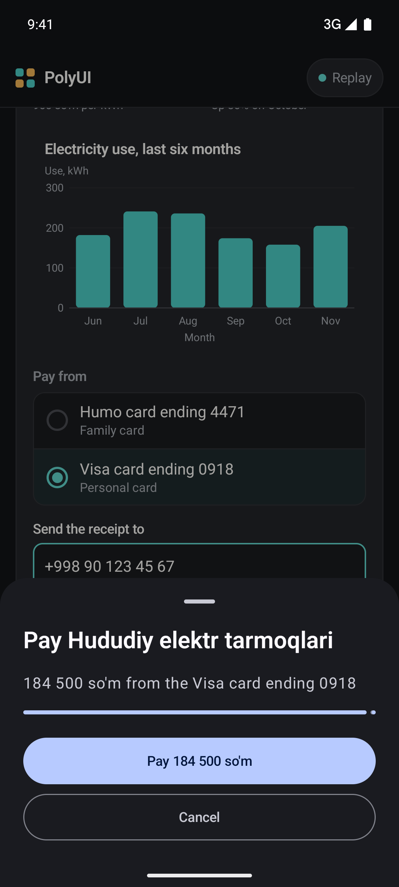

# PolyUI on Android

The Android side mirrors the iOS one. At the bottom is the same `polyui-ffi` C ABI over the Rust client core. A small JNI shim written in C sits on top of it, the Kotlin class `PolyuiCore` wraps that, and a Jetpack Compose renderer (`PolyuiSurface`) draws surfaces. The example app in `android/example` replays the same canned bills conversation as the iOS example, through the real core.




The light screenshot shows the July bar after a tap. The other two come from one run in dark mode: the Visa card was picked, a phone number typed into the receipt field, Pay pressed (the confirm sheet), then confirmed, and the server's patch turned the due amount into 0 and the button into Paid. All of it was driven with `adb shell input` on an emulator.

## Layout

```
android/
  settings.gradle.kts, build.gradle.kts, gradle/libs.versions.toml, gradlew
  scripts/build-rust.sh         cargo-ndk for the device ABIs, or a host build for JVM tests
  polyui/                       the library (namespace dev.polyui)
    src/main/cpp/               polyui_jni.c and CMakeLists.txt
    src/main/kotlin/dev/polyui/ core wrapper, model, Compose renderer
    src/test/                   JVM tests against a host build of the core
    src/androidTest/            device tests: conformance replay and Compose UI tests
    src/sharedTest/             the conformance replayer both test sets use
  example/                      the demo app (dev.polyui.example)
```

## Building

You need a JDK 17 or newer (21 was used), the Android SDK with platform `android-37.2`, build tools 36.0.0 and NDK `28.2.13676358`, rustup, and `cargo-ndk` (`cargo install cargo-ndk`). Point `ANDROID_HOME` at the SDK, or write `sdk.dir=...` into `android/local.properties`.

```sh
cd android
./gradlew :example:installDebug
```

Gradle runs `scripts/build-rust.sh android` before the CMake step. The script adds the Rust targets it needs (`aarch64-linux-android`, `armv7-linux-androideabi`, `x86_64-linux-android`), runs `cargo ndk --platform 26` with the `lite` feature (the core's `client-lite` build), and leaves `libpolyui_ffi.a` in the workspace `target/` folder. CMake then compiles `polyui_jni.c` and links the static library into one `libpolyui_jni.so` per ABI, with `--gc-sections` and `--exclude-libs,ALL`, so only the nine JNI entry points are exported. Set `POLYUI_FFI_FEATURES=` (empty) to build the core with default features instead.

The compile SDK is 37.2 because Compose UI 1.13 (from the 2026.11.01 BOM) refuses anything older. The minimum SDK is 26. Versions in use: AGP 9.5.2 with its built-in Kotlin, Kotlin 2.4.21 for the Compose compiler plugin, Gradle 9.9.2, kotlinx.serialization 1.13.0, activity-compose 1.13.0.

### Sizes

Measured on this machine, Rust 1.100, release profile (fat LTO, one codegen unit), `lite` feature. "Shipped" is the stripped library that ends up in the APK.

| ABI | `lite` (shipped) | default features |
|---|---|---|
| arm64-v8a | 600 kB | 694 kB |
| armeabi-v7a | 411 kB | 465 kB |
| x86_64 | 666 kB | 779 kB |

The numbers are the stripped `libpolyui_jni.so` inside the release APK of the example, which holds the JNI shim and the whole core. `lite` saves about 95 kB on arm64, so the build uses it. The release APK of the example, with Compose and all three ABIs, is 3.4 MB.

## Why the JNI shim is C

The shim could have been a Rust crate using the `jni` crate. It is C instead, for three reasons. It calls the documented C ABI exactly the way Swift does, so the ABI stays the single contract and the Rust crates are untouched. It adds no Rust dependency and no workspace member. And the same file builds for the host with `cc`, which is how the JVM tests reach the real core without an emulator.

Strings cross JNI as UTF-8 byte arrays, not through `NewStringUTF`, which uses modified UTF-8 and mangles emoji and anything else outside the Basic Multilingual Plane. Each native call takes a one-slot array for the error, the same shape as `error_out` in C. The shim frees every string the library returns with `polyui_string_free`, including the error, before it returns to Kotlin.

## `PolyuiCore`

`PolyuiCore` owns one Rust client and implements `AutoCloseable`. Like the Swift wrapper it has raw methods (`receiveJson`, `setValueJson`, `fireJson`, `confirmJson`, `sayJson`, `matchVoiceJson`) that return the core's JSON text, and typed ones that decode it into `RenderBatch`, `RenderOp`, `ConfirmRequest`, `Utterance` and `VoiceMatch` with kotlinx.serialization's `JsonElement` tree. `fire`, `confirm` and `matchVoice` return `null` for the core's `null`.

- An error from the C side becomes a `PolyuiException`. Output the wrapper cannot decode becomes `PolyuiDecodeException`.
- Arguments that contain a NUL character are refused before they reach C, since C strings would cut them short.
- Calls on one client are serialized with a lock, so the client never sees overlapping calls. After `close()` every call throws `IllegalStateException`. `close()` can be called more than once.

Most apps use `PolyuiSession` instead, which owns the core, keeps one `PolyuiSurfaceModel` per surface, applies batches, forwards every `send` message, and reports failures to the server as `ui.error`. Use it from the main thread, since it writes Compose state.

```kotlin
val session = PolyuiSession(PolyuiHello(locale = "uz-Latn")) { text -> socket.send(text) }
socket.onMessage { text -> session.receive(text) }
```

```kotlin
PolyuiSurface(session, surface = "s1")
```

## What the renderer does

Each surface model keeps its components in a map keyed by component id, and each component is a `ComponentNode` holding Compose state. An `update` op changes one node, so Compose recomposes only what reads it. A `create` for an id that already exists with the same type updates that node in place; a different type makes a new node, and `PolyuiComponent` keys its content by the node object, so a replaced component starts with fresh state. A `remove` followed by a `create` of the same id in one batch keeps the node, as on the web and iOS. A whole batch is applied inside one snapshot, so it lands in one frame.

Drawn types: `Text`, `Card` (nested cards are sunken), `Row` (side by side, falling back to a column when it does not fit), `List`, `Stat`, `Badge`, `Image`, `Button`, `ChoiceGroup`, `Input`, `ConfirmSheet`, `Divider`, `chart:Chart`, `chart:Dashboard` and `embed:Embed`.

- `Input` uses a `TextFieldState` that lives as long as the node. When the server's value comes back, the field only changes if the text differs and is not one of the last few values the user typed while focused, the same rule as iOS. The field keeps its focus and cursor through updates, and a test checks that.
- `Image` loads only after the renderer checks the URL again: `https` only (or `http` if the host allowed it), no user info, no control characters, at most 4096 bytes. The default loader follows at most five redirects by hand and checks every hop the same way, caps the download at 8 MB and downsamples large bitmaps. Swap it for Coil or anything else through `LocalPolyuiImageLoader`.
- `chart:Chart` draws the server's scene on a `Canvas`, scaling the view box to the width. Color tokens go through the theme. Taps are hit-tested against the scene's real shapes (pie slices are polygons), and a tap calls `fire` on `on_select` with `{"row": n}`. Each hit also gets an invisible node with the hit's label, so TalkBack can reach and press every bar. SVG arcs are converted from endpoint form to line segments, as on iOS. Chart labels are drawn at the scene's sizes, scaled to the width but never below 85 percent, and do not follow the font scale.
- `chart:Dashboard` is a grid; runs of `Stat` children share a sunken strip. Below 600 dp it has one column.
- `embed:Embed` shows only its title. There is no sandboxed WebView for MCP Apps yet, so the renderer takes the fallback the contract allows.
- The server's `confirm` op opens a Material 3 `ModalBottomSheet` drawn with the system color scheme (dynamic color on Android 12 and later). Neither the PolyUI theme nor the host's `MaterialTheme` reaches it, and nothing in the surface can draw over it. The confirm button stays disabled for 400 ms after the sheet opens (`LocalPolyuiConfirmDelay`), a bar counts down to `expires_ms`, and after that the sheet says the request expired and the button stays disabled.
- `highlight` ops draw an accent outline around one node at a time.

### Accessibility

Containers (`Card`, `Row`, `List`, `ChoiceGroup`, charts, dashboards) are traversal groups with `a11y.label` as their description, so TalkBack reads the label and then the children in order. Card titles, list titles and title or subtitle text are headings. Buttons have the button role, choice rows are selectable radio buttons or checkboxes, images have the image role and their alt text, stats read as one phrase and are polite live regions. Text uses `sp`, so the system font scale applies, and the stat row and the value and unit inside a stat both fall back to a column when large text no longer fits. Animations (the fade-in of new components, the highlight and the button press effect) are skipped when the system has animations turned off (`ValueAnimator.areAnimatorsEnabled()`), or when the host sets `LocalPolyuiReducedMotion`.

### Theming and custom composables

The look comes from `LocalPolyuiTheme`, a `PolyuiTheme` with a light and a dark `PolyuiColors` (the web renderer's tokens), a font family, corner radii and spacing. The renderer picks the palette from the system dark mode, or from `LocalPolyuiDarkTheme` if the host sets it.

```kotlin
val theme = PolyuiTheme(light = PolyuiColors.Light.copy(accent = Color(0xFF4F46E5)))
CompositionLocalProvider(LocalPolyuiTheme provides theme) {
    PolyuiSurface(session, "s1")
}
```

Strings the renderer adds itself ("Cancel", the expiry note, "Chart unavailable") live in `LocalPolyuiLabels`.

A host can draw its own composable for any type, built-in or extension:

```kotlin
val views = PolyuiViewRegistry().with("acme:Map") { context ->
    MapCard(title = context.node.string("title")) {
        context.fire("on_select", buildJsonObject { put("pin", 3) })
    }
}
CompositionLocalProvider(LocalPolyuiViews provides views) {
    PolyuiSurface(session, "s1")
}
```

The context gives the node (props, `a11y`, value, children), `fire`, `setValue`, and `Child(id)` and `Children()` to draw nested components.

For an extension type the core must know its catalog, or the node arrives as `Text` and the composable never runs. Pass the catalogs to `PolyuiSession` (or `PolyuiCore`) and declare them in the hello. The session then goes through `clientNewWithCatalogs` in the JNI shim and `polyui_client_new_with_catalogs` in the C ABI:

```kotlin
val acme = Json.parseToJsonElement(
    """{"id":"acme","version":1,"types":{"Map":{"description":"A map with pins.","role":"img","props":{"title":{"kind":"string"}},"alt":"{title}"}}}""",
).jsonObject
val session = PolyuiSession(
    PolyuiHello(catalogs = listOf("core@1", "chart@1", "acme@1")),
    catalogs = listOf(acme),
) { text -> socket.send(text) }
```

A catalog the core rejects throws a `PolyuiException` that names it, for example `an extension catalog was rejected: [0].id: "core" is reserved`. See [the iOS page](ios.md#extension-catalogs) for the rules.

### Voice

`session.say(surface)` returns the core's utterances and `session.matchVoice(surface, text)` applies a spoken answer. `PolyuiSpeaker` speaks the utterances with `TextToSpeech`, sends a local `highlight` for each one as it starts, and clears it at the end. Speech recognition is not included; pass your recognizer's text to `matchVoice`.

```kotlin
val speaker = PolyuiSpeaker(context)
speaker.speak("s1", session, Locale.US)
```

## Tests

```sh
cd android
./gradlew :polyui:testDebugUnitTest
./gradlew :polyui:connectedDebugAndroidTest
```

- The JVM tests build the core and the JNI shim for the host (`scripts/build-rust.sh host`) and load that library, so they run the real Rust code without an emulator. They replay every `tests/conformance/client/*.json` fixture through the JNI bridge, compare each result with the expectation and check that every batch decodes with no unknown op. Other tests cover errors as exceptions, `null` results, text outside the Basic Multilingual Plane, NUL characters, closed clients, the surface model's identity rules, the URL check and chart hit testing. `ExtensionCatalogTest` checks that an `acme:Badge2` component is `Text` without its catalog and keeps its type and props with it, and the error for a rejected catalog. On this machine: 39 tests, 0 failures.
- The device tests replay the same fixtures through the ARM library on an emulator, then drive the Compose renderer: every core type draws, picking an option writes the data model, the input keeps focus and text while the server patches it, a tap on a bar sends its row, the confirm sheet waits before it arms, confirming sends the nonce, cancelling sends nothing, a custom composable replaces a built-in type, and an `acme:Badge2` from an extension catalog draws through a host composable. On an API 35 emulator: `SurfaceUiTest` passes all 10 of its tests. The conformance replay on the device was not run again after the extension catalog change.

Kotlin sources are formatted with ktlint 1.8.0 (`ktlint_official` style, see `android/.editorconfig`). The extension catalog changes have not been checked with ktlint yet.

## The example app

`android/example` is a Compose chat screen. The transcript starts empty. Ask the question in the composer (or pass an extra) and a small scripted server in the app answers with the bills card. Taps, the confirm sheet and the paid state all go through the real core. The menu behind the Replay pill restarts the demo.

For screenshots it reads a few intent extras:

| Extra | Effect |
|---|---|
| `--es demo ask` | asks the question at start and does nothing else |
| `--es demo select` | asks, then taps the July bar |
| `--es demo pay` | same, fills in the receipt field and presses Pay, which opens the confirm sheet |
| `--es demo paid` | same, then confirms, which ends in the paid state |
| `--ez instant true` | plays the scripted server without delays |
| `--es scroll bottom` | keeps the transcript scrolled to the end |

```sh
adb shell am start -n dev.polyui.example/.MainActivity --es demo select --ez instant true
```

## What is not done yet

- No web content for `embed:Embed`. It shows its title.
- No WebSocket transport and no live mode in the example. The iOS example can talk to `polyui serve`; the Android one only replays.
- No speech recognition, only speech output.
- No x86 (32-bit) ABI.
- The renderer has not been tried with TalkBack on a device, only through the semantics the code sets and the UI tests.
- The emulator runs Android 15 (API 35). Nothing was run on Android 16 or 17 or on a physical phone.
