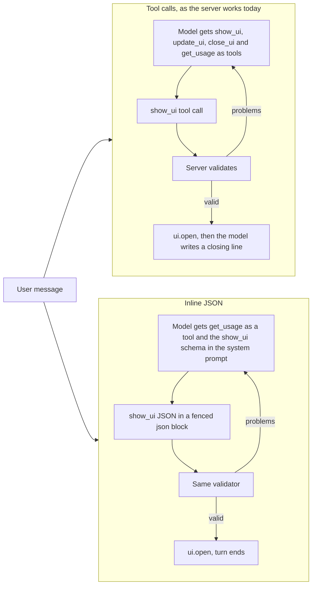
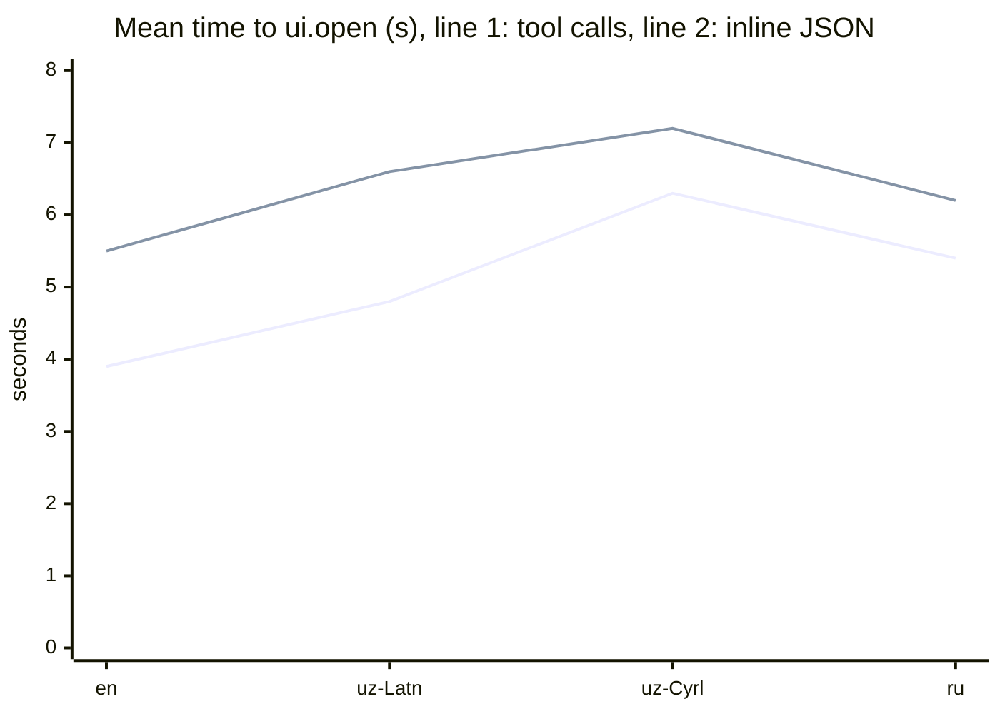

# How often the model gets the UI right

PolyUI only works if the model writes a `show_ui` call that passes validation. When it does not, the server sends the problems back and the model retries, which costs time and tokens. This page explains how we measure that, what the latest run showed, and how to run it yourself.

The short version for the run on 2026-11-24 with `claude-haiku-5-5`: every UI the model attempted was valid on the first try, in all four languages, in both settings we compared. The two settings differed in speed, cost and in what the model chose to draw, not in validity.

The same day we cut the tool definitions from about 20 000 tokens to about 2 400 with a compact tool profile and ran the 32 prompts again with tools. Every UI call was still valid on the first try, the run cost $0.033 instead of $0.104, and the first `ui.open` came sooner. The model drew a form for the phone number request less often, which is the one difference we saw. See [Compact tool profile](#compact-tool-profile-2026-11-24).

On 2026-11-25 we found why: the bills host had no action that could save a phone number, so a form would have been a dead end, and compact read that correctly. With a `save_phone` action added, compact drew the form in 12 of 12 phone turns, and one clearer sentence about data paths made every one of them valid on the first try. See [Forms with the compact profile](#forms-with-the-compact-profile-2026-11-25).

A small self-hosted model is where we expect the settings to differ. The first attempt with `ember:chat` (Gemma, about 12B) on the same day produced no numbers. A second run later that day measured 8 prompts and gave very little. The model tried to draw UI in 7 turns and one was valid, from inline JSON. The tool and constrained settings each stopped after two provider errors in a row. The hypothesis that tool calls plus constrained decoding beat inline JSON on a 12B model is still not tested in a way that can decide it. See [Ember, 8 prompts](#ember-8-prompts-2026-11-24).

## What is measured

The `polyui-bench` binary (crate `bench/`) sends 32 realistic requests to the real Anthropic API through `AnthropicProvider`, against the `bills` demo host (the Karimov household in Tashkent). Each request runs in a fresh session, so earlier answers and paid bills never leak into the next one.

For every turn it records:

- each UI attempt in order, and whether the server accepted it,
- the time from sending the message to the first `ui.open`,
- the number of model calls, and input, cache and output tokens,
- the problem lines of every rejected attempt, normalized into kinds (quoted names become `"x"`, numbers become `N`), so they can be counted.

From that it reports, per locale and overall:

| Number | Meaning |
|---|---|
| Valid on the first try | Of the turns where the model tried to draw UI, the share whose first attempt was accepted. |
| Valid after 1 or 2 retries | The share with an accepted attempt by the second or third try. The server gives up after two failed retries. |
| UI shown when expected | Of the requests that clearly need UI, the share where a `ui.open` reached the client. |
| No UI when none expected | Of the requests that need no UI (a thank you, a definition), the share where the model did not draw any. |
| Mean time to ui.open | Wall time from the user message to the first `ui.open`, over turns that opened one. |
| Cost | Input tokens at $0.10 per million, output at $0.50 per million. Cache writes are billed at 1.25 times the input price and cache reads at 0.1 times, as Anthropic documents for 5 minute cache entries. |

## The two settings

The question behind the comparison: does asking for UI through tool calls beat asking the model to write the same JSON inline?



**Tool calls** is the real agent loop in `polyui-server`, unchanged: the same system prompt, the same tool list (non-strict `show_ui` and `update_ui`, strict `close_ui` and `get_usage`), the same retry limit. `--tool-profile` picks the form of `show_ui` and `update_ui` (see [Tool profiles](server.md#tool-profiles)); the first results below used `full`, which was the only form at the time.

**Inline JSON** uses the same session, host and validator, but the UI tools are taken out of the tool list. The system prompt gets one more paragraph that says to write the `show_ui` input as JSON in a fenced block, followed by the `show_ui` input schema. Since the ember run the paragraph also asks for the JSON on one line with no indentation, to save output tokens on slow models; the Haiku inline numbers below were measured before that sentence was added. The benchmark pulls the first fenced block that starts with `{`, passes it to `Session::show_ui`, and on problems sends them back as a user message, with the same limit of two retries.

Two differences are built into the comparison and you should keep them in mind when reading the numbers:

- The inline prompt carries only the `show_ui` schema, while the tool setting sends all three UI tool schemas. That is the main reason its input is smaller.
- With tools, the model writes its text after it sees that the UI was shown, which takes a second model call. Inline, the text and the JSON come in one reply.

### A third setting: constrained JSON

For servers that accept `response_format` with a JSON Schema (llama-server, vLLM and most gateways in front of them), the benchmark has a third setting, `constrained`. There are no tools in the request. Every reply must be one JSON object, and the server's decoder only lets the model write objects that fit this schema:

```json
{ "anyOf": [
  { "tool": "show_ui",   "input": <show_ui input schema> },
  { "tool": "update_ui", "input": <update_ui input schema> },
  { "tool": "close_ui",  "input": <close_ui input schema> },
  { "tool": "get_usage", "input": <get_usage input schema> },
  { "tool": "none",      "text": string }
] }
```

Each branch is a closed object (`additionalProperties: false`, both keys required, `tool` as a `const`). The input schemas are the ones `polyui-decode` prepares for local decoders, so they keep `maxLength`, `minimum`, `maximum` and `maxItems` and drop only the annotations. For the bills host the whole schema is 34 902 bytes. The system prompt gets one more paragraph that explains the object, lists the tools with their schemas and asks for the JSON on one line.

Ember refuses a union whose branches share a JSON type, and the schema above is made of them. So by default (`--schema-dialect no-same-type-unions`) the benchmark sends it through `SchemaDialect::NoSameTypeUnions` from `polyui-decode`, which merges same-type branches into one (see [decode.md](decode.md#servers-that-refuse-same-type-unions)). The result is 19 985 bytes. It is much looser: the five call objects become one object whose `tool` is an enum of the five names, whose `input` has the properties of all four inputs with none of them required, and whose components may carry any prop of any type. The validator still checks everything the merge gives up. `--schema-dialect standard` sends the schema unchanged.

The benchmark parses the reply, runs the named tool through the same session and validator, and sends problems back as a user message, with the same limit of two retries. A `get_usage` result goes back the same way and the model answers again. A valid UI call or a `none` reply ends the turn.

## The prompt set

Eight kinds of request in four locales: English, Uzbek in Latin script, Uzbek in Cyrillic, and Russian. The full text is in `bench/src/prompts.rs`.

| Kind | Example (English) | Expected |
|---|---|---|
| bills | What do I owe this month? Show me all my bills. | UI |
| pay | Pay my gas bill. (the confirm step is the host's, not the model's) | UI |
| offers | Compare the internet tariffs and let me pick one. | UI |
| chart | Show a chart of my electricity usage over the last six months. | UI |
| phone-form | I want to change the phone number for payment notifications. Ask me for the new number. | UI |
| bill-detail | How much is my internet bill and when is it due? | UI |
| ambiguous | the water thing | either |
| no-ui | What does kWh stand for? | no UI |

## Results, 2026-11-24, `claude-haiku-5-5`

32 prompts, two settings, 102 model calls, about $0.16. The raw data, including every attempt and the first 400 characters of each answer, is in `bench/results/2026-11-24-claude-haiku-5-5.json`. A 4 prompt smoke run before it used 14 more calls (about $0.02).

| Setting | Turns with a UI call | Valid on the first try | Valid after 1 retry | Valid after 2 retries | UI shown when expected | No UI when none expected | Mean time to ui.open | Model calls | Input tokens | Output tokens | Cost |
|---|---|---|---|---|---|---|---|---|---|---|---|
| tool calls | 28 of 32 | 100% (28/28) | 100% (28/28) | 100% (28/28) | 100% (24/24) | 100% (4/4) | 5.1 s | 65 | 1443493 | 30368 | $0.1037 |
| inline JSON | 24 of 32 | 100% (24/24) | 100% (24/24) | 100% (24/24) | 83% (20/24) | 100% (4/4) | 6.4 s | 37 | 393644 | 34027 | $0.0553 |

Input tokens include cache writes and cache reads. For tool calls that is 194 uncached, 643 835 written to the cache and 799 464 read from it; for inline JSON 138, 298 215 and 95 291.

| Locale | Setting | Turns with a UI call | Valid on the first try | Valid after 2 retries | Mean time to ui.open |
|---|---|---|---|---|---|
| en | tool calls | 7 of 8 | 100% (7/7) | 100% (7/7) | 3.9 s |
| en | inline JSON | 6 of 8 | 100% (6/6) | 100% (6/6) | 5.5 s |
| uz-Latn | tool calls | 7 of 8 | 100% (7/7) | 100% (7/7) | 4.8 s |
| uz-Latn | inline JSON | 6 of 8 | 100% (6/6) | 100% (6/6) | 6.6 s |
| uz-Cyrl | tool calls | 7 of 8 | 100% (7/7) | 100% (7/7) | 6.3 s |
| uz-Cyrl | inline JSON | 6 of 8 | 100% (6/6) | 100% (6/6) | 7.2 s |
| ru | tool calls | 7 of 8 | 100% (7/7) | 100% (7/7) | 5.4 s |
| ru | inline JSON | 6 of 8 | 100% (6/6) | 100% (6/6) | 6.2 s |

| Setting | Most common problems | Count |
|---|---|---|
| tool calls | none | 0 |
| inline JSON | none | 0 |

Time to the first `ui.open`, mean per locale, in seconds:



## Compact tool profile, 2026-11-24

The full profile puts every prop of every type into the `show_ui` and `update_ui` input schemas, with a `$bind`/`$ref` union on each one. For the bills host that is 43 985 bytes of tool definitions, sent on every model call. The compact profile keeps a closed but generic schema and moves the catalog into the `show_ui` description as one line per type. We measured both with the Anthropic `count_tokens` endpoint for `claude-haiku-5-5`, with the `core` and `chart` catalogs and the bills actions:

| Profile | Tool definitions | Tool tokens | Whole first request (system prompt, tools, user message) |
|---|---|---|---|
| full | 43 985 bytes | 20 285 | 21 552 tokens |
| compact | 5 025 bytes | 2 430 | 3 697 tokens |
| compact, 8 types (`Text`, `Card`, `List`, `Stat`, `Button`, `ChoiceGroup`, `Input`, `chart:Chart`) | 4 166 bytes | 2 066 | 3 333 tokens |

Tool tokens include the roughly 320 tokens the API adds whenever a request has tools. The system prompt and the user message are 1 267 tokens in every row; most of that is the bills host's own prompt with the bills and tariffs tables. `polyui tools` used to print 160 527 bytes; with the compact profile it prints 7 843.

We then ran all 32 prompts in the tool setting with the compact profile, the same way as the full run above. The raw data is in `bench/results/2026-11-24-claude-haiku-5-5-compact.json`.

| Profile | Turns with a UI call | Valid on the first try | Valid after 1 retry | Valid after 2 retries | UI shown when expected | No UI when none expected | Mean time to ui.open | Model calls | Input tokens | Output tokens | Cost |
|---|---|---|---|---|---|---|---|---|---|---|---|
| full | 28 of 32 | 100% (28/28) | 100% (28/28) | 100% (28/28) | 100% (24/24) | 100% (4/4) | 5.1 s | 65 | 1443493 | 30368 | $0.1037 |
| compact | 26 of 32 | 100% (26/26) | 100% (26/26) | 100% (26/26) | 92% (22/24) | 100% (4/4) | 4.5 s | 63 | 271223 | 27574 | $0.0325 |

For compact, the input tokens are 190 uncached, 139 271 written to the cache and 131 762 read from it, about 4 300 per call against about 22 200 with the full profile. The median time to `ui.open` was 3.9 s against 4.2 s.

| Locale | Turns with a UI call | Valid on the first try | Mean time to ui.open |
|---|---|---|---|
| en | 6 of 8 | 100% (6/6) | 4.3 s |
| uz-Latn | 7 of 8 | 100% (7/7) | 4.3 s |
| uz-Cyrl | 7 of 8 | 100% (7/7) | 4.5 s |
| ru | 6 of 8 | 100% (6/6) | 4.9 s |

The two missing UIs were the English and Russian phone number requests: the model asked for the number in text, as it did in every inline JSON turn. Because one sample per prompt cannot tell that apart from chance, we ran the four phone number prompts twice more with compact and once more with full (`--only`). Compact drew the form in 3 of 4 and then 2 of 4; full drew it in 4 of 4 again. Across all runs that is 7 of 12 for compact and 8 of 8 for full. The extra runs also showed the first rejected calls with the compact profile:

- one first call put `$bind` or `$ref` on a prop that does not take it (the kind is all we record, so we do not know which prop); the retry was valid,
- twice, after a valid `show_ui` had opened the form, the model called `show_ui` again with no components, which was refused; the form stayed on screen.

What we conclude: on Haiku the compact profile keeps validity where it was (every first call in the 32 prompt run was valid, and the one rejected first call in the extra runs was fixed by the retry), costs about a third, and is a little faster. It makes the model less willing to draw a form when the host has no action to submit it, and we have not found out why. We made compact the server default because validity is what the profile could break and it did not, and because the small models we want to support cannot take a 20 000 token prompt at all. Hosts that rely on forms can set `tool_profile: ToolProfile::Full` or run `polyui serve --tool-profile full`.

The smoke run (4 prompts, 9 calls), the main run (63 calls) and the phone number reruns (22 calls) used 94 Haiku calls and cost about $0.054 together.

### Clearer words about `root` and `children`, 2026-11-24

In the first ember smoke test the model's `show_ui` call had 5 components that could not be reached from the root and 4 unknown props on `Card`. The compact description never said what `root` is, and the type lines write `[children]` right after the props, so a model can read `children` as one more prop. We changed the first line of the `show_ui` description to say that each component is `{id, type, props, children}`, that `root` is the id of the top component, that a parent lists its children in its own `children` next to `props` and never inside them, and that every component must be reachable from `root` that way. `polyui tools` now prints 8 051 bytes instead of 7 843; we did not count the tokens again.

To check that this does not hurt Haiku we ran the 8 prompts of the ember run below in the tool setting (16 calls, $0.0093, `bench/results/2026-11-24-claude-haiku-5-5-compact-wording.json`). The result matches the compact run above for the same 8 prompts: 6 turns with a UI call, all 6 valid on the first try, the phone number request answered in text again, and no UI for the thank you. One turn, the Uzbek chart, followed its valid `show_ui` with a valid `update_ui`. Eight prompts can show a regression, not prove an improvement, and we did not see one.

## Forms with the compact profile, 2026-11-25

The compact run above drew a form for the phone number request in 7 of 12 tries, against 8 of 8 for full. The cause was the test host, not the profile.

The bills host registers `pay_bill`, `pick_offer` and `show_usage`. None of them can save a phone number, and a value typed into an `Input` only reaches the host when an action fires with that path in `with`. So a phone form on this host could never do anything. The full profile drew one anyway in every try; compact lists the actions in one short line next to the types, saw that none fits, and usually asked in text, which for this host was the honest answer. In the earlier text replies the model even told the user to type the number into the field and then say it again.

We added a `save_phone` action to the bills host (no arguments; it takes the number from the `with` values, checks that it looks like a phone number and stores it) and ran the four phone prompts three times with each profile (`bench/results/2026-11-25-claude-haiku-5-5-phone-*.json`):

| Profile | Phone turns with a form | Valid on the first try | Cost |
|---|---|---|---|
| full | 12 of 12 | 12 of 12 | $0.020 |
| compact | 12 of 12 | 6 of 12 (all fixed by the retry) | $0.0095 |

Every rejected compact call had the same problem: "`$bind` and `$ref` are not allowed here". The bench records the problem, not the payload, but the only `path` props in these forms are `Input.value` and `ChoiceGroup.value`, and `{"$bind": "/phone"}` on `Input.value` gives exactly that message. The compact legend said `path: data pointer like /form/name`, and the next line says that other props may be `{"$bind": "/path"}`, so writing the path as a binding is an easy misreading. We changed the legend to `path: a data pointer written as a plain string like "/form/name", never as {"$bind": ...}` and ran compact three more times: 12 of 12 forms, 12 of 12 valid on the first try, $0.0069.

Then the whole 32 prompt set with compact, to check that nothing else moved (`bench/results/2026-11-25-claude-haiku-5-5-compact-forms.json`):

| Profile | Turns with a UI call | Valid on the first try | UI shown when expected | No UI when none expected | Mean time to `ui.open` | Cost |
|---|---|---|---|---|---|---|
| compact, 2026-11-24 | 26 of 32 | 26 of 26 | 22 of 24 | 4 of 4 | 4.5 s | $0.0325 |
| compact, 2026-11-25 | 28 of 32 | 27 of 28 | 24 of 24 | 4 of 4 | 4.6 s | $0.0349 |

The one first call that failed was an Uzbek Cyrillic answer to the ambiguous prompt that gave one component two parents; the retry fixed it. It is unrelated to forms, and one case in 28 is within what we saw before. The full profile was not run again on the whole set, so its 24 of 24 is still from 2026-11-24, on the host without `save_phone`.

What we conclude: compact does not avoid forms. It avoids forms the host cannot use, which full did not. A host that wants forms needs an action that takes the values, and it should have one anyway. The earlier advice to use `full` for form-heavy hosts no longer holds. The phone reruns and the full run used 146 Haiku calls and cost about $0.072.

## Ember, first attempt, 2026-11-24

Model `model/chat/ember` (`ember:chat`, Gemma, about 12B, self-hosted) behind an OpenAI-compatible gateway, through `OpenAiCompatProvider`. The gateway is shared with production traffic, so the run was sequential (`--concurrency 1`), at most one call every 2.6 s, with `max_tokens` 4096, a budget of 180 calls, and a rule to stop at once on repeated 5xx errors or timeouts. The plan was a 3 call smoke test on the first prompt (`en-bills`), then all 32 prompts in the three settings.

The smoke test did not get a single model reply:

| Setting | HTTP requests | Time | What came back |
|---|---|---|---|
| tool calls | 2 (one retry) | 130 s | HTTP 503 `model_call_failed`, `model_unavailable`: "peer closed connection without sending complete message body (incomplete chunked read)", both times |
| constrained JSON | 4 (three retries, 1, 2 and 4 s apart) | 8.7 s | HTTP 429 `concurrency_limited`, "over 2" |
| inline JSON | 0 | | not sent, the smoke budget of 3 model calls was used up |

The 429 came while the benchmark had nothing else in flight. Our guess is that the gateway was still working on the two failed tool requests, but we did not verify that. Two 503s in a row is the stop condition, so we made no further calls: 6 HTTP requests in total, 0 tokens reported back.

The requests are large for a 12B model, which may matter here. We measured the first request of each setting against a local mock server:

| Setting | Request body | Of which tool or reply schemas |
|---|---|---|
| tool calls | 47.7 KB | 48.0 KB of tool definitions (show_ui and update_ui are about 23.6 KB each) |
| constrained JSON | 89.8 KB | 47.7 KB system prompt with the schemas, 38.5 KB `response_format` |
| inline JSON | 29.2 KB | 25.1 KB system prompt with the show_ui schema |

With the compact profile and `--max-tokens 800`, the same first requests against the same mock server are much smaller:

| Setting | Request body | Of which |
|---|---|---|
| tool calls | 8.7 KB | 5.2 KB of tool definitions, 3.2 KB system prompt |
| constrained JSON | 44.4 KB | 8.7 KB system prompt with the compact tools, 35.0 KB `response_format` |
| inline JSON | 7.9 KB | 7.1 KB system prompt with the compact show_ui |

With the 8 type subset above the tool calls body is 7.9 KB. The `response_format` schema does not shrink, because constrained decoding always uses the full profile; it becomes a grammar on the server and is not part of the prompt. By the Anthropic count, a compact tool calls request is 3 697 tokens, about 3 380 without the tool preamble the Anthropic API adds, and 3 333 (about 3 010) with the subset. The bills host prompt is 1 267 of those. We have not measured how many tokens ember's own tokenizer and chat template make of the same request.

So, for ember, every number in the results table is still unknown: first-try validity, validity after retries, UI when expected, latency, tokens and problem kinds. The hypothesis that tool calling plus constrained decoding beats inline JSON on a 12B model is not tested yet. The next step is to ask the operator why the 503 happened and whether requests of this size are expected to work, before spending any of the remaining budget. If the tool request is the problem, the inline setting (the smallest body) is the cheapest place to start.

## Ember, 8 prompts, 2026-11-24

The second attempt on `ember:chat` (Gemma, about 12B, self-hosted behind an OpenAI-compatible gateway). The gateway is shared with production traffic, so the rules were: one call at a time, at least 2.6 s between calls, stop a setting after two 5xx answers in a row, and at most 70 HTTP requests in total. Its operator told us to expect about 90 tokens per second of prefill and 21 of output, that the upstream drops a request with no output token after about 60 s, and that the gateway gives up after 85 s.

Setup: compact tool profile with every type, `max_tokens` 1000 for every call (about 48 s of output at 21 tokens per second), up to two retries, no retries on 5xx. Each setting ran as its own process with its own cap of 23, 21 and 21 model calls, so that one setting could not starve the next. The 8 prompts cover every kind once and every locale twice:

| Prompt | Kind | Text |
|---|---|---|
| `en-bills` | bills | What do I owe this month? Show me all my bills. |
| `en-phone-form` | phone-form (a form) | I want to change the phone number for payment notifications. Ask me for the new number. |
| `uz-latn-chart` | chart | Oxirgi olti oydagi gaz sarfimni grafikda ko'rsat. |
| `uz-latn-pay` | pay | Gaz uchun to'lovni qil. |
| `uz-cyrl-offers` | offers | Интернет тарифларини солиштир, биттасини танламоқчиман. |
| `uz-cyrl-bill-detail` | bill-detail | Газ ҳисобим қанча ва қачонгача тўлашим керак? |
| `ru-ambiguous` | ambiguous | а что с этим счётом? |
| `ru-no-ui` | no-ui | Спасибо, на сегодня всё. |

The table counts only the turns that actually ran. A turn that did not run was skipped because its setting had already stopped.

| Setting | Turns run | Turns with a UI call | Valid on the first try | Valid after 2 retries | UI shown when expected | No UI when none expected | Provider errors | HTTP requests | Input tokens | Output tokens |
|---|---|---|---|---|---|---|---|---|---|---|
| tool calls | 2 of 8 | 0 | n/a | n/a | 0 of 2 | not run | 2 | 2 | 0 | 0 |
| inline JSON | 8 of 8 | 5 | 1 of 5 | 1 of 5 | 1 of 6 | 1 of 1 | 1 | 17 | 42 261 | 2 924 |
| constrained JSON | 5 of 8 | 2 | 0 of 2 | 0 of 2 | 0 of 4 | not run | 3 | 9 | 16 580 | 927 |

The one valid UI was the Uzbek gas chart, inline: the model called `get_usage`, then wrote a `List` with a `chart:Chart` of six months that was accepted on the first try, 69 s after the message. The Russian ambiguous prompt got a clarifying question inline, which is a fine answer. The constrained Uzbek pay prompt got a text reply about confirming the payment instead of a UI. The raw data, including the first 4 000 characters of every call the model wrote, is in `bench/results/2026-11-24-ember-tools.json`, `-inline.json` and `-constrained.json`.

Before the run, two single-request checks of the constrained setting on `en-bills`: with the merged schema, ember accepted the `response_format` (the earlier 400 is gone), but the reply went past the 85 s limit. With `max_tokens` 300 it came back in 46.5 s with 2 586 input and 300 output tokens. The constrained Uzbek pay reply (2 587 input, 41 output tokens) took 29.9 s, which fits the operator's prefill figure. The two checks and the three settings used 30 HTTP requests in total.

What went wrong, per setting:

- **Tool calls.** Neither call came back. Both ended after 61 s and 55 s with an agent error, and at the time the benchmark kept only the agent's message ("The assistant is busy right now"), not the provider's. It now records the provider's error next to it. The timing matches the upstream's rule of dropping a request with no output token after about 60 s, but we did not see the error text, so we cannot say that this was the cause.
- **Inline JSON.** No reply reached `max_tokens`: the most output in any turn was 846 tokens over three calls, so the truncation of the first smoke test is gone. The replies were broken in other ways. Nine of the 12 failed attempts were not valid JSON at all. Most had a `}` missing in a run like `}}]` at the end of a component; one had unescaped quotes around a `$ref` inside a string, in a call that also nested a component object inside a `children` list. The rest: 6 components not reachable from the root (a `Text` used as the root, with the other components left unlinked), 2 actions that do not exist (`save_phone`, and `close_ui` used as an action), children on a `ConfirmSheet`, and a missing required prop. Retries fixed nothing; in two turns the model sent the same broken JSON three times.
- **Constrained JSON.** Every reply was valid JSON, as the decoder guarantees, but the merged schema gave up exactly the structure this model needed. The first `en-bills` call was a `show_ui` with no `root` and with `remove` and `service` from the other tools' inputs mixed in. One `uz-cyrl-offers` call put the whole component list, escaped, inside the `root` string, which the schema allows because `root` is a plain string. Then 3 provider errors: `en-bills` streamed past 85 s on its retry, and `uz-latn-chart` and `ru-ambiguous` failed with `RemoteProtocolError: peer closed connection without sending complete message body`. The last two were in a row, so the setting stopped.

The `root` and `children` wording above was in every prompt of this run. Inline still had 6 unreachable components, so on ember it did not fix that problem. We have no tool call from ember to compare with the smoke test.

**What this says about the hypothesis.** The claim was that tool calling plus constrained decoding beats inline JSON on a 12B model. On what we measured it does not: the tool setting produced no reply, constrained produced 0 valid UIs in 2 attempts at a UI, and inline produced 1 valid UI in 5. That is also far too little to say the opposite. With 8 prompts, one sample each, and two of three settings cut short by provider errors, every difference here is within chance. What the run does show:

1. Inline JSON from this model often fails on plain JSON syntax, which is the kind of mistake constrained decoding removes.
2. Constrained decoding on ember, as it stands, cannot show that benefit. To get past the gateway, the schema has to lose its same-type unions, and the merged schema no longer requires `root` or ties an input to its tool, so the model's other mistakes go through. Constrained calls also looked slower: a 1 000 token budget did not fit in 85 s for the bills prompt.
3. On a shared gateway with an 85 s limit and a 60 s first-token limit, a full bills UI in any setting is close to the edge of what one request can do.

A fair test of the hypothesis needs a server that accepts the unmerged schema (llama-server or vLLM with llguidance, see [decode.md](decode.md)), or ember with a longer limit, plus enough prompts and repeats to tell the settings apart.

Caveats: ember was shared with live traffic, so its speed changed during the day (the first smoke test's inline calls took about 20 s each, and later ones up to 85 s). Both JSON settings now ask for one-line JSON, which may have made the missing `}` mistakes more likely; we did not measure that. Input tokens are as ember reported them. A turn that ended in a provider error counts as "no UI shown".

## What the Haiku run tells us

**Validity is not where the settings differ.** No attempt was rejected in either setting, so this run does not support the idea that tool calling produces more valid UI than inline JSON. With every rate at 100%, the benchmark cannot rank them on validity at all; a harder prompt set or a smaller model would be needed for that.

**The model draws a form only with tools.** All four phone number requests opened a surface in the tool setting, and the text around it pointed the user to the field on screen. Inline, all four got a plain text question instead ("What's the new phone number...?") and no JSON block. That is the whole gap in "UI shown when expected", 20 of 24 against 24 of 24. One run per prompt is not enough to call this a rule, but it was consistent across all four languages.

**Tools were faster to first paint.** The mean time to `ui.open` was 5.1 s with tools and 6.4 s inline, and tools were ahead in every locale. The medians tell the same story: 4.2 s against 6.0 s. In both settings the server acts only after the model's reply is complete (the agent loop runs tool calls after `message_stop`), so the gap is in how long the first reply takes to generate. We did not measure which part of that reply takes the time.

**Inline was about half the price.** It used 37 model calls against 65 and cost $0.055 against $0.104. Most of that is the closing call the tool loop makes after a successful `show_ui`, and the larger tool schemas. The tool setting relied heavily on the prompt cache: 55% of its input tokens were cache reads.

**Uzbek in Cyrillic was the slowest locale in both settings.** It also had the slowest single turn of the run, the bills request with tools at 16.7 s end to end. We did not measure tokens per character by script, so we cannot say how much of this is tokenization.

Limits of this run: one sample per prompt and setting, 32 prompts, one model, and a single day. Treat differences of a few percent or a few hundred milliseconds as noise.

## Running it

The key comes from an env file or the environment and is never printed.

```sh
set -a; . ~/.config/polyui/anthropic.env; set +a
cargo run --release -p polyui-bench -- --limit 4 --max-calls 24 --out-dir /tmp/polyui-bench --name smoke
cargo run --release -p polyui-bench -- --max-calls 160
```

For an OpenAI-compatible server, such as ember, name the variable that holds the key and keep it gentle. This is how the ember run above was made, one setting per process so that each has its own cap (21 to 23 calls there):

```sh
set -a; . ~/.config/polyui/ember.env; set +a
cargo run --release -p polyui-bench -- --provider openai-compat \
  --base-url "$EMBER_BASE_URL" --model "$EMBER_MODEL" --api-key-env EMBER_API_KEY \
  --variant inline --tool-profile compact --concurrency 1 --min-gap-ms 2600 \
  --max-tokens 1000 --server-error-attempts 1 --stop-after-errors 2 \
  --input-price 0 --output-price 0 --max-calls 21 \
  --only en-bills,en-phone-form,uz-latn-chart,uz-latn-pay,uz-cyrl-offers,uz-cyrl-bill-detail,ru-ambiguous,ru-no-ui \
  --name 2026-11-24-ember-inline
```

Add `--catalog-subset Text,Card,List,Stat,Button,ChoiceGroup,Input,chart:Chart` to offer fewer types.

| Option | Default | Use |
|---|---|---|
| `--provider` | `anthropic` | `anthropic` or `openai-compat`. |
| `--model` | `claude-haiku-5-5` | Any model id the API accepts. Required for `openai-compat`. |
| `--base-url`, `--api-key-env` | none, `OPENAI_API_KEY` | Where the OpenAI-compatible server is and which variable holds its key. |
| `--variant` | `tools,inline` | Comma separated: `tools`, `constrained`, `inline`. `constrained` needs `openai-compat`. |
| `--tool-profile` | `compact` | `compact` or `full`, the form of `show_ui` and `update_ui` in the prompt. The `constrained` grammar always uses `full`. |
| `--schema-dialect` | `no-same-type-unions` | How the `constrained` reply schema is sent: `no-same-type-unions` merges same-type union branches for servers such as ember that refuse them, `standard` keeps every union. |
| `--catalog-subset` | all types | Comma separated type names to offer the model, for example `Text,Card,chart:Chart`. |
| `--max-tokens` | 16000 | `max_tokens` for every call. |
| `--min-gap-ms` | 0 | Least time between the starts of two model calls. |
| `--stop-after-errors` | 3 | Stop calling the model after this many provider errors in a row. |
| `--server-error-attempts` | 2 | Tries per call on 502, 503 or 504 with `openai-compat`. |
| `--temperature` | server default | Only for `openai-compat`. |
| `--limit` | all 32 | Run only the first N prompts. The first four cover four locales and four kinds of request. |
| `--only` | all 32 | Run only these prompt ids, comma separated, for example `en-phone-form,ru-phone-form`. |
| `--max-calls` | 160 | Hard cap on model calls for the whole run. Calls over the cap fail and the turn is marked `budget`. |
| `--concurrency` | 4 | Turns in flight at once. |
| `--env-file` | none | Read the key (`ANTHROPIC_API_KEY`, or the `--api-key-env` variable) from this file instead of the environment. |
| `--input-price`, `--output-price` | 0.10, 0.50 | Dollars per million tokens. |
| `--list` | off | Print the prompt set and exit, without calling the model. |

Each run writes `<date>-<model>.json` and `<date>-<model>.md` to `--out-dir` (default `bench/results`), with `/` in the model id written as `-`. With `openai-compat` the report also counts HTTP requests including retries, and says so when the run stopped early. Every attempt in the JSON keeps the first 4 000 characters of the call the model wrote, and a turn that ended in a provider error keeps the provider's error text after the agent's message. `cargo test -p polyui-bench` checks the scoring, the prompt set and the inline parser with scripted replies and never calls the network.
