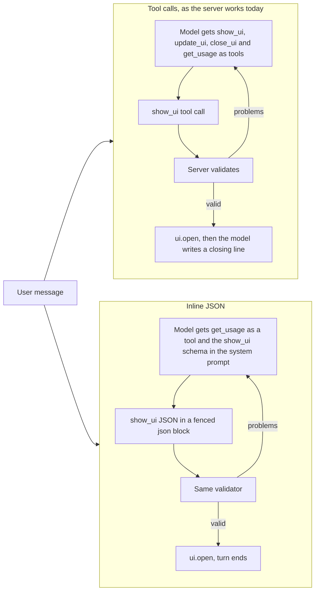
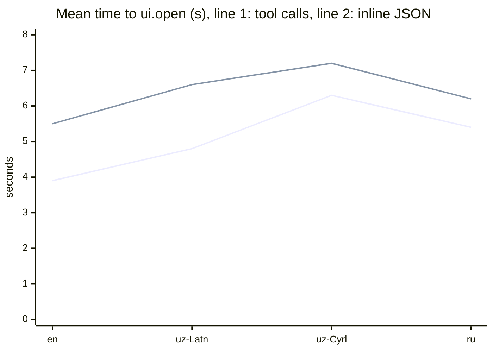

# How often the model gets the UI right

PolyUI only works if the model writes a `show_ui` call that passes validation. When it does not, the server sends the problems back and the model retries, which costs time and tokens. This page explains how we measure that, what the latest run showed, and how to run it yourself.

The short version for the run on 2026-11-24 with `claude-haiku-5-5`: every UI the model attempted was valid on the first try, in all four languages, in both settings we compared. The two settings differed in speed, cost and in what the model chose to draw, not in validity.

A small self-hosted model is where we expect the settings to differ. The first attempt with `ember:chat` (Gemma, about 12B) on the same day produced no numbers: the provider failed on the first request and we stopped, as agreed with its operator. See [Ember, first attempt](#ember-first-attempt-2026-11-24).

## What is measured

The `polyui-bench` binary (crate `bench/`) sends 32 realistic requests to the real Anthropic API through `AnthropicProvider`, against the `bills` demo host (the Karimov household in Tashkent). Each request runs in a fresh session, so earlier answers and paid bills never leak into the next one.

For every turn it records:

- each UI attempt in order, and whether the server accepted it,
- the time from sending the message to the first `ui.open`,
- the number of model calls, and input, cache and output tokens,
- the problem lines of every rejected attempt, normalized into kinds (quoted names become `"x"`, numbers become `N`), so they can be counted.

From that it reports, per locale and overall:

| Number | Meaning |
|---|---|
| Valid on the first try | Of the turns where the model tried to draw UI, the share whose first attempt was accepted. |
| Valid after 1 or 2 retries | The share with an accepted attempt by the second or third try. The server gives up after two failed retries. |
| UI shown when expected | Of the requests that clearly need UI, the share where a `ui.open` reached the client. |
| No UI when none expected | Of the requests that need no UI (a thank you, a definition), the share where the model did not draw any. |
| Mean time to ui.open | Wall time from the user message to the first `ui.open`, over turns that opened one. |
| Cost | Input tokens at $0.10 per million, output at $0.50 per million. Cache writes are billed at 1.25 times the input price and cache reads at 0.1 times, as Anthropic documents for 5 minute cache entries. |

## The two settings

The question behind the comparison: does asking for UI through tool calls beat asking the model to write the same JSON inline?



**Tool calls** is the real agent loop in `polyui-server`, unchanged: the same system prompt, the same tool list (non-strict `show_ui` and `update_ui`, strict `close_ui` and `get_usage`), the same retry limit.

**Inline JSON** uses the same session, host and validator, but the UI tools are taken out of the tool list. The system prompt gets one more paragraph that says to write the `show_ui` input as JSON in a fenced block, followed by the `show_ui` input schema. The benchmark pulls the first fenced block that starts with `{`, passes it to `Session::show_ui`, and on problems sends them back as a user message, with the same limit of two retries.

Two differences are built into the comparison and you should keep them in mind when reading the numbers:

- The inline prompt carries only the `show_ui` schema, while the tool setting sends all three UI tool schemas. That is the main reason its input is smaller.
- With tools, the model writes its text after it sees that the UI was shown, which takes a second model call. Inline, the text and the JSON come in one reply.

### A third setting: constrained JSON

For servers that accept `response_format` with a JSON Schema (llama-server, vLLM and most gateways in front of them), the benchmark has a third setting, `constrained`. There are no tools in the request. Every reply must be one JSON object, and the server's decoder only lets the model write objects that fit this schema:

```json
{ "anyOf": [
  { "tool": "show_ui",   "input": <show_ui input schema> },
  { "tool": "update_ui", "input": <update_ui input schema> },
  { "tool": "close_ui",  "input": <close_ui input schema> },
  { "tool": "get_usage", "input": <get_usage input schema> },
  { "tool": "none",      "text": string }
] }
```

Each branch is a closed object (`additionalProperties: false`, both keys required, `tool` as a `const`). The input schemas are the ones `polyui-decode` prepares for local decoders, so they keep `maxLength`, `minimum`, `maximum` and `maxItems` and drop only the annotations. For the bills host the whole schema is 34 902 bytes. The system prompt gets one more paragraph that explains the object and lists the tools with their schemas.

The benchmark parses the reply, runs the named tool through the same session and validator, and sends problems back as a user message, with the same limit of two retries. A `get_usage` result goes back the same way and the model answers again. A valid UI call or a `none` reply ends the turn.

## The prompt set

Eight kinds of request in four locales: English, Uzbek in Latin script, Uzbek in Cyrillic, and Russian. The full text is in `bench/src/prompts.rs`.

| Kind | Example (English) | Expected |
|---|---|---|
| bills | What do I owe this month? Show me all my bills. | UI |
| pay | Pay my gas bill. (the confirm step is the host's, not the model's) | UI |
| offers | Compare the internet tariffs and let me pick one. | UI |
| chart | Show a chart of my electricity usage over the last six months. | UI |
| phone-form | I want to change the phone number for payment notifications. Ask me for the new number. | UI |
| bill-detail | How much is my internet bill and when is it due? | UI |
| ambiguous | the water thing | either |
| no-ui | What does kWh stand for? | no UI |

## Results, 2026-11-24, `claude-haiku-5-5`

32 prompts, two settings, 102 model calls, about $0.16. The raw data, including every attempt and the first 400 characters of each answer, is in `bench/results/2026-11-24-claude-haiku-5-5.json`. A 4 prompt smoke run before it used 14 more calls (about $0.02).

| Setting | Turns with a UI call | Valid on the first try | Valid after 1 retry | Valid after 2 retries | UI shown when expected | No UI when none expected | Mean time to ui.open | Model calls | Input tokens | Output tokens | Cost |
|---|---|---|---|---|---|---|---|---|---|---|---|
| tool calls | 28 of 32 | 100% (28/28) | 100% (28/28) | 100% (28/28) | 100% (24/24) | 100% (4/4) | 5.1 s | 65 | 1443493 | 30368 | $0.1037 |
| inline JSON | 24 of 32 | 100% (24/24) | 100% (24/24) | 100% (24/24) | 83% (20/24) | 100% (4/4) | 6.4 s | 37 | 393644 | 34027 | $0.0553 |

Input tokens include cache writes and cache reads. For tool calls that is 194 uncached, 643 835 written to the cache and 799 464 read from it; for inline JSON 138, 298 215 and 95 291.

| Locale | Setting | Turns with a UI call | Valid on the first try | Valid after 2 retries | Mean time to ui.open |
|---|---|---|---|---|---|
| en | tool calls | 7 of 8 | 100% (7/7) | 100% (7/7) | 3.9 s |
| en | inline JSON | 6 of 8 | 100% (6/6) | 100% (6/6) | 5.5 s |
| uz-Latn | tool calls | 7 of 8 | 100% (7/7) | 100% (7/7) | 4.8 s |
| uz-Latn | inline JSON | 6 of 8 | 100% (6/6) | 100% (6/6) | 6.6 s |
| uz-Cyrl | tool calls | 7 of 8 | 100% (7/7) | 100% (7/7) | 6.3 s |
| uz-Cyrl | inline JSON | 6 of 8 | 100% (6/6) | 100% (6/6) | 7.2 s |
| ru | tool calls | 7 of 8 | 100% (7/7) | 100% (7/7) | 5.4 s |
| ru | inline JSON | 6 of 8 | 100% (6/6) | 100% (6/6) | 6.2 s |

| Setting | Most common problems | Count |
|---|---|---|
| tool calls | none | 0 |
| inline JSON | none | 0 |

Time to the first `ui.open`, mean per locale, in seconds:



## Ember, first attempt, 2026-11-24

Model `model/chat/ember` (`ember:chat`, Gemma, about 12B, self-hosted) behind an OpenAI-compatible gateway, through `OpenAiCompatProvider`. The gateway is shared with production traffic, so the run was sequential (`--concurrency 1`), at most one call every 2.6 s, with `max_tokens` 4096, a budget of 180 calls, and a rule to stop at once on repeated 5xx errors or timeouts. The plan was a 3 call smoke test on the first prompt (`en-bills`), then all 32 prompts in the three settings.

The smoke test did not get a single model reply:

| Setting | HTTP requests | Time | What came back |
|---|---|---|---|
| tool calls | 2 (one retry) | 130 s | HTTP 503 `model_call_failed`, `model_unavailable`: "peer closed connection without sending complete message body (incomplete chunked read)", both times |
| constrained JSON | 4 (three retries, 1, 2 and 4 s apart) | 8.7 s | HTTP 429 `concurrency_limited`, "over 2" |
| inline JSON | 0 | | not sent, the smoke budget of 3 model calls was used up |

The 429 came while the benchmark had nothing else in flight. Our guess is that the gateway was still working on the two failed tool requests, but we did not verify that. Two 503s in a row is the stop condition, so we made no further calls: 6 HTTP requests in total, 0 tokens reported back.

The requests are large for a 12B model, which may matter here. We measured the first request of each setting against a local mock server:

| Setting | Request body | Of which tool or reply schemas |
|---|---|---|
| tool calls | 47.7 KB | 48.0 KB of tool definitions (show_ui and update_ui are about 23.6 KB each) |
| constrained JSON | 89.8 KB | 47.7 KB system prompt with the schemas, 38.5 KB `response_format` |
| inline JSON | 29.2 KB | 25.1 KB system prompt with the show_ui schema |

So, for ember, every number in the results table is still unknown: first-try validity, validity after retries, UI when expected, latency, tokens and problem kinds. The hypothesis that tool calling plus constrained decoding beats inline JSON on a 12B model is not tested yet. The next step is to ask the operator why the 503 happened and whether requests of this size are expected to work, before spending any of the remaining budget. If the tool request is the problem, the inline setting (the smallest body) is the cheapest place to start.

## What the run tells us

**Validity is not where the settings differ.** No attempt was rejected in either setting, so this run does not support the idea that tool calling produces more valid UI than inline JSON. With every rate at 100%, the benchmark cannot rank them on validity at all; a harder prompt set or a smaller model would be needed for that.

**The model draws a form only with tools.** All four phone number requests opened a surface in the tool setting, and the text around it pointed the user to the field on screen. Inline, all four got a plain text question instead ("What's the new phone number...?") and no JSON block. That is the whole gap in "UI shown when expected", 20 of 24 against 24 of 24. One run per prompt is not enough to call this a rule, but it was consistent across all four languages.

**Tools were faster to first paint.** The mean time to `ui.open` was 5.1 s with tools and 6.4 s inline, and tools were ahead in every locale. The medians tell the same story: 4.2 s against 6.0 s. In both settings the server acts only after the model's reply is complete (the agent loop runs tool calls after `message_stop`), so the gap is in how long the first reply takes to generate. We did not measure which part of that reply takes the time.

**Inline was about half the price.** It used 37 model calls against 65 and cost $0.055 against $0.104. Most of that is the closing call the tool loop makes after a successful `show_ui`, and the larger tool schemas. The tool setting relied heavily on the prompt cache: 55% of its input tokens were cache reads.

**Uzbek in Cyrillic was the slowest locale in both settings.** It also had the slowest single turn of the run, the bills request with tools at 16.7 s end to end. We did not measure tokens per character by script, so we cannot say how much of this is tokenization.

Limits of this run: one sample per prompt and setting, 32 prompts, one model, and a single day. Treat differences of a few percent or a few hundred milliseconds as noise.

## Running it

The key comes from an env file or the environment and is never printed.

```sh
set -a; . ~/.config/polyui/anthropic.env; set +a
cargo run --release -p polyui-bench -- --limit 4 --max-calls 24 --out-dir /tmp/polyui-bench --name smoke
cargo run --release -p polyui-bench -- --max-calls 160
```

For an OpenAI-compatible server, such as ember, name the variable that holds the key and keep it gentle:

```sh
set -a; . ~/.config/polyui/ember.env; set +a
cargo run --release -p polyui-bench -- --provider openai-compat \
  --base-url "$EMBER_BASE_URL" --model "$EMBER_MODEL" --api-key-env EMBER_API_KEY \
  --variant tools,constrained,inline --concurrency 1 --min-gap-ms 2600 \
  --max-tokens 4096 --server-error-attempts 1 --stop-after-errors 2 \
  --input-price 0 --output-price 0 --max-calls 3 --limit 1 --name ember-smoke
```

| Option | Default | Use |
|---|---|---|
| `--provider` | `anthropic` | `anthropic` or `openai-compat`. |
| `--model` | `claude-haiku-5-5` | Any model id the API accepts. Required for `openai-compat`. |
| `--base-url`, `--api-key-env` | none, `OPENAI_API_KEY` | Where the OpenAI-compatible server is and which variable holds its key. |
| `--variant` | `tools,inline` | Comma separated: `tools`, `constrained`, `inline`. `constrained` needs `openai-compat`. |
| `--max-tokens` | 16000 | `max_tokens` for every call. |
| `--min-gap-ms` | 0 | Least time between the starts of two model calls. |
| `--stop-after-errors` | 3 | Stop calling the model after this many provider errors in a row. |
| `--server-error-attempts` | 2 | Tries per call on 502, 503 or 504 with `openai-compat`. |
| `--temperature` | server default | Only for `openai-compat`. |
| `--limit` | all 32 | Run only the first N prompts. The first four cover four locales and four kinds of request. |
| `--max-calls` | 160 | Hard cap on model calls for the whole run. Calls over the cap fail and the turn is marked `budget`. |
| `--concurrency` | 4 | Turns in flight at once. |
| `--env-file` | none | Read the key (`ANTHROPIC_API_KEY`, or the `--api-key-env` variable) from this file instead of the environment. |
| `--input-price`, `--output-price` | 0.10, 0.50 | Dollars per million tokens. |
| `--list` | off | Print the prompt set and exit, without calling the model. |

Each run writes `<date>-<model>.json` and `<date>-<model>.md` to `--out-dir` (default `bench/results`), with `/` in the model id written as `-`. With `openai-compat` the report also counts HTTP requests including retries, and says so when the run stopped early. `cargo test -p polyui-bench` checks the scoring, the prompt set and the inline parser with scripted replies and never calls the network.
