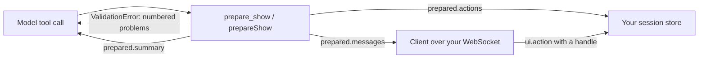

# Python and Node

If your agent server is written in Python or Node, you do not need the Rust server. The bindings give you the same pipeline the Rust server runs around a model's `show_ui`, `update_ui` and `close_ui` calls, from the same Rust code: check the call against the catalogs, resolve `$ref` values for the current user, compile charts, seal actions into handles, and build the `ui.open` and `ui.patch` messages plus the short summary the model reads back.



What the bindings do not do: run the model, keep sessions, or talk to clients. You own the agent loop and the transport; the [server guide](server.md) shows what the Rust server does around these calls, and the same steps apply.

| | Python | Node |
|---|---|---|
| Package | `polyui`, PyO3 and maturin, one abi3 wheel for CPython 3.10+ | `@polyui/node`, napi-rs 3, Node 18+ |
| Build | `maturin develop --uv --release` in `bindings/python` | `npm install && npm run build` in `bindings/node` |
| Published | not yet, build from source | not yet, build from source |
| Tests | `pytest`, including every client fixture in `tests/conformance` | `npm test` |
| Full reference | [bindings/python/README.md](https://github.com/murtazox04/polyui/blob/main/bindings/python/README.md) | [bindings/node/README.md](https://github.com/murtazox04/polyui/blob/main/bindings/node/README.md) |

CI runs `cargo clippy` on both bindings. The release checks build every wheel and addon and run `pytest` and `npm test` on Linux, macOS and Windows whenever a pull request touches the release workflow or a package manifest; otherwise run the tests by hand.

## Python

```python
import polyui

validator = polyui.Validator(
    polyui.Catalogs.builtin(),
    actions={
        "pay_bill": {
            "args": {"bill": {"kind": "string", "required": True, "max": 32}},
            "requires_confirm": True,
        }
    },
    ref_sources={"account": {"kind": "string", "max": 40}},
    resolver=lambda user, source, key: accounts_for(user).get(key),
)

tools = validator.tool_definitions(["core@1", "chart@1"])

try:
    prepared = validator.prepare_show(tool_input, user=current_user, declared=hello["catalogs"])
except polyui.ValidationError as error:
    send_tool_result(str(error), is_error=True)
else:
    send_to_client(prepared.messages[0])
    remember(prepared.model, prepared.client, prepared.actions)
    send_tool_result(prepared.summary)
```

`str(error)` is the numbered problem list written for the model, and `error.problems` has the same problems as dicts. `examples/fastapi_app.py` is a small FastAPI app with a `POST /show_ui` endpoint.

## Node

```js
const polyui = require('@polyui/node')

const validator = new polyui.Validator(polyui.Catalogs.builtin(), {
  actions: {
    pay_bill: {
      args: { bill: { kind: 'string', required: true, max: 32 } },
      requires_confirm: true,
    },
  },
  refSources: { account: { kind: 'string', max: 40 } },
  resolver: (user, source, key) => accountsFor(user).get(key) ?? null,
})

try {
  const prepared = validator.prepareShow(toolInput, { user, declared: hello.catalogs })
  socket.send(JSON.stringify(prepared.messages[0]))
  remember(prepared.model, prepared.client, prepared.actions)
  return { type: 'tool_result', content: prepared.summary }
} catch (error) {
  if (error instanceof polyui.ValidationError) {
    return { type: 'tool_result', content: error.message, is_error: true }
  }
  throw error
}
```

Method names are camelCase; data that mirrors the protocol keeps the wire names, so sealed actions look like `{ action_id, component, prop, action, args, with, requires_confirm }`.

## Tool profiles

`tool_definitions` / `toolDefinitions` takes a `profile`. `"compact"`, the default and the same as the Rust server, keeps a closed generic schema and lists each type as one line in the `show_ui` description: with the built-in catalogs and one action it is about 5 KB of JSON. `"full"` puts every prop of every type into the schema, about 31 KB, and is the only profile that supports `strict`; asking for `strict` with `"compact"` raises an error instead of silently dropping it. On Haiku the compact profile drew a form for a phone number request less often than full ([benchmark](benchmark.md#compact-tool-profile-2026-11-24)), so a host whose answers are mostly forms may prefer `"full"`.

```python
tools = validator.tool_definitions(["core@1", "chart@1"])
tools = validator.tool_definitions(strict=True, profile="full")
```

```js
const tools = validator.toolDefinitions(['core@1', 'chart@1'])
const strict = validator.toolDefinitions(undefined, true, 'full')
```

## Async lookups

The resolver passed to the validator is called synchronously, in the middle of validation. If your lookups are async (a database driver, an HTTP service), fetch them first and pass the values in:

1. `ref_keys(payload)` / `refKeys(payload)` returns the `source:key` strings the tool call uses, in order and without duplicates, only for sources declared in `ref_sources`.
2. Await your lookups however your runtime does it.
3. Pass the results as `refs`, a mapping from `source:key` to value, to `prepare_show`, `prepare_update` or `resolve_refs`. When `refs` is given the resolver is not called. A key missing from the mapping, or mapped to `None` / `null`, is refused like a resolver refusal, and the model gets a problem for that prop.

```python
wanted = validator.ref_keys(tool_input)
values = await asyncio.gather(*(lookup(user, ref) for ref in wanted))
prepared = validator.prepare_show(
    tool_input, user=user, refs=dict(zip(wanted, values, strict=True))
)
```

```js
const wanted = validator.refKeys(toolInput)
const values = await Promise.all(wanted.map((ref) => lookup(user, ref)))
const refs = Object.fromEntries(wanted.map((ref, index) => [ref, values[index]]))
const prepared = validator.prepareShow(toolInput, { user, refs })
```

This works with asyncio, trio, AnyIO or any Node code, because the binding never runs an event loop of its own. Only fetch what `ref_keys` returns: the values still go through the declared kind of each source and the prop's own rules before they reach a client, exactly as with a resolver.

## Keep two copies

Both bindings return two versions of a surface. `prepared.model` is what the model wrote, with `$ref` objects still in place; build summaries from it. `prepared.client` and the messages carry the resolved values, chart scenes and handles; send them to the client and use them for `ui.snapshot`. Keep `prepared.actions` on the server and look the handle up when a `ui.action` arrives. Never put the client copy in front of the model.

## Limits today

- The `ui_resource` / `uiResource` callback is synchronous. For refs, see [Async lookups](#async-lookups).
- There is no async agent loop and no transport in either binding; that part is yours.
- `Client` is also exposed in both, which is handy for tests and for server-side checks of what a renderer would get.
