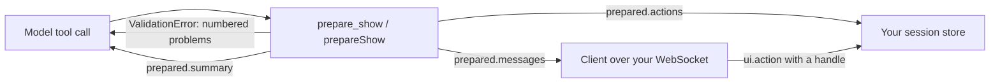

# Python and Node

If your agent server is written in Python or Node, you do not need the Rust server. The bindings give you the same pipeline the Rust server runs around a model's `show_ui`, `update_ui` and `close_ui` calls, from the same Rust code: check the call against the catalogs, resolve `$ref` values for the current user, compile charts, seal actions into handles, and build the `ui.open` and `ui.patch` messages plus the short summary the model reads back.



What the bindings do not do: run the model, keep sessions, or talk to clients. You own the agent loop and the transport; the [server guide](server.md) shows what the Rust server does around these calls, and the same steps apply.

| | Python | Node |
|---|---|---|
| Package | `polyui`, PyO3 and maturin, one abi3 wheel for CPython 3.10+ | `@polyui/node`, napi-rs 3, Node 18+ |
| Build | `maturin develop --uv --release` in `bindings/python` | `npm install && npm run build` in `bindings/node` |
| Published | not yet, build from source | not yet, build from source |
| Tests | `pytest`, including every client fixture in `tests/conformance` | `npm test` |
| Full reference | [bindings/python/README.md](https://github.com/murtazox04/polyui/blob/main/bindings/python/README.md) | [bindings/node/README.md](https://github.com/murtazox04/polyui/blob/main/bindings/node/README.md) |

The binding tests are run by hand today; CI runs the Rust, wasm and web tests.

## Python

```python
import polyui

validator = polyui.Validator(
    polyui.Catalogs.builtin(),
    actions={
        "pay_bill": {
            "args": {"bill": {"kind": "string", "required": True, "max": 32}},
            "requires_confirm": True,
        }
    },
    ref_sources={"account": {"kind": "string", "max": 40}},
    resolver=lambda user, source, key: accounts_for(user).get(key),
)

tools = validator.tool_definitions(["core@1", "chart@1"])

try:
    prepared = validator.prepare_show(tool_input, user=current_user, declared=hello["catalogs"])
except polyui.ValidationError as error:
    send_tool_result(str(error), is_error=True)
else:
    send_to_client(prepared.messages[0])
    remember(prepared.model, prepared.client, prepared.actions)
    send_tool_result(prepared.summary)
```

`str(error)` is the numbered problem list written for the model, and `error.problems` has the same problems as dicts. `examples/fastapi_app.py` is a small FastAPI app with a `POST /show_ui` endpoint.

## Node

```js
const polyui = require('@polyui/node')

const validator = new polyui.Validator(polyui.Catalogs.builtin(), {
  actions: {
    pay_bill: {
      args: { bill: { kind: 'string', required: true, max: 32 } },
      requires_confirm: true,
    },
  },
  refSources: { account: { kind: 'string', max: 40 } },
  resolver: (user, source, key) => accountsFor(user).get(key) ?? null,
})

try {
  const prepared = validator.prepareShow(toolInput, { user, declared: hello.catalogs })
  socket.send(JSON.stringify(prepared.messages[0]))
  remember(prepared.model, prepared.client, prepared.actions)
  return { type: 'tool_result', content: prepared.summary }
} catch (error) {
  if (error instanceof polyui.ValidationError) {
    return { type: 'tool_result', content: error.message, is_error: true }
  }
  throw error
}
```

Method names are camelCase; data that mirrors the protocol keeps the wire names, so sealed actions look like `{ action_id, component, prop, action, args, with, requires_confirm }`.

## Keep two copies

Both bindings return two versions of a surface. `prepared.model` is what the model wrote, with `$ref` objects still in place; build summaries from it. `prepared.client` and the messages carry the resolved values, chart scenes and handles; send them to the client and use them for `ui.snapshot`. Keep `prepared.actions` on the server and look the handle up when a `ui.action` arrives. Never put the client copy in front of the model.

## Limits today

- The resolver and the `ui_resource` / `uiResource` callback are synchronous. Look values up before the call, or run it in a worker thread.
- There is no async agent loop and no transport in either binding; that part is yours.
- `Client` is also exposed in both, which is handy for tests and for server-side checks of what a renderer would get.
