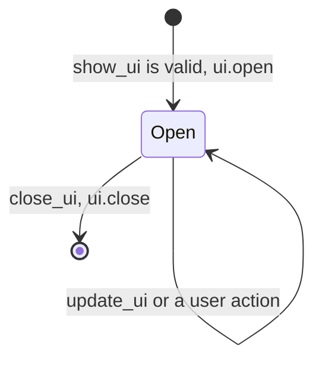
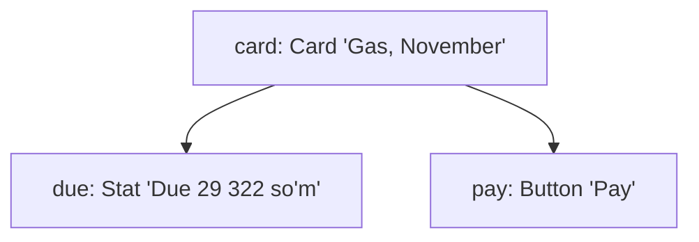
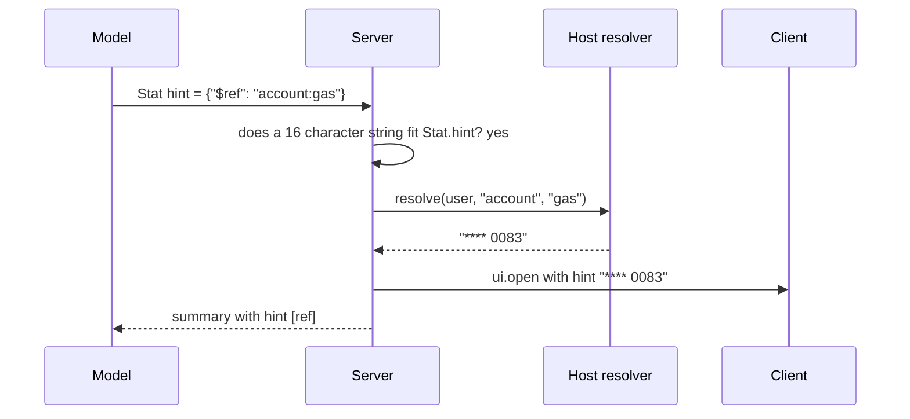
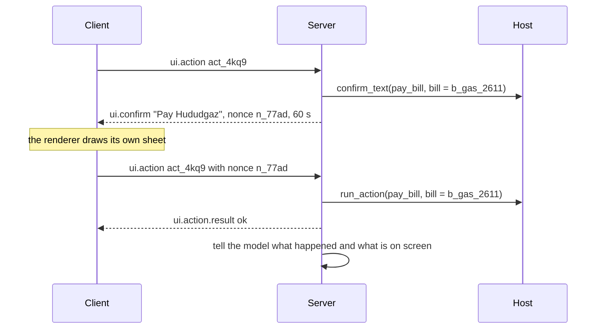
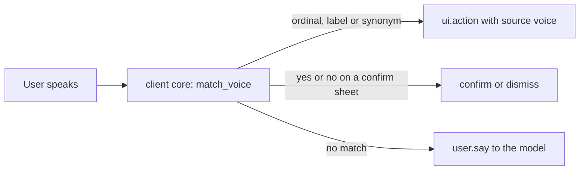

# Concepts

This page walks through the ideas you need to read the rest of the docs: surfaces, components, catalogs, the data model, bindings and refs, actions and confirmation, streaming, and voice. The [protocol](../spec/protocol.md) has the exact rules; this page explains why they look the way they do.

## Surfaces

A surface is one piece of UI the agent opened, with an id like `s1`. A chat answer usually has one. The model opens a surface with `show_ui`, changes it with `update_ui`, and closes it with `close_ui`. Those are the only three UI tools it gets.



Every message about a surface carries a `seq` that goes up by one. A client that sees a gap asks for a full snapshot with `ui.resync`, so a dropped message never leaves the screen half updated.

## Components

A surface is a flat list of components. Children are referenced by id, never nested:

```json
{
  "root": "card",
  "components": [
    { "id": "card", "type": "Card", "props": { "title": "Gas, November" }, "children": ["due", "pay"] },
    { "id": "due", "type": "Stat", "props": { "label": "Due", "value": "29 322", "unit": "so'm" } },
    { "id": "pay", "type": "Button", "props": { "label": "Pay", "tone": "primary", "on_press": { "action": "pay_bill", "args": { "bill": "b_gas_2611" } } } }
  ]
}
```



The flat list has three practical reasons. A small model never has to balance deep brackets. The server can check and send each component as soon as it is complete, which makes streaming simple. And `update_ui` can replace one component by id without resending the tree.

The rules are short: exactly one `root`, every child id exists, no cycles, at most 12 levels deep, at most 256 components. Unknown props are an error, not something to ignore.

## Catalogs

A catalog is a JSON file that lists component types and the rules for their props: kind, length, range, enum values, whether the prop is required, and whether it may come from the data model. Three ship with PolyUI:

| Catalog | Types | On by default |
|---|---|---|
| `core@1` | Text, Card, Row, List, Stat, Badge, Image, Button, ChoiceGroup, Input, ConfirmSheet, Divider | yes |
| `chart@1` | `chart:Chart`, `chart:Dashboard` | yes |
| `embed@1` | `embed:Embed` | only when the host turns it on |

The same file drives three things. The server checks model output against it. `polyui-core` generates the tool schemas the model sees from it, restricted to the catalogs the client said it can draw. And each type's `alt` and `say` templates come from it, so the text and speech forms are written once.

A client declares what it can draw in `hello`. If the model uses a type the client did not declare, the server sends that component's `alt` text instead. See [Catalog format](../spec/catalog.md) and [The catalogs](catalogs.md).

## The data model and `$bind`

Each surface has a JSON document, its data model. A prop can read from it with `{"$bind": "/path"}`, a JSON Pointer. Inputs and choice groups write to it through their `value` path. This means a data update (`ui.data`) changes numbers on screen without resending any components.

In tool calls the model writes data as a list of `{ "path", "value" }` entries rather than a free-form object. That keeps every object in the schema closed, which strict tool use and grammar-based decoders need.

## Private values and `$ref`

`{"$ref": "account:gas"}` is a value the server fills in for the current user, after validation and before anything leaves the server. The model writes the reference and never sees the value. Its tool result shows `[ref]` in that place.



Each ref source declares the kind of value it gives, for example text of up to 16 characters. The check against the prop uses only that declared kind, never the resolved value, so the model cannot learn anything about a value from which calls pass. Every failure to resolve reads the same fixed text: `$ref could not be resolved.`

## Actions and confirmation

Interactive props, such as `on_press` on a Button, hold an action: a name the host registered, arguments checked against that action's schema, and optionally `with`, the data model paths whose values go along when it fires (this is how forms submit).

The client never sees the action. When a surface is accepted, the server replaces each action with a handle like `{"action_id": "act_4kq9", "confirm": true}` and keeps the real name and arguments in the session. The client can only send the handle back.



When the host marks an action `requires_confirm`, the first `ui.action` only gets a challenge back. The title and body of the confirm sheet come from the host and the real arguments, never from text the model wrote, and the renderer draws the sheet itself so the surface cannot style or cover it. A nonce works once and expires. The model has no tool that fires actions, so it cannot skip the step.

After an action runs, the next model turn gets the action, its result and a summary of the surface at that moment. "The second one" in the user's next message then refers to the right thing.

## Streaming

A client that lists `stream` in its `hello` features can get a surface while the model is still writing the `show_ui` call. The server sends `ui.open` as soon as the root and the components it reaches are complete, then a `ui.patch` for each later component. When the call is finished the whole surface is checked; if it fails, the client gets `ui.close` and never keeps UI that did not pass. Buttons are not live until that final check. Numbers from a live run are in the [server guide](server.md#streaming-ui-while-the-model-writes).

## Voice

Every type has a `say` template, so a voice-only client gets the same messages as a screen client and speaks each surface in tree order. Choices are read with ordinals: "first, Gas; second, Power".



The client matches speech against the surface before sending anything to the model. It understands ordinals in the client's locale ("ikkinchisi", "второй", "the second one"), labels and synonyms, and yes or no for confirm sheets. A yes must be the whole short utterance with no negation anywhere, so "yes, don't pay" is never a yes. Version 1 ships locale tables for English, Uzbek in Latin and Cyrillic script, and Russian.

On a screen plus voice client the renderer can highlight the component being read, through `ui.sync` from the server or locally, as the chat example does when you turn on reading aloud.
