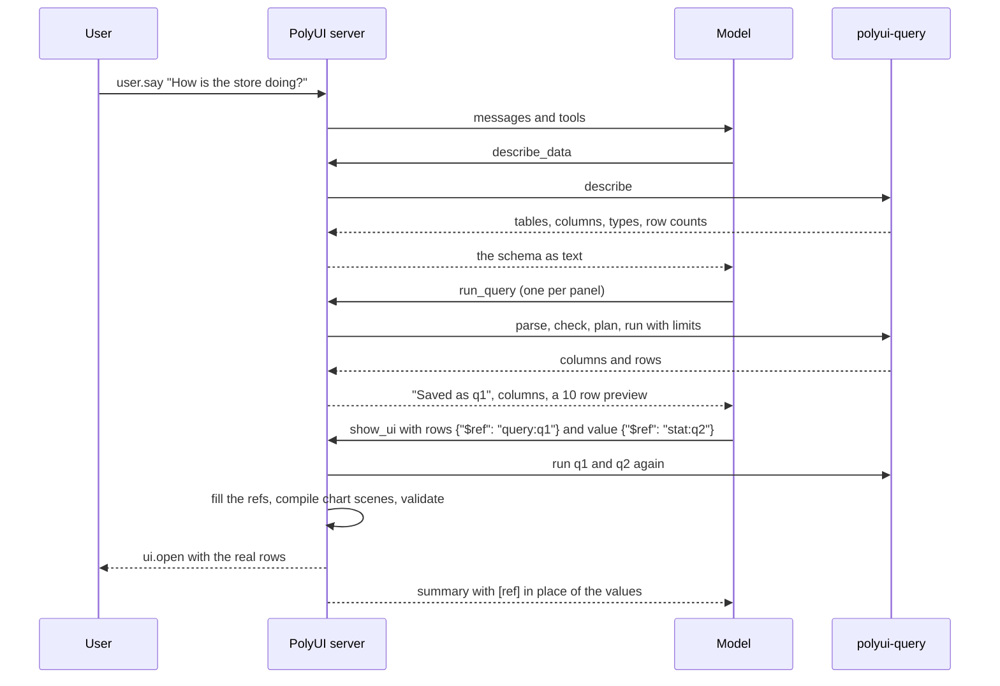

# Dashboards from your own data

An agent can build a dashboard (`chart:Dashboard` with `chart:Chart` panels and `Stat` tiles) where every number comes from a read-only SQL query that runs on your server. The model writes the SQL and lays out the panels. It never types the numbers that end up on screen, and the rows never leave the host except as the finished UI sent to the user's client.

This lives in two places:

- `polyui-query`, a small crate on top of DataFusion that opens CSV and Parquet files (or Arrow batches you already have in memory) behind a table and column whitelist and runs one SELECT at a time with hard limits.
- The `query` feature of `polyui-server`, which gives the model two tools, `describe_data` and `run_query`, and lets a Chart or a Stat point at a saved query instead of literal values.

The feature is off by default in `polyui-server`, so hosts that do not need SQL do not compile DataFusion. The `polyui` command line tool turns it on.

## How a dashboard gets built



The model sees three things about the data: the schema from `describe_data`, the column types and row count of each query, and a preview of at most 10 rows so it can pick sensible titles and chart kinds. The full result, the rows a chart draws and the value a Stat shows, only goes into the client copy of the surface. The model's copy keeps the `$ref`, and its summary shows `[ref]`.

When the model calls `show_ui` or `update_ui`, the server runs each referenced query again. A dashboard therefore always shows the data as it is at the moment it is drawn, and nothing the model remembers from an earlier preview can leak into it.

## Two ref sources

| Ref | Goes into | The query must return |
|---|---|---|
| `{"$ref": "query:q1"}` | `rows` of a `chart:Chart` | columns named `x` and `y`, and optionally `series`; `y` must be a number; at most 1000 rows |
| `{"$ref": "stat:q2"}` | `value` of a `Stat`, or another text prop that accepts the same length | exactly one row with one column |

Numbers in a Stat are formatted for the user's locale: `305,953,000` in English, and the same digits grouped with non-breaking spaces in Uzbek and Russian. Chart rows with a null `x` or a null `y` are skipped.

Why two sources and not one `query:` for both? The protocol says each ref source declares up front the one kind of value it gives, and a `$ref` is accepted only where the prop takes every value of that kind (spec section 6). Chart rows are a list of objects and a Stat value is short text, so one source cannot be both. The two sources take their declared kinds straight from the catalog (`chart:Chart.rows` and `Stat.value`), so they stay right if the catalog changes. If the core ever lets a source declare one kind per prop it fills, the two could merge into one `query:` source.

When a ref does not fit, the model gets a problem it can fix, located at the component and prop, before anything is drawn:

```
2 problems, nothing was shown:
1. components[1] id "c" prop "rows": query q1 has columns category, n; chart rows need columns named x and y, and optionally series. Run it again with AS x, AS y.
2. components[2] id "s" prop "value": query q9 does not exist. Saved queries: q1. Call run_query first.
```

These messages talk about the shape of the result (column names, row count), never its values. A ref in the wrong place, for example `query:q1` on a Stat value, gets the core's usual kind error.

## Changing one panel

When the user asks to change one panel ("show orders by channel instead"), the model runs a new query if the data changes and calls `update_ui` with only that component. The server collects refs from `upsert` only, so it runs only that panel's query, compiles only that chart's scene, and sends a `ui.patch` with that one component. The other panels keep the rows they already have on the client.

`changing_one_panel_reruns_only_its_query_and_scene` in `crates/polyui-server/tests/dashboards.rs` checks this by counting query runs: a three panel dashboard runs six queries (three `run_query` calls and three renders), and the one panel change runs exactly two more.

## What keeps the SQL read-only

Each layer would stop most attacks on its own. They are stacked on purpose.

1. **Only one SELECT.** The SQL is parsed with DataFusion's parser. More than one statement is refused, and so is any statement that is not a query: `DROP`, `INSERT`, `UPDATE`, `DELETE`, `CREATE`, `CREATE EXTERNAL TABLE`, `COPY`, `EXPLAIN`, `SET`, `SHOW`, `TRUNCATE`.
2. **DataFusion's own guard.** The plan is checked with `SQLOptions` that forbid DDL, DML, `COPY` and statements. This catches `SELECT ... INTO`, which parses as a query but creates a table.
3. **Only whitelisted sources.** Every table scan in the plan, subqueries included, must read one of the sources the host registered. Each table is registered as a view that selects only its whitelisted columns, so a hidden column (`customers.email`) does not exist as far as SQL can tell. There is no `information_schema`, URL tables are off, and the table functions `generate_series` and `range` are removed. File paths in `FROM` are refused.
4. **Limits.** At most 1000 rows come back (the query is wrapped in a `LIMIT 1001` and the extra row only marks the result as truncated). Each query has a wall clock timeout (5 s by default) and runs under a memory pool (256 MiB by default) with spilling to disk turned off, so a query that needs more fails instead of writing temporary files. SQL text is capped at 8000 characters.
5. **Safe errors.** Errors that reach the model never contain file paths. Planning errors keep their useful part ("No field named email."), with every form of the data paths replaced by `<data>`. Runtime failures become a short fixed message.

`crates/polyui-query/tests/security.rs` covers writes and DDL, several statements, hidden tables and columns, table functions and file paths, truncation, the timeout, the memory limit, paths in error text, and user text spliced into SQL. `crates/polyui-server/tests/dashboards.rs` runs a prompt injection through the agent loop and checks that the data files are byte for byte the same afterwards.

## Adding data to your host

Describe your tables, open an `Engine`, and return it from `Host::data`:

```rust
use polyui_query::{Engine, Limits, Table};

let engine = Engine::open(
    vec![
        Table::parquet("orders", "data/orders.parquet")
            .about("One row per order.")
            .column("order_date", "Day the order was placed.")
            .column("total", "Order total in so'm."),
        Table::csv("customers", "data/customers.csv")
            .column("customer_id", "Customer id.")
            .column("city", "City."),
    ],
    Limits::default(),
)
.await?;

impl Host for MyHost {
    fn data(&self) -> Option<&polyui_query::Engine> {
        Some(&self.engine)
    }
}
```

Only the columns you list exist. Table and column names must be plain lowercase identifiers. `Table::memory(name, batches)` registers Arrow record batches you already have. `Engine::open` fails with a clear `SetupError` (which may name paths; it is for you, not the model) if a listed column is missing.

The server adds the two tools and a short guide to the system prompt only for hosts whose `data()` returns an engine. If your `refs()` already declares sources named `query` or `stat`, the data sources take their place for that session. Your own system prompt should say how to compute the numbers your users care about, as the shop host does for revenue.

## The shop demo

`shop` is a small online store that sells coffee, tea, brewing gear and accessories in Uzbekistan. The data is generated with a fixed seed, so it is the same on every machine:

```sh
cargo run -p polyui-query --example shop_data -- examples/data/shop
```

That writes `products.csv` (12 products), `customers.csv` (240 customers) and `orders.parquet` (1169 orders from 2026-01-01 to 2026-11-23). The customers file has `email` and `phone`, and products have `supplier_cost`. None of these is whitelisted, so the model cannot read them.

The `polyui` binary is built without the `query` feature by default, because DataFusion makes it about 12 times larger (see the table at the end). Build it with the feature to run the shop:

```sh
cargo run --release -p polyui --features query -- serve --host shop --env-file ~/.config/polyui/anthropic.env --static examples/chat/dist
```

A binary built without the feature still accepts `--host shop`, and stops with a message that says how to rebuild it.

`--data DIR` points at another copy of the data. The system prompt teaches the model to look at the schema, plan three or four panels, run one query per panel, and show one `chart:Dashboard`.

A live run against `claude-haiku-5-5` ("How is the store doing this year? Build me a dashboard.") took 4 model calls: `describe_data`, four `run_query` calls in one reply, one valid `show_ui`, and a closing sentence. The dashboard had two Stats (paid revenue, paid orders) and two charts (monthly revenue as a line, revenue by category as bars). The `ui.open` it produced is saved in `crates/polyui-server/tests/fixtures/shop_dashboard_open.json`, and a normal test checks that the core client accepts it. To run it again:

```sh
set -a; . ~/.config/polyui/anthropic.env; set +a
POLYUI_LIVE=1 cargo test -p polyui-server --features query --test live_shop -- --ignored --nocapture
```

The test caps the turn at 6 model calls and overwrites the fixture.

## How the web renderer lays it out

`chart:Dashboard` puts its children on a grid with `columns` columns (2 by default, and a single column when the dashboard is 560 px wide or less). Consecutive `Stat` children are grouped into one full width strip of tiles, so a row of headline numbers sits above the charts instead of each number taking a whole chart sized cell. Charts and Stats inside a dashboard are drawn as tiles with a border. The order of the children is kept.

## Costs and limits

- **DataFusion 56.0.0**, the current release. It needs Rust 1.95, so `polyui-query` declares `rust-version = "1.95"`. The rest of the workspace builds on 1.88 (checked with `cargo +1.88 check`) when the `query` feature is off. Default features are off; the crate turns on `sql`, `parquet`, and the date, string and unicode functions. `datafusion-table-providers` (Postgres, MySQL, SQLite and others) is not used.
- **Build cost.** See the table below for a clean release build of the `polyui` binary.
- **Memory limit gaps.** DataFusion's memory pool tracks joins, sorts and aggregations, not every allocation a scalar function makes. `repeat`, `lpad` and `rpad`, which can turn a short input into gigabytes, are removed for this reason. Other expensive expressions are bounded only by the timeout.
- **Queries run again on every draw.** That keeps the screen current, and it means a slow query is slow twice. Saved queries live in the session; a conversation can save at most 64.
- **The preview is visible to the model.** Up to 10 rows of each result go into the model's context so it can plan. If even that is too much for your data, describe aggregated views instead of raw tables.

| `polyui` release build, clean | without `query` | with `query` |
|---|---|---|
| Wall time | 45 s | 9 min 35 s |
| Binary size | 7 641 888 bytes (7.3 MiB) | 92 356 400 bytes (88.1 MiB) |
| Binary size after `strip` | 6 500 928 bytes (6.2 MiB) | 75 868 704 bytes (72.4 MiB) |

Measured on an Apple Silicon Mac with the workspace release profile (fat LTO, one codegen unit, `opt-level = 3`), each build in its own empty target directory: `cargo build --release -p polyui` and `cargo build --release -p polyui --features query`. The wall times were measured when `query` was still on by default. The sizes were measured again on 2026-11-24, on the same kind of machine, after the default changed; the earlier figures had mixed MiB and decimal MB. Almost all of the difference is DataFusion and Arrow. If size matters more than query speed, a host can build `polyui-server` without the feature and run the queries in a separate service.
