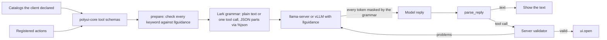

# Constrained decoding for local models

When a model writes a `show_ui` call that does not fit the catalogs, the server sends the problems back and the model tries again. In our benchmark `claude-haiku-5-5` never needed that (see [benchmark.md](benchmark.md)), but we have no numbers for small local models yet, and on your own hardware every retry costs a full generation. `polyui-decode` stops many of those mistakes before they are written: it turns the catalogs and actions into a grammar, and the inference server only lets the model write tokens that fit it.

The grammar is run by [llguidance](https://github.com/guidance-ai/llguidance), the engine behind structured output in llama.cpp (when built with it) and one of the backends in vLLM. This crate uses llguidance 1.9.1 (MIT).

## When to use it

Use it when you run the model yourself, roughly the 4B to 27B range, on llama.cpp or vLLM.

You do not need it for the Anthropic API. There the server sends `close_ui` as a strict tool and the other two in the normal form, because strict schemas on that API are capped at 16 union parameters and the UI tools have far more (spec section 10 has the numbers). A local server has no such cap, so the whole `show_ui` schema, with its unions, lengths and ranges, can be enforced while the model writes.

It is not a replacement for the validator. The grammar knows the shape of a call. It does not know which ids exist, which refs are registered or what a URL points at. The server still checks every call, as it does for hosted models. The section [What the server still checks](#what-the-server-still-checks) has the full list.

## How a turn goes



1. `polyui-core` builds the `show_ui`, `update_ui` and `close_ui` schemas from the catalogs and actions, the same way it does for hosted models. The crate uses the non-strict form, because that one keeps `maxLength`, `minimum`, `maximum` and `maxItems`, and llguidance enforces all of them.
2. `prepare` walks every schema and checks each keyword against what llguidance 1.9.1 implements. Anything it cannot enforce is rewritten so that the grammar is looser, never tighter, and the change is recorded. Today the schemas from `polyui-core` need no rewrite at all; the step is there so a future catalog feature cannot silently break the grammar.
3. The grammar is a Lark file that starts with `%llguidance {}`. It lets the model either answer in plain text or write exactly one tool call, and each tool's arguments are embedded with `%json`.
4. The reply comes back as text. `parse_reply` tells you whether it is text or a call, and a call goes to the validator like any other.

## Using the crate

```rust
use polyui_core::{ActionTable, CatalogSet};
use polyui_decode::request::{Chat, llama_chat_grammar};
use polyui_decode::{CallFormat, Layout, Reply, ToolGrammar};
use serde_json::json;

let grammar = ToolGrammar::for_client(&CatalogSet::builtin(), &declared, &actions)?
    .with_format(CallFormat::hermes())
    .with_layout(Layout::Spaced);

let chat = Chat::new(vec![json!({ "role": "user", "content": "Show my bills" })])
    .with_tools_prompt(&grammar);
let body = llama_chat_grammar(&grammar, &chat);

match grammar.parse_reply(&reply_text) {
    Reply::Call { name, arguments } => validate_and_show(&name, &arguments),
    Reply::Text(text) => show_text(&text),
    Reply::Invalid(problem) => ask_again(&problem),
}
```

`Reply::Invalid` only shows up when the reply did not go through the grammar, for example when the server was built without llguidance.

The main pieces:

| Item | What it does |
|---|---|
| `ToolGrammar::new`, `for_client`, `from_tools` | Build from a `CatalogSet` and an `ActionRegistry`, or from any tool list such as the output of `polyui tools --profile full`. Use the full profile here: the compact profile the server sends by default describes the catalog in prose, which makes a weak grammar. `only(&["show_ui"])` narrows the list, for example when no surface is open yet. |
| `lark()` | The grammar text. It always starts with `%llguidance`. |
| `input_schema(name)`, `call_schema(name)` | The prepared JSON Schema of one tool's input, and the `{"name", "arguments"}` wrapper used inside the grammar. |
| `tools_prompt()`, `json_prompt(name)` | System prompt text that lists the tools and the call format. |
| `render_call`, `schema_order` | Write a call the way the grammar expects it, with keys in schema order. Use it for few-shot examples. |
| `parse_reply` | Text, a call, or a reason it is neither. |
| `request::*` | Request bodies for llama-server and vLLM (below). |
| `Checker` | Compiles a grammar or schema in llguidance and feeds text or tokens through it. The tests and `polyui-decode check` use it. |
| `prepare`, `schema::keywords` | The keyword check on its own. |

There is also a small command line tool:

```sh
cargo run -p polyui -- tools --host bills > tools.json
cargo run -p polyui-decode -- check --tools tools.json --only show_ui,update_ui,close_ui
cargo run -p polyui-decode -- grammar --tools tools.json --only show_ui
cargo run -p polyui-decode -- body llama-chat --tools tools.json --only show_ui --user "Show my bills"
cargo run -p polyui-decode -- parse --tools tools.json --reply reply.txt --arguments
```

## The call format

By default a call looks the way Hermes-style chat templates, such as Qwen's, write it:

```
<tool_call>
{"name": "show_ui", "arguments": {"root": "card", "components": [...]}}
</tool_call>
```

`CallFormat` changes every part of that: the opening and closing markers, the text right before and after the JSON, the names of the `name` and `arguments` keys, and whether plain text is allowed at all (`tool_only()` forces a call).

A marker can be text or a special token. That difference matters. llguidance sees a special token as its own byte sequence that starts with `0xFF`, so a quoted `"<tool_call>"` in the grammar can only be written as ordinary text tokens, never as the dedicated token. When llama.cpp hands its vocabulary to llguidance, it marks a token as special only when the token prints as nothing without special rendering, which is what control tokens do. vLLM's documentation warns about the same thing from the other side: its Qwen3 parser finds `<tool_call>` by token id, so a call spelled with ordinary tokens can be missed. If you parse the reply yourself with `parse_reply`, text markers are fine. If something downstream looks for the token id, use `CallFormat::hermes_tokens()`. If the model's vocabulary does not have that token as a special token, llguidance refuses the grammar with "unknown special token", and you should go back to text markers. We have not checked which GGUF files mark `<tool_call>` as a control token.

`Layout` decides the whitespace inside the JSON:

| Layout | Separators | Note |
|---|---|---|
| `Spaced` (default) | `, ` and `: ` | The separators Python's `json.dumps` uses by default. No other whitespace, so the model cannot pad forever. |
| `Compact` | `,` and `:` | Fewest tokens. |
| `Flexible` | any JSON whitespace | llguidance's own default. |

The layout goes into the `%json` schemas as `x-guidance`, so it applies to the grammar. The plain JSON Schema bodies below do not carry it.

## Running with llama.cpp

llama.cpp has to be built with llguidance, which needs Rust and cargo:

```sh
cmake -B build -DLLAMA_LLGUIDANCE=ON
cmake --build build --config Release -j
./build/bin/llama-server -m /path/to/model.gguf --port 8099
```

A grammar that starts with `%llguidance` then goes to llguidance (`common/sampling.cpp`). In a build without it, the same code throws "failed to parse grammar: llguidance is not enabled".

There are three ways to send a request:

| Body | Endpoint | What it constrains |
|---|---|---|
| `request::llama_chat_grammar` | `/v1/chat/completions` with `grammar` | Text or one call. The server applies the chat template. This is the one to use. |
| `request::llama_completion` | `/completion` with `grammar` | The same grammar, but you send a prompt that is already in the model's chat template. |
| `request::llama_chat_json` | `/v1/chat/completions` with `response_format` of type `json_schema` | The reply is always the arguments of one tool, for example `show_ui`. llama.cpp wraps the schema as `%llguidance {}\nstart: %json ...` when it is built with llguidance. |

Two things about llama-server shape these bodies, both read from its source:

- It refuses a request that has both `tools` and `grammar` ("Cannot use custom grammar constraints with tools"), unless `tool_choice` is `none`. So the grammar bodies send no `tools` field and put the tool list in the system message instead (`Chat::with_tools_prompt`).
- Its own tool calling sets a lazy grammar with trigger words through the chat session, and in `common/sampling.cpp` lazy grammars and triggers only exist on the GBNF path; the `%llguidance` path has neither. So the built-in tool calling does not give you llguidance. The text-or-call grammar here covers the same ground without triggers.

## Running with vLLM

Start the server with the guidance backend:

```sh
vllm serve <model> --structured-outputs-config.backend guidance
```

Then send `request::vllm_chat_grammar` (the same Lark grammar under `structured_outputs.grammar`) or `request::vllm_chat_json` (the tool input under `structured_outputs.json`) to `/v1/chat/completions`. vLLM passes a grammar that starts with `%llguidance` straight to llguidance as Lark. The older fields `guided_json`, `guided_grammar` and `guided_decoding_backend` were removed in vLLM 0.12.0; on an older vLLM use those names instead. With `structured_outputs.json`, vLLM's own `disable_any_whitespace` option decides the whitespace, not `Layout`.

We have not run vLLM against this crate.

## What the grammar guarantees

When the server applies the grammar, the reply is either plain text without the call marker in it, or exactly one call and nothing after it. Inside a call:

- The JSON is complete and well formed.
- The tool name is one of the tools in the grammar.
- Every component `type` is a type from a catalog the client declared.
- A component has only the props its type defines, every required prop is there, and `children` appears only on types that can have children.
- Enum props hold one of their values. Strings, numbers, booleans, lists and objects are where the catalog says they are.
- String lengths, number ranges and list sizes are within the limits in the schema.
- An action prop names a registered action, and its `args` have the declared kinds, with the required ones present.
- `$bind` and `$ref` appear only on props that accept them, as an object with a string.
- `data` entries are `{ "path", "value" }` with a scalar value.
- Object keys come in the order the schema lists them. llguidance always works this way; `render_call` and `schema_order` produce that order, and the tools prompt asks for it.

The conformance fixtures in `tests/conformance/validate` show where the line is. All 6 valid cases pass the grammar once their keys are in schema order (3 of the 35 JSON fixtures list keys in another order). Of the 31 invalid cases, 16 are stopped by the grammar at the offending byte, for example at the `P` of `"PayButton"`, at the `c` of an unknown prop `"colour"`, at the `}` that would close a `Stat` without its `value`, or at the 33rd character of a string whose limit is 32. The other 15 pass the grammar and are caught only by the server.

## What the server still checks

These rules live in the validator, not in the schema, so a call can follow the grammar and still be refused:

- ids: unique, and made of letters, digits, `_` and `-`.
- The tree: `root` is in `components`, every child id exists, no component has two parents or lists itself, there are no cycles, everything is reachable from the root, and the tree is at most 12 levels deep.
- Which child types a container accepts (for example the allowed children of `chart:Dashboard`). The schema only mentions them in a description.
- `$ref`: the source is registered and the value looks like `source:key`.
- `$bind` and `data` paths are valid JSON Pointers, and bound data fits the prop's kind.
- URLs: the scheme is allowed for the prop and the catalog, `javascript:` is never allowed, and there is no whitespace or backslash.
- `update_ui`: removed ids and the new root exist on the open surface.
- Anything a later catalog adds that llguidance cannot enforce. `prepare` reports each such change.

The tool schema also leaves out the component fields `alt`, `say` and `voice` that the validator accepts, so under the grammar the model never writes them.

## How fast it is

Measured with `cargo run --release -p polyui-decode --example compile_time` on an Apple M5 Pro, median of 20 runs, built-in catalogs with two actions (`pay_bill`, `pick_store`). "Compile" is building the llguidance parser from the grammar text, which happens once per request. "First mask" is the first set of allowed tokens.

The byte level tokenizer has 262 tokens. The large one is not a real model tokenizer: it is 150 002 tokens made from the system word list (`/usr/share/dict/words`, each word with and without a leading space), to get a trie the size of a large vocabulary. Numbers with a real tokenizer will differ.

| Grammar | Size | Compile, 262 tokens | Compile, 150 002 tokens | First mask, 150 002 tokens |
|---|---|---|---|---|
| Lark, show_ui + update_ui + close_ui | 32 057 B | 4.82 ms | 4.95 ms | 1.04 ms |
| Lark, show_ui only | 15 891 B | 2.81 ms | 3.41 ms | 1.06 ms |
| Lark, core@1 client, three tools | 25 751 B | 3.94 ms | 4.94 ms | 1.26 ms |
| JSON Schema, show_ui | 15 512 B | 2.10 ms | 2.35 ms | 0.01 ms |
| JSON Schema, update_ui | 15 550 B | 2.11 ms | 2.29 ms | 0.01 ms |
| JSON Schema, close_ui | 127 B | 0.11 ms | 0.11 ms | 0.00 ms |

Building the parser factory for the 150 002 token vocabulary took 149.8 ms; a server does that once per model, not per request. Writing the bills card call token by token took a mean of 0.030 ms per mask (worst 1.578 ms) over 265 tokens with the large vocabulary, and 0.003 ms (worst 0.105 ms) over 552 tokens with the byte level one. We have not measured how this compares with a model's own time per token on real hardware.

## What is verified and what is not

The tests in `crates/polyui-decode/tests` run without a model. They drive llguidance's own `Matcher` with its byte level test tokenizer, so each byte is one token and a rejection has an exact offset:

- every schema from `polyui-core`, in six catalog and action setups (one of them with the strict schemas), compiles in llguidance without lenient mode and without warnings, and so do the grammars in every layout and with and without plain text;
- every conformance fixture is fed through the grammar and lands in one of the three groups above;
- wrong enum values, a missing required prop, keys out of schema order, unknown tools, text with the call marker in it, a second call and text after a call are all rejected where expected;
- special token markers work with a tokenizer that has them and fail to compile with one that does not.

The example in `examples/local-model` sends a real request when a llama-server is available. We have not run it against llama-server or vLLM with a real model, so model output quality under the grammar is not measured yet.
