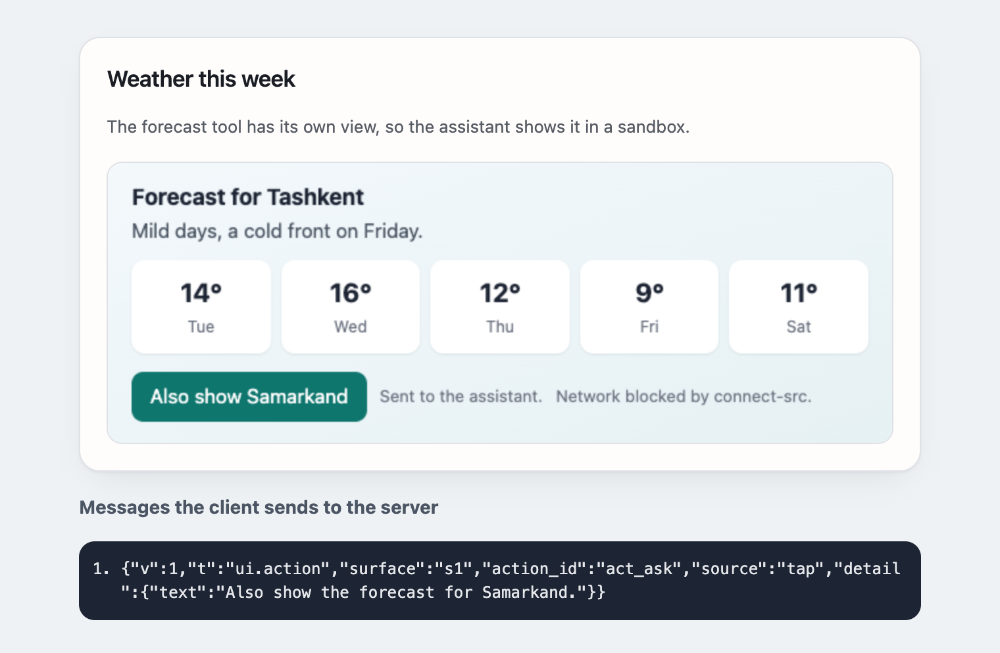
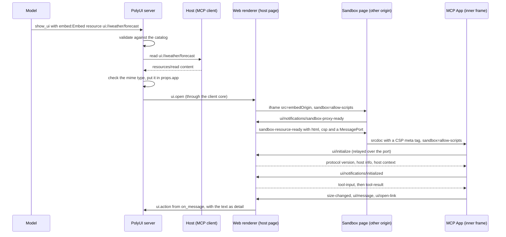

# Embedding MCP Apps

Sometimes the catalog is not enough. A tool already ships its own interface, say a seat map or a forecast widget built as an [MCP App](https://github.com/modelcontextprotocol/ext-apps/blob/main/specification/2026-01-26/apps.mdx), and redrawing it with Cards and Charts would lose most of what makes it useful. The `embed` catalog is the escape hatch for that case. It has one type, `embed:Embed`, that shows an MCP App inside a sandboxed frame, in the middle of an ordinary PolyUI surface.

The model still never writes HTML. It names a `ui://` resource that the host already offers, and the host decides what HTML that name stands for.



## Turning it on

The catalog is off unless the host asks for it. `CatalogSet::builtin()` still returns `core` and `chart` only, so a model offered the default catalogs never sees `embed:Embed`, whatever the client declares.

| Side | What to do |
|---|---|
| Server | Return `CatalogSet::builtin().with_embed()` from your host's catalogs and answer `Host::ui_resource` for the `ui://` URIs you offer (see [Server side](#server-side)). `embed` is a reserved id, so nobody can register a look-alike catalog under that name. |
| Client | Declare `embed@1` in `hello`. The wasm client core knows the catalog, but only draws it for clients that declare it. |
| Web renderer | Pass `embedOrigin`, the URL of the sandbox page on a separate origin (see below). Without it the renderer refuses every embed. |

## The component

```json
{ "id": "forecast", "type": "embed:Embed", "props": {
  "resource": "ui://weather/forecast",
  "title": "Five day forecast for Tashkent",
  "height": "small",
  "on_message": { "action": "ask_agent" }
} }
```

| Prop | Kind | Notes |
|---|---|---|
| `resource` | `url`, scheme `ui`, required, not bindable | Must start with `ui://` and a name. It cannot come from `$bind`, because the server resolves it once, when the model calls `show_ui` or `update_ui`. |
| `title` | string, up to 120, required | The frame's accessible name, and the text shown and read aloud when the app cannot load. It is also the `alt` and `say` of the component. |
| `height` | `small`, `medium` or `large`, default `medium` | A hint. The frame starts at 160, 320 or 480 px and the app may resize it between 80 px and 320, 640 or 960 px. |
| `on_message` | action, optional | Fires when the app sends `ui/message`. Without it, the app's messages are refused. |

There is also a server-only prop, `app`, in the same spirit as the chart `scene`. The model cannot write it: it is not in the catalog, so the validator rejects it as an unknown prop like any other. The server fills it after validation:

```json
"app": {
  "resource": { "uri": "ui://weather/forecast", "mimeType": "text/html;profile=mcp-app", "text": "<!doctype html>...", "_meta": { "ui": { "csp": { "connectDomains": ["https://api.example.com"] } } } },
  "tool_input": { "city": "Tashkent" },
  "tool_result": { "content": [{ "type": "text", "text": "Mild days" }], "structuredContent": {} }
}
```

`resource` is one entry of the MCP `resources/read` result, unchanged. `tool_input` and `tool_result` are optional; when present they are the tool call arguments and the `CallToolResult` the app was made for.

The client core passes `app` to the renderer only when `mimeType` is exactly `text/html;profile=mcp-app`, `text` is a string, `uri` equals the `resource` prop, and `tool_input` and `tool_result` are objects when present. Anything else is dropped and the renderer shows the title instead. HTML gets a larger string limit than other props (204 800 characters, see `MAX_APP_STRING_CHARS`), but only inside `app` of an `embed:Embed`, and the whole message still has to fit in 256 KiB.

## How a frame comes up



## Security rules

These are the rules the web renderer follows. Hosts with their own renderer should follow the same ones.

1. **No sandbox origin, no frame.** The renderer only draws an embed when the host set `embedOrigin`, and only if that URL is `https` (or `http` when `allowHttp` is on) and its origin differs from the page's own origin. Otherwise it shows the `title` as plain text and never creates an iframe. The HTML is never put into the host page, not as `srcdoc`, not with `document.write`, not as a blob URL.
2. **`allow-scripts` and nothing else.** Both the frame the renderer draws and the inner frame the sandbox page draws have `sandbox="allow-scripts"`. Never `allow-same-origin` with it: both frames run in opaque origins, so the app cannot read the sandbox page's storage, cannot reach the host page, cannot open popups, cannot submit forms and cannot navigate the top window.
3. **Every message is checked.** The renderer listens on `window` only for `ui/notifications/sandbox-proxy-ready`, and only when `event.source` is its own frame's window and `event.origin` is `"null"`, which is what an opaque sandbox reports. It answers once, with the HTML and a `MessagePort`. From then on it talks to that port only, so nothing else on the page can inject messages, and nothing it sends can reach a document the frame was navigated to later. The sandbox page accepts the resource only from its parent, only from the origin in its referrer (the renderer sets `referrerpolicy="origin"` so it is always there), only once, and relays app messages only when their source is its own inner frame. Methods named `ui/notifications/sandbox-*` are never relayed in either direction.
4. **CSP from `_meta.ui.csp`, restrictive by default.** The renderer keeps only plain origins (`https://` or `wss://`, an optional `*.` and port, nothing else) from `connectDomains`, `resourceDomains`, `frameDomains` and `baseUriDomains`, at most 32 each. The sandbox page checks them again and puts this policy in a meta tag at the very start of the app's document, after the doctype:
   `default-src 'none'; script-src 'self' 'unsafe-inline' R; style-src 'self' 'unsafe-inline' R; img-src 'self' data: R; media-src 'self' data: R; font-src 'self' R; connect-src C or 'none'; frame-src F or 'none'; base-uri B or 'self'; object-src 'none'`.
   The browser check confirms that a `fetch` from an app with no `connectDomains` is blocked by `connect-src`. Permissions (camera, microphone, geolocation, clipboard) are never granted.
5. **Links need https and a person.** `ui/open-link` accepts only `https` URLs without credentials. The renderer shows the full URL in its own confirm sheet, the same one it uses for payments, which the surface and the app cannot style or cover. Only after the user accepts does it open the link with `noopener,noreferrer`. One link question at a time; others are refused while one is open.
6. **Messages go through the action system.** `ui/message` becomes a normal `ui.action` through the core `fire`, using the component's `on_message` handle, with `{"text": ...}` as `detail`. No `on_message`, no message. The detail must fit the 4096 byte detail limit (`MAX_DETAIL_BYTES`, counted on the serialized object, and checked by the core and again by the server), and the renderer accepts at most one message per second so an app cannot flood the agent.
7. **The frame stays in its box.** `size-changed` can set the height between 80 px and the maximum of the height hint. Width is ignored; the frame always fills the column.

What CSP cannot stop: an app can navigate its own frame to any URL and carry the data it was given in the query string. An MCP App only ever receives what its own tool call returned, so this is the same trust you already give that tool, but do not put anything else into `tool_input` or `tool_result`.

### Where this differs from the MCP Apps spec

The spec says a web host's sandbox proxy must have `allow-scripts` and `allow-same-origin`. We drop `allow-same-origin` on purpose. With it, the browser can tell the host the sandbox's exact origin, which the reference proxy uses for `postMessage` target checks. Without it, the sandbox origin is opaque, so the renderer cannot check `event.origin` against `embedOrigin`; it checks the source window and the `"null"` origin instead, and moves everything after the first message onto a private `MessagePort`, which gives the same guarantee as a target origin check. The app inside sees the normal `window.parent.postMessage` transport, so apps built with `@modelcontextprotocol/ext-apps` work unchanged. Apps that need their own origin (for example for storage or OAuth callbacks through `_meta.ui.domain`) do not get one.

The spec and the SDK types disagree on the shape of `ui/message`: the spec shows `content` as one block, the SDK as a list of blocks. The renderer accepts both and joins the text blocks.

### What the renderer does not do yet

`tools/call`, `resources/read` and `ui/update-model-context` from the app are answered with JSON-RPC error `-32601`, and `hostCapabilities` does not advertise `serverTools` or `serverResources`. `ui/request-display-mode` always answers `inline`. Proxying tool calls needs a server message that does not exist in protocol version 1.

## Hosting the sandbox page

`js/polyui-web/embed-sandbox/index.html` is a single static file with an inline script and no dependencies. Serve it from an origin that differs from your app's origin (a different host name, not a different path), for example `https://sandbox.example-usercontent.net/`, and set `embedOrigin` to that URL. Serve it without a `Content-Security-Policy` header: the page builds the app's policy itself, and the app's document is a `srcdoc` child of this page, so a header here would be layered on top of the app's policy as well. The reference browser check serves it with no headers at all.

## Browser check

`js/polyui-web/scripts/embed-check.mjs` serves the host page on `http://localhost:4190` and the sandbox on `http://127.0.0.1:4191`, loads the real wasm core in Chrome through Playwright, and embeds `demo/embed/forecast-app.html`, a small MCP App written without the SDK. It checks the sandbox attributes of both frames, waits for the app to resize its frame, clicks the app's button so it sends `ui/message`, and reads the `ui.action` the client sends. The screenshot above comes from it.

```sh
cd js/polyui-web
node scripts/build.mjs
npx -y -p playwright node scripts/embed-check.mjs
```

It launches the installed Google Chrome by default; set `PLAYWRIGHT_CHANNEL` to use another channel.

## Server side

`polyui-server` reads the app, checks it and fills `app`. Your host only has to say what a `ui://` URI stands for.

1. **The host hook.** `Host::ui_resource(user, uri)` is async, like `call_tool`, and returns `Option<UiResource>`. A `UiResource` is one `contents` entry of the MCP `resources/read` result, unchanged, plus the optional `tool_input` and `tool_result` the app was made for. The default returns `None`. The host does the MCP call, decides whether this user may see the app, and caches as it likes; PolyUI never talks to an MCP server itself.
2. **When it is read.** After the model calls `show_ui` or `update_ui`, the server collects the literal `resource` of every `embed:Embed` in the call and asks the host once per distinct URI. A call that names more than 8 different apps (`polyui_core::embed::MAX_APPS`) is refused before anything is read. While a surface streams, each embed is read when its component is complete, and the final check reuses what was read.
3. **`attach_apps`.** Next to `charts::attach_scenes`, `apps::attach_apps` runs on the client copy of the components after `$ref` values are resolved. For each embed it requires `mimeType` to be exactly `text/html;profile=mcp-app` and `uri` to equal the `resource` prop, decodes `blob` (standard base64, UTF-8) into `text` or takes `text` as it is, and puts the result in `props.app`. Anything else is a problem for the model, which can then fall back to the catalog: `components[1] id "calc" prop "resource": ui://bills/weather is not an MCP App this host offers. Show it with other components instead.`
4. **Size.** The server sends the embed alone in a probe `ui.patch` through the same outgoing check the client copy gets. An app that would not fit in one 256 KiB message, or whose HTML is longer than `MAX_APP_STRING_CHARS`, is refused with a problem that says it is too large; it is never sent. The usual check of the whole message still runs afterwards.
5. **Out of the model's copy.** `app` exists only in the client copy, the messages and `ui.snapshot`. The model copy keeps what the model wrote, so the tool result still reads `embed:Embed "Tariff calculator" (act)`, with no URI and no HTML.
6. **Who gets it.** The session offers the `embed` catalog only when the host returns it from `catalogs()` and the client declared `embed@1`. Otherwise the catalog is dropped for that session: the tool schema and the prompt do not mention it, an `embed:Embed` the model writes anyway is an unknown type, and the host is never asked for a resource.
7. **Messages.** A `ui.action` from `on_message` arrives with `detail.text`. The host action decides what to do with it, usually nothing more than letting the `[UI event]` report carry the text to the model. It is user-controlled text from inside the app, so treat it exactly like typed user input.

The Python and Node bindings run the same step in `prepare_show` and `prepare_update` (`prepareShow`, `prepareUpdate`). Pass a resource callback when you build the validator, `ui_resource=` in Python and `uiResource` in Node. It is called as `(user, uri)` and returns a `resources/read` entry, an object `{"resource": entry, "tool_input": ..., "tool_result": ...}`, or nothing. Like the ref resolver it has to answer synchronously. `Catalogs.with_embed()` (`withEmbed()`) turns the catalog on, `attach_apps` (`attachApps`) runs the step on its own, and a call whose `declared` list leaves out `embed@1` never reads a resource.

## Trying it locally

The bills demo host has one app, an internet tariff calculator at `ui://bills/tariff` (`crates/polyui-server/src/tariff-app.html`). It gets the family's usage as `tool_input` and the three tariffs as `tool_result`, lets the user move two sliders, and has a button that sends the best tariff back as a `ui/message`. Turn it on with `--embed-origin`:

```sh
(cd examples/chat && npm run build)
polyui serve --env-file ~/.config/polyui/anthropic.env --static examples/chat/dist --embed-origin http://localhost:8788/
```

The command serves the chat page on `127.0.0.1:8787` and `js/polyui-web/embed-sandbox` on `localhost:8788`, a different origin. The chat page reads `/config.json`, declares `embed@1` and passes `embedOrigin` to the renderer, with `allowHttp` on only because the sandbox is plain `http` on a loopback address.
