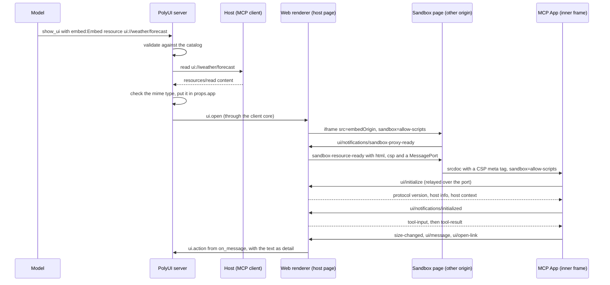
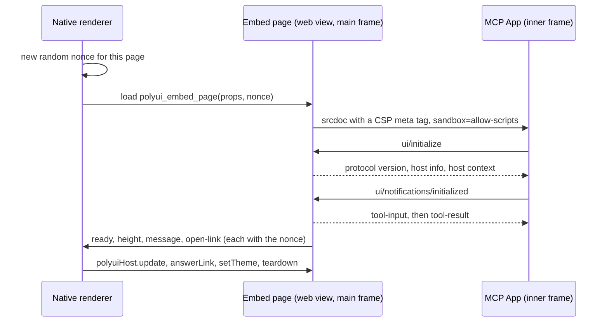
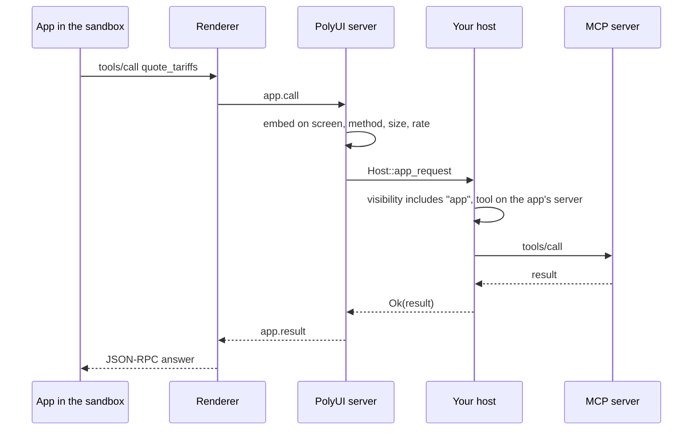
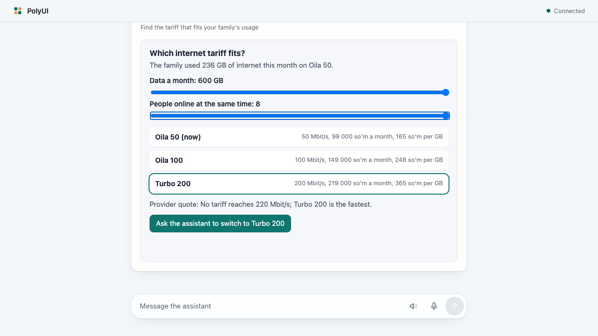
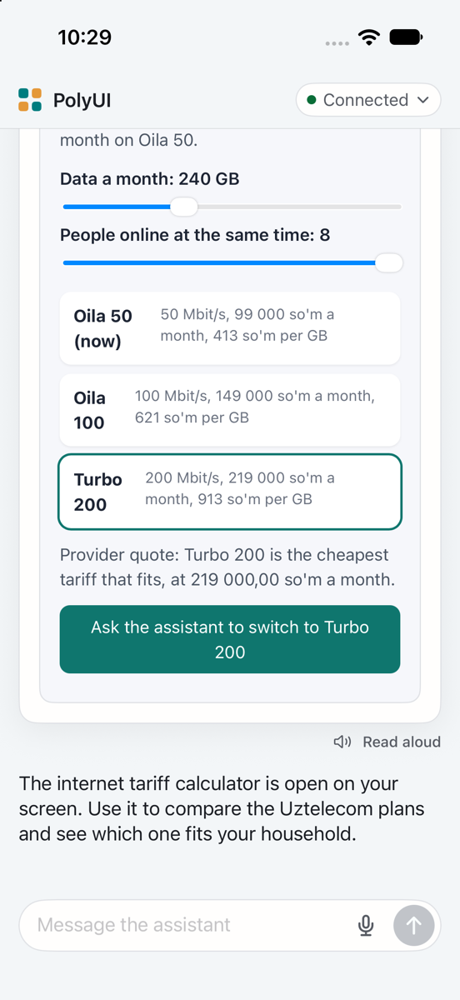
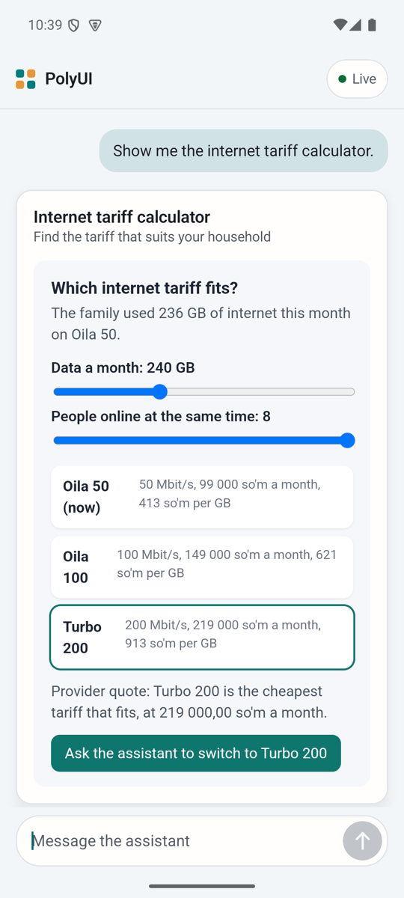
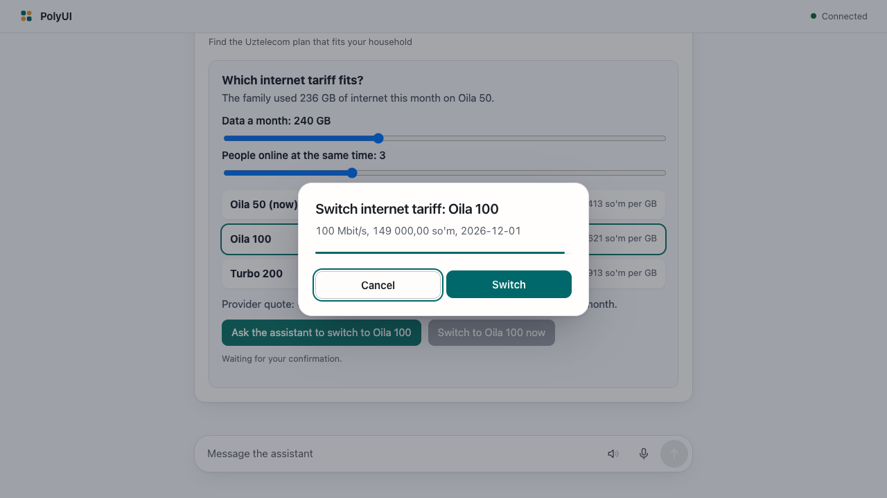
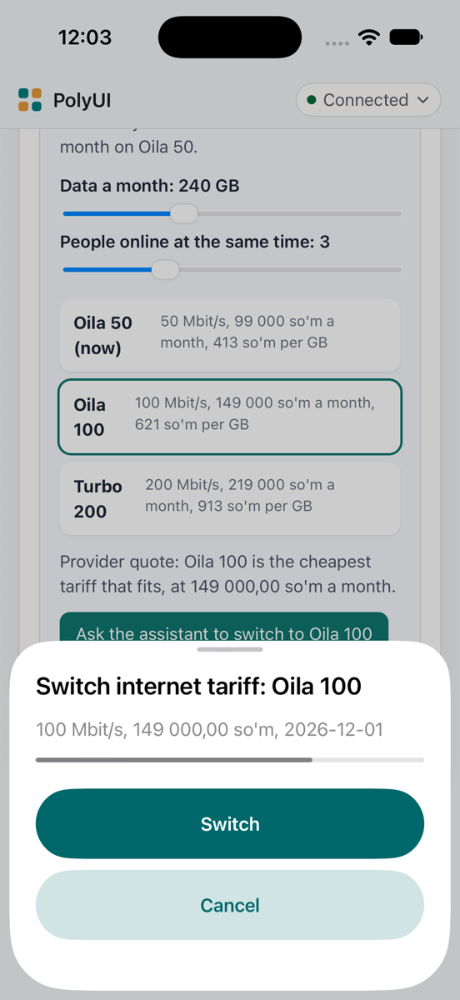
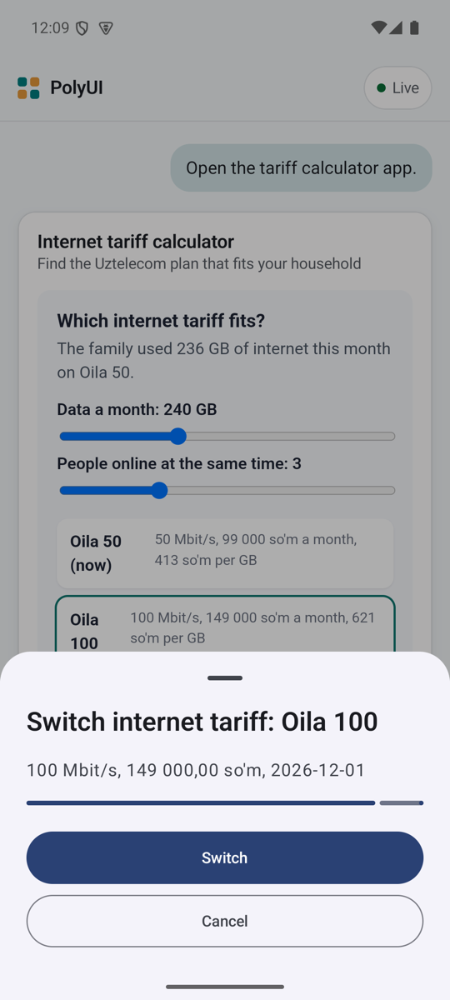

# Embedding MCP Apps

Sometimes the catalog is not enough. A tool already ships its own interface, say a seat map or a forecast widget built as an [MCP App](https://github.com/modelcontextprotocol/ext-apps/blob/main/specification/2026-01-26/apps.mdx), and redrawing it with Cards and Charts would lose most of what makes it useful. The `embed` catalog is the escape hatch for that case. It has one type, `embed:Embed`, that shows an MCP App inside a sandboxed frame, in the middle of an ordinary PolyUI surface.

The model still never writes HTML. It names a `ui://` resource that the host already offers, and the host decides what HTML that name stands for.


## Turning it on

The catalog is off unless the host asks for it. `CatalogSet::builtin()` still returns `core` and `chart` only, so a model offered the default catalogs never sees `embed:Embed`, whatever the client declares.

| Side | What to do |
|---|---|
| Server | Return `CatalogSet::builtin().with_embed()` from your host's catalogs and answer `Host::ui_resource` for the `ui://` URIs you offer (see [Server side](#server-side)). `embed` is a reserved id, so nobody can register a look-alike catalog under that name. |
| Client | Declare `embed@1` in `hello`. The wasm client core knows the catalog, but only draws it for clients that declare it. |
| Web renderer | Pass `embedOrigin`, the URL of the sandbox page on a separate origin (see below). Without it the renderer refuses every embed. |

## The component

```json
{ "id": "forecast", "type": "embed:Embed", "props": {
  "resource": "ui://weather/forecast",
  "title": "Five day forecast for Tashkent",
  "height": "small",
  "on_message": { "action": "ask_agent" }
} }
```

| Prop | Kind | Notes |
|---|---|---|
| `resource` | `url`, scheme `ui`, required, not bindable | Must start with `ui://` and a name. It cannot come from `$bind`, because the server resolves it once, when the model calls `show_ui` or `update_ui`. |
| `title` | string, up to 120, required | The frame's accessible name, and the text shown and read aloud when the app cannot load. It is also the `alt` and `say` of the component. |
| `height` | `small`, `medium` or `large`, default `medium` | A hint. The frame starts at 160, 320 or 480 px and the app may resize it between 80 px and 320, 640 or 960 px. |
| `on_message` | action, optional | Fires when the app sends `ui/message`. Without it, the app's messages are refused. |

There is also a server-only prop, `app`, in the same spirit as the chart `scene`. The model cannot write it: it is not in the catalog, so the validator rejects it as an unknown prop like any other. The server fills it after validation:

```json
"app": {
  "resource": { "uri": "ui://weather/forecast", "mimeType": "text/html;profile=mcp-app", "text": "<!doctype html>...", "_meta": { "ui": { "csp": { "connectDomains": ["https://api.example.com"] } } } },
  "tool_input": { "city": "Tashkent" },
  "tool_result": { "content": [{ "type": "text", "text": "Mild days" }], "structuredContent": {} }
}
```

`resource` is one entry of the MCP `resources/read` result, unchanged. `tool_input` and `tool_result` are optional; when present they are the tool call arguments and the `CallToolResult` the app was made for.

The client core passes `app` to the renderer only when `mimeType` is exactly `text/html;profile=mcp-app`, `text` is a string, `uri` equals the `resource` prop, and `tool_input` and `tool_result` are objects when present. Anything else is dropped and the renderer shows the title instead. HTML gets a larger string limit than other props (204 800 characters, see `MAX_APP_STRING_CHARS`), but only inside `app` of an `embed:Embed`, and the whole message still has to fit in 256 KiB.

## How a frame comes up



### Theme

The host context in the `ui/initialize` answer carries `theme`, `"light"` or `"dark"`, as the MCP Apps spec defines it. When the theme changes after that, the renderer sends `ui/notifications/host-context-changed` with `{ "theme": ... }`, once per change. An app that reads it can follow the host; the forecast and tariff example apps do, through a `data-theme` attribute on their root.

| Renderer | Where the theme comes from |
|---|---|
| Web | The computed `color-scheme` of the embed's element. With the default `light dark`, the system setting (`prefers-color-scheme`) decides; a page that sets `--pui-scheme` to `light` or `dark` on the surface gets that theme in the app too. A change of the system setting is sent at once; a change of `--pui-scheme` is sent with the next update of the component. |
| iOS | The web view's `prefers-color-scheme`, which WebKit takes from the view's trait collection, so the app follows the window's light or dark style. |
| Android | The theme the Compose renderer draws with: `LocalPolyuiDarkTheme`, or the system setting when it is not set. The renderer calls `polyuiHost.setTheme` with it, so an activity theme that is always light does not hide dark mode from the app. |
| Flutter | The brightness of the `PolyuiTheme` background, through `polyuiHost.setTheme`. |

The app gets no `styles` with CSS variables yet, only the theme name.

## Security rules

These are the rules the web renderer follows. Hosts with their own renderer should follow the same ones.

1. **No sandbox origin, no frame.** The renderer only draws an embed when the host set `embedOrigin`, and only if that URL is `https` (or `http` when `allowHttp` is on) and its origin differs from the page's own origin. Otherwise it shows the `title` as plain text and never creates an iframe. The HTML is never put into the host page, not as `srcdoc`, not with `document.write`, not as a blob URL.
2. **`allow-scripts` and nothing else.** Both the frame the renderer draws and the inner frame the sandbox page draws have `sandbox="allow-scripts"`. Never `allow-same-origin` with it: both frames run in opaque origins, so the app cannot read the sandbox page's storage, cannot reach the host page, cannot open popups, cannot submit forms and cannot navigate the top window.
3. **Every message is checked.** The renderer listens on `window` only for `ui/notifications/sandbox-proxy-ready`, and only when `event.source` is its own frame's window and `event.origin` is `"null"`, which is what an opaque sandbox reports. It answers once, with the HTML and a `MessagePort`. From then on it talks to that port only, so nothing else on the page can inject messages, and nothing it sends can reach a document the frame was navigated to later. The sandbox page accepts the resource only from its parent, only from the origin in its referrer (the renderer sets `referrerpolicy="origin"` so it is always there), only once, and relays app messages only when their source is its own inner frame. Methods named `ui/notifications/sandbox-*` are never relayed in either direction.
4. **CSP from `_meta.ui.csp`, restrictive by default.** The renderer keeps only plain origins (`https://` or `wss://`, an optional `*.` and port, nothing else) from `connectDomains`, `resourceDomains`, `frameDomains` and `baseUriDomains`, at most 32 each. The sandbox page checks them again and puts this policy in a meta tag at the very start of the app's document, after the doctype:
   `default-src 'none'; script-src 'self' 'unsafe-inline' R; style-src 'self' 'unsafe-inline' R; img-src 'self' data: R; media-src 'self' data: R; font-src 'self' R; connect-src C or 'none'; frame-src F or 'none'; base-uri B or 'self'; object-src 'none'`.
   The browser check confirms that a `fetch` from an app with no `connectDomains` is blocked by `connect-src`. Permissions (camera, microphone, geolocation, clipboard) are never granted.
5. **Links need https and a person.** `ui/open-link` accepts only `https` URLs without credentials. The renderer shows the full URL in its own confirm sheet, the same one it uses for payments, which the surface and the app cannot style or cover. Only after the user accepts does it open the link with `noopener,noreferrer`. One link question at a time; others are refused while one is open.
6. **Messages go through the action system.** `ui/message` becomes a normal `ui.action` through the core `fire`, using the component's `on_message` handle, with `{"text": ...}` as `detail`. No `on_message`, no message. The detail must fit the 4096 byte detail limit (`MAX_DETAIL_BYTES`, counted on the serialized object, and checked by the core and again by the server), and the renderer accepts at most one message per second so an app cannot flood the agent.
7. **The frame stays in its box.** `size-changed` can set the height between 80 px and the maximum of the height hint. Width is ignored; the frame always fills the column.

What CSP cannot stop: an app can navigate its own frame to any URL and carry the data it was given in the query string. An MCP App only ever receives what its own tool call returned, so this is the same trust you already give that tool, but do not put anything else into `tool_input` or `tool_result`.

### Where this differs from the MCP Apps spec

The spec says a web host's sandbox proxy must have `allow-scripts` and `allow-same-origin`. We drop `allow-same-origin` on purpose. With it, the browser can tell the host the sandbox's exact origin, which the reference proxy uses for `postMessage` target checks. Without it, the sandbox origin is opaque, so the renderer cannot check `event.origin` against `embedOrigin`; it checks the source window and the `"null"` origin instead, and moves everything after the first message onto a private `MessagePort`, which gives the same guarantee as a target origin check. The app inside sees the normal `window.parent.postMessage` transport, so apps built with `@modelcontextprotocol/ext-apps` work unchanged. Apps that need their own origin (for example for storage or OAuth callbacks through `_meta.ui.domain`) do not get one.

The spec and the SDK types disagree on the shape of `ui/message`: the spec shows `content` as one block, the SDK as a list of blocks. The renderer accepts both and joins the text blocks.

### What the renderer does not do yet

`ui/update-model-context` from the app is answered with JSON-RPC error `-32601`: text written by app code would reach the model, which needs its own decision. `ui/request-display-mode` always answers `inline`. `tools/call` and `resources/read` work when the server accepts app calls (see [App calls](#app-calls)) and get `-32601` otherwise.

## Hosting the sandbox page

`js/polyui-web/embed-sandbox/index.html` is a single static file with an inline script and no dependencies. Serve it from an origin that differs from your app's origin (a different host name, not a different path), for example `https://sandbox.example-usercontent.net/`, and set `embedOrigin` to that URL. Serve it without a `Content-Security-Policy` header: the page builds the app's policy itself, and the app's document is a `srcdoc` child of this page, so a header here would be layered on top of the app's policy as well. The reference browser check serves it with no headers at all.

The page that hosts the renderer has to allow the frame: if it has a `Content-Security-Policy`, its `frame-src` must include the sandbox origin, or the browser blocks the frame and the embed stays blank. The chat example allows `https:` and plain `http` on `localhost` and `127.0.0.1` only.

## Browser check

`js/polyui-web/scripts/embed-check.mjs` serves the host page on `http://localhost:4190` and the sandbox on `http://127.0.0.1:4191`, loads the real wasm core in Chrome through Playwright, and embeds `demo/embed/forecast-app.html`, a small MCP App written without the SDK. It checks the sandbox attributes of both frames, waits for the app to resize its frame, clicks the app's button so it sends `ui/message`, and reads the `ui.action` the client sends. The screenshot above comes from it. After the screenshot it switches the page to dark and back with `emulateMedia` and checks that the app's theme follows both times.

```sh
cd js/polyui-web
node scripts/build.mjs
npx -y -p playwright node scripts/embed-check.mjs
```

It launches the installed Google Chrome by default; set `PLAYWRIGHT_CHANNEL` to use another channel.

## Native renderers

iOS, Android and Flutter do not each rebuild the sandbox. They all load one page that the C ABI builds, `polyui_embed_page(props_json, nonce)`, into a web view. The page is `bindings/ffi/src/embed-page.html` with the component's props and a nonce filled in.



The page does the same work as the web sandbox page and the web renderer together:

- The app runs in an inner frame with `sandbox="allow-scripts"` and the CSP from rule 4, built by the same code as the web sandbox page.
- The page answers `ui/initialize`, `ping` and `ui/request-display-mode` itself, sends `tool-input` and `tool-result`, refuses everything else with `-32601`, and drops `ui/notifications/sandbox-*` methods.
- It checks `ui/message` the same way the web renderer does (`on_message` present, text only, 4096 bytes, one per second) and clamps `size-changed` to the height hint.
- It accepts `ui/open-link` only for `https` URLs without credentials, and only one at a time.
- It tells the app the theme from `prefers-color-scheme`, or from `polyuiHost.setTheme("light" | "dark")` once the native side has called it, and sends `host-context-changed` when it changes (see [Theme](#theme)).

What reaches the native side is a JSON string with `kind` set to `ready`, `height`, `message`, `open-link` or `unavailable`, sent through `window.webkit.messageHandlers.polyui` on iOS and `window.polyui` elsewhere. Every event carries the nonce. The app's frame can see the same bridge object on some platforms, but it cannot read the page's script, so it cannot know the nonce. The native side drops any event without it, and where the platform says which frame sent it, also any event that is not from the main frame.

The native side still does the parts that need the person or the core: it fires `on_message` through the core `fire`, shows `open-link` URLs in its own confirm sheet before opening them outside the app and then calls `polyuiHost.answerLink`, and sizes the view from `height` after clamping it again. Props are put into the page's script as JSON with `<`, `>`, `&`, U+2028 and U+2029 escaped, so a title like `</script>` cannot end the script.

Where the web view is Chromium, load the page with a fixed `https` base URL such as `https://embed.polyui.invalid/`, not as `about:blank` content: desktop Chrome stopped with a failed check when the page came in that way. Android and Flutter do this. iOS loads it with no base URL, and WebKit draws the inner frame fine that way.

`bindings/ffi/tests/embed/check.mjs` loads the page in Chromium with a fake bridge and checks the sandbox attribute, that the tool input reaches the app, that the app's `fetch` is blocked by `connect-src`, the clamped height, the message and its one-per-second limit, the link round trip, that plain `http` links are refused, that the app cannot forge an event with the nonce, that it cannot reach `polyuiHost`, and that the theme reaches the app at start, after a system change and after `setTheme`. CI runs it next to the C test.

```sh
cargo build -p polyui-ffi --example embed_page
npx -y playwright@1.65.1 install chromium
PLAYWRIGHT_CHANNEL=chromium npx -y -p playwright@1.65.1 node bindings/ffi/tests/embed/check.mjs
```

## Server side

`polyui-server` reads the app, checks it and fills `app`. Your host only has to say what a `ui://` URI stands for.

1. **The host hook.** `Host::ui_resource(user, uri)` is async, like `call_tool`, and returns `Option<UiResource>`. A `UiResource` is one `contents` entry of the MCP `resources/read` result, unchanged, plus the optional `tool_input` and `tool_result` the app was made for. The default returns `None`. The host does the MCP call, decides whether this user may see the app, and caches as it likes; PolyUI never talks to an MCP server itself.
2. **When it is read.** After the model calls `show_ui` or `update_ui`, the server collects the literal `resource` of every `embed:Embed` in the call and asks the host once per distinct URI. A call that names more than 8 different apps (`polyui_core::embed::MAX_APPS`) is refused before anything is read. While a surface streams, each embed is read when its component is complete, and the final check reuses what was read.
3. **`attach_apps`.** Next to `charts::attach_scenes`, `apps::attach_apps` runs on the client copy of the components after `$ref` values are resolved. For each embed it requires `mimeType` to be exactly `text/html;profile=mcp-app` and `uri` to equal the `resource` prop, decodes `blob` (standard base64, UTF-8) into `text` or takes `text` as it is, and puts the result in `props.app`. Anything else is a problem for the model, which can then fall back to the catalog: `components[1] id "calc" prop "resource": ui://bills/weather is not an MCP App this host offers. Show it with other components instead.`
4. **Size.** The server sends the embed alone in a probe `ui.patch` through the same outgoing check the client copy gets. An app that would not fit in one 256 KiB message, or whose HTML is longer than `MAX_APP_STRING_CHARS`, is refused with a problem that says it is too large; it is never sent. The usual check of the whole message still runs afterwards.
5. **Out of the model's copy.** `app` exists only in the client copy, the messages and `ui.snapshot`. The model copy keeps what the model wrote, so the tool result still reads `embed:Embed "Tariff calculator" (act)`, with no URI and no HTML.
6. **Who gets it.** The session offers the `embed` catalog only when the host returns it from `catalogs()` and the client declared `embed@1`. Otherwise the catalog is dropped for that session: the tool schema and the prompt do not mention it, an `embed:Embed` the model writes anyway is an unknown type, and the host is never asked for a resource.
7. **Messages.** A `ui.action` from `on_message` arrives with `detail.text`. The host action decides what to do with it, usually nothing more than letting the `[UI event]` report carry the text to the model. It is user-controlled text from inside the app, so treat it exactly like typed user input.

The Python and Node bindings run the same step in `prepare_show` and `prepare_update` (`prepareShow`, `prepareUpdate`). Pass a resource callback when you build the validator, `ui_resource=` in Python and `uiResource` in Node. It is called as `(user, uri)` and returns a `resources/read` entry, an object `{"resource": entry, "tool_input": ..., "tool_result": ...}`, or nothing. Like the ref resolver it has to answer synchronously; when your MCP client is async, read the URIs from `resource_uris` (`resourceUris`) first and pass the entries as `resources` (see [Async lookups](bindings.md#async-lookups)). `Catalogs.with_embed()` (`withEmbed()`) turns the catalog on, `attach_apps` (`attachApps`) runs the step on its own, and a call whose `declared` list leaves out `embed@1` never reads a resource.

## App calls

An app can ask its own MCP server for fresh data without a model turn: the tariff calculator asks for a quote every time a slider stops moving. The request goes from the app to the renderer, to the PolyUI server as `app.call`, to your host, and back as `app.result` ([ADR 3](adr/0003-tool-calls-from-an-embedded-app.md), `spec/protocol.md` section 8.3).



| Web | iOS | Android |
|---|---|---|
|  |  |  |

**Host.** Return `true` from `Host::app_calls` and answer `Host::app_request(user, request)`. `request.app` is the app's `ui://` URI, `request.method` is `AppMethod::CallTool` or `AppMethod::ReadResource`, and `request.params` are the app's params unchanged (`tool_name()` and `resource_uri()` read the usual fields). Return the MCP result as it came, or an `AppError`. Before you call the MCP server:

- refuse a tool whose `_meta.ui.visibility` leaves out `"app"`; `polyui_server::apps::callable_by_app(&tool)` reads it with the spec's default of `["model", "app"]`,
- refuse any tool or resource that is not on the MCP server the app URI came from,
- for tools that move money, change a contract or delete things, return a `ConfirmText` from `Host::app_confirm` so a person says yes first (below).

The bills host shows the whole shape in `crates/polyui-server/src/bills.rs` (`app_tools`, `quote_tariffs`, `switch_tariff`, `app_confirm` and `app_request`).

**A person says yes first.** `Host::app_confirm(user, request, locale)` runs after the server's checks and before `app_request`. Return `None` to go on, or a `ConfirmText` built from the tool name and arguments you know, never from text the app sent. The server then sends a normal `ui.confirm` with an `action_id` that starts with `app_`, every renderer shows it in its own sheet outside the app's frame, and only a `ui.action` with the matching nonce runs the call ([ADR 4](adr/0004-confirming-an-app-call.md)). The question lives for `app_call_timeout` (30 seconds) and only one app question is open per session. When nobody says yes in time, the confirm gets `ui.action.result` `expired` and the app gets `-32000` "The person did not confirm this request." Cancel in the sheet does not reach the server, so after a cancel the app hears this answer when the 30 seconds are over.

| Web | iOS | Android |
|---|---|---|
|  |  |  |

**Server.** The session accepts app calls when the host says yes, the client declared `app_calls` and `embed@1` was negotiated; `welcome.features` then lists `app_calls`. `AgentConfig` holds the limits: `open_app_calls` (4 per session), `app_call_rate` (30 a minute per embed), `app_call_timeout` (30 seconds) and `max_app_params_bytes` (64 KiB). Calls and results never enter the model's history.

**Renderers.** The web renderer, `PolyUISession` on iOS, and the Android and Flutter sessions read `welcome.features` and route `app.result` back to the right frame by surface, embed and their own call id. They advertise `serverTools` and `serverResources` to the app only when app calls are on, allow 4 open calls per embed, and answer a call the server never answers with a timeout error after 90 seconds, which leaves room for a 30 second question and a 30 second host call. A host app that handles server messages itself, like the web chat example, has to pass `app.result` to the renderer the same way it passes `ui.*` messages. Native pages are built with `polyui_embed_page_with(props, nonce, host)`, where `host` is `{"app_calls": true}` or `false`.

The Python and Node bindings have no transport, so app calls are a feature of `polyui-server` and of hosts that implement the same messages.

## Trying it locally

The bills demo host has one app, an internet tariff calculator at `ui://bills/tariff` (`crates/polyui-server/src/tariff-app.html`). It gets the family's usage as `tool_input` and the three tariffs as `tool_result`, lets the user move two sliders, asks the host for a quote through the app-only tool `quote_tariffs` when the sliders stop, and has a button that sends the best tariff back as a `ui/message`. Turn it on with `--embed-origin`:

```sh
(cd examples/chat && npm run build)
polyui serve --env-file ~/.config/polyui/anthropic.env --static examples/chat/dist --embed-origin http://localhost:8788/
```

The command serves the chat page on `127.0.0.1:8787` and `js/polyui-web/embed-sandbox` on `localhost:8788`, a different origin. The chat page reads `/config.json`, declares `embed@1` and passes `embedOrigin` to the renderer, with `allowHttp` on only because the sandbox is plain `http` on a loopback address.
