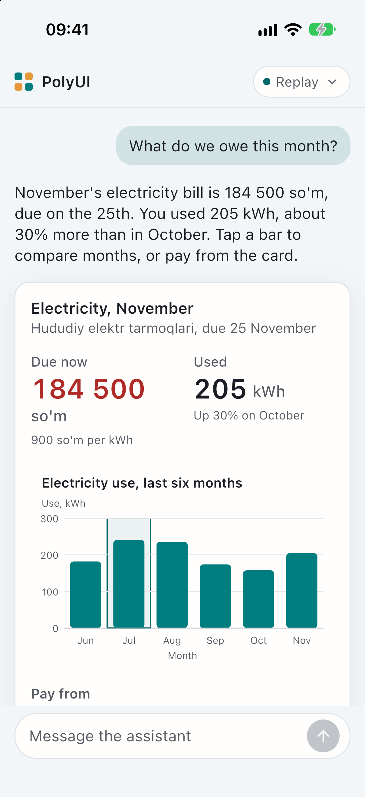

# PolyUI on Flutter

The Flutter renderer lives in `flutter/polyui`. It is a Dart package that calls the same Rust client core as the iOS renderer, through the C ABI in `bindings/ffi`, and draws surfaces with Flutter widgets. Because the core is the same code, a surface looks and behaves the same in a SwiftUI app, a web page and a Flutter app on iOS or Android. The example app in `flutter/polyui/example` replays the bills conversation from the iOS example.




The light screenshot shows the July bar after it was selected. The dark one comes from a full run: the Visa card picked, a phone number typed into the receipt field, Pay pressed, the confirm sheet accepted, and the server's patch turning the button into Paid.

## Requirements

- Flutter 3.41 or later (it ships Dart 3.11). The package was built and tested with Flutter 3.41.9 on the stable channel.
- rustup and cargo on `PATH`. The build compiles the core from this repository on every platform you build for.
- For iOS: Xcode. Xcode 27 needs an iOS deployment target of 15.0 or later, so the example app uses 15.0.
- For Android: the Android NDK that Flutter is configured with, and `cargo install cargo-ndk`.

## How the native library gets into the app

The package uses Dart build hooks (native assets). They are on by default on the stable channel in Flutter 3.41: `flutter_tools/lib/src/features.dart` marks `enable-native-assets` as enabled by default for stable. You do not need `flutter config` and you do not need a plugin class or a podspec.

`flutter/polyui/hook/build.dart` runs whenever Flutter builds the app or runs `flutter test`. It reads the target OS, architecture and SDK from the hook input, builds `polyui-ffi` with `cargo build --release --lib -p polyui-ffi --features lite` for the matching Rust target, and reports the result as a code asset with the id `package:polyui/polyui_ffi`. The Dart bindings in `lib/src/native/bindings.dart` are `@Native` functions under `@DefaultAsset('package:polyui/polyui_ffi')`, so the Dart runtime finds the library by that id. There are no hand written `DynamicLibrary.open` paths.

If a Rust target is missing, the hook adds it with `rustup target add`, the same thing `swift/build-xcframework.sh` does. It also lists the Rust sources, `Cargo.toml`, `Cargo.lock` and the catalog files as dependencies, so a change in the core triggers a rebuild and nothing else does.

| Platform | Rust target | What ends up in the app |
|---|---|---|
| iOS device | `aarch64-apple-ios` | `Runner.app/Frameworks/polyui_ffi.framework`, about 760 KB |
| iOS simulator | `aarch64-apple-ios-sim`, `x86_64-apple-ios` | the same framework, built for the simulator |
| Android | `aarch64-linux-android`, `armv7-linux-androideabi`, `x86_64-linux-android`, `i686-linux-android` | `libpolyui_ffi.so` per ABI in the APK's `lib/<abi>/` (not verified) |
| macOS (for `flutter test`) | `aarch64-apple-darwin` (`x86_64-apple-darwin` is mapped but was not tried) | `build/native_assets/macos/libpolyui_ffi.dylib`, about 700 KB |

### Why a dynamic library on iOS

The iOS renderer links the static library from `PolyUICore.xcframework`. Flutter's native assets cannot do that yet: `code_assets` 1.0.0, the version Flutter 3.41 pins, only knows `DynamicLoadingBundled`, `DynamicLoadingSystem` and `LookupInProcess`, and has no static linking mode. Linking the static library would mean an FFI plugin with a podspec, `-force_load` so the linker keeps symbols nothing in Objective-C calls, and `LookupInProcess` on the Dart side. That works, but it needs CocoaPods (or a Swift package), a second build path for tests, and the xcframework built by hand before every Flutter build.

The hook instead builds the `cdylib` that `polyui-ffi` already declares. Flutter wraps it in a framework, sets its install name to `@rpath/polyui_ffi.framework/polyui_ffi`, embeds it and signs it with the app. The same hook builds the macOS dylib that `flutter test` loads, so the tests run the exact Rust code the app ships. The cost is one extra framework in the bundle and a dynamic load at startup.

### Android

On Android the hook calls `cargo ndk --target <abi> --platform <minSdk> build ...`. It takes the NDK path from the C compiler Flutter hands to the hook and passes it to cargo-ndk as `ANDROID_NDK_HOME`. Flutter's Gradle integration then puts each `.so` into the APK under the right ABI folder, the same place a hand made `jniLibs/<abi>/` folder would end up. Do not also add a `jniLibs` folder with the library, or the APK gets two copies.

This path is written but has not been built or run. The machine this was made on has no Android Rust targets and no cargo-ndk, and they were not installed for this work.

### Using the package outside this repository

The hook looks for the Rust workspace two folders above the package (`flutter/polyui/../..`). If you copy the package somewhere else, point it at the workspace from your app's `pubspec.yaml`:

```yaml
hooks:
  user_defines:
    polyui:
      rust_workspace: ../path/to/polyui
```

## Using it

Add the package as a path dependency, create a session and draw a surface:

```dart
final session = PolyuiSession.start(
  hello: const PolyuiHello(locale: 'uz-Latn'),
  send: socket.add,
);
socket.listen((message) => session.receive(message as String));
socket.add(session.core.hello);
```

```dart
PolyuiSurface(session: session, surface: 's1')
```

The transport is yours. `send` gets every message the client must send (`ui.action`, `ui.error`, and the `send` list the core returns from `receive`), and you pass every server message to `receive`. The app must use `MaterialApp` (or provide Material localizations), because the renderer uses Material text fields, buttons and the bottom sheet route.

Keep the `PolyuiSurface` mounted while its surface is open. The confirm sheet is driven by the mounted widget, so a surface built lazily inside a `ListView` that has scrolled out of view will not show a confirm sheet until it is built again. The example app uses a `SingleChildScrollView` for this reason.

### `PolyuiCore`

`PolyuiCore` owns one Rust client. Like the Swift wrapper it has two layers. The raw methods (`receiveJson`, `setValueJson`, `fireJson`, `confirmJson`, `sayJson`, `matchVoiceJson`) return the core's JSON text untouched. The typed ones (`receive`, `setValue`, `fire`, `confirm`, `say`, `matchVoice`) decode it into `RenderBatch`, the sealed `RenderOp` family (`CreateOp`, `UpdateOp`, `ChildrenOp`, `RemoveOp`, `RootOp`, `ConfirmOp`, `HighlightOp`, `CloseOp`, `UnknownOp`), `ConfirmRequest`, `Utterance` and `VoiceMatch`. `fire` and `confirm` return `null` when the core returns the text `null`.

Memory follows the ownership rules in [the iOS page](ios.md#ownership):

- Every argument is copied into native memory from an arena that is released when the call returns. Strings that contain a NUL character are refused with a `PolyuiException` before anything crosses the boundary, because C would cut them short.
- Every string the core returns, including the one written to the error slot, is read and then freed with `polyui_string_free` in a `finally` block.
- A failed call throws `PolyuiException` with the core's message.
- `dispose()` frees the client. A `NativeFinalizer` frees it too if you forget, and is detached when you dispose by hand so the client is never freed twice. Calls after `dispose()` throw.

Calls run on the calling isolate. They take microseconds to a few milliseconds, so the session makes them on the main isolate. A client is not thread safe, and keeping it on one isolate is what keeps calls from overlapping.

`PolyuiSession` wraps the core the way the Swift `PolyUISession` does: one `PolyuiSurfaceModel` per surface, every batch applied to its surface, every `send` message forwarded, and a failed call reported to the server as `ui.error` with reason `bad_message`.

## What the renderer does

Each surface model keeps its components in a map keyed by component id, plus one `ValueListenable` slot per id. A component is a `ComponentNode`, which is a `ChangeNotifier`. An `update` op changes one node and only the widget listening to that node rebuilds. A `create` for an id that already exists with the same type updates the node in place; a different type makes a new node, the slot for that id points at it, and its widget is rebuilt under a new key, so it starts with fresh state. As in the other renderers, a `remove` followed by a `create` of the same id in one batch keeps the node.

Drawn types: `Text`, `Card` (nested cards get the sunken style), `Row`, `List`, `Stat`, `Badge`, `Image`, `Button`, `ChoiceGroup`, `Input`, `ConfirmSheet`, `Divider`, `chart:Chart`, `chart:Dashboard` and `embed:Embed`.

- `Row` puts stats side by side with equal widths and stacks them when each would be narrower than 120 points (scaled with the text size). Other children go in a `Wrap`, so they wrap on narrow screens as the catalog says.
- `Image` checks the URL again before loading it: `https` only (or `http` when the session allows it), no user or password, no spaces or control characters, at most 4096 characters. Anything else shows the alt text. The core applies the same rule first, so in practice a bad URL already arrives as muted text.
- `Input` keeps its own `TextEditingController` and `FocusNode` for the life of the node. When the server echoes a value the user just typed, nothing changes, so focus and caret stay where they are. When the server sends a different value while the field has focus, the text is replaced and the caret keeps its offset, clamped to the new length. A late echo of an older value the user already typed past is ignored while the field has focus.
- `chart:Chart` paints the server's scene with a `CustomPainter`, scaled from the view box to the available width. Color tokens (`series-1` to `series-8`, `axis`, `grid`, `text`, `muted`) go through the theme. SVG arcs in pie scenes use `Path.arcToPoint`, which takes the same endpoint form. A tap finds the hit shape under the finger and calls `fire` on `on_select` with `{"row": n}`. Each hit is also its own semantics node with the hit's label, a tap action and the selected state. Chart labels are drawn at the sizes the scene gives, scaled to the chart's width but never below 85 percent, and do not follow the system text size.
- `chart:Dashboard` is a grid with the requested number of columns, one column below 600 points. Runs of `Stat` children are grouped into one strip on a sunken background, like the web and iOS versions.
- `embed:Embed` shows its title. Flutter has no sandboxed web view for MCP Apps here, so the renderer takes the fallback the contract allows.
- The server's `confirm` op opens a modal bottom sheet on the root navigator. The sheet is built from the app's Material theme only; nothing in the surface and nothing in `PolyuiTheme` reaches it. The confirm button stays disabled for 400 ms after the sheet opens (change it with `PolyuiSurface.confirmDelay`), a bar counts down to `expires_ms`, and after that the sheet says the request expired and the button stays disabled. If the surface closes or a new request replaces this one, the sheet is removed.
- `highlight` ops (and `ui.sync`) outline one node at a time with the accent color. The outline is drawn outside the component, so nothing moves.

### Accessibility

Each component uses `a11y.label` from the batch. Containers (`Card`, `Row`, `List`, `ChoiceGroup`, charts, dashboards) are semantics containers with that label. `List` uses the `list` role and its items `listItem`. A single choice group uses the `radioGroup` role, and each option is checked or not and in a mutually exclusive group. `Stat` has the `status` role and reads its hint as the value. Titles are headings, images are images, and the input field carries the label. Text outside charts follows `MediaQuery.textScaler`. When `MediaQuery.disableAnimations` is on, components appear without fading, the surface resizes without animating, buttons have no splash, and the confirm sheet opens without its slide.

### Theming and custom builders

The look comes from `PolyuiThemeData`. `PolyuiThemeData.light` and `PolyuiThemeData.dark` copy the web renderer's tokens. The renderer looks for a `PolyuiTheme` widget above the surface first, then a `PolyuiThemeData` theme extension on the app's `ThemeData`, and otherwise picks light or dark from the theme's brightness.

```dart
MaterialApp(
  theme: ThemeData(
    extensions: [PolyuiThemeData.light.copyWith(accent: Colors.indigo)],
  ),
  darkTheme: ThemeData.dark().copyWith(
    extensions: [PolyuiThemeData.dark],
  ),
)
```

Strings the renderer adds itself ("Cancel", the expiry note, "Chart unavailable") live in `PolyuiLabels`, passed to `PolyuiSurface`.

A host can draw its own widget for any type that reaches the renderer:

```dart
PolyuiSurface(
  session: session,
  surface: 's1',
  builders: {
    'Badge': (context, component) => Chip(
      label: Text(component.node.string('text')),
    ),
  },
)
```

The `PolyuiComponentContext` gives the node (props, `a11y`, value, children), `fire`, `setValue`, `child(id)` and `children` for nested components.

### Extension types

A builder for an extension type such as `acme:Map` only runs if the core knows that type. Pass the catalogs to `PolyuiSession.start` (or `PolyuiCore`) and declare them in the hello. The session then uses `polyui_client_new_with_catalogs` from the C ABI:

```dart
const acme = <String, Object?>{
  'id': 'acme',
  'version': 1,
  'types': {
    'Map': {
      'description': 'A map with pins.',
      'role': 'img',
      'props': {'title': {'kind': 'string'}},
      'alt': '{title}',
    },
  },
};

final session = PolyuiSession.start(
  hello: const PolyuiHello(catalogs: ['core@1', 'chart@1', 'acme@1']),
  catalogs: const [acme],
  send: socket.add,
);
```

```dart
PolyuiSurface(
  session: session,
  surface: 's1',
  builders: {
    'acme:Map': (context, component) => MapCard(
      title: component.node.string('title'),
      onPin: (pin) => component.fire('on_select', detail: {'pin': pin}),
    ),
  },
)
```

Without the catalog, or without `acme@1` in the hello, the component arrives as `Text` with its alt text and the core sends `unknown_component`. A catalog the core rejects (bad names, unknown prop kinds, a default that does not fit, a reserved or repeated id) throws a `PolyuiException` that names it, for example `an extension catalog was rejected: [0].id: "core" is reserved`. See [the iOS page](ios.md#extension-catalogs) for the C side.

## Tests

```sh
source ~/.cargo/env
cd flutter/polyui
flutter test
dart analyze
dart format --output=none --set-exit-if-changed .
```

The first `flutter test` runs the build hook for the host and compiles the core, which takes a minute. After that it is cached.

- `test/conformance_test.dart` replays every `tests/conformance/client/*.json` fixture through the real Rust core on the host, compares each raw result with the fixture, then decodes it into the Dart types and compares again. All 15 fixtures pass.
- `test/components_test.dart` draws each core type and checks text, colors, layout at two widths and at 2.5x text, semantics, the `$bind` echo, missing required props, patches that change a type, close, highlight, reduced motion, theming and custom builders.
- `test/extension_catalog_test.dart` shows that an `acme:Badge2` component falls back to `Text` without its catalog, and with it reaches a custom builder with its props and no `unknown_component` error. It also checks the error for a rejected catalog.
- `test/interaction_test.dart` checks that typing keeps focus and caret through the core's echo, a server patch of the same input, a server value change while focused, and a late echo; chart taps on the bills scene (a real `polyui-chart` scene) and the semantics tap on a hit; the dashboard grid at two widths; and the confirm sheet: opened outside the surface, disabled for 400 ms, the nonce sent on confirm, cancel, expiry, removal on close, and that `PolyuiTheme` does not reach it.

On this machine `flutter test` passes all 54 tests, and `flutter analyze` reports no issues.

## The example app

`flutter/polyui/example` is a chat screen that plays the canned turn in `assets/conversation.json` (the same script as the iOS example) through a small scripted server in Dart, so taps, the confirm sheet and the paid state all go through the real core. It reads a few build defines for screenshots and quick checks:

| Define | Effect |
|---|---|
| `POLYUI_DEMO=ask` | asks the question as soon as the app starts |
| `POLYUI_DEMO=select` | same, then selects the July bar |
| `POLYUI_DEMO=pay` | same, picks the Visa card, fills in the receipt field and presses Pay, which opens the confirm sheet |
| `POLYUI_DEMO=paid` | same, then confirms, which ends in the paid state |
| `POLYUI_INSTANT=true` | plays the scripted server without delays |
| `POLYUI_SCROLL=bottom` | keeps the transcript scrolled to the end |

```sh
cd flutter/polyui/example
flutter run -d <simulator> --dart-define=POLYUI_DEMO=select --dart-define=POLYUI_INSTANT=true
```

The screenshots were taken on an iPhone 17 simulator running iOS 27.0, with `select` for light mode and `paid` with `POLYUI_SCROLL=bottom` for dark mode. `flutter build ios --release --no-codesign` also builds the device app with an arm64 `polyui_ffi.framework`; it was not installed on a device.

## What is not done yet

- Android has not been built or run. The hook's cargo-ndk path and the APK layout above are untested.
- No web content for `embed:Embed`. It shows its title.
- No speech output or recognition. `session.say` and `session.matchVoice` return the core's results; speaking them is up to the app.
- The example has no live connection to `polyui serve`, only the replay.
- `flutter build ios --simulator` fails on this machine with Flutter's own `debug_unpack_ios` architecture check. A fresh `flutter create` app fails the same way, so it is not caused by this package. `flutter run` on a simulator works.
- The semantics have been checked in widget tests, not with VoiceOver or TalkBack on a device.
