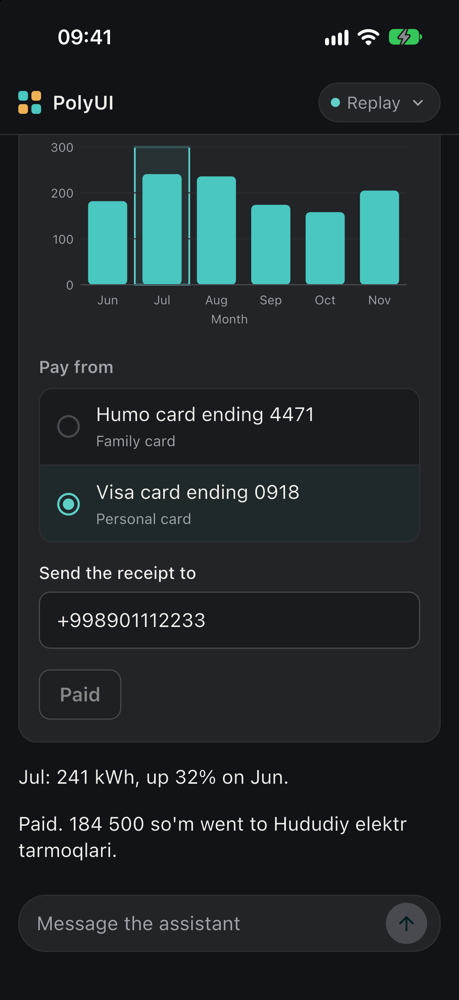
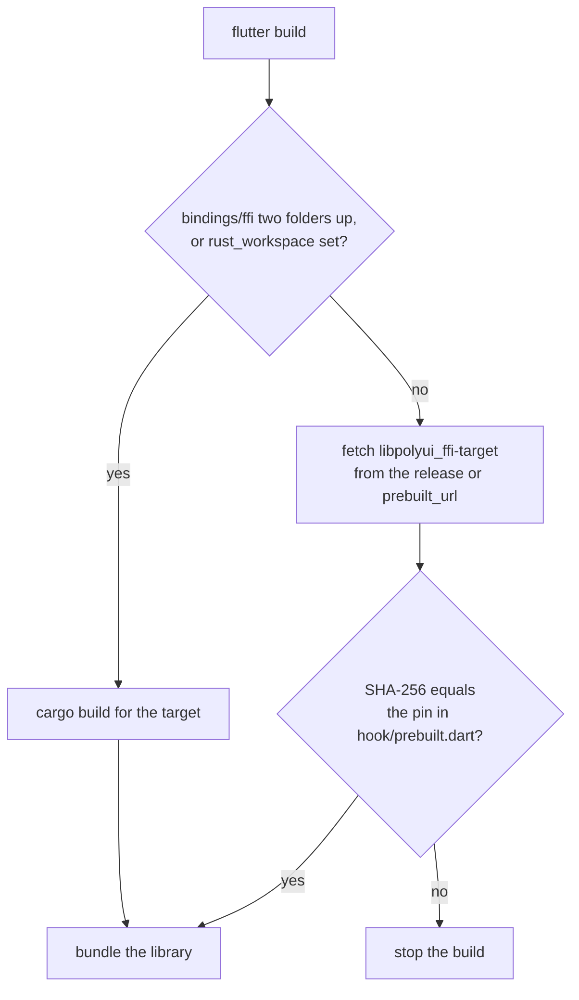
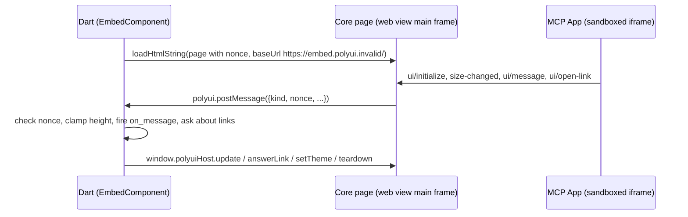
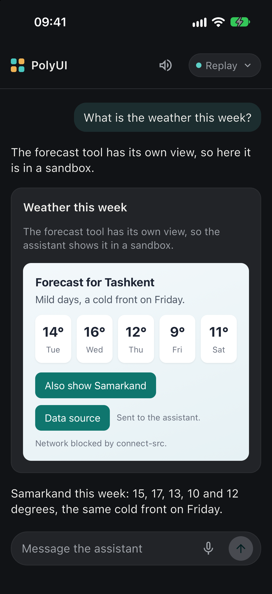
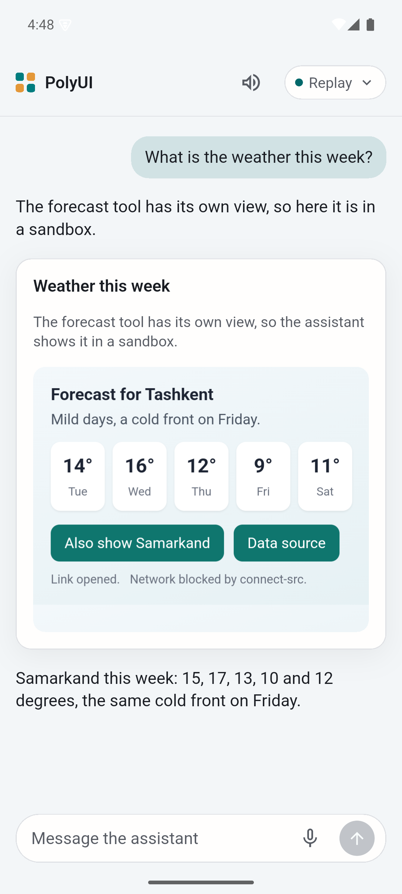

# PolyUI on Flutter

The Flutter renderer lives in `flutter/polyui`. It is a Dart package that calls the same Rust client core as the iOS renderer, through the C ABI in `bindings/ffi`, and draws surfaces with Flutter widgets. Because the core is the same code, a surface looks and behaves the same in a SwiftUI app, a web page and a Flutter app on iOS or Android. The example app in `flutter/polyui/example` replays the bills conversation from the iOS example and a forecast MCP App, and can also talk to a real `polyui serve`.




The light screenshot shows the July bar after it was selected. The dark one comes from a full run: the Visa card picked, a phone number typed into the receipt field, Pay pressed, the confirm sheet accepted, and the server's patch turning the button into Paid.

## Requirements

- Flutter 3.41 or later (it ships Dart 3.11). The package was built and tested with Flutter 3.41.9 on the stable channel.
- Inside this repository: rustup and cargo on `PATH`, because the build compiles the core from source on every platform you build for. An app that gets the package from pub.dev needs no Rust at all (see [Using the package outside this repository](#using-the-package-outside-this-repository)).
- For iOS: Xcode and CocoaPods. Xcode 27 needs an iOS deployment target of 15.0 or later, so the example app and its Podfile use 15.0. CocoaPods is there for the plugins the package now uses (`webview_flutter`, `url_launcher`) and the ones the example adds (`flutter_tts`, `speech_to_text`); the PolyUI core itself still needs no podspec.
- For Android, when building from source: the Android NDK that Flutter is configured with, the four Android Rust targets (`rustup target add aarch64-linux-android armv7-linux-androideabi x86_64-linux-android i686-linux-android`), and `cargo install cargo-ndk`.

## How the native library gets into the app

The package uses Dart build hooks (native assets). They are on by default on the stable channel in Flutter 3.41: `flutter_tools/lib/src/features.dart` marks `enable-native-assets` as enabled by default for stable. You do not need `flutter config` and you do not need a plugin class or a podspec.

`flutter/polyui/hook/build.dart` runs whenever Flutter builds the app or runs `flutter test`. It reads the target OS, architecture and SDK from the hook input, builds `polyui-ffi` with `cargo build --release --lib -p polyui-ffi --features lite` for the matching Rust target, and reports the result as a code asset with the id `package:polyui/polyui_ffi`. The Dart bindings in `lib/src/native/bindings.dart` are `@Native` functions under `@DefaultAsset('package:polyui/polyui_ffi')`, so the Dart runtime finds the library by that id. There are no hand written `DynamicLibrary.open` paths.

If a Rust target is missing, the hook adds it with `rustup target add`, the same thing `swift/build-xcframework.sh` does. It also lists the Rust sources, `Cargo.toml`, `Cargo.lock`, the catalog files and `bindings/ffi/src/embed-page.html` as dependencies, so a change in the core triggers a rebuild and nothing else does.

| Platform | Rust target | What ends up in the app |
|---|---|---|
| iOS device | `aarch64-apple-ios` | `Runner.app/Frameworks/polyui_ffi.framework`, about 760 KB |
| iOS simulator | `aarch64-apple-ios-sim`, `x86_64-apple-ios` | the same framework, built for the simulator |
| Android | `aarch64-linux-android`, `armv7-linux-androideabi`, `x86_64-linux-android` (and `i686-linux-android` when Flutter asks for x86) | `libpolyui_ffi.so` in `lib/arm64-v8a/` (622 KB), `lib/armeabi-v7a/` (428 KB) and `lib/x86_64/` (693 KB) of the APK |
| macOS (for `flutter test`) | `aarch64-apple-darwin` (`x86_64-apple-darwin` is mapped but was not tried) | `build/native_assets/macos/libpolyui_ffi.dylib`, about 700 KB |

### Why a dynamic library on iOS

The iOS renderer links the static library from `PolyUICore.xcframework`. Flutter's native assets cannot do that yet: `code_assets` 1.0.0, the version Flutter 3.41 pins, only knows `DynamicLoadingBundled`, `DynamicLoadingSystem` and `LookupInProcess`, and has no static linking mode. Linking the static library would mean an FFI plugin with a podspec, `-force_load` so the linker keeps symbols nothing in Objective-C calls, and `LookupInProcess` on the Dart side. That works, but it needs CocoaPods (or a Swift package), a second build path for tests, and the xcframework built by hand before every Flutter build.

The hook instead builds the `cdylib` that `polyui-ffi` already declares. Flutter wraps it in a framework, sets its install name to `@rpath/polyui_ffi.framework/polyui_ffi`, embeds it and signs it with the app. The same hook builds the macOS dylib that `flutter test` loads, so the tests run the exact Rust code the app ships. The cost is one extra framework in the bundle and a dynamic load at startup.

### Android

On Android the hook calls `cargo ndk --target <abi> --platform <minSdk> build ...`. It takes the NDK path from the C compiler Flutter hands to the hook and passes it to cargo-ndk as `ANDROID_NDK_HOME`. Flutter's Gradle integration then puts each `.so` into the APK under the right ABI folder, the same place a hand made `jniLibs/<abi>/` folder would end up. Do not also add a `jniLibs` folder with the library, or the APK gets two copies.

This path is built and run. `flutter build apk --debug` in the example (Flutter 3.41.9, NDK 28.2.13676358, cargo-ndk 4.1.2, the Gradle 8.14 and AGP 8.11.1 that `flutter create` wrote) produced `app-debug.apk`, and `unzip -l` on it shows:

```text
lib/arm64-v8a/libflutter.so
lib/arm64-v8a/libpolyui_ffi.so        636608
lib/arm64-v8a/libVkLayer_khronos_validation.so
lib/armeabi-v7a/libflutter.so
lib/armeabi-v7a/libpolyui_ffi.so      438408
lib/x86_64/libflutter.so
lib/x86_64/libpolyui_ffi.so           709256
```

Flutter builds an APK for `android-arm`, `android-arm64` and `android-x64` by default, so there is no `lib/x86/`. The hook maps `ia32` to `i686-linux-android`, and `cargo ndk --target x86 --platform 24 build --release --lib --package polyui-ffi --features lite` builds that library too, but no Flutter build asked for it here. The Vulkan validation layer comes from Flutter's debug engine, not from PolyUI.

### Using the package outside this repository

The hook first looks for the Rust workspace two folders above the package (`flutter/polyui/../..`). That is where it is in this repository, so here it always builds from source.

A copy from pub.dev has no workspace next to it. There the hook downloads the prebuilt `libpolyui_ffi-<rust target>` for the build's target from the GitHub release of the same version, for example `https://github.com/murtazox04/polyui/releases/download/v0.1.0/libpolyui_ffi-aarch64-apple-ios.dylib`. `hook/prebuilt.dart` pins the SHA-256 of every file of that release, and the hook refuses a file whose hash differs, so a changed release asset never reaches an app. The release workflow writes those pins (see [Releasing](releasing.md)). Prebuilt files exist for iOS (device, Apple silicon and Intel simulators), Android (`arm64-v8a`, `armeabi-v7a`, `x86_64`, `x86`), macOS (Apple silicon and Intel) and Linux (x86_64 and arm64). Windows is not supported.



Two settings in your app's `pubspec.yaml` change this. `rust_workspace` builds from a clone instead of downloading. `prebuilt_url` downloads from your own mirror (an `https` or `file` URL of a folder that holds the release's `libpolyui_ffi-*` files); the pins still apply.

```yaml
hooks:
  user_defines:
    polyui:
      rust_workspace: ../path/to/polyui
      prebuilt_url: https://mirror.example.com/polyui/v0.1.0/
```

Both paths were tried on a Mac. With the package copied out of the repository, no cargo on `PATH` and `prebuilt_url` pointing at a local folder, `flutter test` fetched `libpolyui_ffi-aarch64-apple-darwin.dylib`, checked it and passed every test that does not read fixtures from the repository. With one byte appended to that file the build stopped with `polyui fetched ... but its SHA-256 is ..., expected .... The file was not used.`

## Using it

Add the package as a path dependency, create a session and draw a surface:

```dart
final session = PolyuiSession.start(
  hello: const PolyuiHello(locale: 'uz-Latn'),
  send: socket.add,
);
socket.listen((message) => session.receive(message as String));
socket.add(session.core.hello);
```

```dart
PolyuiSurface(session: session, surface: 's1')
```

The transport is yours. `send` gets every message the client must send (`ui.action`, `ui.error`, and the `send` list the core returns from `receive`), and you pass every server message to `receive`. The app must use `MaterialApp` (or provide Material localizations), because the renderer uses Material text fields, buttons and the bottom sheet route.

Keep the `PolyuiSurface` mounted while its surface is open. The confirm sheet is driven by the mounted widget, so a surface built lazily inside a `ListView` that has scrolled out of view will not show a confirm sheet until it is built again. The example app uses a `SingleChildScrollView` for this reason.

### `PolyuiCore`

`PolyuiCore` owns one Rust client. Like the Swift wrapper it has two layers. The raw methods (`receiveJson`, `setValueJson`, `fireJson`, `confirmJson`, `sayJson`, `matchVoiceJson`) return the core's JSON text untouched. The typed ones (`receive`, `setValue`, `fire`, `confirm`, `say`, `matchVoice`) decode it into `RenderBatch`, the sealed `RenderOp` family (`CreateOp`, `UpdateOp`, `ChildrenOp`, `RemoveOp`, `RootOp`, `ConfirmOp`, `HighlightOp`, `CloseOp`, `UnknownOp`), `ConfirmRequest`, `Utterance` and `VoiceMatch`. `fire` and `confirm` return `null` when the core returns the text `null`.

Memory follows the ownership rules in [the iOS page](ios.md#ownership):

- Every argument is copied into native memory from an arena that is released when the call returns. Strings that contain a NUL character are refused with a `PolyuiException` before anything crosses the boundary, because C would cut them short.
- Every string the core returns, including the one written to the error slot, is read and then freed with `polyui_string_free` in a `finally` block.
- A failed call throws `PolyuiException` with the core's message.
- `dispose()` frees the client. A `NativeFinalizer` frees it too if you forget, and is detached when you dispose by hand so the client is never freed twice. Calls after `dispose()` throw.

Calls run on the calling isolate. They take microseconds to a few milliseconds, so the session makes them on the main isolate. A client is not thread safe, and keeping it on one isolate is what keeps calls from overlapping.

`PolyuiSession` wraps the core the way the Swift `PolyUISession` does: one `PolyuiSurfaceModel` per surface, every batch applied to its surface, every `send` message forwarded, and a failed call reported to the server as `ui.error` with reason `bad_message`.

## What the renderer does

Each surface model keeps its components in a map keyed by component id, plus one `ValueListenable` slot per id. A component is a `ComponentNode`, which is a `ChangeNotifier`. An `update` op changes one node and only the widget listening to that node rebuilds. A `create` for an id that already exists with the same type updates the node in place; a different type makes a new node, the slot for that id points at it, and its widget is rebuilt under a new key, so it starts with fresh state. As in the other renderers, a `remove` followed by a `create` of the same id in one batch keeps the node.

Drawn types: `Text`, `Card` (nested cards get the sunken style), `Row`, `List`, `Stat`, `Badge`, `Image`, `Button`, `ChoiceGroup`, `Input`, `ConfirmSheet`, `Divider`, `chart:Chart`, `chart:Dashboard` and `embed:Embed`.

- `Row` puts stats side by side with equal widths and stacks them when each would be narrower than 120 points (scaled with the text size). Other children go in a `Wrap`, so they wrap on narrow screens as the catalog says.
- `Image` checks the URL again before loading it: `https` only (or `http` when the session allows it), no user or password, no spaces or control characters, at most 4096 characters. Anything else shows the alt text. The core applies the same rule first, so in practice a bad URL already arrives as muted text.
- `Input` keeps its own `TextEditingController` and `FocusNode` for the life of the node. When the server echoes a value the user just typed, nothing changes, so focus and caret stay where they are. When the server sends a different value while the field has focus, the text is replaced and the caret keeps its offset, clamped to the new length. A late echo of an older value the user already typed past is ignored while the field has focus.
- `chart:Chart` paints the server's scene with a `CustomPainter`, scaled from the view box to the available width. Color tokens (`series-1` to `series-8`, `axis`, `grid`, `text`, `muted`) go through the theme. SVG arcs in pie scenes use `Path.arcToPoint`, which takes the same endpoint form. A tap finds the hit shape under the finger and calls `fire` on `on_select` with `{"row": n}`. Each hit is also its own semantics node with the hit's label, a tap action and the selected state. Chart labels are drawn at the sizes the scene gives, scaled to the chart's width but never below 85 percent, and do not follow the system text size.
- `chart:Dashboard` is a grid with the requested number of columns, one column below 600 points. Runs of `Stat` children are grouped into one strip on a sunken background, like the web and iOS versions.
- `embed:Embed` shows the MCP App in a web view when the server sent the app, and its title otherwise. See [Embedded MCP Apps](#embedded-mcp-apps).
- The server's `confirm` op opens a modal bottom sheet on the root navigator. The sheet is built from the app's Material theme only; nothing in the surface and nothing in `PolyuiTheme` reaches it. The confirm button stays disabled for 400 ms after the sheet opens (change it with `PolyuiSurface.confirmDelay`), a bar counts down to `expires_ms`, and after that the sheet says the request expired and the button stays disabled. If the surface closes or a new request replaces this one, the sheet is removed.
- `highlight` ops (and `ui.sync`) outline one node at a time with the accent color. The outline is drawn outside the component, so nothing moves.

### Accessibility

Each component uses `a11y.label` from the batch. Containers (`Card`, `Row`, `List`, `ChoiceGroup`, charts, dashboards) are semantics containers with that label. `List` uses the `list` role and its items `listItem`. A single choice group uses the `radioGroup` role, and each option is checked or not and in a mutually exclusive group. `Stat` has the `status` role and reads its hint as the value. Titles are headings, images are images, and the input field carries the label. Text outside charts follows `MediaQuery.textScaler`. When `MediaQuery.disableAnimations` is on, components appear without fading, the surface resizes without animating, buttons have no splash, and the confirm sheet opens without its slide.

### Theming and custom builders

The look comes from `PolyuiThemeData`. `PolyuiThemeData.light` and `PolyuiThemeData.dark` copy the web renderer's tokens. The renderer looks for a `PolyuiTheme` widget above the surface first, then a `PolyuiThemeData` theme extension on the app's `ThemeData`, and otherwise picks light or dark from the theme's brightness.

```dart
MaterialApp(
  theme: ThemeData(
    extensions: [PolyuiThemeData.light.copyWith(accent: Colors.indigo)],
  ),
  darkTheme: ThemeData.dark().copyWith(
    extensions: [PolyuiThemeData.dark],
  ),
)
```

Strings the renderer adds itself ("Cancel", the expiry note, "Chart unavailable") live in `PolyuiLabels`, passed to `PolyuiSurface`.

A host can draw its own widget for any type that reaches the renderer:

```dart
PolyuiSurface(
  session: session,
  surface: 's1',
  builders: {
    'Badge': (context, component) => Chip(
      label: Text(component.node.string('text')),
    ),
  },
)
```

The `PolyuiComponentContext` gives the node (props, `a11y`, value, children), `fire`, `setValue`, `child(id)` and `children` for nested components.

### Extension types

A builder for an extension type such as `acme:Map` only runs if the core knows that type. Pass the catalogs to `PolyuiSession.start` (or `PolyuiCore`) and declare them in the hello. The session then uses `polyui_client_new_with_catalogs` from the C ABI:

```dart
const acme = <String, Object?>{
  'id': 'acme',
  'version': 1,
  'types': {
    'Map': {
      'description': 'A map with pins.',
      'role': 'img',
      'props': {'title': {'kind': 'string'}},
      'alt': '{title}',
    },
  },
};

final session = PolyuiSession.start(
  hello: const PolyuiHello(catalogs: ['core@1', 'chart@1', 'acme@1']),
  catalogs: const [acme],
  send: socket.add,
);
```

```dart
PolyuiSurface(
  session: session,
  surface: 's1',
  builders: {
    'acme:Map': (context, component) => MapCard(
      title: component.node.string('title'),
      onPin: (pin) => component.fire('on_select', detail: {'pin': pin}),
    ),
  },
)
```

Without the catalog, or without `acme@1` in the hello, the component arrives as `Text` with its alt text and the core sends `unknown_component`. A catalog the core rejects (bad names, unknown prop kinds, a default that does not fit, a reserved or repeated id) throws a `PolyuiException` that names it, for example `an extension catalog was rejected: [0].id: "core" is reserved`. See [the iOS page](ios.md#extension-catalogs) for the C side.

## Embedded MCP Apps

`embed:Embed` draws an [MCP App](embed.md) in a `webview_flutter` web view (WKWebView on iOS, Android System WebView on Android). The page in the web view is not written in Dart. It comes from the core: `PolyuiCore.embedPage` calls `polyui_embed_page(props, nonce)`, or `polyui_embed_page_with(props, nonce, host)` when app calls are on, from the C ABI, which returns one HTML page that runs the MCP Apps host protocol itself and puts the app in an inner `<iframe sandbox="allow-scripts">` with the app's CSP. The same C function is there for the iOS and Android renderers, so a native renderer does not have to reimplement the host protocol.





What the renderer does, and why:

| Rule | How |
|---|---|
| A fresh secret per page | Every page load gets a new nonce: 32 letters and digits from `Random.secure()`. A reload after the app changed gets a new one too. |
| Only the page may talk to Dart | The page sends events through a JavaScript channel named `polyui`. `webview_flutter` does not say which frame a channel message came from, and on Android the channel object is visible in every frame, the sandboxed app included. So the nonce is the guard: an event is used only when its `nonce` equals the current one (compared in constant time). The app never sees the nonce, because the page keeps it in a closure and the app's frame has an opaque origin. Anything else (no nonce, a wrong one, not JSON, an unknown kind) is dropped. |
| Scripts on, nothing else | `JavaScriptMode.unrestricted` is set only because the page and the app need scripts. Permission requests (camera, microphone) are denied. On Android file and content access, geolocation and the file chooser are off, and media needs a gesture. On iOS link previews, back and forward swipes, inline media and windows opened by script are off. |
| No navigation | The main frame may load once: the page itself at `https://embed.polyui.invalid/`. Every later main frame navigation is prevented. For subframes only `about:srcdoc`, `about:blank` and `https` are allowed. iOS asks for every frame, so this rule is applied there. On Android `webview_flutter` only reports main frame navigations, so the subframe rule cannot be applied; the app can still navigate its own sandboxed frame, which [embed.md](embed.md#security-rules) already counts as possible. Android never asks about the first `loadHtmlString`, so the "first load" allowance is used up when the page starts. |
| A fixed https base URL | The page is loaded with `loadHtmlString(html, baseUrl: 'https://embed.polyui.invalid/')`. `.invalid` never resolves, so nothing is fetched from it. Desktop Chrome crashed when the page ran as `about:blank` content, and the Android WebView is Chromium, so the page always gets this https URL. |
| No storage of our own | The page stores nothing, and the app runs in an opaque origin where storage is refused. The renderer does not clear the web view caches, because both platforms clear them for the whole app, not for one view. `webview_flutter_android` turns DOM storage on for every web view and does not offer a switch. |
| Height in its box | The frame starts at the hint (160, 320 or 480) and follows `height` events. The page already clamps them; Dart clamps again to 80 up to 320, 640 or 960. Width always fills the column. |
| Messages are actions | A `message` event calls the core `fire(surface, component, "on_message", {"text": text})` and sends what it returns. Without `on_message` the core returns nothing and nothing is sent. Dart also drops a second message within one second, like the page. |
| Links need a person | An `open-link` URL is checked again (`https`, no user name or password, no spaces or control characters). It is shown in full in the same confirm sheet the renderer uses for payments (`polyuiConfirmRoute`, on the root navigator). Only after the user presses Open link does `url_launcher` open it with `LaunchMode.externalApplication`; then the page hears `answerLink(true)`. Cancel, or a launch that fails, answers `false`. One question at a time across all embeds; others are ignored while one is open. |
| App calls through the server | When the server's `welcome` listed `app_calls`, `PolyuiSession.appCalls` is true and the page is built with `polyui_embed_page_with(props, nonce, {"app_calls": true})`, so the app sees `serverTools` and `serverResources`. An `app-call` event goes out as `app.call` through `session.callApp`, the `app.result` comes back by surface, embed and id, and the widget answers with `window.polyuiHost.answerApp(id, JSON.parse(answer))`. A fifth open call is refused, a call the server never answers gets a timeout error after 90 seconds, and leaving the screen or reloading the page drops the open calls. With `app_context` accepted too, `ui/update-model-context` goes the same way. See [App calls](embed.md#app-calls) and [Model context](embed.md#model-context). |
| Saying no | When the server accepted `dismiss`, Cancel, a barrier tap or back on the confirm sheet sends `ui.dismiss` with the question's `action_id` and nonce once (`session.cancelConfirm`). A yes, a voice answer or a new question closes the sheet without it. |
| No app, no web view | When `app` is missing, the page reports `unavailable`, or the platform has no web view implementation (for example `flutter test` without a fake), the renderer shows the title as text. The semantics label is the title in both cases. |

When the server patches the embed, the new props go to `window.polyuiHost.update`. If the page answers `false` (the app HTML changed) or the call fails, the renderer loads a fresh page with a fresh nonce. When the component goes away, it calls `teardown()` and closes an open link question.

The link and open-link strings ("Open this link?", "Open link") are in `PolyuiLabels` (`openLinkTitle`, `openLinkConfirm`).

## Voice

The core already has `say` (what to read for a surface) and `match_voice` (what a spoken sentence means on a surface). `PolyuiVoice` puts them on a device without tying the package to a speech plugin. You give it a `PolyuiSpeechOutput` and a `PolyuiSpeechInput`; the example implements them with [`flutter_tts`](https://pub.dev/packages/flutter_tts) 4.2.5 and [`speech_to_text`](https://pub.dev/packages/speech_to_text) 7.4.0.

```dart
final voice = PolyuiVoice(
  session: session,
  output: TtsOutput(),
  input: RecognizerInput(),
  locale: 'en',
  onUnmatched: (text) => socket.add(jsonEncode({'v': 1, 't': 'user.say', 'text': text})),
);
await voice.speak('s1');
await voice.listen('s1');
```

- `speak(surface)` reads the utterances from `say` in order and highlights each component while it is read, then clears the highlight.
- `listen(surface)` stops any speech first (barge-in), then listens. The final transcript goes to `heard`, which calls the core `match_voice`. On a match, the session applies the batch the core returned and sends the `ui.action` (with `source: "voice"`). A spoken yes or no to an open confirm sheet also closes the sheet. Words that match nothing go to `onUnmatched`, which the example sends to the agent as `user.say`, as [protocol.md](../spec/protocol.md#11-voice) says.
- If the microphone or speech recognition is denied, or recognition is not available, `listen` returns `denied` or `unavailable`, the state stays idle and `problem` says why. Touch keeps working. The example shows a short notice above the composer. A failing speech engine sets `speechFailed`; the screen is unchanged.

The example declares `NSMicrophoneUsageDescription` and `NSSpeechRecognitionUsageDescription` on iOS, and `RECORD_AUDIO` plus `<queries>` for `android.speech.RecognitionService` and `android.intent.action.TTS_SERVICE` on Android.

## Tests

```sh
source ~/.cargo/env
cd flutter/polyui
flutter test
dart analyze
dart format --output=none --set-exit-if-changed .
```

The first `flutter test` runs the build hook for the host and compiles the core, which takes a minute. After that it is cached.

- `test/conformance_test.dart` replays every `tests/conformance/client/*.json` fixture through the real Rust core on the host, compares each raw result with the fixture, then decodes it into the Dart types and compares again. All 15 fixtures pass.
- `test/components_test.dart` draws each core type and checks text, colors, layout at two widths and at 2.5x text, semantics, the `$bind` echo, missing required props, patches that change a type, close, highlight, reduced motion, theming and custom builders.
- `test/extension_catalog_test.dart` shows that an `acme:Badge2` component falls back to `Text` without its catalog, and with it reaches a custom builder with its props and no `unknown_component` error. It also checks the error for a rejected catalog.
- `test/interaction_test.dart` checks that typing keeps focus and caret through the core's echo, a server patch of the same input, a server value change while focused, and a late echo; chart taps on the bills scene (a real `polyui-chart` scene) and the semantics tap on a hit; the dashboard grid at two widths; and the confirm sheet: opened outside the surface, disabled for 400 ms, the nonce sent on confirm, cancel, expiry, removal on close, and that `PolyuiTheme` does not reach it.
- `test/embed_test.dart` runs the real `EmbedComponent` against a fake `WebViewPlatform` and a fake `UrlLauncherPlatform` (`test/support/fake_platforms.dart`). It checks the title fallback without an app, the page load (JavaScript mode, base URL, channel name, a 32 character nonce, a new nonce per page), that events with a missing or wrong nonce or bad JSON change nothing, height clamping for all three hints, the `unavailable` fallback, `on_message` becoming a `ui.action` and the one second limit, the navigation rules, denied permissions, links (the sheet shows the full URL, accept opens it externally and answers true, cancel answers false, a second link and non https links never reach the sheet), prop updates, a reload with a new nonce that ignores the old one, and teardown.
- `test/voice_test.dart` runs `PolyuiVoice` with fake speech engines and the real core: a final transcript through `match_voice` to a `ui.action` with `source: "voice"`, unmatched words going to `onUnmatched`, a spoken yes and no on an open confirm sheet, a denied microphone and missing recognition, reading a surface in order with highlights, and barge-in.

On this machine `flutter test` passes all 80 tests, and `flutter analyze` reports no issues in the package and in the example.

## The example app

`flutter/polyui/example` is a chat screen. By default it replays canned turns through a small scripted server in Dart, so taps, the confirm sheet, the paid state and the embedded app all go through the real core. The menu in the header switches to a live connection.

- **Replay** (default). "What do we owe this month?" plays `assets/conversation.json`, the same bills turn as the iOS example. "What is the weather this week?" plays `assets/weather.json`: a card with the forecast MCP App. The app's HTML is `assets/forecast-app.html`, a copy of `js/polyui-web/demo/embed/forecast-app.html` with one extra button, Data source, that asks to open `https://open-meteo.com/en/docs` so the link flow can be tried. Its Also show Samarkand button sends `ui/message`; the scripted server answers the `ui.action` with a line about Samarkand.
- **Live.** "Connect to polyui serve" asks for a WebSocket address and connects with `web_socket_channel` (`dart:io` underneath). The default is `ws://127.0.0.1:8787/ws`, or `ws://10.0.2.2:8787/ws` on Android, where the emulator reaches the computer at 10.0.2.2. The app sends `hello` as soon as the socket is open, well inside the server's 60 second `attach_timeout`. A native app sends no `Origin` header (the `dart:io` WebSocket client does not add one), so the server's origin check lets it through without `--allow-origin`. The header shows Replay, Connecting, Live or Offline, and a closed connection shows the reason. Messages from an old connection or an old replay are dropped after a switch. When the connection drops, the transport resumes the session (`spec/protocol.md`, section 8.2): it declares `resume`, keeps the `resume_token` in memory and reconnects after 1, 2, 4, 8 and 16 seconds with the session and token in `hello`, so the cards and their buttons keep working. If the server cannot resume, the example removes the old cards. Checked in the iOS simulator against `polyui serve` through a proxy that cut the connection: "Pay gas" on the old card opened the confirm sheet afterwards.
- **Voice.** The speaker button reads the latest surface aloud and the microphone in the composer listens (see [Voice](#voice)).

The hello declares `core@1`, `chart@1` and `embed@1`. Build defines for screenshots and quick checks:

| Define | Effect |
|---|---|
| `POLYUI_DEMO=ask` | asks the bills question as soon as the app starts |
| `POLYUI_DEMO=select` | same, then selects the July bar |
| `POLYUI_DEMO=pay` | same, picks the Visa card, fills in the receipt field and presses Pay, which opens the confirm sheet |
| `POLYUI_DEMO=paid` | same, then confirms, which ends in the paid state |
| `POLYUI_DEMO=embed` | asks the weather question |
| `POLYUI_DEMO=embed-press` | same, and the app presses its own two buttons after 2.5 and 4.5 seconds (a script added to the app HTML for this define only), for checks on machines where nothing can tap inside the simulator |
| `POLYUI_MODE=live` | connects to `POLYUI_SERVER` (or the default address) at start |
| `POLYUI_ASK=text` | with `POLYUI_MODE=live`, sends this question once connected |
| `POLYUI_VOICE=read` or `listen` | reads the first surface aloud, or starts listening, once it is drawn |
| `POLYUI_LOG=true` | prints every message in and out, and voice state changes |
| `POLYUI_INSTANT=true` | plays the scripted server without delays |
| `POLYUI_SCROLL=bottom` | keeps the transcript scrolled to the end |

```sh
cd flutter/polyui/example
flutter run -d <simulator> --dart-define=POLYUI_DEMO=select --dart-define=POLYUI_INSTANT=true
```

To try live mode against this repository's server:

```sh
cargo run -p polyui -- serve --env-file ~/.config/polyui/anthropic.env --embed-origin http://localhost:8788/
cd flutter/polyui/example
flutter run -d <device> --dart-define=POLYUI_MODE=live "--dart-define=POLYUI_ASK=Compare the internet tariffs for us"
```

The first two screenshots were taken on an iPhone 17 simulator running iOS 27.0, with `select` for light mode and `paid` with `POLYUI_SCROLL=bottom` for dark mode. `flutter build ios --release --no-codesign` also builds the device app with an arm64 `polyui_ffi.framework`; it was not installed on a device.

### `flutter build ios --simulator`

This used to fail in `debug_unpack_ios` with "does not contain architectures "arm64 x86_64"". The cause is the `lipo` that ships with Xcode 27: `lipo <file> -verify_arch arm64 x86_64` now stops with "-verify_arch requires exactly one input file", while one architecture at a time works. Flutter 3.41.9 passes all of `ARCHS` in one call, and `flutter build ios --simulator` builds for `arm64 x86_64`; `flutter run` builds only the simulator's own architecture, which is why it worked. The example now sets `EXCLUDED_ARCHS[sdk=iphonesimulator*] = x86_64` in `ios/Flutter/Debug.xcconfig` and `Release.xcconfig`, so simulator builds are arm64 only, and `flutter build ios --simulator --debug` builds `Runner.app` with arm64 `Runner`, `Flutter.framework` and `polyui_ffi.framework`. An app that needs an Intel simulator build has to wait for a Flutter fix. Device builds are not affected.

## What was checked on devices

| Check | iOS simulator (iPhone 17, iOS 27.0) | Android emulator (Pixel 8 image, Android 15, WebView 124) |
|---|---|---|
| Example builds and runs | `flutter run`, and `flutter build ios --simulator` | `flutter build apk --debug` and `flutter run` |
| Forecast app renders with its tool input and result, its `fetch` is blocked by `connect-src`, the frame grows from 160 to fit | yes | yes |
| The app's message button produces `ui.action` `act_ask` with `{"text": "Also show the forecast for Samarkand."}` | yes, pressed by the `embed-press` script | yes, with a real tap (`adb shell input tap`) |
| A link request shows the confirm sheet with the full URL | yes | yes |
| Open link opens the browser outside the app and the app hears yes | yes, tapped by hand: Safari came to the front with open-meteo.com, and back in the app it showed "Link opened." | yes: Chrome came to the front in its own task, the app showed "Link opened." |
| Cancel and the app hears no | yes, tapped by hand: the app showed "Link opening denied by user" | yes: the app showed "Link opening denied by user" |
| Live mode against `polyui serve` from this repository | yes, `ws://127.0.0.1:8777/ws`, a ChoiceGroup surface came back | yes, `ws://10.0.2.2:8777/ws`, a chart surface came back |
| Read aloud | the engine took every utterance and finished without an error, the read part was outlined; the audio itself was not listened to | logcat shows Google TTS synthesizing each utterance in en-US |
| Microphone | the speech recognition prompt shows the usage string. Don't Allow shows the microphone-off notice. Allow on both prompts: the simulator's recognizer fails to start (`Error starting listen` from `speech_to_text`) and the app shows the recognition-unavailable notice | a denied microphone shows the notice and touch keeps working; with the permission granted, listening starts and stops on silence. Checked again on 2026-11-26 after the start check was added: the composer shows Listening and Google's recognizer starts. The emulator got no audio from the Mac's microphone (`MIC_END_OF_DATA`), so no words were recognized |

The iOS embed screenshot is above. This is the same app on Android after the link was accepted:



## What is not done yet

- Real speech has been checked once, on an iPhone 14 Pro (iOS 27.0.1) on 2026-11-26, with a release build of the example in Replay mode: with the bills card open, the person holding the phone tapped the microphone and said "the visa card", and the Visa option was selected through `match_voice`. That is the only real recognizer transcript so far. On Android no one has spoken to the recognizer, and speech output was not listened to on either platform.
- The iOS simulators here have no speech model, so the recognizer cannot start there (see [iOS](ios.md#what-is-not-done-yet)).
- On Android `webview_flutter` does not report subframe navigations, so the "only `about:srcdoc`, `about:blank` and https in subframes" rule is applied on iOS only. The main frame rule works on both.
- `webview_flutter_android` turns on DOM storage for every web view and has no setting to turn it off. Nothing writes to it, but it is not off.
- No `lib/x86/` in the APK: Flutter did not ask for x86. The `i686-linux-android` build was run by hand with cargo-ndk, not through Flutter.
- No release APK was built, and nothing was installed on an Android phone. A release build of the example ran on an iPhone 14 Pro (iOS 27.0.1); only the spoken choice above was checked on it.
- Simulator builds are arm64 only because of the Xcode 27 `lipo` change described above.
- The semantics have been checked in widget tests, not with VoiceOver or TalkBack on a device.
