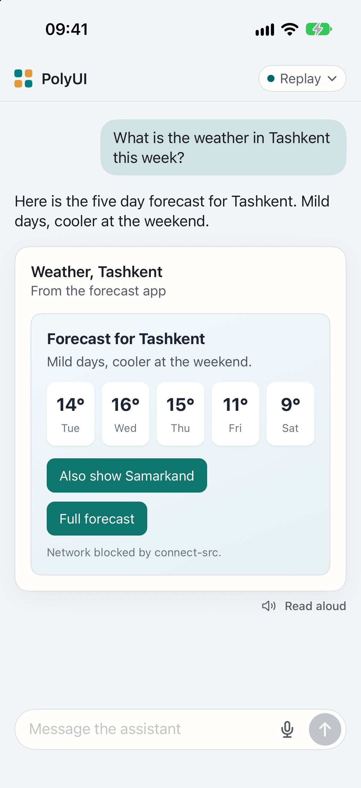
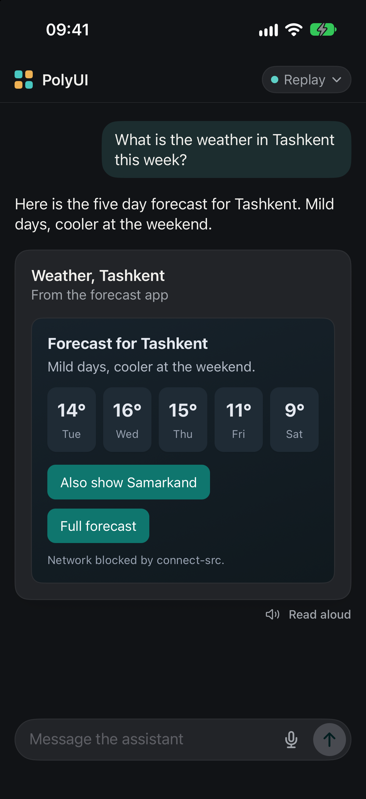
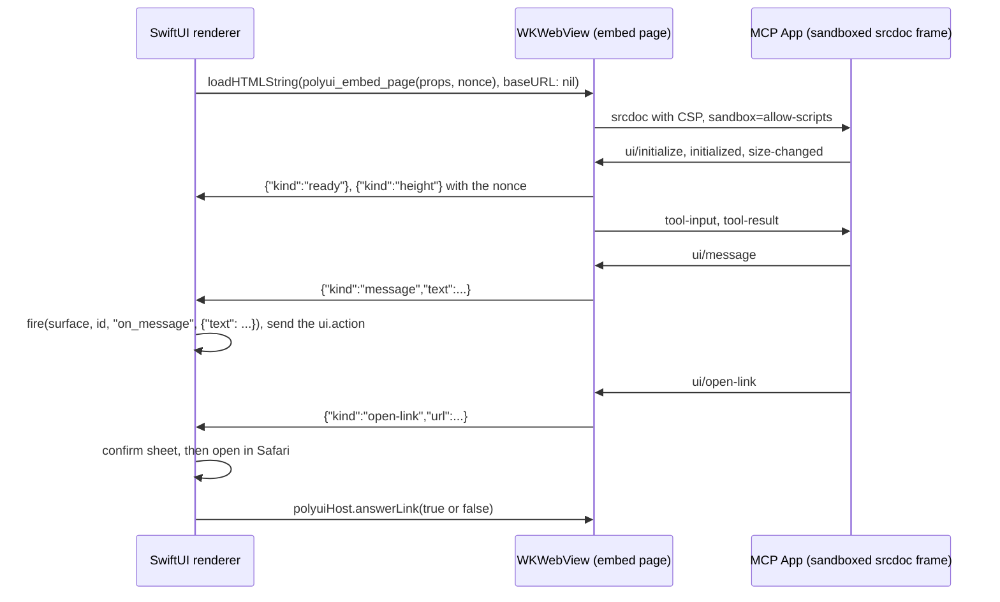

# PolyUI on iOS

The iOS side has three layers. At the bottom is `polyui-ffi`, a small C ABI over the Rust client core. On top of it sits the Swift package `PolyUI`, which wraps the C calls in a Swift type (`PolyUICore`) and draws surfaces with SwiftUI (`PolyUISurfaceView`). The example app in `swift/Example` replays a canned conversation through the real core and can also talk to `polyui serve`.





The light screenshot shows the July bar after a tap. The dark screenshot is the `paid` demo with `-PolyUIVoice "the visa card"`: the heard phrase picked the Visa card, a phone number went into the receipt field, Pay was pressed and confirmed, and the server's patch turned the button into Paid. Both were taken on 2026-11-26 in the iPhone 17 simulator. The confirm sheet is older, from a run where the Visa card was picked by hand; the sheet covers the composer, so the missing microphone button does not show. The two embed screenshots are newer: they show the forecast app from `js/polyui-web/demo/embed` running inside the iOS renderer, with the tool result drawn and its fetch blocked by the app's CSP.

## Adding it to an app

From a release, add the package in Xcode (File, Add Package Dependencies) or in `Package.swift`:

```swift
.package(url: "https://github.com/murtazox04/polyui", from: "0.1.0")
```

and depend on the `PolyUI` product. The `Package.swift` at the root of the repository is written by the release workflow: it points at `PolyUICore.xcframework.zip` on the GitHub release and pins its checksum, so SwiftPM refuses a changed file. The Swift sources come from `swift/PolyUI/Sources/PolyUI` in the same tag. See [Releasing](releasing.md).

## Building

You need Xcode 26 or later and rustup. The build script adds the Rust targets it needs if they are missing.

```sh
swift/build-xcframework.sh
```

It builds `libpolyui_ffi.a` for five Rust targets, strips debug info, joins them with `lipo` into three slices and writes `swift/PolyUI/PolyUICore.xcframework`:

| Slice | Rust targets |
|---|---|
| iOS devices | `aarch64-apple-ios` |
| iOS Simulator | `aarch64-apple-ios-sim` (Apple silicon) and `x86_64-apple-ios` (Intel) |
| Mac Catalyst | `aarch64-apple-ios-macabi` and `x86_64-apple-ios-macabi` |

The framework is not checked in, so run the script once after cloning and again after changing Rust code. The script decides whether a target is missing by looking for its standard library in `rustc --print sysroot`, not by asking `rustup target list`, because a rustup run that was interrupted can leave a target on disk that rustup no longer lists.

Then open `swift/Example/PolyUIExample.xcodeproj`, or run the tests from the command line:

```sh
cd swift/PolyUI
xcodebuild test -scheme PolyUI -destination "platform=iOS Simulator,name=iPhone 17"
```

### Sizes

Measured on this machine on 25 November 2026 with the release profile (fat LTO, one codegen unit), Rust 1.100, Xcode 27.2. MB here means 1 000 000 bytes and kB 1000 bytes.

| What | `client-lite` (shipped) | default features |
|---|---|---|
| `libpolyui_ffi.a`, device slice, as built | 21.0 MB | 23.7 MB |
| same, after `strip -S` (what the xcframework holds) | 2.9 MB | 3.5 MB |
| xcframework on disk, all three slices (five architectures) | 14.3 MB | not measured |
| added to a stripped arm64 iOS binary that calls all eleven functions | 605 kB | 706 kB |

These numbers include `polyui_client_new_with_catalogs`, which pulls the core's catalog checker into the `lite` build, and `polyui_embed_page`, which adds the embed page (about 10 kB of HTML) to the library. The last row is the number that matters for an app. It comes from a small C program for `arm64-apple-ios17.0` that calls every function in the header once, built with `clang -O2 -Wl,-dead_strip` against the library and then stripped, minus a program with the same `main` that only prints its argument, built and stripped the same way. The lite build is about 100 kB smaller there. The earlier numbers in this file (627 kB and 682 kB for nine functions) came from a baseline program that was not kept, so the two sets are not exactly comparable. Building with `opt-level = "z"` made the text segment smaller but the linked file larger, so the script keeps the release defaults. Set `POLYUI_FFI_FEATURES=` (empty) to build with default features instead.

## The C ABI

The header is `bindings/ffi/include/polyui.h`. It mirrors the calls of the wasm binding plus the two voice helpers. Every argument and every result is UTF-8 JSON text, so any language with a C FFI (Swift, Dart, Kotlin through JNI) can use it without generated bindings.

```c
PolyuiClient *polyui_client_new(const char *hello_json, bool allow_http, char **error_out);
PolyuiClient *polyui_client_new_with_catalogs(const char *hello_json, const char *catalogs_json, bool allow_http, char **error_out);
char *polyui_client_receive(PolyuiClient *client, const char *message_json, char **error_out);
char *polyui_client_set_value(PolyuiClient *client, const char *surface, const char *path, const char *value_json, char **error_out);
char *polyui_client_fire(PolyuiClient *client, const char *surface, const char *component, const char *prop, const char *detail_json, char **error_out);
char *polyui_client_confirm(PolyuiClient *client, const char *surface, const char *action_id, const char *nonce, char **error_out);
char *polyui_client_say(PolyuiClient *client, const char *surface, char **error_out);
char *polyui_client_match_voice(PolyuiClient *client, const char *surface, const char *text, char **error_out);
char *polyui_embed_page(const char *props_json, const char *nonce, char **error_out);
char *polyui_embed_page_with(const char *props_json, const char *nonce, const char *host_json, char **error_out);
void polyui_string_free(char *text);
void polyui_client_free(PolyuiClient *client);
```

What each call returns is described in [the renderer contract](../spec/renderer.md). A few details are specific to the C side:

- `fire`, `confirm` and `match_voice` return the text `null` when there is nothing to send or nothing matched. They never return a null pointer for that case.
- `detail_json` in `fire` may be a null pointer. An empty or blank string counts as no detail, the same as in the wasm binding.
- `set_value` and `fire` check that the value or detail is valid JSON and fail with an error if it is not. `receive` does not fail on a bad message: it returns a batch whose `send` list holds the `ui.error` to send back, because that is protocol behavior, not a programming error.
- `allow_http` lets `Image` URLs use plain `http`. Leave it false outside development.

### Extension catalogs

`polyui_client_new` knows only the built-in catalogs (`core`, `chart`, `embed`). A component of any other type, such as `acme:Map`, reaches the renderer as a plain `Text` with its alt text, and the core reports `unknown_component` to the server. To render extension types, start the client with `polyui_client_new_with_catalogs` and pass your catalogs as a JSON array, each item in the same format as `crates/polyui-core/catalogs/core.json`:

```c
const char *catalogs =
    "[{\"id\":\"acme\",\"version\":1,\"types\":{\"Badge2\":{\"description\":\"A status badge.\","
    "\"role\":\"status\",\"props\":{\"text\":{\"kind\":\"string\",\"required\":true}},\"alt\":\"{text}\"}}}]";
PolyuiClient *client = polyui_client_new_with_catalogs(hello, catalogs, false, &error);
```

- The hello must also declare each catalog (`"catalogs": ["core@1", "acme@1"]`). The core keeps only the catalogs the hello declares, so a catalog you pass but do not declare is dropped and its types still arrive as `Text`.
- The core checks every catalog with the same rules the server uses (`Catalog::from_value`): ids, type and prop names, prop kinds, defaults that do not fit their prop. A reserved id (`core`, `chart`, `embed`) or the same id twice is also refused. On any problem the call returns null and the error names the catalog by its index, for example `PolyUI client_new_with_catalogs: an extension catalog was rejected: [0].types.badge: type names must be PascalCase`.
- `"[]"` gives the same client as `polyui_client_new`.

### Ownership

- Every non-null `char *` the library returns, including the one written to `*error_out`, belongs to the caller. Free it exactly once with `polyui_string_free`. Do not free it with `free()`; it was allocated by Rust.
- Every `PolyuiClient *` from `polyui_client_new` belongs to the caller. Free it exactly once with `polyui_client_free`, and do not use it afterwards.
- Both free functions accept a null pointer and do nothing.
- Strings you pass in are borrowed for the length of the call only. The library never keeps a pointer to them.

### Errors

Each call that can fail takes `char **error_out` as its last argument.

- On success the call returns a non-null pointer and, if `error_out` is not null, sets `*error_out` to null.
- On failure it returns null and, if `error_out` is not null, sets `*error_out` to a message you must free.
- `error_out` itself may be null if you do not want the message.

Failures are: a null client or a null required argument, text that is not valid UTF-8, invalid JSON in a value or detail, a hello the core rejects, an extension catalog the core rejects, and a panic inside the core.

### Panics and threads

No panic crosses the boundary. Each call runs inside `catch_unwind` and turns a panic into an error message. A client whose call panicked is marked unusable, and every later call on it fails with an error saying so; free it and make a new one. The crate refuses to compile with `panic = "abort"`, because then this guarantee would not hold.

A client is not thread safe. Calls on one client must not overlap; serialize them yourself (the Swift wrapper keeps the client on the main actor). Different clients are independent and can live on different threads, and a client can move between threads between calls.

### How the ABI is tested

- `cargo test -p polyui-ffi` and `cargo test -p polyui-ffi --features lite` replay every `tests/conformance/client/*.json` fixture through the C functions and check null pointers, invalid UTF-8, bad JSON, the error slot, poisoning after a panic, deep and very large inputs, and clients on several threads. They also check that an `acme:Badge2` component keeps its type and props only when its catalog is passed, and that each kind of bad catalog gives its own error.
- `cargo +nightly miri test -p polyui-ffi` runs the same tests under Miri, except the one with multi-megabyte inputs, which is too slow there. Miri reports no undefined behavior.
- `bindings/ffi/tests/c/run.sh` builds a C program with clang that calls every function, including `polyui_client_new_with_catalogs`, with AddressSanitizer and UndefinedBehaviorSanitizer, and checks that the header also compiles as C++. On Linux, which is where CI runs it, LeakSanitizer fails the run on any leak. On a Mac it runs a second build under `leaks` instead.

## The Swift package

Add `swift/PolyUI` as a local package and depend on the `PolyUI` product. The minimum is iOS 17 (Mac Catalyst 17).

### `PolyUICore`

`PolyUICore` is a main-actor class that owns one Rust client. It has two layers of methods: the raw ones (`receiveJSON`, `setValueJSON`, `fireJSON`, `confirmJSON`, `sayJSON`, `matchVoiceJSON`) return the core's JSON text untouched, and the typed ones decode it with `Codable` into `RenderBatch`, `RenderOp`, `ConfirmRequest`, `Utterance` and `VoiceMatch`. Any error from the C side comes out as `PolyUIError.core(message)`.

Most apps do not call it directly. They use `PolyUISession`, which owns the core, keeps one `PolyUISurfaceModel` per surface, applies batches to them, forwards every `send` message, and reports failures to the server as `ui.error` the way the web renderer does.

```swift
let socket = PolyUIWebSocket()
let session = try PolyUISession(hello: PolyUIHello(locale: "uz-Latn")) { text in
    socket.send(text)
}
socket.connect(to: URL(string: "wss://agent.example.com/ws")!, hello: session.core.hello) { text in
    session.receive(text)
}
```

```swift
PolyUISurfaceView(session: session, surface: "s1")
```

`PolyUIWebSocket` resumes the session when the connection drops (`spec/protocol.md`, section 8.2). It adds `resume` to the `features` of your `hello`, keeps the `resume_token` from each `welcome` in memory, and when the socket fails it connects again after 1, 2, 4, 8 and 16 seconds with the session and token in `hello.resume`. The server answers with `ui.snapshot` for every open surface, so the cards and their buttons keep working. If the server could not resume (`welcome` with `resumed: false`), `onSessionLost` is called and the old surfaces' buttons no longer work; the example app removes those cards then. Checked in the simulator against `polyui serve` through a proxy that cut the connection: after the cut, "Pay water bill" on the old card opened the server's confirm sheet.

### What the renderer does

Each surface model keeps its components in a dictionary keyed by component id. Every component is an `@Observable` node, so an `update` op changes one node and SwiftUI redraws only the views that read it. A `create` for an id that already exists with the same type updates that node in place; a different type makes a new node, and the view is rebuilt with a new identity. That is what keeps a text field focused while the server echoes its value back, and what makes a replaced component start fresh. As on the web, a `remove` followed by a `create` of the same id in one batch keeps the node.

Drawn types: `Text`, `Card` (nested cards get the sunken style), `Row` (side by side, falling back to a column when it does not fit), `List`, `Stat`, `Badge`, `Image`, `Button`, `ChoiceGroup`, `Input`, `ConfirmSheet`, `Divider`, `chart:Chart`, `chart:Dashboard` and `embed:Embed`.

- `Image` loads with `AsyncImage`, but only after the renderer checks the URL again itself: `https` only (or `http` if the host allowed it), no user or password, no control characters, at most 4096 bytes. Anything else shows the alt text.
- `chart:Chart` draws the server's scene with `Canvas`, scaling the view box to the available width. Color tokens (`series-1` to `series-8`, `axis`, `grid`, `text`, `muted`) go through the theme. Each hit area is an invisible shape on top of the canvas, so bars, points and slices can be tapped and are separate VoiceOver buttons with the hit's label. A tap calls `fire` on `on_select` with `{"row": n}`. SVG arcs in pie scenes are converted from endpoint form and drawn as short line segments.
- `chart:Dashboard` is a grid. Runs of `Stat` children are grouped into one strip, like the web version. On a compact width the grid has one column.
- `embed:Embed` runs the MCP App in a `WKWebView`. See [Embedded MCP Apps](#embedded-mcp-apps) below.
- The server's `confirm` op opens a sheet drawn with system controls and system colors only. The theme does not apply to it and nothing in the surface can cover it. The confirm button stays disabled for 400 ms after the sheet appears (change it with the `polyUIConfirmDelay` environment value), a bar counts down to `expires_ms`, and after that the sheet says the request expired and the confirm button stays disabled.
- `highlight` ops mark one node at a time with an accent outline.

### Embedded MCP Apps

`embed:Embed` follows the rules in [Embedding MCP Apps](embed.md), with a `WKWebView` in place of the browser's cross-origin iframe. The page it loads comes from the core: `PolyUICore.embedPage(propsJSON:nonce:appCalls:)` calls `polyui_embed_page_with`, which returns one HTML page for the component's props. `host_json` is `{"app_calls": true}` or `false`; `polyui_embed_page` is the same call with app calls off. That page puts the app's HTML into an inner `<iframe sandbox="allow-scripts">` through `srcdoc`, with the CSP from `_meta.ui.csp` in a meta tag, and speaks the MCP Apps host protocol with it. Native code never parses the app's messages. It only hears a few short events from the page.



What the renderer does, and why:

- **No app, no web view.** Without a valid `app` prop (the core already drops a bad one), or after the page reports `unavailable`, the renderer shows the title as text, the same way it did before.
- **A fresh nonce per page.** Every page load gets 32 letters and digits from `SecRandomCopyBytes` (bytes above 247 are thrown away so each character is equally likely). The page adds the nonce to every event it sends.
- **Only the main frame counts.** `WKUserContentController` exposes `window.webkit.messageHandlers.polyui` to every frame, including the app's frame, so the handler is not private. A script message is accepted only when `message.frameInfo.isMainFrame` is true, it comes from this web view, its body is a string of at most 96 kB, and its nonce matches (compared in constant time). Everything else is dropped without an answer. The real web view test also posts a forged event from inside the app frame and checks that it never reaches the renderer.
- **A web view that stores and opens nothing.** `WKWebsiteDataStore.nonPersistent()`, `javaScriptCanOpenWindowsAutomatically = false`, a `uiDelegate` that returns nil for new windows, no back and forward gestures, no link previews and no context menu, no data detectors, media capture denied, element full screen off. The page is loaded with `loadHTMLString`, so no file URL is ever loaded and no file access is granted.
- **Navigation.** The first main-frame load is allowed and every later main-frame navigation is cancelled. A reload after an `update` the page refused is the only other main-frame load, and it is armed the same way. Subframes may load only `about:srcdoc`, `about:blank` and `https` URLs. A navigation without a target frame (a new window) is cancelled.
- **Base URL.** `baseURL` is nil. The task allowed a fixed `https://embed.polyui.invalid/` base if WebKit treated the inner `srcdoc` frame or the `"null"` origin check badly, but it was not needed: in the iOS 27.2 simulator the app frame loads, its messages arrive with origin `"null"`, and the CSP blocks its `fetch`.
- **Height.** The frame starts at the hint (160, 320 or 480 points for `small`, `medium`, `large`) and follows `height` events. The page clamps the value, and the renderer clamps it again to 80 points up to 320, 640 or 960.
- **Messages.** A `message` event fires the component's `on_message` through the core, `fire(surface, component, "on_message", {"text": ...})`, and the session sends whatever the core returns, like any button. Without `on_message` nothing is sent. The page also refuses more than one message per second and anything over the 4096 byte detail limit.
- **Links.** The renderer checks the URL again with the same rule `Image` uses: `https` only, no user or password, no control characters. It then asks in the same confirm sheet the server's `confirm` op uses, with system controls only, the full URL as the body, and the confirm button disabled for the first 400 ms. Only after the user accepts does it call `UIApplication.shared.open`, which opens the link outside the app, and then `window.polyuiHost.answerLink(true)`. Cancel or swiping the sheet away answers `false`. There is one link question at a time for the whole session, and none while a server confirm is open; a second request is refused at once. Change how links open by setting `session.openLink`.
- **App calls.** When the server's `welcome` listed `app_calls`, `PolyUISession.appCalls` is true and the page is built with app calls on, so the app sees `serverTools` and `serverResources`. A `tools/call` or `resources/read` from the app reaches native as an `app-call` event with the page's own call id. The session sends it as `app.call`, routes the `app.result` back by surface, embed and id, and the controller answers with `window.polyuiHost.answerApp(id, JSON.parse(answer))`, both passed as JSON string literals. A call the server never answers gets a timeout error after `session.appCallTimeout` (90 seconds), and leaving the screen drops the open calls. The page refuses a fifth open call and params over 64 KiB, so an event is never too large for the 96 KiB event limit. See [App calls](embed.md#app-calls).
- **Updates.** When the component's props change, the renderer calls `window.polyuiHost.update(...)` with the new props. The props are passed as a JSON string literal and parsed with `JSON.parse` inside the page, so no prop text is ever spliced into script as code. If the page answers `false` (the app's HTML changed), the renderer loads a new page with a new nonce.
- **Teardown and crashes.** When the view goes away the renderer calls `window.polyuiHost.teardown()`, removes the script message handler and withdraws an open link question. If the web content process dies, the page is loaded again with a new nonce.
- **Accessibility.** The web view is an accessibility container labelled with the component title, so VoiceOver announces the title and then reads the app's own content.

The web view keeps a strong reference to its script message handler, so the handler is a small relay that holds the page controller weakly.

The tests check this at two levels. `EmbedTests` in the package covers the nonce, the frame and nonce filter, height clamping, the navigation rules, the link queue, and runs a real `WKWebView` with a tiny MCP App that sends `ui/message`, `ui/open-link` and a forged native message, and checks that only the real ones get through. A second real `WKWebView` test puts the web view in a dark window, checks that the app is told `dark` in `ui/initialize`, then switches the window to light and checks that `host-context-changed` brings `light`. Two more real `WKWebView` tests run an app that calls `tools/call`: with app calls on, the call reaches `onAppCall` and the answer reaches the app; with them off, the app is told there are no server tools and gets `-32601`. `AppCallSessionTests` covers the welcome flag, routing by embed and id, withdrawn calls and the timeout. `PolyUIExampleUITests` drives the example app (see below).

### Accessibility

Each component reads `a11y.label` from the batch. Containers (`Card`, `Row`, `List`, `ChoiceGroup`, charts, dashboards) are accessibility containers with that label, so VoiceOver reads their children in order. Leaves expose the matching traits: headings for titles, `isImage` for images, buttons for buttons, choice options and chart hits, and `isSelected` on the chosen option and the selected bar. Text outside charts uses text styles, so Dynamic Type applies, and a stat row turns into a column when large text no longer fits side by side. Chart labels are drawn at the sizes the scene gives, scaled to the chart's width but never below 85 percent of the scene size, so they do not follow Dynamic Type. Every animation is switched off when Reduce Motion is on.

### Theming and custom views

The look comes from a `PolyUITheme` in the environment. The default copies the web renderer's tokens and adapts to light and dark mode. Change any color, the series palette, the corner radii or the spacing:

```swift
var theme = PolyUITheme.standard
theme.accent = .indigo
theme.series[0] = .indigo
PolyUISurfaceView(session: session, surface: "s1")
    .polyUITheme(theme)
```

User-facing strings the renderer adds itself ("Cancel", the expiry note, "Chart unavailable") live in `PolyUILabels`, also in the environment.

A host can draw its own view for any type, including extension types and the built-in ones:

```swift
PolyUISurfaceView(session: session, surface: "s1")
    .polyUIView(for: "acme:Map") { context in
        MapCard(title: context.node.string("title")) {
            context.fire("on_select", detail: ["pin": 3])
        }
    }
```

The context gives the node (props, `a11y`, value, children), `fire`, `setValue`, and `children` to draw nested components.

For an extension type the core must know its catalog, or the node arrives as `Text` and the custom view never runs. Pass the catalogs when you make the session (or `PolyUICore`), and declare them in the hello:

```swift
let acme: JSONValue = [
    "id": "acme", "version": 1,
    "types": ["Map": ["description": "A map with pins.", "role": "img", "props": ["title": ["kind": "string"]], "alt": "{title}"]],
]
let session = try PolyUISession(
    hello: PolyUIHello(catalogs: ["core@1", "chart@1", "acme@1"]),
    catalogs: [acme]
) { text in socket.send(text) }
```

A catalog the core rejects throws `PolyUIError.core` with the reason. `ExtensionCatalogTests` renders an `acme:Badge2` this way through a registered view.

### Voice

`session.say(surface:)` returns the core's utterances and `session.matchVoice(surface:text:)` applies a spoken answer. `PolyUISpeaker` speaks the utterances with `AVSpeechSynthesizer` and sends a local `highlight` for each one as it starts, then clears it at the end.

```swift
let speaker = PolyUISpeaker()
speaker.speak(surface: "s1", in: session, language: "uz-UZ")
```

`PolyUIListener` is the other direction. It uses the Speech framework with `AVAudioEngine`, and asks for on-device recognition whenever the recognizer supports it for the language. If that recognizer fails before it hears anything, for example because its model is not installed, the listener starts again once without the on-device requirement, the same way the Android listener falls back to the default service. The final transcript goes to the core's `match_voice` for the surface, and the session acts on the result as the [renderer contract](../spec/renderer.md) says: the match's `batch` is applied, its `action` is sent, and when that action answers the open confirm sheet (a spoken "yes"), the sheet closes.

```swift
let listener = PolyUIListener()
await listener.listen(surface: "s1", in: session, locale: Locale(identifier: "en-US")) { heard in
    if heard.match == nil { sendAsChat(heard.transcript) }
}
listener.stop()
```

`listen` returns once listening has started. `stop()` ends the audio, the recognizer sends its final text, and the callback runs with the transcript and the match. While it listens, `listener.transcript` holds the partial text. If the user refuses speech recognition or the microphone, if the recognizer is not available for the language, or if there is no audio input, `listener.state` becomes `.unavailable(message)` with a sentence that tells the user to type instead (`PolyUIListenerLabels` holds the wording). Nothing else changes, so touch keeps working. The audio session is switched on and off away from the main thread.

`listener.hear(_:surface:in:)` is the step the recognizer's final text takes. Call it if you have your own recognizer, or in tests. An app that uses `PolyUIListener` needs `NSMicrophoneUsageDescription` and `NSSpeechRecognitionUsageDescription` in its Info.plist.

## The example app

`swift/Example` is a SwiftUI chat screen. By default it replays a canned turn: a bills card with two stats, a bar chart compiled by `polyui-chart` at phone width, a card picker, a receipt field and a pay button that needs confirmation. A small scripted server in the app plays the server side, so taps, the confirm sheet and the paid state all go through the real Rust core. The menu next to the status pill switches to `ws://localhost:8787/ws`, the default address of `polyui serve`.

A second question, "What is the weather in Tashkent this week?", opens a card with an `embed:Embed`. The scripted server fills its `app` prop at run time from `PolyUIExample/forecast-app.html`, a copy of `js/polyui-web/demo/embed/forecast-app.html` with one extra button, "Full forecast", that asks to open `https://example.com/forecast/tashkent`. Pressing "Also show Samarkand" in the app sends a `ui.action`, and the scripted server answers it with a line that quotes the app's text. The example declares `embed@1` in its hello and the scripted welcome lists it too, because the core keeps only the catalogs both sides name.

The microphone button in the composer starts and stops `PolyUIListener` for the newest surface. If the core matches what was heard, the card changes and a line under the composer says what was heard. If nothing matches, the transcript is sent as a chat message. If permission is refused, the line says so and asks you to type.

For screenshots and quick checks it reads a few launch arguments:

| Argument | Effect |
|---|---|
| `-PolyUIDemo ask` | asks the question as soon as the app starts and does nothing else |
| `-PolyUIDemo select` | asks the question as soon as the app starts and taps the July bar |
| `-PolyUIDemo pay` | same, fills in the receipt field and presses Pay, which opens the confirm sheet |
| `-PolyUIDemo paid` | same, then confirms, which ends in the paid state |
| `-PolyUIInstant YES` | plays the scripted server without delays |
| `-PolyUIScroll bottom` | keeps the transcript scrolled to the end |
| `-PolyUIDemo forecast` | asks the weather question, which shows the forecast embed |
| `-PolyUIVoice "the visa card"` | after the bills card appears, passes the text to the listener as if it had been heard |

`PolyUIExampleUITests` (scheme `PolyUIExample`) drives the app on a simulator:

```sh
cd swift/Example
xcodebuild test -project PolyUIExample.xcodeproj -scheme PolyUIExample -destination "platform=iOS Simulator,name=iPhone 17"
```

It checks that the forecast app draws its tool input and tool result and that its `fetch` is blocked by CSP, that the web view is labelled with the title, that "Also show Samarkand" turns into a `ui.action` the server answers with the app's text, that "Full forecast" opens the confirm sheet with the full URL, that Cancel gives the app the "denied by user" error, that Open link brings Safari to the front and the app hears the link was accepted, that a heard "the visa card" selects the Visa option through `match_voice`, and that refusing speech permission shows the type-instead message. The last test taps "Don't Allow" on the system prompt, so after it runs the example app has speech recognition denied on that simulator until you reinstall it.

## On a device

On 2026-11-25 the example app ran on an iPhone 14 Pro with iOS 27.0.1, as a Debug build in Replay mode. These checks were done by hand by the person holding the phone. No automated test runs on a device.

- Speaking "Show my bills" was recognized, sent as a message, and the bills card opened.
- With VoiceOver on, swiping through the card read the title, the amounts, the chart bars and the "Pay from" options.
- Tapping a bar in the chart selected it.

## What is not done yet

- On-device recognition and audio session behavior next to `PolyUISpeaker` were not checked on their own. Only the spoken request above went through a real recognizer.
- Speech recognition does not work in the iOS 27 simulators on this Mac. None of them has the speech model installed (the `com_apple_MobileAsset_UAF_Siri_Understanding` asset has no `mini.json`), so the recognizer fails with `kLSRErrorDomain` 300 "Failed to initialize recognizer", with or without the on-device requirement, and the app shows "Could not hear that". The fallback above was seen to start its second attempt there, but whether that attempt succeeds where only the on-device model is missing has not been seen. Test listening on a device.
- The embed was tested in the iOS 27.2 simulator and, through the package tests (including the real `WKWebView` test), on Mac Catalyst on this Mac. The forecast embed was not opened on the device, and the example app does not have a Catalyst build.
- The Intel simulator slice builds and the package links against it, but no test ran on an Intel simulator.
- `teardown` is best effort: the web view can be gone before the app receives `ui/resource-teardown`.
- An embed inside a `LazyVStack` that scrolls far off screen can be torn down by SwiftUI and loads again, with a new nonce, when it comes back.
- VoiceOver was tried on a device only with the bills card, by hand. Other component types and the embed have been checked only through the accessibility traits and labels the code sets, and through the UI test that finds the web view by its title.
