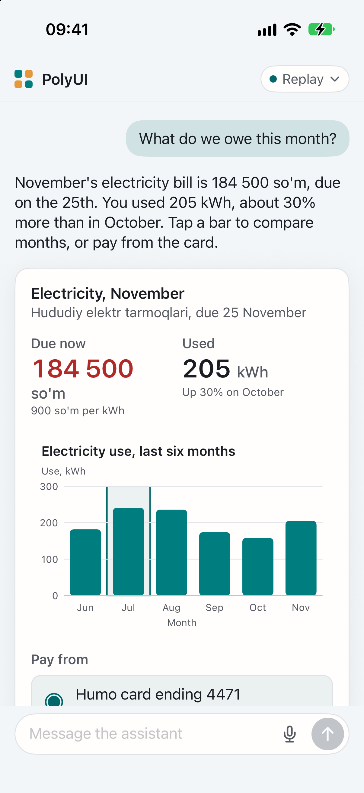
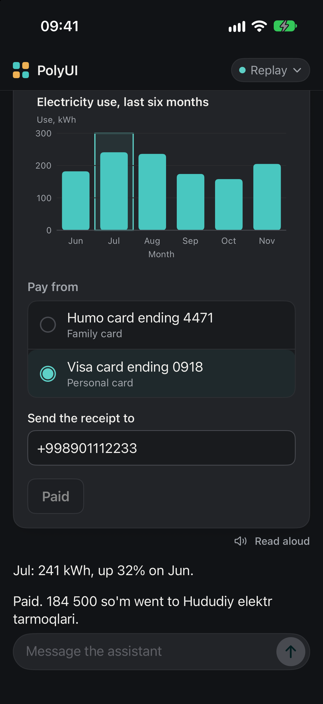
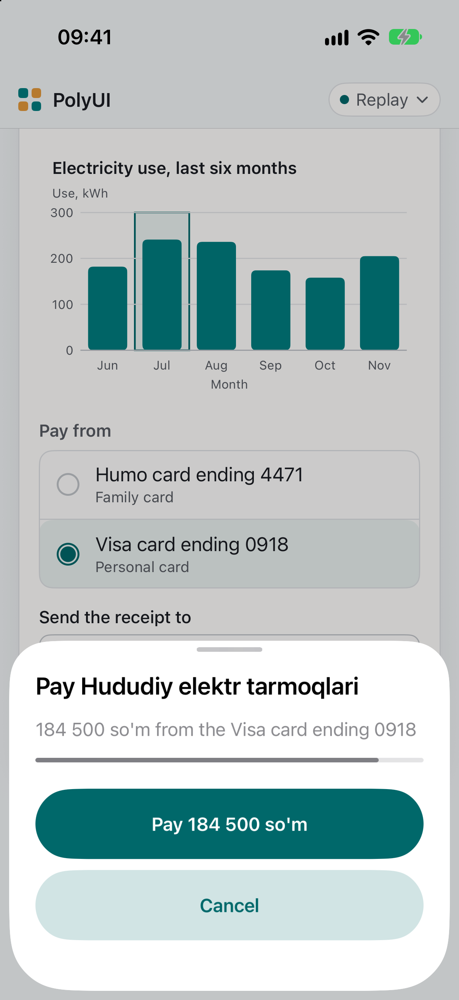

# PolyUI on iOS

The iOS side has three layers. At the bottom is `polyui-ffi`, a small C ABI over the Rust client core. On top of it sits the Swift package `PolyUI`, which wraps the C calls in a Swift type (`PolyUICore`) and draws surfaces with SwiftUI (`PolyUISurfaceView`). The example app in `swift/Example` replays a canned conversation through the real core and can also talk to `polyui serve`.





The light screenshot shows the July bar after a tap. The confirm sheet and the dark screenshot come from the same run: the Visa card was picked, a phone number typed into the receipt field, Pay pressed and confirmed, and the server's patch turned the button into Paid.

## Building

You need Xcode 26 or later and rustup. The build script adds the two Rust targets it needs if they are missing.

```sh
swift/build-xcframework.sh
```

It builds `libpolyui_ffi.a` for `aarch64-apple-ios` (devices) and `aarch64-apple-ios-sim` (Apple silicon simulators), strips debug info, and writes `swift/PolyUI/PolyUICore.xcframework`. The framework is not checked in, so run the script once after cloning and again after changing Rust code. Intel simulators are not built.

Then open `swift/Example/PolyUIExample.xcodeproj`, or run the tests from the command line:

```sh
cd swift/PolyUI
xcodebuild test -scheme PolyUI -destination "platform=iOS Simulator,name=iPhone 17"
```

### Sizes

Measured on this machine with the release profile (fat LTO, one codegen unit), Rust 1.100:

| What | `client-lite` (shipped) | default features |
|---|---|---|
| `libpolyui_ffi.a`, device slice, as built | 19.8 MB | 23.6 MB |
| same, after `strip -S` (what the xcframework holds) | 2.7 MB | not measured |
| xcframework on disk, both slices | 5.4 MB | not measured |
| added to a stripped arm64 iOS binary that calls all nine functions | 627 kB | 682 kB |

These numbers were measured before `polyui_client_new_with_catalogs` was added. That function pulls the core's catalog checker into the `lite` build, and the sizes have not been measured again since. The last row is the number that matters for an app: a minimal C program linked with `-dead_strip` against the library, minus the same program without it. The `lite` feature turns on the core's `client-lite` build, the same one the wasm package uses, and saves about 55 kB. Building with `opt-level = "z"` made the text segment smaller but the linked file larger, so the script keeps the release defaults. Set `POLYUI_FFI_FEATURES=` (empty) to build with default features instead.

## The C ABI

The header is `bindings/ffi/include/polyui.h`. It mirrors the calls of the wasm binding plus the two voice helpers. Every argument and every result is UTF-8 JSON text, so any language with a C FFI (Swift, Dart, Kotlin through JNI) can use it without generated bindings.

```c
PolyuiClient *polyui_client_new(const char *hello_json, bool allow_http, char **error_out);
PolyuiClient *polyui_client_new_with_catalogs(const char *hello_json, const char *catalogs_json, bool allow_http, char **error_out);
char *polyui_client_receive(PolyuiClient *client, const char *message_json, char **error_out);
char *polyui_client_set_value(PolyuiClient *client, const char *surface, const char *path, const char *value_json, char **error_out);
char *polyui_client_fire(PolyuiClient *client, const char *surface, const char *component, const char *prop, const char *detail_json, char **error_out);
char *polyui_client_confirm(PolyuiClient *client, const char *surface, const char *action_id, const char *nonce, char **error_out);
char *polyui_client_say(PolyuiClient *client, const char *surface, char **error_out);
char *polyui_client_match_voice(PolyuiClient *client, const char *surface, const char *text, char **error_out);
void polyui_string_free(char *text);
void polyui_client_free(PolyuiClient *client);
```

What each call returns is described in [the renderer contract](../spec/renderer.md). A few details are specific to the C side:

- `fire`, `confirm` and `match_voice` return the text `null` when there is nothing to send or nothing matched. They never return a null pointer for that case.
- `detail_json` in `fire` may be a null pointer. An empty or blank string counts as no detail, the same as in the wasm binding.
- `set_value` and `fire` check that the value or detail is valid JSON and fail with an error if it is not. `receive` does not fail on a bad message: it returns a batch whose `send` list holds the `ui.error` to send back, because that is protocol behavior, not a programming error.
- `allow_http` lets `Image` URLs use plain `http`. Leave it false outside development.

### Extension catalogs

`polyui_client_new` knows only the built-in catalogs (`core`, `chart`, `embed`). A component of any other type, such as `acme:Map`, reaches the renderer as a plain `Text` with its alt text, and the core reports `unknown_component` to the server. To render extension types, start the client with `polyui_client_new_with_catalogs` and pass your catalogs as a JSON array, each item in the same format as `spec/catalogs/core.json`:

```c
const char *catalogs =
    "[{\"id\":\"acme\",\"version\":1,\"types\":{\"Badge2\":{\"description\":\"A status badge.\","
    "\"role\":\"status\",\"props\":{\"text\":{\"kind\":\"string\",\"required\":true}},\"alt\":\"{text}\"}}}]";
PolyuiClient *client = polyui_client_new_with_catalogs(hello, catalogs, false, &error);
```

- The hello must also declare each catalog (`"catalogs": ["core@1", "acme@1"]`). The core keeps only the catalogs the hello declares, so a catalog you pass but do not declare is dropped and its types still arrive as `Text`.
- The core checks every catalog with the same rules the server uses (`Catalog::from_value`): ids, type and prop names, prop kinds, defaults that do not fit their prop. A reserved id (`core`, `chart`, `embed`) or the same id twice is also refused. On any problem the call returns null and the error names the catalog by its index, for example `PolyUI client_new_with_catalogs: an extension catalog was rejected: [0].types.badge: type names must be PascalCase`.
- `"[]"` gives the same client as `polyui_client_new`.

### Ownership

- Every non-null `char *` the library returns, including the one written to `*error_out`, belongs to the caller. Free it exactly once with `polyui_string_free`. Do not free it with `free()`; it was allocated by Rust.
- Every `PolyuiClient *` from `polyui_client_new` belongs to the caller. Free it exactly once with `polyui_client_free`, and do not use it afterwards.
- Both free functions accept a null pointer and do nothing.
- Strings you pass in are borrowed for the length of the call only. The library never keeps a pointer to them.

### Errors

Each call that can fail takes `char **error_out` as its last argument.

- On success the call returns a non-null pointer and, if `error_out` is not null, sets `*error_out` to null.
- On failure it returns null and, if `error_out` is not null, sets `*error_out` to a message you must free.
- `error_out` itself may be null if you do not want the message.

Failures are: a null client or a null required argument, text that is not valid UTF-8, invalid JSON in a value or detail, a hello the core rejects, an extension catalog the core rejects, and a panic inside the core.

### Panics and threads

No panic crosses the boundary. Each call runs inside `catch_unwind` and turns a panic into an error message. A client whose call panicked is marked unusable, and every later call on it fails with an error saying so; free it and make a new one. The crate refuses to compile with `panic = "abort"`, because then this guarantee would not hold.

A client is not thread safe. Calls on one client must not overlap; serialize them yourself (the Swift wrapper keeps the client on the main actor). Different clients are independent and can live on different threads, and a client can move between threads between calls.

### How the ABI is tested

- `cargo test -p polyui-ffi` and `cargo test -p polyui-ffi --features lite` replay every `tests/conformance/client/*.json` fixture through the C functions and check null pointers, invalid UTF-8, bad JSON, the error slot, poisoning after a panic, deep and very large inputs, and clients on several threads. They also check that an `acme:Badge2` component keeps its type and props only when its catalog is passed, and that each kind of bad catalog gives its own error.
- `cargo +nightly miri test -p polyui-ffi` runs the same tests under Miri, except the one with multi-megabyte inputs, which is too slow there. Miri reports no undefined behavior.
- `bindings/ffi/tests/c/run.sh` builds a C program with clang that calls every function, including `polyui_client_new_with_catalogs`, with AddressSanitizer and UndefinedBehaviorSanitizer, and checks that the header also compiles as C++. On Linux, which is where CI runs it, LeakSanitizer fails the run on any leak. On a Mac it runs a second build under `leaks` instead.

## The Swift package

Add `swift/PolyUI` as a local package and depend on the `PolyUI` product. The minimum is iOS 17.

### `PolyUICore`

`PolyUICore` is a main-actor class that owns one Rust client. It has two layers of methods: the raw ones (`receiveJSON`, `setValueJSON`, `fireJSON`, `confirmJSON`, `sayJSON`, `matchVoiceJSON`) return the core's JSON text untouched, and the typed ones decode it with `Codable` into `RenderBatch`, `RenderOp`, `ConfirmRequest`, `Utterance` and `VoiceMatch`. Any error from the C side comes out as `PolyUIError.core(message)`.

Most apps do not call it directly. They use `PolyUISession`, which owns the core, keeps one `PolyUISurfaceModel` per surface, applies batches to them, forwards every `send` message, and reports failures to the server as `ui.error` the way the web renderer does.

```swift
let socket = PolyUIWebSocket()
let session = try PolyUISession(hello: PolyUIHello(locale: "uz-Latn")) { text in
    socket.send(text)
}
socket.connect(to: URL(string: "wss://agent.example.com/ws")!, hello: session.core.hello) { text in
    session.receive(text)
}
```

```swift
PolyUISurfaceView(session: session, surface: "s1")
```

### What the renderer does

Each surface model keeps its components in a dictionary keyed by component id. Every component is an `@Observable` node, so an `update` op changes one node and SwiftUI redraws only the views that read it. A `create` for an id that already exists with the same type updates that node in place; a different type makes a new node, and the view is rebuilt with a new identity. That is what keeps a text field focused while the server echoes its value back, and what makes a replaced component start fresh. As on the web, a `remove` followed by a `create` of the same id in one batch keeps the node.

Drawn types: `Text`, `Card` (nested cards get the sunken style), `Row` (side by side, falling back to a column when it does not fit), `List`, `Stat`, `Badge`, `Image`, `Button`, `ChoiceGroup`, `Input`, `ConfirmSheet`, `Divider`, `chart:Chart`, `chart:Dashboard` and `embed:Embed`.

- `Image` loads with `AsyncImage`, but only after the renderer checks the URL again itself: `https` only (or `http` if the host allowed it), no user or password, no control characters, at most 4096 bytes. Anything else shows the alt text.
- `chart:Chart` draws the server's scene with `Canvas`, scaling the view box to the available width. Color tokens (`series-1` to `series-8`, `axis`, `grid`, `text`, `muted`) go through the theme. Each hit area is an invisible shape on top of the canvas, so bars, points and slices can be tapped and are separate VoiceOver buttons with the hit's label. A tap calls `fire` on `on_select` with `{"row": n}`. SVG arcs in pie scenes are converted from endpoint form and drawn as short line segments.
- `chart:Dashboard` is a grid. Runs of `Stat` children are grouped into one strip, like the web version. On a compact width the grid has one column.
- `embed:Embed` shows only its title. iOS has no sandboxed web view for MCP Apps yet, so the renderer takes the fallback the contract allows.
- The server's `confirm` op opens a sheet drawn with system controls and system colors only. The theme does not apply to it and nothing in the surface can cover it. The confirm button stays disabled for 400 ms after the sheet appears (change it with the `polyUIConfirmDelay` environment value), a bar counts down to `expires_ms`, and after that the sheet says the request expired and the confirm button stays disabled.
- `highlight` ops mark one node at a time with an accent outline.

### Accessibility

Each component reads `a11y.label` from the batch. Containers (`Card`, `Row`, `List`, `ChoiceGroup`, charts, dashboards) are accessibility containers with that label, so VoiceOver reads their children in order. Leaves expose the matching traits: headings for titles, `isImage` for images, buttons for buttons, choice options and chart hits, and `isSelected` on the chosen option and the selected bar. Text outside charts uses text styles, so Dynamic Type applies, and a stat row turns into a column when large text no longer fits side by side. Chart labels are drawn at the sizes the scene gives, scaled to the chart's width but never below 85 percent of the scene size, so they do not follow Dynamic Type. Every animation is switched off when Reduce Motion is on.

### Theming and custom views

The look comes from a `PolyUITheme` in the environment. The default copies the web renderer's tokens and adapts to light and dark mode. Change any color, the series palette, the corner radii or the spacing:

```swift
var theme = PolyUITheme.standard
theme.accent = .indigo
theme.series[0] = .indigo
PolyUISurfaceView(session: session, surface: "s1")
    .polyUITheme(theme)
```

User-facing strings the renderer adds itself ("Cancel", the expiry note, "Chart unavailable") live in `PolyUILabels`, also in the environment.

A host can draw its own view for any type, including extension types and the built-in ones:

```swift
PolyUISurfaceView(session: session, surface: "s1")
    .polyUIView(for: "acme:Map") { context in
        MapCard(title: context.node.string("title")) {
            context.fire("on_select", detail: ["pin": 3])
        }
    }
```

The context gives the node (props, `a11y`, value, children), `fire`, `setValue`, and `children` to draw nested components.

For an extension type the core must know its catalog, or the node arrives as `Text` and the custom view never runs. Pass the catalogs when you make the session (or `PolyUICore`), and declare them in the hello:

```swift
let acme: JSONValue = [
    "id": "acme", "version": 1,
    "types": ["Map": ["description": "A map with pins.", "role": "img", "props": ["title": ["kind": "string"]], "alt": "{title}"]],
]
let session = try PolyUISession(
    hello: PolyUIHello(catalogs: ["core@1", "chart@1", "acme@1"]),
    catalogs: [acme]
) { text in socket.send(text) }
```

A catalog the core rejects throws `PolyUIError.core` with the reason. `ExtensionCatalogTests` renders an `acme:Badge2` this way through a registered view.

### Voice

`session.say(surface:)` returns the core's utterances and `session.matchVoice(surface:text:)` applies a spoken answer. `PolyUISpeaker` speaks the utterances with `AVSpeechSynthesizer` and sends a local `highlight` for each one as it starts, then clears it at the end.

```swift
let speaker = PolyUISpeaker()
speaker.speak(surface: "s1", in: session, language: "uz-UZ")
```

Speech recognition is not included; pass whatever text your recognizer produces to `matchVoice`.

## The example app

`swift/Example` is a SwiftUI chat screen. By default it replays a canned turn: a bills card with two stats, a bar chart compiled by `polyui-chart` at phone width, a card picker, a receipt field and a pay button that needs confirmation. A small scripted server in the app plays the server side, so taps, the confirm sheet and the paid state all go through the real Rust core. The menu next to the status pill switches to `ws://localhost:8787/ws`, the default address of `polyui serve`.

For screenshots and quick checks it reads a few launch arguments:

| Argument | Effect |
|---|---|
| `-PolyUIDemo ask` | asks the question as soon as the app starts and does nothing else |
| `-PolyUIDemo select` | asks the question as soon as the app starts and taps the July bar |
| `-PolyUIDemo pay` | same, fills in the receipt field and presses Pay, which opens the confirm sheet |
| `-PolyUIDemo paid` | same, then confirms, which ends in the paid state |
| `-PolyUIInstant YES` | plays the scripted server without delays |
| `-PolyUIScroll bottom` | keeps the transcript scrolled to the end |

## What is not done yet

- No web content for `embed:Embed`. It shows its title.
- No speech recognition, only speech output.
- No Intel simulator slice and no Mac Catalyst slice in the xcframework.
- The renderer has not been tested with VoiceOver on a device, only through the accessibility traits and labels the code sets.
