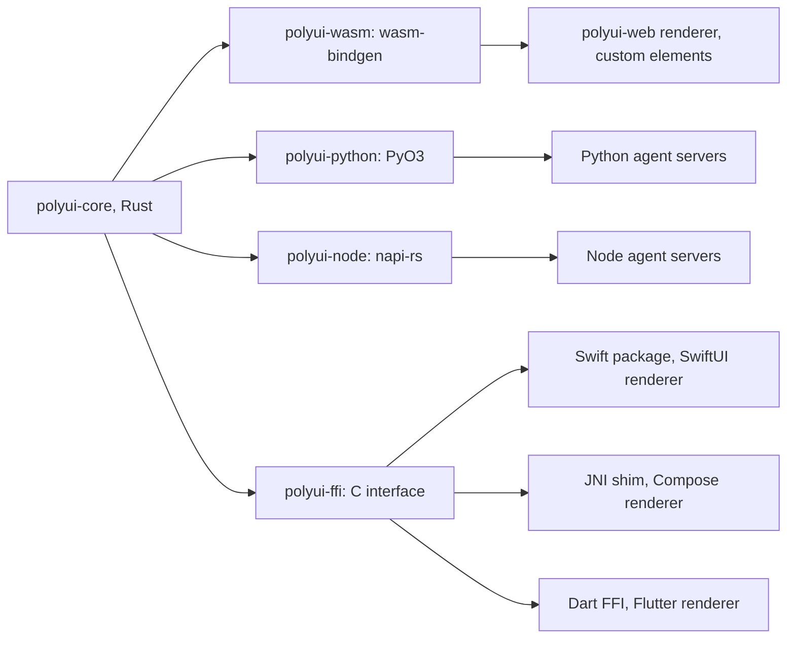
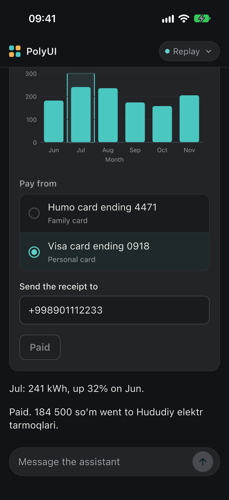

# Platforms

Every platform runs the same Rust client core. A renderer only turns render operations into native views, so adding a platform means writing a renderer, not porting the rules. The [renderer contract](../spec/renderer.md) is what each one implements.

| Platform | Status | Notes |
|---|---|---|
| Rust server and `polyui` command | Done | [Server guide](server.md) |
| Web | Done | Wasm core 60 337 bytes brotli, renderer 10 986 bytes brotli. Tested with vitest and happy-dom, and in Chrome by the chat check and the embed check. |
| Python | Done | [Python and Node](bindings.md) |
| Node | Done | [Python and Node](bindings.md) |
| iOS (SwiftUI) | Done | A C interface over the client core (`bindings/ffi`) and a SwiftUI renderer (`swift/`). Tests run on an iOS simulator. See [iOS](ios.md). |
| Flutter | Done on iOS | A Dart package over the same C interface (`flutter/polyui`). Tested with `flutter test` and run on an iOS simulator. The Android build of the Flutter package has not been run. See [Flutter](flutter.md). |
| Android (Compose) | Done | A JNI shim over the same C interface and a Compose renderer (`android/`). JVM tests run the real core; the UI tests and the example ran on an API 35 emulator. See [Android](android.md). |

All three native renderers use the one C interface, so they share its rules for errors, ownership and threads.

### Extension catalogs

Every platform can render host types such as `acme:Map` with its own code: `define` on the web renderer, `polyUIView(for:)` in SwiftUI, `builders` in Flutter and `PolyuiViewRegistry` in Compose. The client core must also know the type's catalog, or the component arrives as `Text` with its alt text. Pass the catalogs when you start the client and declare them in the hello:

| Platform | How to pass catalogs |
|---|---|
| Web | `loadCore(hello, source, { catalogs: [acme] })` |
| iOS | `PolyUISession(hello:catalogs:send:)` or `PolyUICore(hello:catalogs:)` |
| Flutter | `PolyuiSession.start(hello: ..., catalogs: [acme])` |
| Android | `PolyuiSession(hello, catalogs = listOf(acme))` |
| C | `polyui_client_new_with_catalogs(hello, catalogs_json, allow_http, &error)` |

On iOS, Android and Flutter the core checks each catalog with the full rules the server uses and refuses a bad one with an error that names it. The wasm build does a smaller check (a list of catalogs, each with an id, a version and types, every type an object, every prop of a known kind, no reserved or repeated id), because with the full checker the wasm file measured 63 817 bytes brotli, over its 61 440 byte budget. The server still checks every component against the full catalog before it sends it.

## Web

The web renderer is plain custom elements written in TypeScript, with no framework, so it works inside React, Vue or a plain page. Charts arrive as scenes the server compiled, so there is no chart library on the client. Try it in the [live demos](https://murtazox04.github.io/polyui/demos.html).

## iOS

A C interface over the client core (`bindings/ffi`), a Swift package that draws surfaces with SwiftUI, and an example app that replays a canned conversation or talks to `polyui serve`. [iOS](ios.md) explains how to build it. Screenshots: `images/ios-light.png`, `images/ios-dark.png` and `images/ios-confirm.png`.

## Flutter

A Dart package that loads the same core through Dart build hooks and draws surfaces with Flutter widgets. It was run on an iOS simulator; the Android side of the package is written but has not been built. [Flutter](flutter.md) explains how to use it. Screenshots: `images/flutter-light.png` and `images/flutter-dark.png`.

## Android

A JNI shim in C over the same core, a Kotlin wrapper and a Jetpack Compose renderer, with an example app. It was run on an API 35 emulator, not on a phone. [Android](android.md) explains how to build it. Screenshots: `images/android-light.png`, `images/android-dark.png` and `images/android-confirm.png`.

