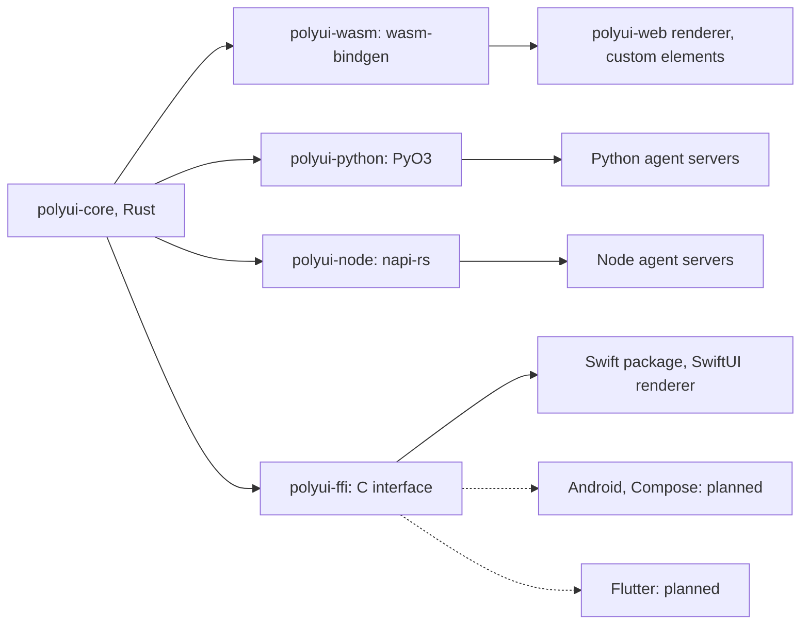
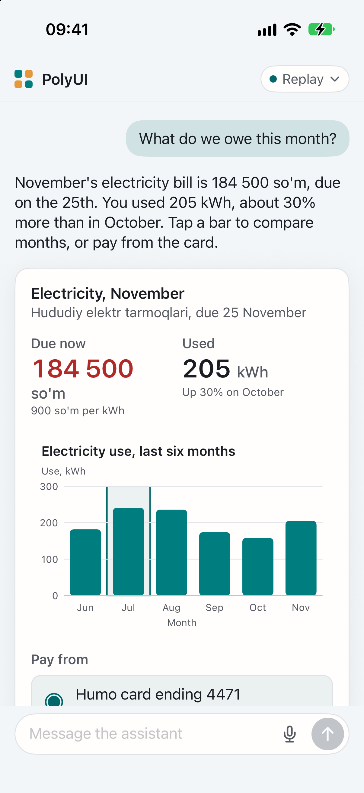
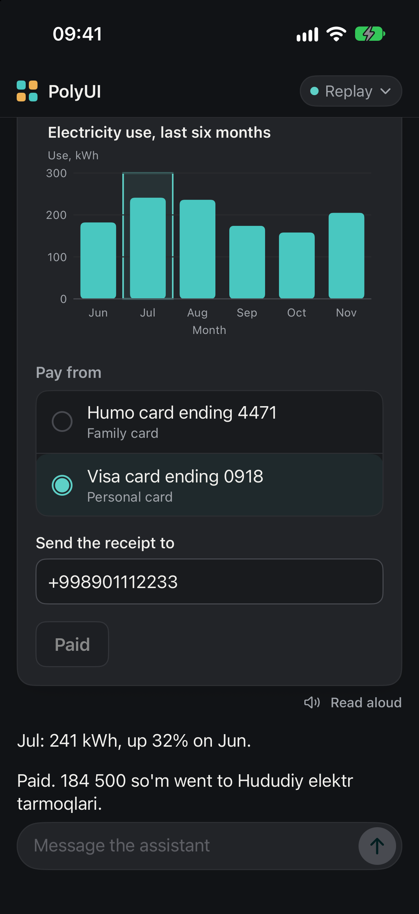

# Platforms

Every platform runs the same Rust client core. A renderer only turns render operations into native views, so adding a platform means writing a renderer, not porting the rules. The [renderer contract](../spec/renderer.md) is what each one implements.

| Platform | Status | Notes |
|---|---|---|
| Rust server and `polyui` command | Done | [Server guide](server.md) |
| Web | Done | Wasm core 58 967 bytes brotli, renderer 10 922 bytes brotli. Tested with vitest and happy-dom, and in Chrome by the chat check and the embed check. |
| Python | Done | [Python and Node](bindings.md) |
| Node | Done | [Python and Node](bindings.md) |
| iOS | In progress | A C interface over the client core (`bindings/ffi`) and a SwiftUI renderer (`swift/`). See [iOS](ios.md). |
| Android (Compose) | Planned | Nothing built yet. |
| Flutter | Planned | Nothing built yet. |

The dotted lines are plans, not code. Android and Flutter could also use their own binding instead of the C interface; that has not been decided.

## Web

The web renderer is plain custom elements written in TypeScript, with no framework, so it works inside React, Vue or a plain page. Charts arrive as scenes the server compiled, so there is no chart library on the client. Try it in the [live demos](https://murtazox04.github.io/polyui/demos.html).

## iOS

The iOS work is in progress: a C interface over the client core (`bindings/ffi`), a Swift package that draws surfaces with SwiftUI, and an example app that replays a canned conversation or talks to `polyui serve`. [iOS](ios.md) explains how to build it.

