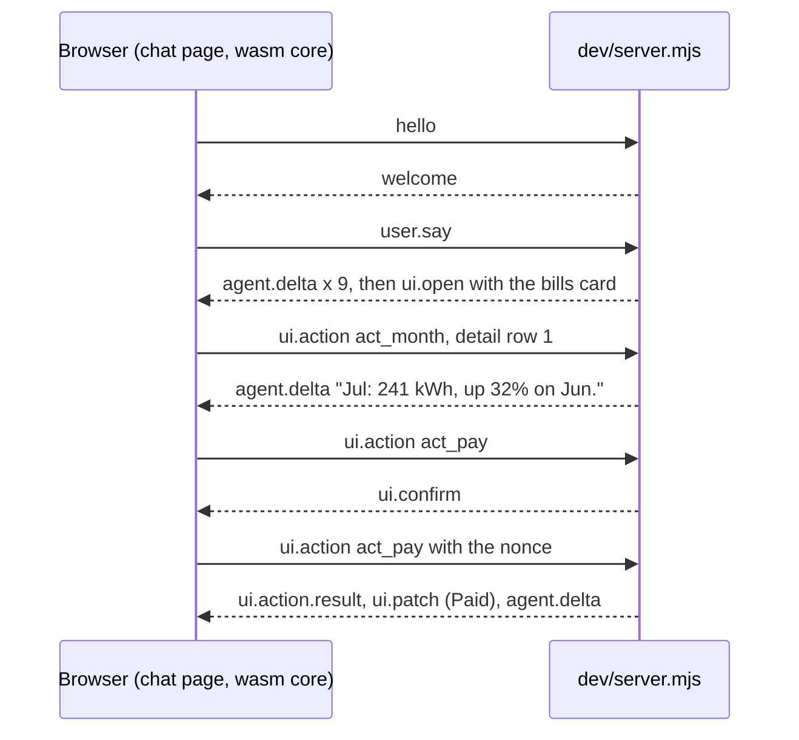

# Quick start

Three ways in, from no setup at all to a live model: open the demo in the browser, replay the canned conversation on your machine, or run the reference server against the Anthropic API.

## No setup: the live demo

The [chat replay](https://murtazox04.github.io/polyui/demos/chat/) runs the chat example in your browser with the real wasm core and a canned conversation. Send any message, tap a bar in the chart, then pay. No model is called and nothing leaves the page.

## What you need on your machine

| Tool | Version | Install |
|---|---|---|
| Rust | stable, with the `wasm32-unknown-unknown` target | [rustup](https://rustup.rs); `rust-toolchain.toml` adds the target on first build |
| Node | 22 | [nodejs.org](https://nodejs.org) |
| `wasm-bindgen` CLI | 0.2.130, the same as the crate | `cargo install wasm-bindgen-cli --version 0.2.130 --locked` |
| `wasm-opt` | binaryen 133 is what CI uses | `brew install binaryen`, or a release from [WebAssembly/binaryen](https://github.com/WebAssembly/binaryen/releases) |

The web builds compile the Rust core to wasm first (`bindings/wasm/build.mjs`), which is why the wasm tools are needed even for the JavaScript examples.

## Replay the canned conversation

```sh
cd examples/chat
npm install
npm run dev
```

Open http://localhost:4190/. The dev server in `examples/chat/dev/server.mjs` answers over a real WebSocket with the messages in `dev/conversation.json`: a streamed answer, a bills card with two stats and a chart, a reply when you tap a bar, and the confirm flow when you pay. `npm run check` drives the same flow in Chrome with Playwright and fails on any console error.



## Run the server with a model

The `bills` demo host is a household in Tashkent with four bills, six months of usage and three internet tariffs. It calls the Anthropic Messages API, so it needs a key. Put one line, `ANTHROPIC_API_KEY=` followed by your key, in `~/.config/polyui/anthropic.env` and make the file readable only by you (`chmod 600`). Without `--env-file` the server reads `ANTHROPIC_API_KEY` from the environment.

Build the chat page and start the server:

```sh
(cd examples/chat && npm install && npm run build)
cargo run --release -p polyui -- serve --env-file ~/.config/polyui/anthropic.env --static examples/chat/dist
```

Open http://127.0.0.1:8787/ and try "What do we owe this month?", "Chart our electricity use" or "Compare internet tariffs". The default model is `claude-haiku-5-5`; `--model` picks another. The key is never printed or logged. The [server guide](server.md) covers every option, the shop host with SQL dashboards, and the MCP App sandbox.

## Check a call by hand

`polyui validate` runs the checks the server runs on a `show_ui` call, against the bills host's actions and refs by default. Save this as `card.json`:

```json
{
  "root": "card",
  "components": [
    { "id": "card", "type": "Card", "props": { "title": "Gas, November" }, "children": ["due", "pay"] },
    { "id": "due", "type": "Stat", "props": { "label": "Due", "unit": "so'm" } },
    { "id": "pay", "type": "PayButton", "props": { "label": "Pay" } }
  ]
}
```

```sh
cargo run -p polyui -- validate card.json
```

```
2 problems, nothing was shown:
1. components[1] id "due" prop "value": required prop is missing.
2. components[2] id "pay": type "PayButton" is not in the catalog. Known: Badge, Button, Card, ChoiceGroup, ConfirmSheet, Divider, Image, Input, List, Row, Stat, Text, chart:Chart, chart:Dashboard.
```

This is exactly the text the model gets back as a tool error. Fix both problems (add `"value": "29 322"`, make the button a `Button` with `"tone": "primary"` and `"on_press": {"action": "pay_bill", "args": {"bill": "b_gas_2611"}}`) and it prints the summary the model sees on success:

```
valid
surface s1 open: Card(2) "Gas, November" > [Stat "Due: 29 322 so'm", Button "Pay" (act)]
```

To see the tool schemas the model gets:

```sh
cargo run -p polyui -- tools --catalogs core@1,chart@1 --strict
```

## Draw surfaces in your own page

`js/polyui-web` is a renderer with no framework: custom elements and the wasm core. Build it with `node js/polyui-web/scripts/build.mjs`, which leaves `polyui.js`, `polyui.css` and `polyui_core_bg.wasm` in `js/polyui-web/dist`. The package is not on npm yet.

This sketch shows the shape of the code. It is not tested as written; `examples/chat/main.ts` is the tested version, with reconnects that resume the session, streaming text and voice.

```js
import { loadCore, mount } from "./polyui.js";

const hello = { v: 1, t: "hello", client: { name: "my-app", version: "0.1.0" }, catalogs: ["core@1", "chart@1"], modalities: ["screen"], features: ["stream"], locale: "en" };
const core = await loadCore(hello, new URL("./polyui_core_bg.wasm", import.meta.url));
const socket = new WebSocket("ws://127.0.0.1:8787/ws");
const renderer = mount(document.querySelector("#answers"), { core, send: (message) => socket.send(message) });

socket.addEventListener("open", () => socket.send(JSON.stringify(hello)));
socket.addEventListener("message", (event) => {
  const message = JSON.parse(event.data);
  if (message.t === "welcome" || message.t.startsWith("ui.")) renderer.receive(event.data);
});
```

The page's Content Security Policy needs `'wasm-unsafe-eval'` in `script-src` for the core to load. `mount` adds a `<polyui-surface>` element to the container for each surface the server opens, and draws the confirm sheet itself.

## Next

- [Concepts](concepts.md) explains surfaces, bindings, refs, actions and voice.
- [Python and Node](bindings.md) if your server is not written in Rust.
- [Protocol](../spec/protocol.md) for the exact messages.
