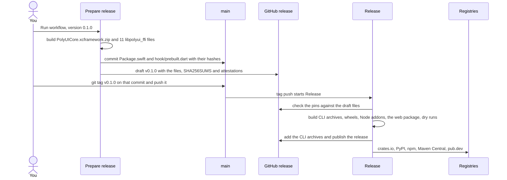

# Releasing

One version number covers every package: the Rust crates, the Python and Node bindings, the web renderer, the Swift package, the Android library and the Flutter package. Two workflows ship it. **Prepare release** builds the native libraries that other packages pin by hash and drafts the GitHub release. **Release** runs when you push the tag, builds everything else, publishes the GitHub release and then the registries.



The pins need two steps because SwiftPM and the Flutter build hook read the hashes from the tagged commit, and the hashes only exist after the binaries are built. The tag is yours to push for two reasons: it is the moment of no return, and pub.dev only accepts a publish from a workflow that a tag push started. A tag pushed by the workflow's own token would not start another workflow.

## Where each package goes

| Package | Registry | Name | Built by |
|---|---|---|---|
| Rust crates | crates.io | `polyui-core`, `polyui-chart`, `polyui-query`, `polyui-server`, `polyui-decode`, `polyui` | `cargo publish`, in dependency order |
| Command line tool | GitHub release | `polyui-<version>-<target>` for Linux x86_64 and arm64 (glibc 2.35), macOS arm64 and x86_64, Windows x64 | `cargo build --release -p polyui` |
| Python | PyPI | `polyui` | maturin, abi3 wheels for CPython 3.10 and later on manylinux and musllinux (x86_64, aarch64), macOS (arm64, x86_64) and Windows x64, plus the sdist |
| Node | npm | `@polyui/node` and one `@polyui/node-<platform>` per addon | napi-rs, for linux-x64-gnu, linux-arm64-gnu (glibc 2.17), linux-x64-musl, darwin-arm64, darwin-x64, win32-x64-msvc |
| Web renderer | npm | `@polyui/web` | `npm pack` of `js/polyui-web`, with the wasm core and the embed sandbox page |
| Swift | the repository itself | `https://github.com/murtazox04/polyui`, product `PolyUI` | root `Package.swift` pointing at `PolyUICore.xcframework.zip` |
| Android | Maven Central | `io.github.murtazox04:polyui-android` | Gradle with `com.vanniktech.maven.publish`, signed |
| Flutter | pub.dev | `polyui` | the package source; its build hook fetches `libpolyui_ffi-<target>` from the GitHub release |

## One-time setup

Nothing here goes in the repository. Secrets and variables live in the repository settings, under Secrets and variables, Actions.

1. **Choose the registries.** Add a repository variable `RELEASE_REGISTRIES` listing the registries the Release workflow may publish to, separated by spaces. For 0.1.0 use `crates pypi npm maven`. Add `pub` after the first pub.dev version is out (step 6). A registry missing from the list is skipped; the GitHub release still goes out.
2. **crates.io.** crates.io cannot create a new crate through trusted publishing, so the first version needs a token. Create an API token with the `publish-new` and `publish-update` scopes and store it as the secret `CARGO_REGISTRY_TOKEN`. After 0.1.0 is out, open each of the six crates, Settings, Trusted Publishing, and add repository `murtazox04/polyui`, workflow `release.yml`, environment `crates-io`. Then delete the secret: the workflow falls back to `rust-lang/crates-io-auth-action` when the secret is empty.
3. **PyPI.** No secret. In your PyPI account, Publishing, add a pending publisher: project `polyui`, owner `murtazox04`, repository `polyui`, workflow `release.yml`, environment `pypi`. PyPI creates the project on the first upload. A pending publisher does not reserve the name, so add it shortly before releasing.
4. **npm.** Create the organization `polyui` on npmjs.com (free for public packages); `@polyui/...` names need it. npm trusted publishing cannot create a package either, so for 0.1.0 create a granular access token with read and write access to the `@polyui` scope and "Bypass two-factor authentication" turned on, and store it as `NPM_TOKEN`. After 0.1.0 is out, add a trusted publisher on each of the eight packages (`@polyui/node`, the six `@polyui/node-*`, `@polyui/web`): GitHub Actions, `murtazox04/polyui`, workflow `release.yml`, environment `npm`, and allow `npm publish` (new configurations only allow staged publishing unless you say otherwise). Then delete `NPM_TOKEN`. Provenance is attached in both modes.
5. **Maven Central.** Sign in at central.sonatype.com with GitHub; the namespace `io.github.murtazox04` is verified from that login. Generate a user token and store its two halves as `MAVEN_CENTRAL_USERNAME` and `MAVEN_CENTRAL_PASSWORD`. Create a GPG key, send the public key to `keys.openpgp.org`, and store `gpg --export-secret-keys --armor <key id>` as `SIGNING_KEY` and its passphrase as `SIGNING_KEY_PASSWORD`.
6. **pub.dev.** pub.dev automates only packages that already exist, so publish 0.1.0 yourself once the GitHub release is out: `git checkout v0.1.0 && cd flutter/polyui && flutter pub publish`. Then on pub.dev, the package's Admin tab, enable publishing from GitHub Actions with repository `murtazox04/polyui`, tag pattern `v{{version}}` and required environment `pub.dev`, and add `pub` to `RELEASE_REGISTRIES`.

## Each release

1. Set the new version everywhere. `scripts/release/check-versions.sh 0.2.0` lists every file and says which ones are wrong: the workspace `Cargo.toml` (package and the `polyui-*` dependency versions), `bindings/node/package.json`, `js/polyui-web/package.json`, `flutter/polyui/pubspec.yaml` (and its `CHANGELOG.md`), `flutter/polyui/hook/prebuilt.dart` and `android/gradle.properties`. The Python version comes from Cargo. Merge that to `main`.
2. In Actions, run **Prepare release** on `main` with the version. It refuses a version that is already tagged. When it finishes, its summary shows the commit it pushed and the exact tag command.
3. Push the tag on that commit:

   ```sh
   git fetch origin && git tag v0.2.0 <commit> && git push origin v0.2.0
   ```

4. **Release** starts. It stops before publishing anything if the tag is not on the prepared commit, the draft is missing, or a file of the draft does not match `SHA256SUMS` or the pins.

If a registry job fails after the GitHub release is out, fix the cause and re-run that job. The crates step skips crates whose version is already on crates.io and the PyPI step skips files that are already uploaded. npm refuses to publish a version twice, so a re-run after a partly finished npm job fails on the packages that went out; publish the rest by hand from the job's artifacts.

## Checks on pull requests

Both workflows also run on pull requests that touch them, the release scripts, the build hook or a package manifest. Nothing is pushed or published then. Prepare release builds every native library and the xcframework, builds the release `Package.swift` for iOS and Mac Catalyst against the local xcframework, and shows the pins it would commit. Release builds every CLI archive, wheel and Node addon, runs the Python tests on the Linux, macOS and Windows wheels and the Node tests on the matching addons, packs the web renderer, runs `cargo publish --workspace --dry-run`, `flutter pub publish --dry-run`, and publishes the Android library into a local Maven folder.

## What has not happened yet

PyPI is the only registry that is set up. `RELEASE_REGISTRIES` is `pypi`, and `polyui` 0.1.0 to 0.1.7 are on PyPI. The other registry jobs (`crates`, `npm`, `maven`, `pub`) have not run, because they still need the setup above. For those registries, the dry runs and the build jobs are what the pull request checks prove.
