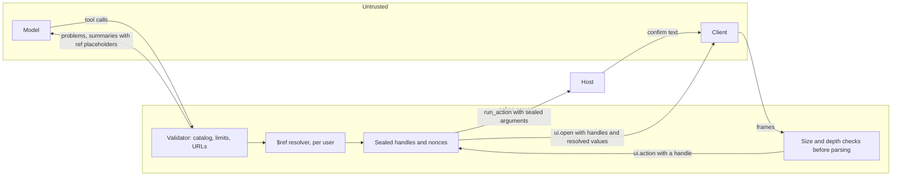
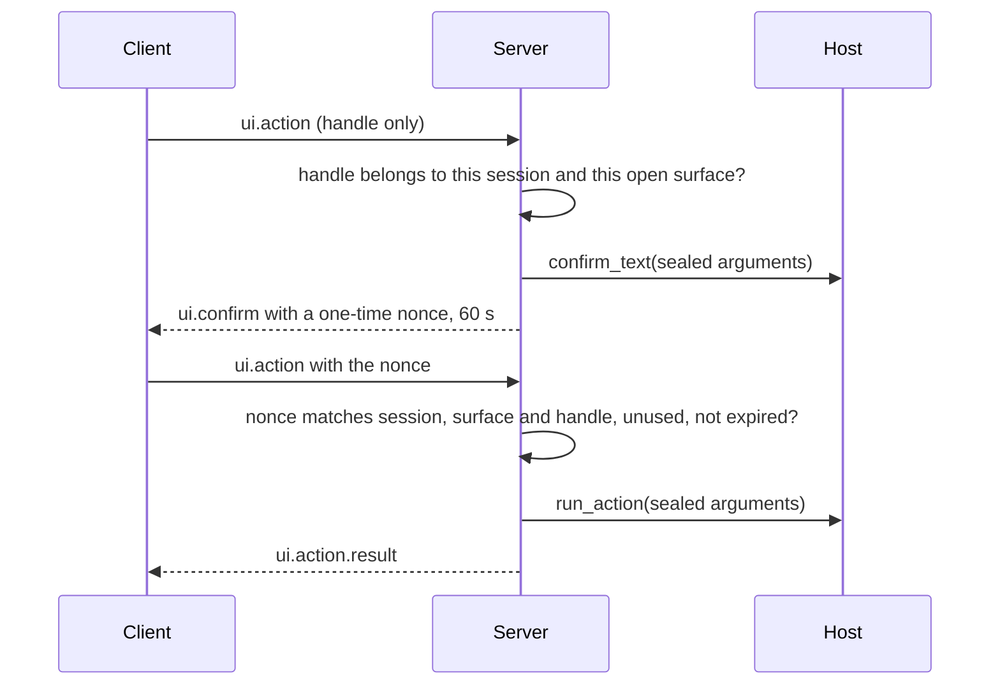

# Security model and the tests behind it

Section 13 of `spec/protocol.md` lists eight security rules. This page explains who we defend against, where the trust boundaries are, and which test checks each rule. It also lists the defects the tests found and how each one was fixed.

## Who we defend against

PolyUI puts a language model between a user and real actions such as paying a bill. Five parties can send it data, and only one of them, the host, is trusted.

| Party | What it can send | What we assume |
|---|---|---|
| The model | Tool calls and text | It can be talked into anything. A user, a web page or a document in its context may tell it to draw raw HTML, skip the confirm step, or read out an account number. Every tool call is treated as hostile input. |
| The client | Protocol messages over WebSocket or SSE and POST | It is code on someone else's device. Any field can be forged, any frame can be garbage, and it can send as fast as the network allows. |
| Another user or session | Requests with a stolen session id, nonce or handle | It must never act inside a session it did not open. |
| A page on another site | WebSocket and HTTP requests that the user's own browser sends for it, to `127.0.0.1` or to the real server | It must never open or use a session. See [The transport](#the-transport). |
| The host | The system prompt, actions, `$ref` resolvers, confirm text | Trusted. It is the application that embeds PolyUI. |

What we protect:

- **Money and other side effects.** Actions run only from server-held handles, and risky ones only after a confirm step whose text the host writes.
- **Private values.** Account and card numbers are filled in through `$ref` on the server and must never enter the model's context, in any form.
- **The user's screen.** Nothing the model writes may run as code in the renderer: no markup, no script, no CSS, no unsafe URLs.
- **The server itself.** Memory, CPU and model spend must stay bounded whatever a client or the model sends.

The arrows that leave the server toward the model carry only what the model wrote plus summaries in which every `$ref` reads `[ref]`. The arrows toward the client carry only validated components, sealed handles and values resolved for that user.

## Rules and the tests that check them

Most of the tests live in three files. Run them with `cargo test`. None of them is ignored. Rule 8 has its own files, named in its section.

- `crates/polyui-core/tests/security_pack.rs`: the validator and the client core, with no I/O.
- `crates/polyui-server/tests/security_pack.rs`: the agent loop with `ScriptedProvider`, which replays the exact hostile replies a prompt-injected model would send.
- `crates/polyui-server/tests/security_pack_transport.rs`: the WebSocket and SSE transports on a real socket.

Earlier suites (`crates/polyui-core/tests/security.rs`, `crates/polyui-server/tests/agent.rs` and `transport.rs`) cover some of the same ground; the security pack is written so that each attack has one test with its name on it.

### Rule 1: the model never produces markup, script, CSS or executed URLs

The model can only name catalog types and fill typed props, so prompt injection has nothing to inject into.

| Attack | Test |
|---|---|
| Unknown or lookalike component types (`Html`, `button`, `Button `, `core:Html`, `acme:Html`) | core `rule1_unknown_component_types_never_validate` |
| Props such as `html`, `innerHTML`, `srcdoc`, `onclick`, `class` | core `rule1_markup_and_script_props_are_unknown_props` |
| Extra fields on a component | core `rule1_unknown_component_fields_never_reach_the_surface` |
| Markup inside a text prop | core `rule1_markup_inside_text_stays_plain_text_for_the_renderer` |
| A prompt-injected model asks three times for raw HTML components | server `prompt_injection_unknown_components_never_reach_the_client` |
| The model adds `html` and `style` props, then fixes the call | server `prompt_injection_raw_html_props_are_refused_and_the_fix_carries_none` |

Text such as `<b>Bills</b>` is valid content and reaches the client as a plain string. The web renderer and the chat example never use `innerHTML`, `outerHTML` or `insertAdjacentHTML` (checked with a search of `js/polyui-web/src` and `examples/chat`), so it is shown as text.

### Rule 2: URLs are `https`, or `http` only when the host allows it

| Attack | Test |
|---|---|
| 22 URL tricks: mixed case, whitespace and zero width characters inside the scheme, entities, percent encoding, `data:`, `vbscript:`, `file:`, `blob:`, `about:`, protocol relative, backslashes, credentials, spaces in the host, plain `http` | core `rule2_url_tricks_are_rejected_in_a_literal_url_prop` |
| `http` with and without the host's permission | core `rule2_http_is_accepted_only_when_the_host_allows_it` |
| URLs in arrays of arrays, in objects inside arrays, in nested objects | core `rule2_urls_in_nested_arrays_and_objects_are_checked` |
| URLs in action arguments, including arrays and objects | core `rule2_urls_in_action_arguments_are_checked` |
| A `$bind` prop whose data the model sets to a bad URL, in `show_ui` | core `rule2_bound_urls_are_checked_against_show_ui_data` |
| The same through `update_ui` data, upserts and rebinding | core `rule2_bound_urls_are_checked_against_update_ui_data_and_upserts` |
| A `$ref` source that may give `http` or a resolver that returns `data:` | core `rule2_ref_urls_are_checked_by_declared_kind_and_by_value` |
| Bad URLs arriving at the renderer in `ui.data`, `ui.patch`, `ui.snapshot` and merge ops | core `rule2_the_renderer_rejects_bad_urls_in_every_server_message` |
| The user types a `javascript:` URL into a form field bound to an image | server `bound_urls_stay_safe_when_the_user_writes_form_values` |

One behavior to know about: `allow_http()` on the host does not widen a URL prop that does not list `http` in its own `schemes`. The built-in `Image.src` has no `schemes`, which means `https` only, so it stays `https` only even when the host allows `http`. That is stricter than the wording of the rule, not looser; a catalog that wants `http` must list it.

### Rule 3: style comes from enums only

| Attack | Test |
|---|---|
| CSS in `tone`, a `style` prop on `Card`, a `$ref` in an enum prop | core `rule3_style_comes_only_from_enums` |

### Rule 4: invalid output never reaches a client

| Attack | Test |
|---|---|
| Invalid `update_ui` calls (unknown type, orphan, removing the root, missing root) leave the surface as it was | core `rule4_invalid_updates_leave_the_surface_untouched` |
| More than 256 components, a data model over 128 KiB, a `ui.open` over 256 KiB, 120 levels of nesting from the model | server `oversized_and_deep_tool_inputs_never_reach_the_client` |
| Broken JSON from the model, including a lone surrogate and raw HTML | server `malformed_tool_json_never_reaches_the_client` |

### Rule 5: `$ref` values never enter the model's context

| Attack | Test |
|---|---|
| Every way a resolve can fail (refusal, wrong type, too long, an object, unknown key) gives exactly `$ref could not be resolved.` | core `rule5_every_ref_failure_reads_exactly_the_same` |
| Resolved values in the model copy, its summary or its fallback | core `rule5_resolved_values_never_reach_the_model_copy_or_its_summary` |
| Unregistered sources and malformed refs, including a newline that tries to add a fake problem line | core `rule5_unknown_sources_and_malformed_refs_are_rejected_without_values` |
| A `$ref` whose declared kind does not fit the prop | core `rule5_out_of_kind_props_are_rejected_from_the_declared_kind_only` |
| A `$ref` hidden in data entries or action arguments | core `rule5_refs_cannot_hide_in_data_entries_or_action_arguments` |
| A `$ref` inside a list of options | core `rule5_refs_inside_option_lists_never_show_their_value_to_the_model` |
| Every request body the provider would send (built with `AnthropicProvider::body`), across a show, an update, a user action with form values, a resync and a later turn | server `ref_values_never_appear_in_any_provider_request_body` |
| A resolver whose error message names the known accounts | server `resolver_errors_reach_the_model_only_as_the_fixed_message` |
| A user who may not see the household's accounts | server `refs_for_another_user_fail_with_the_same_fixed_message` |
| Unknown sources and out-of-kind props through the agent loop | server `unknown_ref_sources_and_out_of_kind_props_are_refused` |
| Values that could leak through the problems of later failing calls, including chart errors | server `ref_values_never_appear_in_error_text` |

The spec uses the fixed message only for resolve failures. An unregistered source and a declared kind that does not fit the prop get a normal problem line, because both are derived from what the model wrote and the declared kind, never from a value.

### Rule 6: actions run on the server, from handles, with host-built confirm text

| Attack | Test |
|---|---|
| The model calls `pay_bill` or `run_action` as a tool | server `the_model_cannot_call_actions_as_tools` |
| The model writes `{"action_id": ..., "confirm": false}` itself | core `rule6_the_model_cannot_write_handles_or_skip_confirmation`, server `the_model_cannot_write_its_own_handles` |
| The model wraps a payment in its own `ConfirmSheet` with a misleading title | core `rule6_the_model_cannot_write_handles_or_skip_confirmation`, server `confirm_text_comes_from_the_host_not_from_the_model` |
| Firing without a nonce, again and again | server `firing_without_a_nonce_only_asks_for_confirmation` |
| Replaying a used nonce | server `a_used_nonce_cannot_be_replayed` |
| An expired nonce, then the same nonce again | server `an_expired_nonce_is_refused` |
| An older nonce after a newer one was issued | server `asking_again_invalidates_the_earlier_nonce` |
| A nonce or a handle from another session | server `a_nonce_from_another_session_is_refused` |
| A nonce for one button used on another | server `a_nonce_for_one_button_cannot_fire_another` |
| Forged, truncated, extended, uppercased handles and a handle on the wrong surface | server `forged_action_ids_are_refused` |
| A pending nonce after the surface is closed | server `actions_on_a_closed_surface_are_refused_even_with_a_pending_nonce` |
| The old handle of a button the model replaced | server `a_replaced_button_loses_its_old_handle` |
| The client adds `action` and `args` to `ui.action` | server `the_client_cannot_change_sealed_arguments`, core `rule6_the_client_only_ever_sends_the_handle_back` |
| A session id used by a different user over SSE | transport `sessions_are_bound_to_the_user_who_opened_them` |

### Rule 7: limits are checked before full parsing

| Attack | Test |
|---|---|
| A 10 MiB message is refused by size, not by a JSON error | core `rule7_oversized_input_is_refused_before_json_parsing` |
| 200 000 levels of nesting in the parser, the hello parser, the validator and the client | core `rule7_deep_nesting_is_refused_without_recursion` |
| 5000 unknown props produce a short problem list, not a 5000 line one | core `rule7_problem_lists_stay_short_for_huge_inputs` |
| Empty input, a BOM, trailing data, `NaN`, `1e999`, lone surrogates, bad escapes, raw control characters, single quotes, trailing commas | core `malformed_json_is_reported_and_never_panics` |
| Duplicate keys that try to sneak a second `src` past the check | core `duplicate_keys_cannot_smuggle_a_url_past_the_checks` |
| A user message over 4000 characters gets `agent.error`; 4000 Cyrillic letters (8000 bytes) still pass | server `overlong_user_text_never_reaches_the_model` |
| A blank `user.say`, or one with no string `text`, gets `agent.error` | server `blank_or_textless_user_say_gets_an_agent_error` |
| A raw `ui.action` with a `detail` over 4096 bytes or `values` over 128 KiB is refused before the action, with `ui.error` | server `oversized_action_detail_and_values_are_refused_before_the_action`, core `action_detail_and_values_are_capped` |
| Strings are counted in characters, the same way by the guarded parser and by the value checks: multi-byte letters, emoji and escaped surrogate pairs | core `strings_are_counted_in_characters_not_bytes_or_escapes`, conformance `string_limits_count_characters_in_both_builds` |
| Invalid JSON on the WebSocket, then normal use | transport `ws_invalid_json_gets_bad_message_and_the_socket_stays_usable` |
| Invalid UTF-8 in a WebSocket text frame | transport `ws_invalid_utf8_text_frames_drop_only_that_connection` |
| Binary WebSocket frames | transport `ws_binary_frames_are_refused` |
| A broken or deeply nested `hello` | transport `ws_hello_must_be_valid_json` |
| Deep and oversized WebSocket messages | transport `ws_deep_and_oversized_messages_are_refused` |
| Invalid UTF-8 in a POST body, with and without a session | transport `http_send_refuses_invalid_utf8_bodies` |
| Invalid, deep and oversized POST bodies | transport `http_send_reports_invalid_and_deep_json_without_reaching_the_model` |
| 20 000 bad frames from one client while another connects | transport `ws_flood_of_bad_messages_keeps_the_server_responsive` |
| A client that floods without reading replies | transport `ws_flood_from_a_client_that_never_reads_is_bounded` |
| A client that stops reading is closed as a slow consumer | server `a_client_that_stops_reading_is_closed_as_a_slow_consumer` |
| A flood of `user.say` | transport `ws_user_say_flood_is_bounded_per_session` |
| `user.say` faster than the rate limit | server `user_say_is_rate_limited_with_a_user_safe_agent_error` |
| Opening more WebSocket sessions than `max_sessions` | transport `ws_sessions_count_against_max_sessions` |
| WebSocket and SSE sessions together over `max_sessions` | transport `sse_and_websocket_sessions_share_max_sessions` |
| A client that leaves while the model is still answering | transport `a_disconnect_cancels_the_running_turn` |
| A WebSocket that never sends `hello` is closed after the attach timeout and gives its session place back | transport `a_client_that_never_says_hello_gives_its_place_back` |
| One model reply that opens 300 surfaces | server `the_number_of_open_surfaces_per_session_is_capped` |

### Rule 8: HTML only through `embed:Embed`, from the host, in a sandbox

The model names a `ui://` resource and nothing more. The host supplies the HTML, the server puts it in the server-only `app` prop, and the renderer runs it only in a sandbox on a separate origin. [Embedding MCP Apps](embed.md) has the full rules.

| Attack | Test |
|---|---|
| The model uses `embed:Embed` when the host did not turn it on, or the client did not declare `embed@1` | core `the_model_only_sees_embed_when_the_host_turns_it_on`, server `clients_without_embed_are_never_offered_it` |
| A `resource` that is not a literal `ui://` URI: an `https`, `javascript:` or `data:` URL, a `$bind`, a number | core `the_resource_must_be_a_ui_uri_written_literally` |
| The model writes the server-only `app` prop, or HTML in another prop | core `the_model_cannot_write_the_server_only_app_prop_or_markup` |
| A resource the host does not offer, or an app too large for one message | server `unknown_resources_and_oversized_apps_are_problems_for_the_model` |
| One call that names many different apps | server `too_many_different_apps_are_refused_before_any_read` |
| The app's HTML or URI reaching the model's copy or its summary | server `the_tariff_app_reaches_the_client_and_stays_out_of_the_model` |
| An `app` with the wrong mime type, another URI, a `blob` instead of `text`, or a non-object `tool_input` reaching the renderer | core `the_client_core_drops_apps_that_do_not_fit` |
| App HTML over `MAX_APP_STRING_CHARS`, or the larger HTML limit used outside `embed:Embed` | core `app_html_has_its_own_ceiling` |
| A client without `embed@1` gets the title, not the frame | core `a_client_that_did_not_declare_embed_draws_the_title` |
| No sandbox origin, a sandbox on the host's own origin, or a bad sandbox URL | web `embed.test.ts` "shows the title and no frame when the host set no sandbox origin", "refuses a sandbox on the host's own origin or with a bad URL" |
| The frame gets more than `allow-scripts`, or the HTML lands in the host page | web `embed.test.ts` "loads the sandbox page with allow-scripts only and never puts the HTML in the host page" |
| Messages from another frame or window | web `embed.test.ts` "answers the sandbox only for its own frame with an opaque origin" |
| `ui/message` without an `on_message` action, and links that skip the confirm sheet or are not `https` | web `embed.test.ts` "denies ui/message when the component has no on_message action", "opens only https links, and only after the user confirms in the renderer's sheet" |
| An app calls a tool it may not call (`visibility` without `"app"`, another server's tool, or a model-only action) | server `app_calls.rs` `only_tools_the_app_may_call_run`, `apps::tests::visibility_decides_what_an_app_may_call` |
| An app call for a component that is not an embed on an open surface, or with bad params | server `app_calls.rs` `calls_need_an_embed_that_is_on_screen`, `bad_params_are_refused_before_the_host` |
| An app floods the host or a slow MCP server holds every slot | server `app_calls.rs` `each_embed_has_a_rate_limit`, `slow_hosts_time_out_and_open_calls_are_capped` |
| An app call that needs a person runs without a yes, with a forged or reused nonce, or after the question expired | server `app_calls.rs` `a_switch_waits_for_the_person_and_then_runs`, `a_wrong_or_missing_nonce_does_not_count_as_a_yes`, `an_unanswered_question_expires_and_the_app_hears_no`, `one_question_at_a_time_and_quotes_still_flow` |
| A no to an app question or an action confirm with a forged nonce, or a second no | server `agent.rs` `a_no_ends_the_question_and_pays_nothing`, `app_calls.rs` `a_no_answers_the_app_at_once_and_frees_the_question` |
| App context from an app the host does not allow, without the feature, too long, or unmarked in the model's input | server `app_calls.rs` `app_context_needs_the_feature_the_host_and_a_short_text`, `app_context_reaches_the_next_turn_once_and_marked_as_the_apps` |
| App calls without the `app_calls` feature, or app results leaking into the model | server `app_calls.rs` `without_the_feature_every_call_is_method_not_found`, `the_app_gets_a_quote_without_a_model_turn` |

The core tests are in `crates/polyui-core/tests/embed.rs`, the server tests in `crates/polyui-server/tests/embed.rs` and `crates/polyui-server/tests/app_calls.rs`, and the renderer tests in `js/polyui-web/test/embed.test.ts` (run with `npm test` in `js/polyui-web`).

## The transport

These are not among the eight rules, because the protocol does not fix a transport, but the reference server needs them.

| Attack | Test |
|---|---|
| A page on another site opens `ws://127.0.0.1:8787/ws`, or calls `/send` and `/events`, with the user's browser (cross-site WebSocket hijacking) | transport `pages_on_other_origins_cannot_open_or_use_sessions` |
| A cross-site `POST /send` as `text/plain`, which a browser sends without a CORS preflight | transport `pages_on_other_origins_cannot_open_or_use_sessions` |
| Forged or malformed `Origin` values and the loopback forms of the server's own origin | server `origin::tests` |

## Defects the pack found

The pack first ran with these five tests marked `#[ignore = "known defect: ..."]`, and all five failed. They are fixed now and run with every `cargo test`. The limits they rely on are described in [server.md](server.md#limits-per-session-and-per-server).

1. **Form values skipped the URL check (rules 2 and 4).** `Session::store_values` wrote the `with` values into both copies of the data model and checked only the size limits, so a `javascript:` URL typed into a field bound to `Image.src` reached the client in the next `ui.snapshot`. Now every component that binds to the data model is checked again against the data with the new values, using the same prop rules as `show_ui`, and charts that bind to it are drawn again. A value that does not fit refuses the action with `ui.action.result` `rejected`, before the confirm sheet when the action needs one and again just before it runs.
2. **No backpressure on outgoing messages.** Replies went into an unbounded channel and the WebSocket reader never waited for the writer; a client that sent without reading made the server accept 400 000 messages in under 2 seconds. Now each session has a bounded queue (256 messages). The server waits for room before it handles the next client message or model event, so the client is slowed down through TCP, and a session that does not make room within 10 seconds is closed as a slow consumer (WebSocket close code 1008 with the reason when the frame still fits).
3. **No limit on queued turns.** Every `user.say` went into an unbounded queue and later became a model call. Now one turn runs at a time, at most two wait, and a rate limit (8 at once, then one every 4 seconds) covers `user.say` and actions that start a turn. Anything over is answered with an `agent.error` that is safe to show to the user, or a rejected `ui.action.result` before the action runs.
4. **`max_sessions` did not count WebSocket sessions.** Now one semaphore counts both transports. A WebSocket takes a place before the upgrade and gets HTTP 503 when none is left.
5. **No limit on open surfaces per session.** Now a session can have at most 16 open surfaces. A `show_ui` over that fails like any invalid call, and the model reads which surfaces are open so it can close or reuse one.

One more gap was closed at the same time: a turn kept running after its client left. Now closing the session stops the turn and drops the model stream, and `AnthropicProvider` aborts the HTTP request as soon as nobody reads its events.
