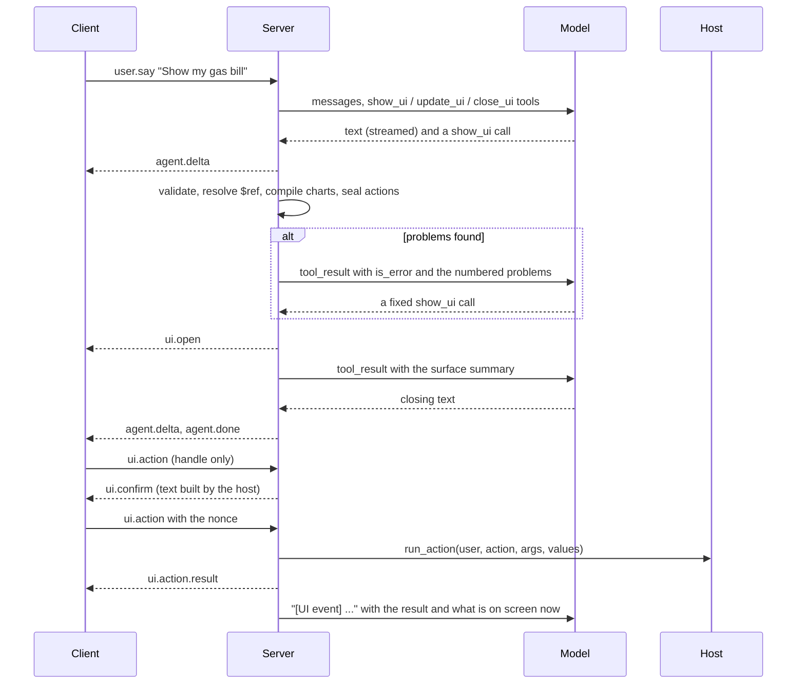

# The reference server

`polyui-server` is the Rust server that sits between a model and a client. It runs the agent loop, checks every UI the model asks for, keeps the real action arguments and the private values on the server, and talks to clients over WebSocket or Server-Sent Events. The `polyui` command line tool wraps it.

This page explains how a turn works, what your application has to provide, and how to run the demo.

## How a turn works

A client connects, says `hello`, and gets `welcome` back. From then on the user can type (`user.say`) or use the UI (`ui.action`). Each of those starts a model turn.



Step by step:

1. The server sends the conversation to the model with three tools, `show_ui`, `update_ui` and `close_ui`, generated by `polyui-core` for the catalogs the client declared, plus any tools the host adds. By default they use the compact tool profile (see [Tool profiles](#tool-profiles)). Text the model writes is streamed to the client as `agent.delta`.
2. Each tool call is parsed strictly and checked with `polyui-core`. The model's JSON is never trusted, even when the provider enforces a schema.
3. If the call has problems, the model gets them back as a tool result with `is_error: true` and tries again. After two failed retries of the same tool in one turn, the server stops asking, sends the user a plain text apology in their language, and ends the turn.
4. A valid call goes through four more steps before anything leaves the server:
   - every `{"$ref": "source:key"}` is resolved by the host for the current user,
   - every `chart:Chart` is compiled by `polyui-chart`, the scene goes into the props as `scene`, and the chart's spoken summary becomes its `say` when the model gave none,
   - every action object is replaced by a handle like `{"action_id": "act_3f2a...", "confirm": true}`, and the real action name and arguments stay in the session,
   - components from catalogs the client did not declare are turned into `Text` with their alt text.
5. The client gets `ui.open`, `ui.patch`, `ui.data` or `ui.close` with a per-surface `seq`. The model gets a one-line summary of what is on screen. `$ref` props show as `[ref]` in that summary, so private values never enter the model's context.
6. If the model reply stops on `max_tokens` or `refusal`, its tool calls are not run. The client gets `agent.error`.

### Streaming UI while the model writes

A client that lists `stream` in the `features` of its `hello` does not have to wait for the whole `show_ui` call. The Anthropic API streams the tool input as `input_json_delta` fragments, and the server feeds them to `polyui-core`'s `ShowUiStream`, which reports each component as soon as its closing brace arrives and checks it on its own:

1. When the root component has arrived, the client gets `ui.open` with the root and every finished component the root already reaches.
2. Each later component goes out in a `ui.patch` with the next `seq`. Section 5.1 of the spec allows a component in such a patch that no parent reaches yet, because its parent may still be on the way.
3. When the model has finished, the whole call is checked as usual. If it passes, the server compares the result with what it already sent and sends only the difference: a `ui.data` for the data model, which usually comes last in the input, and a `ui.patch` for any component that changed. Components that did not change keep their action handles.
4. If the full check fails, or the model reply breaks off, the server sends `ui.close` for that surface and the model gets the problems and tries again, as without streaming. The client never keeps UI that did not pass.

Buttons on a surface that is still streaming are not live yet. A `ui.action` on such a surface gets `ui.action.result` with `rejected` and "This screen is still loading.", and the model cannot `update_ui` or `close_ui` it until it is complete. Streaming stops early (and the final check decides) as soon as a component fails its own check, a `$ref` cannot be resolved, the surface would go over a limit, or 16 surfaces are already open.

How much sooner the UI appears depends on how long the call is. In a live run against `claude-haiku-5-5` ("Show all four of my bills with a pay button for each", 2357 bytes of `show_ui` input in 148 fragments over 3.1 s, about 15 bytes every 21 ms), the first `ui.open` came at 4.9 s after the user message, while the full input was only complete at 7.7 s. A second call without streaming opened its surface at 6.8 s, right when its input was complete. With the same timing replayed by `ScriptedProvider` for a bills card with 15 components, the first `ui.open` comes after 0.32 s with streaming and after 2.47 s without (`cargo test -p polyui-server --test streaming -- --nocapture` prints both).

The server keeps one `ShowUiStream` per streamed tool call, for the whole call. The stream owns only its parser state; the `Validator` is passed to `feed` on every fragment, so the stream can live across an `await` even though `Validator` borrows the host's registry and ref resolver, which are not `Sync`. Each byte is scanned once and each component is checked once while it streams, so the work grows with the size of the input, not with its square. `tests/embed.rs` streams 100 and 200 components that each hold a `$ref` and counts the host's ref lookups: 400 and 800, four per component.

The server keeps two copies of every surface. The model copy is what the model wrote, and the summaries are built from it. The client copy has the resolved values, the chart scenes and the sealed handles, and it is what `ui.snapshot` returns after a `ui.resync`. When the user fires an action with form values (the paths listed in the action's `with`), both copies are updated, so the next summary shows what the user typed. Before that, every component that binds to the data model is checked again against the data with the new values, the same way `show_ui` data is checked. A value that does not fit a prop, for example `javascript:alert(1)` typed into a field bound to `Image.src`, is refused: the action does not run and the client gets `ui.action.result` with `rejected`. Charts that bind to the data model are drawn again, and the client gets a `ui.patch` with the new scene.

### Actions and confirmation

`ui.action` only carries a handle. The server looks it up in the session. An unknown handle, a handle from another surface, or a handle on a surface that was closed or replaced gets `ui.action.result` with `rejected`.

If the host marked the action `requires_confirm`, the first `ui.action` does not run it. The server answers with `ui.confirm`. The title and body come from `Host::confirm_text`, built from the sealed arguments, never from text the model wrote. The nonce is random, works once, and expires after 60 seconds. A reused or unknown nonce is rejected; an expired one gets `expired`.

When the action runs, the client gets `ui.action.result`, and the model gets a user message that starts with `[UI event]`. It names the action and its arguments, the form values, the result, the host's note, and the summary of the surface at that moment.

### Conversation history

History is kept in the Anthropic message format. Assistant messages are stored exactly as they arrived, including thinking blocks and their signatures. Tool results for one model reply go back in a single user message. If a turn ends early, its tool results are kept and the next user message is merged into the same user turn, so the history stays valid.

## The `Host` trait

Your application implements `Host`. The server calls it; it never calls the model.

| Method | What it does |
|---|---|
| `system_prompt(user, locale)` | Your instructions and context. The server appends a short guide on using the UI tools and what the client can draw. |
| `actions()` | The action registry (`polyui_core::ActionTable` works). Each action has typed arguments and a `requires_confirm` flag. |
| `refs(user)` | A `RefResolver` for this user. `source_kind` declares the kind of value each source gives (for example text of up to 16 characters); `resolve` returns the value or a refusal when the user may not see it. The model only ever sees one fixed message when a `$ref` cannot be resolved. |
| `confirm_text(user, action, args, locale)` | Title, body and button label for the confirm sheet. |
| `run_action(user, call)` | Runs the action. Return `ActionOutcome::ok()` or `ActionOutcome::rejected(message)`. The message is shown to the user; `with_note` adds a note only the model sees. |
| `authenticate(headers)` | Turns request headers into a `User`. The default is a guest. |
| `tools()` and `call_tool(...)` | Optional plain tools, for example a data lookup. |
| `ui_resource(user, uri)` | Optional. Returns the MCP Apps `resources/read` entry for a `ui://` URI this user may see, for `embed:Embed`. See [Embedding MCP Apps](embed.md). |
| `catalogs()`, `fallback_text(locale)`, `allow_http()` | Optional overrides. |

Wiring it up:

```rust
let host = Arc::new(MyHost::new());
let provider = Arc::new(AnthropicProvider::new(ApiKey::from_env().unwrap(), "claude-haiku-5-5"));
let app = polyui_server::router(Agent::new(host, provider), ServerConfig::default());
polyui_server::serve(tokio::net::TcpListener::bind("127.0.0.1:8787").await?, app).await?;
```

The model sits behind the `ModelProvider` trait. `AnthropicProvider` streams from the Messages API with plain HTTP. `OpenAiCompatProvider` talks to any server with an OpenAI style `POST /chat/completions` (see below). `ScriptedProvider` replays canned replies for tests and records every request it gets.

### OpenAI-compatible servers

`OpenAiCompatProvider` is for self-hosted models behind llama-server, vLLM or a gateway that speaks the OpenAI chat format. It sends one request per model call and does not stream, so the client sees the text and the UI only when the whole reply is in.

```rust
let provider = OpenAiCompatProvider::new("http://127.0.0.1:8080/v1", "gemma-3-12b")
    .with_key(ApiKey::from_env_var("MY_GATEWAY_KEY").unwrap());
```

The session keeps its history in the Anthropic format either way, and the provider translates each request:

| Session history | Sent to the server |
|---|---|
| system prompt | a first message with role `system` |
| `tool_use` blocks in an assistant message | `tool_calls` with `type: "function"` and the input as a JSON string in `function.arguments` |
| a `tool_result` block | a message with role `tool` and its `tool_call_id`; an error result starts with `Error: ` because the format has no `is_error` |
| text in a user message after tool results | a `user` message after the `tool` messages |
| thinking blocks | dropped |
| tools | `{"type": "function", "function": {"name", "description", "parameters"}}` with `tool_choice: "auto"`; `strict` is not sent |

On the way back, `finish_reason` `tool_calls` becomes `tool_use`, `length` becomes `max_tokens` and `content_filter` becomes `refusal`. Arguments that are not a JSON object reach the session as a parse error, as with the Anthropic provider. `prompt_tokens` and `completion_tokens` become input and output tokens. `with_response_format(json_schema_format(name, schema))` adds a `response_format` of type `json_schema` to every request, which the benchmark uses for its constrained setting.

Errors: 429, or any body that mentions `concurrency_limited` or `rate_limit`, is tried at most four times in all, which means three retries, after waits of 1, 2 and 4 seconds. 502, 503, 504 and 529 are retried once, after 1 second (`with_overloaded_attempts(1)` turns that off). Everything else fails the turn at once. The key goes only into the `Authorization: Bearer` header, and error texts never include the URL.

## Tool profiles

The tool definitions are most of what the model reads on every call, so their size matters for cost, for latency and for small models with short context windows. `AgentConfig::tool_profile` picks one of two forms of the same catalogs:

| Profile | What the model gets | Size with `core`, `chart` and the bills actions |
|---|---|---|
| `ToolProfile::Compact` (default) | A closed but generic input schema (`id`, `type` from an enum, `props` as an object, `children`; data as `{path, value}`) and the catalog as one line per type in the `show_ui` description | 5 025 bytes, 2 430 tokens |
| `ToolProfile::Full` | Every type as an `anyOf` branch with every prop, its limits and a `$bind`/`$ref` union | 43 985 bytes, 20 285 tokens |

Token counts are from the Anthropic `count_tokens` endpoint for `claude-haiku-5-5` and include the roughly 320 tokens the API adds whenever tools are present. The compact lines look like this:

```
Stat(label<=80!, value<=40!, unit<=16, tone: neutral|positive|negative|warning, hint) - One important number with a label, like a balance or a total.
pay_bill(bill: b_gas_2611|b_power_2611|b_water_2611|b_net_2611!)
```

Validation does not depend on the profile. Every prop is still checked against the catalog, and a call with problems gets the same numbered list back, so the model fixes it on the retry. In the 32 prompt benchmark on `claude-haiku-5-5` every first UI call was valid with both profiles, and compact cost about a third as much. Compact draws a form only when the host has an action that can take its values, which is also the only case where a form is useful; register one and it draws the form as often as `full`. See [the benchmark](benchmark.md#forms-with-the-compact-profile-2026-11-25) for the numbers.

`polyui-decode` builds its grammars from the full profile whatever the server uses, because a grammar constrains decoding without adding prompt tokens.

For small models there is one more lever: `Agent::with_tool_types(vec![...])` offers only the listed types, for example `Text`, `Card`, `List`, `Stat`, `Button`, `ChoiceGroup`, `Input` and `chart:Chart`. That brings the compact tools for the bills host down to 4 166 bytes and 2 066 tokens. The validator still accepts every type the client draws, so a model that uses another type is not refused for it.

## Transports

| Endpoint | Use |
|---|---|
| `GET /ws` | WebSocket. Send `hello` first, read `welcome`, then everything goes both ways on one connection. |
| `POST /send` | With a `hello` body and no `session`, starts a session and returns `welcome`. |
| `GET /events?session=<id>` | The server messages for that session as an SSE stream. One stream per session; the session ends when it closes. |
| `POST /send?session=<id>` | Any client message. Answers `202`. |
| `GET /config.json` | `{"embed_origin": ...}`, the sandbox URL from `ServerConfig::embed_origin` or `null`. The chat example reads it to decide whether to declare `embed@1`. |
| `/` | Static files from `--static DIR`, if given. |

Every incoming message is size checked before it is parsed: the WebSocket frame and message limit and the HTTP body limit are both 256 KiB, and the text then goes through `polyui-core`'s guarded parser. Bad input gets `ui.error`; it never reaches the model. A `user.say` that is refused (no text, blank text, more than 4000 characters, or over the turn limits below) gets `agent.error` instead, with a message the chat can show.

`POST /send` only takes `Content-Type: application/json` and answers anything else with 415. A browser cannot send that type to another site without asking first through CORS, and the server never says yes to such a request.

A session lives as long as its connection. When the WebSocket closes, or the SSE stream ends, the session ends with it: its surfaces and handles are dropped and a running turn stops. A client that reconnects sends `hello` again and starts over; the server does not resume the old session or send `ui.snapshot` for it.

### Which pages may connect

A browser lets any page open a WebSocket to any address, including `127.0.0.1`, and sends the page's `Origin` header with it. Without a check, a page on another site could open a session on your server, spend your API key and read every `ui.open`. So `/ws`, `/events` and `/send` look at `Origin` before anything else and answer 403 when it is not allowed. Allowed are:

- the server's own origin: the same host and port as the request's `Host` header;
- when that host is `localhost`, `127.0.0.1` or `[::1]`, the other two names with the same port;
- every origin in `ServerConfig::allowed_origins`, or `--allow-origin URL` on the command line (repeat it for more), compared after lowercasing and dropping a trailing `/`.

A request with no `Origin` header is not a browser request and passes; native apps, `curl` and the tests send none. An origin is a scheme, a host and an optional port, such as `http://localhost:5173`. `null`, a path or a user name makes it invalid; the command refuses such a `--allow-origin`, and `router` drops it from `allowed_origins` with a message on stderr.

### Limits per session and per server

Memory, CPU and model spend have to stay bounded whatever a client sends. These limits are in `AgentConfig` and `ServerConfig`:

| Limit | Default | What happens when it is reached |
|---|---|---|
| `max_sessions` | 1000 | Counts WebSocket and SSE sessions together. A WebSocket upgrade or a new `POST /send` session gets HTTP 503 "too many sessions". A WebSocket counts from the upgrade until it closes, an SSE session until its event stream closes or the attach timeout passes. |
| `attach_timeout` | 60 s | How long a new session may wait for its client. A WebSocket that sends no `hello` in this time is closed with code 1008 "no hello in time" and gives its place back. A session started with `POST /send` whose `GET /events` does not arrive in this time is closed. |
| `outgoing_queue` | 256 messages | Server messages for one session wait in a queue of this size. Before the server handles a client message or a model event, it waits until at least 16 places are free, so a client that sends faster than it reads is slowed down instead of filling memory. |
| `slow_consumer_after` | 10 s | If those places do not free up in time, the session is closed as a slow consumer. A WebSocket gets close code 1008 with the reason "the client did not read server messages in time" when the frame still fits in the socket; an SSE stream ends with an event named `close` whose data is the same text. A client that reads nothing at all may only see the connection drop. |
| `waiting_turns` | 2 | One turn runs at a time per session, and at most this many `user.say` messages or action reports wait behind it. A `user.say` beyond that gets `agent.error` "The assistant is still working on your earlier messages. Please wait for it to finish." An action that would start a turn is refused with `ui.action.result` `rejected` and the same text, before it runs. |
| `turn_rate` | 8 at once, then one more every 4 s | Each `user.say` and each action that runs takes one. When none is left, a `user.say` gets `agent.error` "You are sending messages too quickly. Please wait a moment and try again." and an action is refused before it runs. Set `refill` to zero to turn the limit off. |
| `max_open_surfaces` | 16 | A `show_ui` that would open one more surface fails like any other invalid call, and the model reads "16 surfaces are already open, which is the most one conversation can have. Close one with close_ui or change one with update_ui." with the list of open surfaces. |

When a client goes away (its WebSocket closes, or its SSE stream is dropped or never attached), the session is closed and a running turn is stopped where it is. The model stream is dropped, and `AnthropicProvider` stops reading and closes the HTTP request at once, so no more tokens are generated for nobody.

## Running the demo

The `bills` demo host is a household in Tashkent with gas, electricity, water and internet accounts, six months of usage, and three internet tariffs. It has three actions: `pay_bill` (needs confirmation), `pick_offer` and `show_usage`, plus a `get_usage` tool for charts. `{"$ref": "account:gas"}` resolves to a masked account number like `**** 0083`.

```sh
polyui serve --env-file ~/.config/polyui/anthropic.env --static js/polyui-web/demo
```

Options: `--addr` (default `127.0.0.1:8787`), `--model` (default `claude-haiku-5-5`), `--static DIR`, `--host bills|shop`, `--data DIR`, `--embed-origin URL`, `--embed-sandbox DIR`, `--tool-profile compact|full` (default `compact`), `--catalog-subset TYPES` (comma separated type names; the command stops if one is not in the host's catalogs) and `--allow-origin URL` (one more page origin that may connect, see [Which pages may connect](#which-pages-may-connect)). Without `--env-file` the key is read from `ANTHROPIC_API_KEY`. The key is never printed or logged.

To use a self-hosted model instead, pass `--provider openai-compat` with the base URL and the model, and name the variable that holds the key:

```sh
polyui serve --provider openai-compat --base-url http://127.0.0.1:8080/v1 --model gemma-3-12b --api-key-env MY_GATEWAY_KEY --static js/polyui-web/demo
```

`--api-key-env` defaults to `OPENAI_API_KEY`. The variable is read from `--env-file` when one is given and from the environment otherwise; if it is not set, the requests go without a key, which is what a local llama-server expects.

`--embed-origin` turns on the MCP App demo. The bills host then offers the `embed` catalog and one app, an internet tariff calculator at `ui://bills/tariff`, and `/config.json` tells the chat page where the sandbox page lives. When the URL is `http` on `localhost`, `127.0.0.1` or `[::1]`, the command also serves `js/polyui-web/embed-sandbox` (or `--embed-sandbox DIR`) on that port, so the sandbox has an origin of its own:

```sh
(cd examples/chat && npm run build)
polyui serve --env-file ~/.config/polyui/anthropic.env --static examples/chat/dist --embed-origin http://localhost:8788/
```

Open `http://127.0.0.1:8787/` and ask which internet tariff suits the family. The calculator's button sends a `ui/message`, which reaches the model as a `tariff_message` action with the text as its detail. For an `https` URL the command serves nothing and expects you to host the sandbox page there.

`--host shop` runs a small store whose dashboards are built from SQL over local CSV and Parquet files. It needs the `query` feature, which is off by default because DataFusion grows the binary from about 7 MiB to about 88 MiB. Build with `cargo run -p polyui --features query -- serve --host shop ...` or `cargo install --path crates/polyui-cli --features query`. A binary built without it stops with a message that says so. See [dashboards.md](dashboards.md).

Two more commands help when writing prompts or catalogs:

```sh
polyui tools --catalogs core@1,chart@1 --strict   # the tool JSON the model gets
polyui tools --profile full                        # the same tools with every prop in the schema
polyui validate surface.json                       # problems, or the summary if it is valid
```

## Tests

`cargo test -p polyui-server -p polyui` runs everything that does not need the network: the stream parser, the agent loop with `ScriptedProvider` (valid calls, a fixed retry, the retry limit, cut-off replies, the confirm flow, reused and expired nonces, forged handles, `$ref` values never reaching the model, chart scenes, patches and snapshots, streamed surfaces, embedded MCP Apps), the session limits and the WebSocket, SSE and static file transports on a real socket. `cargo test -p polyui-server --features query` adds the dashboard tests. `ScriptedReply::paced(bytes, every)` splits text and tool input into fragments of that many bytes and waits between them, so tests can replay realistic model timing.

Two tests in `tests/live.rs` talk to the real API. They are ignored by default:

```sh
set -a; . ~/.config/polyui/anthropic.env; set +a
POLYUI_LIVE=1 cargo test -p polyui-server --test live -- --ignored --nocapture
```

`live_gas_bill_opens_valid_ui` asks for the gas bill, checks that a valid `ui.open` arrives, and prints whether the first `show_ui` was valid and how many tokens were used. `live_streaming_opens_ui_sooner` makes one model call with the `stream` feature and one without, and prints when the first `ui.open` arrived, when the `show_ui` input was complete, and the size and timing of the input fragments.

## Known limits

- The Anthropic API limits strict tool schemas to 24 optional parameters and 16 parameters with union types across one request. `polyui-core` builds strict schemas with no optional parameters (null stands for a missing value), and marks a tool `strict` only when it fits what is left of those limits, counting host tools too. With the built-in catalogs in the full profile every bindable prop is a union, so `show_ui` and `update_ui` go without `strict` and `close_ui` (and small host tools such as `get_usage`) go with it. In the compact profile `show_ui` and `update_ui` are never strict, because their `props` object is open. Sending all three strict returns HTTP 400 "Schemas contains too many parameters with union types (116 parameters with type arrays or anyOf) ... (limit: 16 parameters with unions)". If the API still refuses strict schemas (for example "Schema is too complex for compilation"), the provider logs it once and sends the same tools without `strict` from then on. Validation on the server is unchanged, so nothing invalid reaches a client either way.
- Sessions live in memory. A WebSocket session ends when the socket closes. An SSE session ends when its event stream closes, or after 60 seconds if no stream was opened.
- A turn that is running stops when the client leaves. If a host action had already run, its report to the model is lost with the turn.
