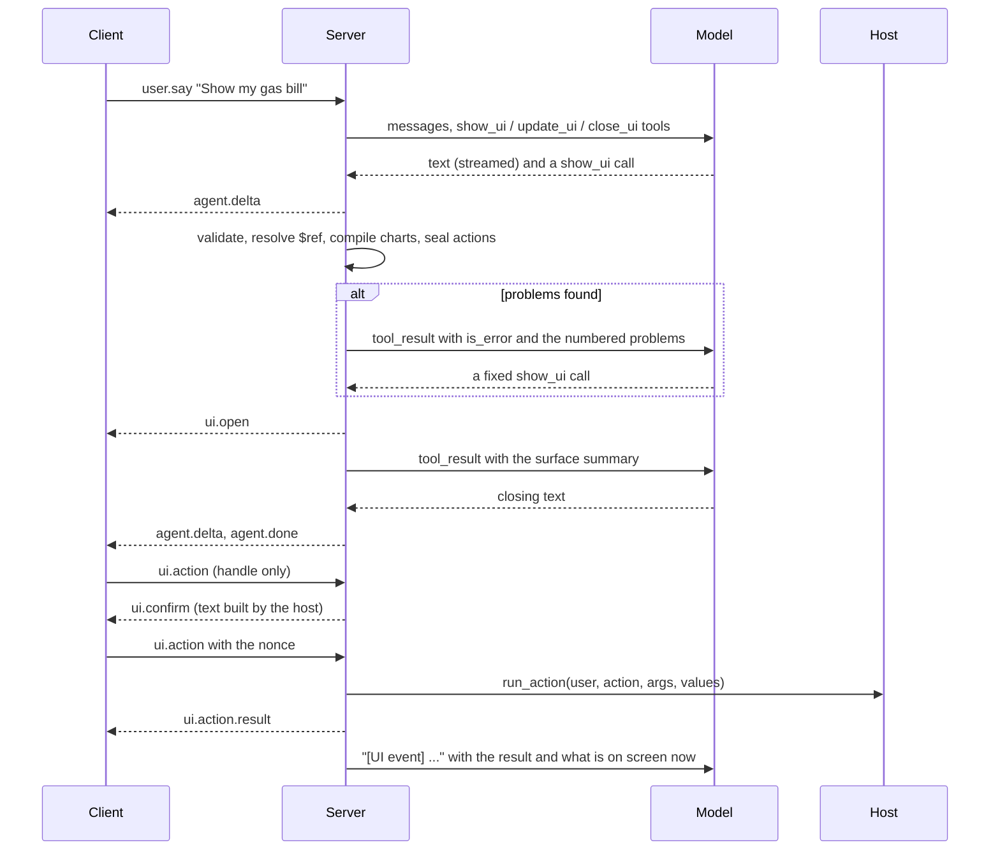

# The reference server

`polyui-server` is the Rust server that sits between a model and a client. It runs the agent loop, checks every UI the model asks for, keeps the real action arguments and the private values on the server, and talks to clients over WebSocket or Server-Sent Events. The `polyui` command line tool wraps it.

This page explains how a turn works, what your application has to provide, and how to run the demo.

## How a turn works

A client connects, says `hello`, and gets `welcome` back. From then on the user can type (`user.say`) or use the UI (`ui.action`). Each of those starts a model turn.



Step by step:

1. The server sends the conversation to the model with three tools, `show_ui`, `update_ui` and `close_ui`, generated by `polyui-core` for the catalogs the client declared, plus any tools the host adds. Text the model writes is streamed to the client as `agent.delta`.
2. Each tool call is parsed strictly and checked with `polyui-core`. The model's JSON is never trusted, even when the provider enforces a schema.
3. If the call has problems, the model gets them back as a tool result with `is_error: true` and tries again. After two failed retries of the same tool in one turn, the server stops asking, sends the user a plain text apology in their language, and ends the turn.
4. A valid call goes through four more steps before anything leaves the server:
   - every `{"$ref": "source:key"}` is resolved by the host for the current user,
   - every `chart:Chart` is compiled by `polyui-chart`, the scene goes into the props as `scene`, and the chart's spoken summary becomes its `say` when the model gave none,
   - every action object is replaced by a handle like `{"action_id": "act_3f2a...", "confirm": true}`, and the real action name and arguments stay in the session,
   - components from catalogs the client did not declare are turned into `Text` with their alt text.
5. The client gets `ui.open`, `ui.patch`, `ui.data` or `ui.close` with a per-surface `seq`. The model gets a one-line summary of what is on screen. `$ref` props show as `[ref]` in that summary, so private values never enter the model's context.
6. If the model reply stops on `max_tokens` or `refusal`, its tool calls are not run. The client gets `agent.error`.

The server keeps two copies of every surface. The model copy is what the model wrote, and the summaries are built from it. The client copy has the resolved values, the chart scenes and the sealed handles, and it is what `ui.snapshot` returns after a `ui.resync`. When the user fires an action with form values (the paths listed in the action's `with`), both copies are updated, so the next summary shows what the user typed.

### Actions and confirmation

`ui.action` only carries a handle. The server looks it up in the session. An unknown handle, a handle from another surface, or a handle on a surface that was closed or replaced gets `ui.action.result` with `rejected`.

If the host marked the action `requires_confirm`, the first `ui.action` does not run it. The server answers with `ui.confirm`. The title and body come from `Host::confirm_text`, built from the sealed arguments, never from text the model wrote. The nonce is random, works once, and expires after 60 seconds. A reused or unknown nonce is rejected; an expired one gets `expired`.

When the action runs, the client gets `ui.action.result`, and the model gets a user message that starts with `[UI event]`. It names the action and its arguments, the form values, the result, the host's note, and the summary of the surface at that moment.

### Conversation history

History is kept in the Anthropic message format. Assistant messages are stored exactly as they arrived, including thinking blocks and their signatures. Tool results for one model reply go back in a single user message. If a turn ends early, its tool results are kept and the next user message is merged into the same user turn, so the history stays valid.

## The `Host` trait

Your application implements `Host`. The server calls it; it never calls the model.

| Method | What it does |
|---|---|
| `system_prompt(user, locale)` | Your instructions and context. The server appends a short guide on using the UI tools and what the client can draw. |
| `actions()` | The action registry (`polyui_core::ActionTable` works). Each action has typed arguments and a `requires_confirm` flag. |
| `refs(user)` | A `RefResolver` for this user. `source_kind` declares the kind of value each source gives (for example text of up to 16 characters); `resolve` returns the value or a refusal when the user may not see it. The model only ever sees one fixed message when a `$ref` cannot be resolved. |
| `confirm_text(user, action, args, locale)` | Title, body and button label for the confirm sheet. |
| `run_action(user, call)` | Runs the action. Return `ActionOutcome::ok()` or `ActionOutcome::rejected(message)`. The message is shown to the user; `with_note` adds a note only the model sees. |
| `authenticate(headers)` | Turns request headers into a `User`. The default is a guest. |
| `tools()` and `call_tool(...)` | Optional plain tools, for example a data lookup. |
| `catalogs()`, `fallback_text(locale)`, `allow_http()` | Optional overrides. |

Wiring it up:

```rust
let host = Arc::new(MyHost::new());
let provider = Arc::new(AnthropicProvider::new(ApiKey::from_env().unwrap(), "claude-haiku-5-5"));
let app = polyui_server::router(Agent::new(host, provider), ServerConfig::default());
polyui_server::serve(tokio::net::TcpListener::bind("127.0.0.1:8787").await?, app).await?;
```

The model sits behind the `ModelProvider` trait. `AnthropicProvider` streams from the Messages API with plain HTTP. `ScriptedProvider` replays canned replies for tests and records every request it gets.

## Transports

| Endpoint | Use |
|---|---|
| `GET /ws` | WebSocket. Send `hello` first, read `welcome`, then everything goes both ways on one connection. |
| `POST /send` | With a `hello` body and no `session`, starts a session and returns `welcome`. |
| `GET /events?session=<id>` | The server messages for that session as an SSE stream. One stream per session; the session ends when it closes. |
| `POST /send?session=<id>` | Any client message. Answers `202`. |
| `/` | Static files from `--static DIR`, if given. |

Every incoming message is size checked before it is parsed: the WebSocket frame and message limit and the HTTP body limit are both 256 KiB, and the text then goes through `polyui-core`'s guarded parser. Bad input gets `ui.error`; it never reaches the model.

## Running the demo

The `bills` demo host is a household in Tashkent with gas, electricity, water and internet accounts, six months of usage, and three internet tariffs. It has three actions: `pay_bill` (needs confirmation), `pick_offer` and `show_usage`, plus a `get_usage` tool for charts. `{"$ref": "account:gas"}` resolves to a masked account number like `**** 0083`.

```sh
polyui serve --env-file ~/.config/polyui/anthropic.env --static js/polyui-web/demo
```

Options: `--addr` (default `127.0.0.1:8787`), `--model` (default `claude-haiku-5-5`), `--static DIR`, `--host bills|shop`, `--data DIR`. Without `--env-file` the key is read from `ANTHROPIC_API_KEY`. The key is never printed or logged.

`--host shop` runs a small store whose dashboards are built from SQL over local CSV and Parquet files. It needs the `query` feature, which the `polyui` binary has on by default. See [dashboards.md](dashboards.md).

Two more commands help when writing prompts or catalogs:

```sh
polyui tools --catalogs core@1,chart@1 --strict   # the tool JSON the model gets
polyui validate surface.json                       # problems, or the summary if it is valid
```

## Tests

`cargo test -p polyui-server -p polyui` runs everything that does not need the network: the stream parser, the agent loop with `ScriptedProvider` (valid calls, a fixed retry, the retry limit, cut-off replies, the confirm flow, reused and expired nonces, forged handles, `$ref` values never reaching the model, chart scenes, patches and snapshots) and the WebSocket, SSE and static file transports on a real socket.

One test talks to the real API. It is ignored by default:

```sh
set -a; . ~/.config/polyui/anthropic.env; set +a
POLYUI_LIVE=1 cargo test -p polyui-server live -- --ignored --nocapture
```

It asks for the gas bill, checks that a valid `ui.open` arrives, and prints whether the first `show_ui` was valid and how many tokens were used.

## Known limits

- The Anthropic API limits strict tool schemas to 24 optional parameters and 16 parameters with union types across one request. `polyui-core` builds strict schemas with no optional parameters (null stands for a missing value), and marks a tool `strict` only when it fits what is left of those limits, counting host tools too. With the built-in catalogs every bindable prop is a union, so `show_ui` and `update_ui` go without `strict` and `close_ui` (and small host tools such as `get_usage`) go with it. Sending all three strict returns HTTP 400 "Schemas contains too many parameters with union types (116 parameters with type arrays or anyOf) ... (limit: 16 parameters with unions)". If the API still refuses strict schemas (for example "Schema is too complex for compilation"), the provider logs it once and sends the same tools without `strict` from then on. Validation on the server is unchanged, so nothing invalid reaches a client either way.
- Sessions live in memory. A WebSocket session ends when the socket closes. An SSE session ends when its event stream closes, or after 60 seconds if no stream was opened.
- A turn that is running finishes even if the client leaves; its messages are dropped.
