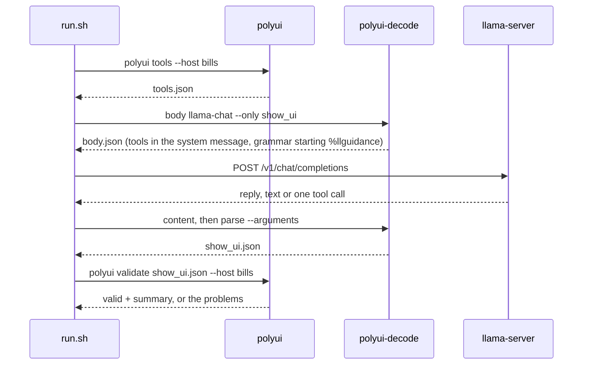

# PolyUI with a local model

This example asks a model running in llama-server for UI, with the llguidance grammar from `polyui-decode` applied while it writes, and then checks the answer with `polyui validate`. [docs/decode.md](../../docs/decode.md) explains the grammar and what it does and does not guarantee.



## What you need

- llama.cpp built with llguidance. Do not point the script at a server built without it: in grammar mode such a server stops with "llguidance (cmake -DLLAMA_LLGUIDANCE=ON) is not enabled" and drops every request it was serving. With `POLYUI_DECODE_MODE=json` such a server builds its own GBNF grammar from the schema instead; we have read that in the llama.cpp source but not run it.

  ```sh
  git clone https://github.com/ggml-org/llama.cpp
  cd llama.cpp
  cmake -B build -DLLAMA_LLGUIDANCE=ON
  cmake --build build --config Release -j
  ```

- A GGUF model that was trained on a Hermes-style `<tool_call>` format, for example a Qwen3 model.
- Rust, to build `polyui` and `polyui-decode` from this repository, and `curl`.

## Run it

Point the script at a server that is already running:

```sh
./build/bin/llama-server -m /path/to/model.gguf --port 8099
POLYUI_LLAMA_URL=http://127.0.0.1:8099 examples/local-model/run.sh "What do I owe this month?"
```

Or let it start `llama-server` from your `PATH` and stop it again at the end:

```sh
POLYUI_LLAMA_MODEL=/path/to/model.gguf examples/local-model/run.sh "Compare the internet tariffs"
```

With neither set, the script prints these steps and exits.

| Variable | Default | Meaning |
|---|---|---|
| `POLYUI_LLAMA_URL` | none | Base URL of a running llama-server. |
| `POLYUI_LLAMA_MODEL` | none | GGUF file; used only when `POLYUI_LLAMA_URL` is not set and `llama-server` is on `PATH`. |
| `POLYUI_LLAMA_PORT` | `8099` | Port for the server the script starts. |
| `POLYUI_DECODE_MODE` | `grammar` | `grammar` lets the model answer in text or call `show_ui`. `json` sends `response_format` with the `show_ui` schema, so the answer is always a UI. |

The script prints the raw reply and then the output of `polyui validate`. A plain text reply is a normal outcome in `grammar` mode; there is just nothing to validate. The model does not see the household's real bills, so expect made-up amounts, and expect the validator to catch things the grammar cannot, such as a `$ref` key the host does not know.

## Other servers

`polyui-decode body` also writes bodies for `/completion` (`llama-completion`, with `--prompt` already in the model's chat template) and for vLLM (`vllm-chat`, `vllm-json`, with `--model`). For vLLM, start it with `--structured-outputs-config.backend guidance` and send the body to `/v1/chat/completions` yourself.

## Status

The script was checked against a stub HTTP server that returns a fixed reply, which covers building the body, reading the reply and validating it. It has not been run against a real llama-server or model.
