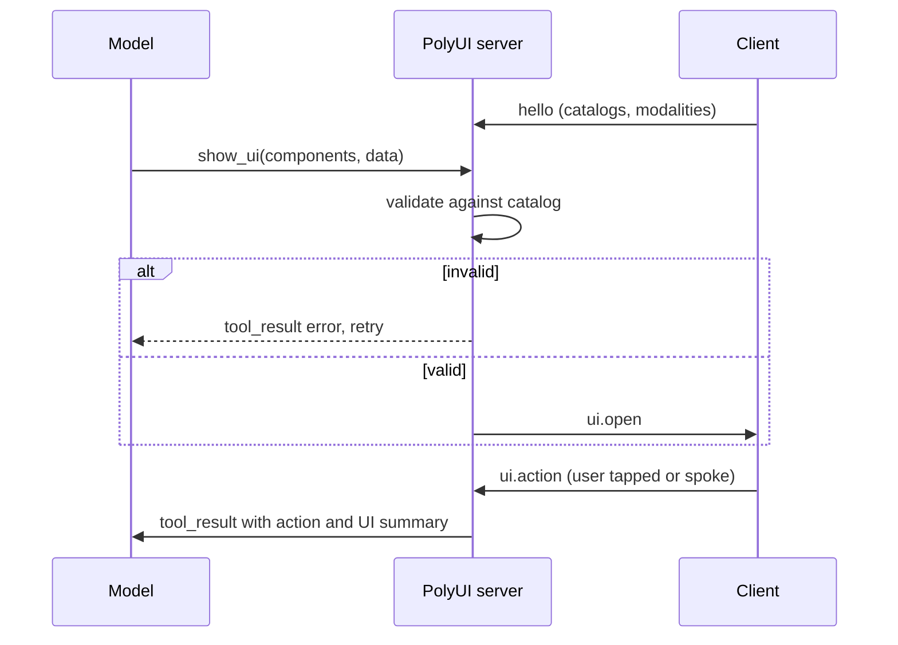

# PolyUI protocol, version 1

This document is the source of truth for the wire format. Code in this repository follows it. If the code and this file disagree, the code is wrong.

## 1. The idea in one paragraph

An agent answers with UI instead of only text. It does that by calling three tools: `show_ui`, `update_ui` and `close_ui`. The server checks every call against a catalog of known components. A call that does not pass never reaches a client; the error goes back to the model so it can try again. A valid call becomes protocol messages that any client can draw: a web page, a phone app, or a voice assistant with no screen at all. Every component knows how to describe itself in plain text (`alt`) and in speech (`say`), so the same answer works everywhere.



## 2. Words used in this document

| Word | Meaning |
|---|---|
| surface | One piece of UI the agent opened. A chat answer usually has one surface. Surfaces have ids like `s1`. |
| component | One node in a surface: a button, a card, a list. |
| catalog | A named set of component types with the rules for their props. `core`, `chart` and `embed` ship with PolyUI; `embed` is only offered when the host turns it on. Hosts can add their own. |
| data model | A JSON document that belongs to a surface. Components read from it through bindings. |
| host | The application that embeds PolyUI: it owns the model, the users, and the actions. |
| renderer | The client code that draws components for one platform. |

## 3. Envelope

Every message is one JSON object. Two fields are always present:

- `v`: protocol version, an integer. This document describes `1`.
- `t`: message type, a string.

A receiver that sees a `v` it does not support must not crash. A client shows the `fallback` text if the message has one, and sends `ui.error` with reason `unsupported_version`.

Unknown fields are ignored. Unknown `t` values are ignored by clients and answered with `ui.error` reason `unknown_message` by servers.

## 4. Handshake

The client speaks first.

```json
{
  "v": 1,
  "t": "hello",
  "client": { "name": "polyui-web", "version": "0.1.0" },
  "catalogs": ["core@1", "chart@1"],
  "modalities": ["screen", "voice"],
  "features": ["sync", "stream"],
  "locale": "uz-Latn"
}
```

- `catalogs`: what the renderer can draw, as `id@major`. The server must only send components from these catalogs. Anything else is sent as its `alt` text inside a `Text` component.
- `modalities`: any non-empty subset of `screen` and `voice`.
- `features`: optional abilities. `sync` means the client handles `ui.sync`. `stream` means it accepts surfaces that grow while the model is still writing (section 8.1). `resume` means the client can come back to its session after the connection drops (section 8.2).
- `resume`: optional, `{ "session": "...", "token": "..." }`, sent by a client that lost its connection and wants its old session back (section 8.2).
- `locale`: BCP 47 tag. Used for `alt` and `say` templates and for voice matching.

The server answers with `welcome`:

```json
{ "v": 1, "t": "welcome", "session": "sess_8f2c", "catalogs": ["core@1", "chart@1"] }
```

`catalogs` in `welcome` is the intersection the server will actually use. When the client declared `resume`, `welcome` also carries `resume_token`, and, when the `hello` asked to resume, `resumed`:

```json
{ "v": 1, "t": "welcome", "session": "sess_8f2c", "catalogs": ["core@1", "chart@1"], "resume_token": "rt_3b9e...", "resumed": true }
```

## 5. Components

A surface is a flat list of components. Children are referenced by id, never nested. This keeps streaming simple and keeps small models from losing track of brackets.

```json
{
  "id": "pay",
  "type": "Button",
  "props": { "label": "Pay 29 322 so'm", "tone": "primary", "on_press": { "action": "pay_bill", "args": { "bill": "b_17" } } },
  "children": []
}
```

| Field | Required | Notes |
|---|---|---|
| `id` | yes | 1 to 64 chars, `[A-Za-z0-9_-]`, unique in the surface. |
| `type` | yes | A catalog type. Core types are bare (`Button`). Extension types are namespaced (`acme:InvoiceCard`). |
| `props` | no | Checked against the catalog. Unknown props are an error. |
| `children` | no | Ids of child components, in order. Only allowed when the catalog says the type has children. |
| `alt` | no | Text fallback. When missing, the catalog template builds it from props. |
| `say` | no | Spoken form. When missing, the catalog template builds it from props. |
| `voice` | no | `{ "ordinal": 2, "synonyms": ["gaz", "hududgaz"] }`. Helps match speech like "the second one". |

The model rarely needs to write `alt`, `say` or `voice`. The catalog fills them in.

### 5.1 Surface rules

- Exactly one `root`. It must exist in the component list.
- Every id in `children` must exist.
- No cycles. A component has at most one parent.
- Depth from root is at most 12.
- At most 256 components per surface.
- Components that no parent reaches are allowed only in `ui.patch` while a surface is streaming. A finished surface with orphans is rejected.

### 5.2 Limits

| Limit | Value |
|---|---|
| One message, serialized | 256 KiB |
| One string prop | 4096 characters, or the catalog's own `max` |
| Data model, serialized | 128 KiB |
| Array length in props or data | 1000 |
| JSON nesting depth | 32 |

A server rejects anything above these limits before parsing the rest.

Sizes of messages and data models are bytes of UTF-8. String lengths, here and in every `max` of a catalog, are characters: Unicode code points, not bytes and not UTF-16 units. A prop of 4096 Cyrillic letters fits, although it takes 8192 bytes, and so does `oʻ` written 2048 times: the Uzbek `ʻ` is a character of its own, so that is 4096 characters in 6144 bytes. In JSON text, an escape such as `\u0041` is one character, and a surrogate pair written as two escapes (`\ud83d\ude00`) is one character too. The message limit still bounds memory, because a string can never be larger than the message that carries it.

The data model limit is half the message limit because the whole data model travels in one `ui.open` or `ui.snapshot` together with the components. After every `show_ui`, every `update_ui` and every action that stores form values, the server checks the data model as it would sit in that envelope: nesting is counted from the envelope (so the data model itself can be at most 31 levels deep), every array holds at most 1000 items, every string and key holds at most 4096 characters, and the serialized data model is at most 128 KiB. The server also checks the whole `ui.open`, `ui.patch`, `ui.data` and `ui.snapshot` it is about to send against the client limits and rejects the tool call when one would not fit, so a client never has to refuse a message and ask for a resync that would fail again.

## 6. Bindings and references

A prop value can be a literal or one of two objects.

**`{"$bind": "/path"}`** reads from the surface data model. The path is a JSON Pointer (RFC 6901). The client resolves it, so data updates never resend the UI. If the path does not exist the prop is treated as missing, and a required missing prop makes the component render its `alt`.

**`{"$ref": "source:key"}`** is resolved on the server before anything leaves it. The host registers sources (for example `account`, `bill`) with a resolver that checks the current user's rights. The resolved value goes to the client. The model only ever sees the `$ref` string, never the value. This is how sensitive values stay out of the model's context.

Rules for `$ref`:

- `source` must be a registered source. Anything else is a validation error returned to the model.
- Every source declares up front the kind of value it gives, using the prop kinds of the catalog format, for example `{"kind": "string", "max": 16}`. When the model calls `show_ui` or `update_ui`, a `$ref` is checked against the prop using the declared kind only: the prop must accept every value of that kind (a string prop must allow the declared length, an enum must contain every declared value, a number range must contain the declared range, a URL prop must allow every declared scheme). The resolved value is never used to answer this check.
- The resolver gets the session's user and the key, and returns a value or a refusal. A refusal, an unknown key, or a value that does not fit the declared kind or the prop all produce the same problem text, `$ref could not be resolved.`, with no detail, so the model cannot learn anything about a value from the error.
- The UI summary sent back to the model (section 10) shows `$ref` props as `[ref]`, never as values.

## 7. Actions

Interactive props have the `action` kind, for example `on_press` on `Button`.

```json
{ "action": "pay_bill", "args": { "bill": "b_17" }, "with": ["/form/phone"] }
```

- `action` names an action the host registered on the server. Each registered action has an argument schema and a flag `requires_confirm`.
- `args` are checked against that schema when the model calls `show_ui`.
- `with` lists data model paths whose current client values are sent along when the action fires. This is how forms submit.

The model's `args` never travel to the client. When the server accepts a surface, it replaces each action object with a handle:

```json
{ "action_id": "act_4kq9", "confirm": true, "with": ["/form/phone"] }
```

`confirm` tells the renderer that the server will ask before it runs the action. `with` is copied from the action object so the client knows which values to send; it is left out when the action has none. Changing it on the client changes nothing on the server, which keeps its own copy.

The server keeps `act_4kq9 -> pay_bill(bill = b_17)` in the session. The client can only send the handle back. It cannot change the arguments, and neither can the model after the fact.

### 7.1 Firing an action

```json
{ "v": 1, "t": "ui.action", "surface": "s1", "action_id": "act_4kq9", "values": { "/form/phone": "+998901234567" }, "source": "tap" }
```

`source` is `tap`, `voice` or `keyboard`. It is recorded, not trusted for security.

`values` holds the current value of every path in the handle's `with`. The client core also sends the value of the component's own bound path (the `value` path of an `Input` or a `ChoiceGroup`); the server drops every path that is not in its copy of `with`. The serialized `values` object may be at most 128 KiB, the data model limit.

`detail` is an optional JSON object that says which part of a component the user used, for example `{ "row": 3 }` when a chart bar is tapped, or `{ "text": "..." }` when an embedded app sends a message. The renderer gets it from the platform, so it is user input like `values`: the server passes it to the model and the host as data and never acts on it. Serialized, it may be at most 4096 bytes.

A `ui.action` whose `detail` or `values` is over its limit is answered with `ui.error` reason `bad_message`, and nothing runs.

`values` are user input and get the same checks as data the model writes. The server keeps only the paths listed in `with`, puts them into the surface data model, and checks every prop bound to that data model again with the new values, by the rules of section 6 and the limits of section 5.2. If a value does not fit (for example a `javascript:` URL typed into a field bound to an `Image.src`), the action does not run and nothing is stored; the server answers `ui.action.result` with `rejected` and a `message` the client can show. For an action with `requires_confirm` this check happens before `ui.confirm` is sent and again before the action runs.

### 7.2 Confirmation

If the action has `requires_confirm`, the first `ui.action` does not run it. The server answers with a challenge whose text the host builds from the real arguments, not from anything the model wrote:

```json
{ "v": 1, "t": "ui.confirm", "surface": "s1", "action_id": "act_4kq9", "nonce": "n_77ad", "title": "Pay Hududgaz", "body": "29 322,19 so'm from card 4471", "confirm_label": "Pay", "expires_ms": 60000 }
```

The renderer shows this in its own confirm sheet, drawn by the renderer and not by the surface. The user confirms, and the client sends the action again with the nonce:

```json
{ "v": 1, "t": "ui.action", "surface": "s1", "action_id": "act_4kq9", "confirm": "n_77ad", "source": "tap" }
```

A nonce works once and expires. The model has no tool that fires actions, so it cannot skip this step.

### 7.3 Result

```json
{ "v": 1, "t": "ui.action.result", "surface": "s1", "action_id": "act_4kq9", "status": "ok" }
```

`status` is one of `ok`, `rejected`, `expired`, `error`. A `message` string is optional.

## 8. Server to client messages

All of these carry `surface` and a per-surface `seq` that starts at 1 and goes up by one. A client that sees a gap asks for a snapshot with `ui.resync`.

### `ui.open`

```json
{ "v": 1, "t": "ui.open", "surface": "s1", "seq": 1, "root": "card", "components": [], "data": {}, "fallback": "Your bills: Gas 29 322 so'm. Pay?" }
```

`fallback` is plain text for clients that can draw nothing. The server builds it from the `alt` of every component in tree order.

### `ui.patch`

```json
{ "v": 1, "t": "ui.patch", "surface": "s1", "seq": 2, "upsert": [], "remove": ["old_note"], "root": "card" }
```

`upsert` replaces whole components by id or adds new ones. `remove` deletes by id and also deletes the removed ids from every `children` list. `root` is optional.

### `ui.data`

```json
{ "v": 1, "t": "ui.data", "surface": "s1", "seq": 3, "ops": [ { "op": "set", "path": "/bills/0/paid", "value": true } ] }
```

Operations, applied in order:

| `op` | Effect |
|---|---|
| `set` | Put `value` at `path`, creating missing objects on the way. |
| `merge` | JSON Merge Patch (RFC 7396) of `value` into the object at `path`. |
| `remove` | Delete `path`. Missing paths are fine. |

### `ui.close`

```json
{ "v": 1, "t": "ui.close", "surface": "s1", "seq": 4 }
```

### `ui.sync`

Only sent to clients with the `sync` feature.

```json
{ "v": 1, "t": "ui.sync", "surface": "s1", "highlight": "opt_2", "at_ms": 1840 }
```

While the voice layer speaks, the client highlights the component being spoken. `at_ms` is the offset into the current utterance. `highlight: null` clears it.

### `ui.snapshot`

The full state of a surface: `root`, `components`, `data`, `seq`. Sent after `ui.resync`.

A session lives as long as its connection: the WebSocket, or the SSE event stream. When that closes, the session ends. Its surfaces, handles and pending confirmations are gone, and a running model turn stops. A client that connects again sends `hello` and starts a new session; nothing is resumed and no `ui.snapshot` is sent for the old surfaces. The client should mark the surfaces it still shows as stale, because their handles no longer work. A client that declared `resume` can get its session back instead (section 8.2).

### 8.1 Streaming surfaces

A client that declared `stream` may get a surface before the model has finished writing it:

1. `ui.open` arrives as soon as the root component is complete. It holds the root and the complete components the root reaches so far, and usually no data.
2. Each component completed later arrives in a `ui.patch`. Such a patch may hold components that no parent reaches yet (section 5.1).
3. When the model has finished, the server checks the whole surface. If it passes, the server sends what is still different: a `ui.data` with the data model and a `ui.patch` for changed, added or removed components. If it fails, the server sends `ui.close` for the surface.

Every one of these messages has the next `seq`, so the usual gap and `ui.resync` rules apply. While a surface is streaming the server refuses `ui.action` on it with `rejected`, because its action handles become valid only after the full check. A client without `stream` gets one `ui.open` after the full check, as before.

### 8.2 Resuming a session

A client that declared `resume` gets a `resume_token` in `welcome`. When its connection drops, the server keeps the session for a while (the reference server: 120 seconds). A running turn goes on, and messages for the client wait in the session's outgoing queue. If that queue stays full, the session ends as it would for a slow client.

To come back, the client sends a new `hello` with `resume` set to its session id and the last token it got. The server attaches the new connection to the old session when all of these hold: the session is still kept, the token matches, the user is the same, and the page origin is the same. It then answers `welcome` with the same `session`, `resumed: true` and a new `resume_token`; the old token stops working. After `welcome` it sends:

1. a `ui.snapshot` for every surface that is open and not still streaming,
2. the `ui.confirm` of every confirmation that is still waiting, with `expires_ms` set to the time it has left,
3. the messages that waited in the queue, without the `ui.open`, `ui.patch`, `ui.data`, `ui.sync` and `ui.confirm` messages of the surfaces the snapshots already cover.

If any check fails, the server starts a new session and answers `welcome` with `resumed: false`, and the client treats its old surfaces as stale, as above. A resume for a session whose old connection is still open closes that connection first. Only one connection works on a session at a time.

The token is a secret like a password. A client keeps it in memory only, never in storage, and sends it only in `hello`.

## 9. Client to server messages

| `t` | Fields | When |
|---|---|---|
| `hello` | section 4 | First message. |
| `ui.action` | `surface`, `action_id`, `values`, `confirm`, `source`, `detail` (section 7.1) | User tapped, typed or spoke. |
| `ui.resync` | `surface` | Client saw a `seq` gap or lost state. |
| `ui.error` | `surface`, `reason`, `detail` | Client could not draw something. Reasons: `unsupported_version`, `unknown_component`, `render_failed`, `bad_message`. |

The transport is not part of the protocol. The reference server speaks WebSocket (both directions on one connection) and Server-Sent Events plus HTTP POST (server messages on the event stream, client messages as POST bodies). Both carry the same JSON.

## 10. What the model sees

The model calls tools. The server turns valid calls into the messages above.

### Tools

| Tool | Input |
|---|---|
| `show_ui` | `{ "surface"?: string, "root": string, "components": [...], "data"?: object }` |
| `update_ui` | `{ "surface": string, "upsert"?: [...], "remove"?: [string], "root"?: string, "data"?: [ops] }` |
| `close_ui` | `{ "surface": string }` |

The server generates the JSON Schema for these tools from the catalogs the client declared, so the model only sees types the client can draw. The schemas avoid JSON Schema features that constrained decoders do not support (`not`, `if/then/else`, `uniqueItems`, `contains`, `propertyNames`).

The catalogs can reach the model in two forms, called tool profiles. Both describe the same types, actions and limits, and the server validates every call the same way in both.

- **Full.** Every component type is one branch of an `anyOf` in the `show_ui` and `update_ui` input schemas, with every prop, its limits, and a `$bind`/`$ref` union on each bindable prop. This is what a grammar-based decoder needs, and `polyui-decode` always builds its grammars from this profile.
- **Compact.** The input schema is generic but still closed: a component is `{ "id", "type", "props", "children" }` with `type` an `enum` of the offered type names and `props` a plain object; a data entry is `{ "path", "value" }`. The catalog moves into the `show_ui` description as one line per type, generated from the catalog, for example `Stat(label<=80!, value<=40!, unit<=16, tone: neutral|positive|negative|warning, hint) - One important number with a label, like a balance or a total.` A short legend explains the notation (`!` required, a bare name is text, `name<=N` is text of at most N characters, `a|b` one of), one line explains `$bind` and `$ref`, and the host's actions follow with their arguments, like `pay_bill(bill: b_gas_2611|b_power_2611!)`. Text and list limits above 100 are left out of the lines; the validator still enforces them. `update_ui` refers back to the `show_ui` lines instead of repeating them.

Compact is much smaller. With the `core` and `chart` catalogs and the demo host's actions, the three UI tools and one host tool take 43 985 bytes in the full profile and 5 025 bytes in the compact one, and the Anthropic token count of the tool definitions falls from 20 285 to 2 430. The reference server uses the compact profile unless it is configured otherwise. A host can also offer the model a subset of the types; the validator still accepts every type the client draws.

In tool input, `data` is not a free-form object. It is a list of `{ "path": "/bills/0/amount", "value": ... }` entries where `value` is a string, number or bool. The server builds the data model from them. This keeps every object in the schema closed (`additionalProperties: false`), which strict tool use and grammar-based decoders need, and it is easier for small models than writing nested JSON.

There is a strict mode for providers that enforce the schema while decoding (for example `strict: true` on Anthropic tools). In strict mode the schema leaves out length and range limits, because those providers do not support them, and every property of every object is listed in `required`. A property that may be left out accepts `null` instead (an `enum` gets `null` as one more value, a boolean becomes `{"enum": [true, false, null]}`, anything else becomes `anyOf` with `{"type": "null"}`). Lists that may be left out (`children`, `with`, `data`, `upsert`, `remove`) stay required and take `[]` for none. The validator treats `null` in any object field exactly like a missing field, in both modes. The server still checks every limit after the call.

Providers also limit how complex strict schemas may be. The Anthropic API allows at most 20 strict tools, 24 optional parameters and 16 parameters with union types (`anyOf` or type arrays) across all strict tools in one request. A tool is marked `strict` only when its strict schema fits what is left of these limits; the others are sent in the normal form. With the built-in catalogs every component prop that accepts `$bind` or `$ref` is a union, so `show_ui` and `update_ui` exceed the union limit (the API counted 116 union parameters for the two) and are sent without `strict`, while `close_ui` is strict. In the compact profile `show_ui` and `update_ui` are never strict, because `props` is an open object and strict mode needs every object closed; `close_ui` is strict in both profiles.

### Tool results

On success the tool result is a short summary of what is now on screen, for example:

```
surface s1 open: Card "Your bills" > List(2) > [Button "Gas 29 322 so'm" (act), Button "Power [ref]" (act)]
```

On failure it is a numbered list of problems with the component id and prop, for example:

```
2 problems, nothing was shown:
1. components[3] id "pay": type "PayButton" is not in the catalog. Known: Button, ChoiceGroup, ...
2. components[1] id "list": children references "row9" which does not exist.
```

When the user acts, the next model turn gets the action and the summary of the surface at that moment, so "the second one" refers to the right thing.

## 11. Voice

Every catalog type has a `say` template. A voice-only client gets the same messages as a screen client and turns each surface into speech in tree order. Choices are read with their ordinal ("first, Gas; second, Power").

When the user speaks, the client matches the words against the surface before sending anything to the model. A match produces a normal `ui.action` with `source: "voice"`. The matcher understands:

- ordinals in the client's locale ("ikkinchisi", "второй", "the second one"),
- labels and `voice.synonyms`,
- yes and no for confirm sheets.

A yes or no for a confirm sheet must be the whole utterance, at most 6 words: yes or no words plus polite fillers ("yes please", "ha, tasdiqlayman", "да, подтверждаю"). A negation anywhere ("not", "don't", "не", "emas", an Uzbek verb in the negative form such as "tasdiqlamayman"), a word that is neither, or an utterance with both a yes and a no word is never a yes. A negation with no yes word is a no. Anything else is not an answer, and the confirm sheet stays open.

Words that match nothing go to the model as ordinary user speech.

If the user talks over the assistant (barge-in), the client stops speech and keeps the surface. The model decides whether to patch or close it.

## 12. Versioning

- Protocol version `v` changes only for breaking changes to messages.
- Catalogs have their own major version, `core@1`. A new optional prop is not breaking. Removing a prop or a type is.
- A renderer that gets a component type it does not know draws the component's `alt` as text and sends `ui.error` with reason `unknown_component` once per type.

## 13. Security rules

1. The model never produces markup, script, CSS or URLs that are executed. It only names catalog types and fills typed props.
2. Props of kind `url` accept `https` (and `http` only when the host allows it). `javascript:`, `data:`, `file:` and everything else are rejected by the server and again by the renderer.
3. Style is chosen from enums (`tone`, `size`, `variant`). There is no free-form style prop.
4. Invalid output never reaches a client.
5. `$ref` values are resolved on the server, per user, and never enter the model's context.
6. Actions run on the server, from handles, with server-built confirm text when the host marks them risky.
7. Limits in section 5.2 are checked before full parsing.
8. The one place HTML reaches a client is `embed:Embed`, and the model does not write it. The model names a `ui://` resource; the server asks the host for that resource and puts the host's answer in the server-only `app` prop, which the model cannot set. The HTML runs only in a sandbox on an origin separate from the client's, with scripts allowed and same-origin access denied, under a CSP built from the resource's `_meta.ui.csp` with a restrictive default. A client with no such sandbox shows the component's `title` instead. Details are in [Embedding MCP Apps](../docs/embed.md).

## 14. Chat extras used by the reference server

These are not part of the UI protocol. The reference server and the example chat client use them so one connection can carry the whole conversation. Other hosts can use their own chat transport.

| Direction | Message | Meaning |
|---|---|---|
| client to server | `{ "v": 1, "t": "user.say", "text": "..." }` | The user typed or said something to the agent. |
| server to client | `{ "v": 1, "t": "agent.delta", "text": "..." }` | A piece of the agent's text answer, streamed. |
| server to client | `{ "v": 1, "t": "agent.done" }` | The agent finished its turn. |
| server to client | `{ "v": 1, "t": "agent.error", "message": "..." }` | The turn failed, or a `user.say` was not accepted. The message is safe to show to the user. |

A server may limit how many `user.say` messages it accepts. The reference server runs one turn at a time per session, lets at most two more wait, and applies a rate limit. It also refuses a `user.say` whose `text` is missing, not a string, empty or only whitespace, or longer than 4000 characters. Every refused `user.say` is answered with `agent.error` and never reaches the model.

The WebSocket endpoint is `/ws`. The client sends `hello` first and waits for `welcome`.
