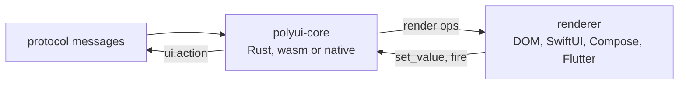

# Renderer contract

A renderer is the platform code that draws components. It is deliberately dumb. All the thinking (applying patches, resolving bindings, filling defaults, building `alt` and `say`, matching speech) happens in `polyui-core`, which is the same Rust code on every platform. A renderer only turns a short list of operations into native views.



## The client core API

Every binding exposes the same five calls. Arguments and results are JSON strings so one call crosses the language boundary once.

| Call | Input | Output |
|---|---|---|
| `Client::new(hello)` | the `hello` object the client will send | a client |
| `client.receive(message)` | one server message | a `RenderBatch` |
| `client.set_value(surface, path, value)` | a local edit from an input or choice | a `RenderBatch` with every component bound to `path` |
| `client.fire(surface, component, prop)` | the user pressed something | the `ui.action` message to send, or `null` |
| `client.confirm(surface, action_id, nonce)` | the user accepted a `confirm` sheet | the `ui.action` message with the nonce |

Two helpers are also exposed: `client.say(surface)` returns the utterances for voice (section below) and `client.match_voice(surface, text)` returns a voice match or `null`.

## RenderBatch

```json
{
  "surface": "s1",
  "ops": [
    { "op": "create", "id": "pay", "type": "Button", "props": { "label": "Pay", "tone": "primary", "on_press": { "action_id": "act_4kq9", "confirm": true }, "disabled": false }, "a11y": { "role": "button", "label": "Pay" } },
    { "op": "update", "id": "total", "props": { "label": "Total", "value": "29 322", "unit": "so'm", "tone": "negative" }, "a11y": { "role": "status", "label": "Total: 29 322 so'm" } },
    { "op": "children", "id": "card", "children": ["total", "pay"] },
    { "op": "remove", "id": "old_note" },
    { "op": "root", "id": "card" },
    { "op": "confirm", "action_id": "act_4kq9", "nonce": "n_77ad", "title": "Pay Hududgaz", "body": "29 322,19 so'm from card 4471", "confirm_label": "Pay", "expires_ms": 60000 },
    { "op": "highlight", "id": "opt_2" },
    { "op": "close" }
  ],
  "fallback": "Total: 29 322 so'm. [Pay]"
}
```

Rules the core guarantees, so renderers do not have to check:

- `props` are complete: defaults are filled and `$bind` values are resolved. A renderer never sees `$bind`, `$ref` or action `args`.
- `create` comes before any `children` op that references the new id.
- `update` carries all props of the component, not a delta. Renderers replace, they do not merge.
- Ops for one batch are applied together. A renderer should apply a whole batch in one frame.
- A component whose required prop resolved to nothing arrives as `{ "op": "create", "type": "Text", "props": { "text": "<its alt>", "style": "muted" } }` instead.
- Unknown types never reach a renderer. The core turns them into `Text` with the `alt`.

## Voice utterances

`client.say(surface)` returns:

```json
[ { "id": "card", "text": "Your bills." }, { "id": "choices", "text": "Pick one. First, Gas; second, Power." } ]
```

The voice layer speaks them in order and can send `highlight` ops (through `ui.sync` or locally) as it goes.

`client.match_voice(surface, "ikkinchisini tanla")` returns:

```json
{ "component": "choices", "option": "power", "batch": { "surface": "s1", "ops": [] }, "action": null }
```

When the match selects an option, the core has already written it to the data model, so `batch` holds the updates. When the matched component has an action, `action` is the `ui.action` message to send.

## What a renderer must do

1. Expose `a11y.role` and `a11y.label` to the platform's accessibility API.
2. Keep focus stable: updating a component must not move focus away from it.
3. Never put any prop into HTML, a URL handler or a style without going through the platform's safe API. On the web that means `textContent` and attribute setters, never `innerHTML`.
4. Draw the `confirm` op in its own sheet that the surface cannot style or cover.
5. Animate changes, but respect the platform's reduced motion setting.
